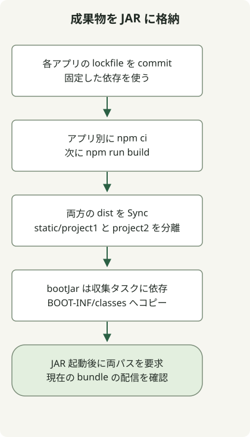

複数の Vue アプリを Spring Boot JAR に含めるには、各アプリに専用の `npm ci` とビルドタスクを用意し、生成ファイルを `build/` に集めてから `bootJar` に追加します。あるアプリのインストールタスクを他のアプリで共用したり、生成したバンドルを `src/main/resources` に直接書き込んだりしないでください。

この実行可能な例では、`/project1/index.html` と `/project2/index.html` で二つのアプリを配信します。再現環境は JDK17.0.8.1、Gradle8.4、Node24.13.0/npm11.6.2、Boot3.5.7、Vue3.5.44、Vite8.3.5 です。再現用に固定したバージョンであり、現在の本番依存関係の推奨ではありません。[Vite の実行環境要件](https://vite.dev/guide/)と、選んだ Boot リリースの要件をそれぞれ確認してください。

## 処理の流れ



各 Vue アプリがそれぞれ成果物をビルドします。Gradle Sync タスクがその出力だけを集め、bootJar が別々の静的パスに配置します。

## アプリごとのタスクとパッケージ化

空のプロジェクトに次のファイルを保存します。各アプリはそれぞれ `package.json`、ロックファイル、`node_modules`、`dist` を持ちます。`prepare.sh` は共通の HTML/JS を二番目のアプリにコピーし、両方のロックファイルを作成します。

### `settings.gradle`

```groovy
rootProject.name = 'multi-frontend'
```

### `build.gradle`

```groovy
plugins {
    id 'java'
    id 'org.springframework.boot' version '3.5.7'
}
group = 'example'
version = '1.0.0'
repositories { mavenCentral() }
dependencies {
    implementation platform('org.springframework.boot:spring-boot-dependencies:3.5.7')
    implementation 'org.springframework.boot:spring-boot-starter-web'
}

def apps = ['project1', 'project2']
def npmCommand = System.getProperty('os.name').toLowerCase().contains('windows') ? 'npm.cmd' : 'npm'
def frontendBuilds = apps.collect { app ->
    def frontend = layout.projectDirectory.dir("frontend/${app}")
    def install = tasks.register("${app}NpmCi", Exec) {
        workingDir frontend
        commandLine npmCommand, 'ci', '--no-audit', '--no-fund'
        inputs.files(frontend.file('package.json'), frontend.file('package-lock.json'))
        outputs.dir(frontend.dir('node_modules'))
    }
    tasks.register("${app}Build", Exec) {
        dependsOn install
        workingDir frontend
        commandLine npmCommand, 'run', 'build'
        inputs.files(fileTree(frontend) {
            exclude 'node_modules/**', 'dist/**'
        })
        outputs.dir(frontend.dir('dist'))
    }
}
def collectFrontend = tasks.register('collectFrontend', Sync) {
    dependsOn frontendBuilds
    into layout.buildDirectory.dir('frontend-resources')
    apps.each { app ->
        from("frontend/${app}/dist") { into "static/${app}" }
    }
}
tasks.named('bootJar') {
    dependsOn collectFrontend
    from(collectFrontend) { into 'BOOT-INF/classes' }
}
```

### `src/main/java/example/Application.java`

```java
package example;

import org.springframework.boot.SpringApplication;
import org.springframework.boot.autoconfigure.SpringBootApplication;

@SpringBootApplication
public class Application {
    public static void main(String[] args) {
        SpringApplication.run(Application.class, args);
    }
}
```

### `frontend/project1/package.json`

```json
{
  "name": "project1",
  "private": true,
  "type": "module",
  "scripts": {
    "build": "vite build --base=/project1/"
  },
  "dependencies": {
    "vue": "3.5.44"
  },
  "devDependencies": {
    "vite": "8.3.5"
  }
}
```

### `frontend/project2/package.json`

```json
{
  "name": "project2",
  "private": true,
  "type": "module",
  "scripts": {
    "build": "vite build --base=/project2/"
  },
  "dependencies": {
    "vue": "3.5.44"
  },
  "devDependencies": {
    "vite": "8.3.5"
  }
}
```

### `frontend/project1/index.html`

```html
<!doctype html>
<html lang="en"><head><meta charset="UTF-8"><title>Vue build example</title></head>
<body><div id="app"></div><script type="module" src="/src/main.js"></script></body></html>
```

### `frontend/project1/src/main.js`

```js
import { createApp, h } from 'vue';
createApp({ render: () => h('h1', `Vue app at ${import.meta.env.BASE_URL}`) }).mount('#app');
```

### `prepare.sh`

```sh
#!/bin/sh
set -eu
mkdir -p frontend/project2/src
cp frontend/project1/index.html frontend/project2/index.html
cp frontend/project1/src/main.js frontend/project2/src/main.js
for app in project1 project2; do
    (cd "frontend/$app" && npm install --package-lock-only --ignore-scripts --no-audit --no-fund)
done
```

この例を初めて準備するときに `prepare.sh` を実行し、生成された両方の `package-lock.json` をコミットします。それ以降の CI ビルドでは保存済みのロックファイルに対して `npm ci` を実行します。ビルドのたびに再生成しないでください。

## ビルドと実行

PATH から Node/npm を利用できる状態で、プロジェクトのルートから実行します。

```sh
node --version
npm --version
sh prepare.sh
gradle --no-daemon clean bootJar
java -jar build/libs/multi-frontend-1.0.0.jar
```

既存の Wrapper ベースのプロジェクトでは、`./gradlew` から選択済みの Gradle バージョンを使います。起動後に `http://localhost:8080/project1/index.html` と `http://localhost:8080/project2/index.html` を開くと、それぞれ `Vue app at /project1/` と `Vue app at /project2/` が表示されます。

[Vite の base オプション](https://vite.dev/guide/build.html#public-base-path)は各アプリのアセット URL を設定します。サーバー側の SPA ルーティングは設定しません。この例は明示的な `index.html` URL を使います。history-router の URL に直接移動する場合や別のコンテキストパスを使う場合には、追加設定が必要です。

## 実際の JAR 内のパスを確認する

```text
BOOT-INF/classes/static/project1/index.html
BOOT-INF/classes/static/project1/assets/...
BOOT-INF/classes/static/project2/index.html
BOOT-INF/classes/static/project2/assets/...
```

アプリごとのビルド後、`collectFrontend` が `Sync` を使って現在の出力だけを集めます。`bootJar` がそれを実行可能 JAR のクラスパス配下に追加します。[Gradle のファイル処理](https://docs.gradle.org/current/userguide/working_with_files.html)と [Boot のアーカイブ作成](https://docs.spring.io/spring-boot/3.5/gradle-plugin/packaging.html)を参照してください。

この設定で両方のアプリをビルドしてパッケージ化し、実行中の JAR から HTML と JS を HTTP で配信できました。その後、アプリの `public` 内のファイルを削除し、`clean` なしで JAR を再ビルドして旧ファイルが残らないことを確認しました。両アプリのロックファイルも個別に確認しました。

## 既存のプロジェクトに適用する

- `apps` リストをディレクトリに合わせ、各ロックファイルを用意します。
- 生成される `static/project1` と `static/project2` の名前空間を手書きのリソースと分けます。
- Vue SFC を使う場合は、そのアプリに合うプラグインと Vite 設定を追加します。この小さな例は Vue のレンダー関数を使います。
- 対象は実行可能な `bootJar` であり、通常の `jar` ではありません。デプロイする成果物を確認します。

既存のアプリでは、パッケージ化とは別に [Spring Boot の Java と Jakarta 移行の基準](/en/posts/2023-09-08-springboot3-migration/)を確認してください。Batch ジョブも動く場合は [Batch リポジトリ移行と再起動の確認](/en/posts/2023-10-27-springbatch5-migration/)に従います。JAR からフロントエンドのリソースを配信できても、永続化されたジョブデータの検証にはなりません。

リリースに基づく自動化は [GitHub のリリースとアセットの選択](/en/posts/2023-09-23-linux-shellscript-github-latest/)、[数値比較器の入力契約](/en/posts/2023-11-17-linux-shellscript-version-compare/)を参照してください。[POSIX sh 関数ガイド](/en/posts/2023-09-20-linux-shellscript-function-error/)では準備スクリプトのインタープリター選択を扱います。
