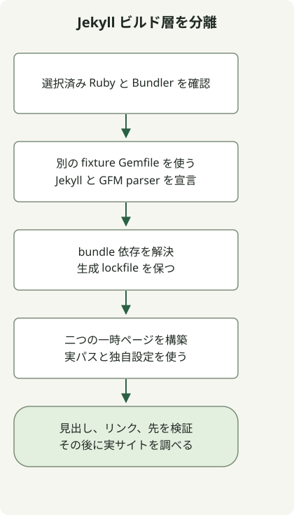

権限を変える前に、実行される Ruby、依存関係の環境を管理する Bundler、小さなサイトの描画可否を確認します。このサイトの現行ビルドは Astro を使います。以下の Jekyll 例は、残してある Ruby アーカイブの診断用です。

当初の環境は Ruby 3.2.2 でした。この系列は現在[サポート終了](https://www.ruby-lang.org/en/downloads/branches/)のため、旧版は互換性の再現用であり、新規インストールの推奨ではありません。導入時はプロジェクトの gem に対応する保守中の Ruby を選んでください。

## gem のインストール前にインタープリターを選ぶ



[Jekyll の macOS 向け手順](https://jekyllrb.com/docs/installation/macos/)は、システム Ruby ではなく独立した Ruby 環境を勧めています。このリポジトリの以前の環境は rbenv を使っていました。[バージョン選択規則](https://github.com/rbenv/rbenv#readme)では、プロジェクトの `.ruby-version`、`RBENV_VERSION`、全体の既定値を区別します。

プロジェクトのディレクトリで次を実行します。

```sh
command -v ruby
ruby --version
rbenv version
rbenv which ruby
gem env home
bundle --version
```

想定した管理ツールで `ruby` が選ばれていなければ、何かをインストールする前にシェルの初期化を直します。導入済みの rbenv の手順に従って `rbenv init` を使い、他人のホームパスをシェル設定に貼り付けないでください。`rbenv global` で全 Ruby プロジェクトを変えるより、プロジェクト内で選択する方が適切です。

## 二ページを描画して bundle を試す

この互換性フィクスチャは Ruby3.2.2、Bundler2.4.19、Jekyll3.9.3、kramdown-parser-gfm1.1.0 で実行しました。記録された旧版であり、サポート対象の基準ではありません。Gemfile は直接依存する二つの gem を固定し、生成される Gemfile.lock がプラットフォームごとの間接依存のバージョンを記録します。

別の作業用ディレクトリを作り、以下の完全なファイルを保存します。リポジトリの既存の Gemfile を置き換えないでください。

### `Gemfile`

```ruby
source 'https://rubygems.org'
gem 'jekyll', '= 3.9.3'
gem 'kramdown-parser-gfm', '= 1.1.0'
```

### `jekyll_probe.rb`

```ruby
require 'jekyll'
require 'tmpdir'
require 'fileutils'
require 'json'

Dir.mktmpdir('jekyll-probe-') do |root|
  root = File.realpath(root)
  source = File.join(root, 'source')
  destination = File.join(root, 'output')
  FileUtils.mkdir_p(File.join(source, '_layouts'))
  File.write(File.join(source, '_layouts', 'default.html'), '<!doctype html><html lang="en"><body>{{ content }}</body></html>')
  File.write(File.join(source, 'index.md'), "---\nlayout: default\ntitle: Probe\n---\n# Bundled build\n\n[Guide](/guide/)\n")
  File.write(File.join(source, 'guide.md'), "---\nlayout: default\npermalink: /guide/\n---\n# Local guide\n")
  config = Jekyll.configuration('config' => [], 'source' => source, 'destination' => destination, 'quiet' => true)
  Dir.chdir(source) { Jekyll::Site.new(config).process }
  home = File.read(File.join(destination, 'index.html'))
  guide = File.read(File.join(destination, 'guide', 'index.html'))
  raise 'Missing rendered heading' unless home.include?('<h1') && home.include?('Bundled build')
  raise 'Missing guide link' unless home.include?('href="/guide/"')
  raise 'Missing guide output' unless guide.include?('Local guide')
  puts JSON.generate('ruby' => RUBY_VERSION, 'jekyll' => Jekyll::VERSION, 'pages' => 2, 'result' => 'passed')
end
```

選択した Ruby と Bundler を利用できる状態で、そのディレクトリから実行します。

```sh
bundle install
bundle exec ruby jekyll_probe.rb
```

必要な gem の正確な版が既にあれば、`bundle lock --local` でローカルの一覧から解決してから、同じ実行コマンドを使えます。不足する gem の取得はできません。失敗を再現するときはロックファイルを保ち、更新前に差分を確認します。[Bundler のアプリケーションガイド](https://guides.rubygems.org/using_bundler_in_applications/)に Gemfile とロックファイルの役割が説明されています。

観測した結果は次のとおりです。

```json
{"ruby":"3.2.2","jekyll":"3.9.3","pages":2,"result":"passed"}
```

プローブは一時ディレクトリでビルドし、実パスを使って macOS の `/var` のシンボリックリンクの不一致を避けます。既定の設定ファイル探索を無効にし、描画時には自分のソースへ移動します。見出し、リンク、リンク先を確認し、終了後に一時ファイルを削除します。アーカイブ全体、テーマ、プラグイン、CSS、デプロイは対象外です。

## 利用可能であることと bundle に含まれることを区別する

この再現では Jekyll は読み込めましたが、bundle に `kramdown-parser-gfm` が宣言されておらず Markdown 変換が失敗しました。マシンのどこかに gem があることと、`bundle exec` 内で使えることは別の条件です。このフィクスチャの Gemfile にパーサーを追加すると変換できました。

二ページのプローブが通れば、次の調査を実サイトの設定、テーマ、プラグイン、入力に絞れます。ネイティブ拡張の読み込み失敗は別の層の問題なので、[Ruby と C++ の診断プローブ](/en/posts/2026-04-07-ruby-rbenv-jekyll-build-troubleshooting/)を使ってください。このサイトの現行の公開手順は [Astro の候補レビューの流れ](/en/posts/2026-04-07-jekyll-github-actions-content-pipeline/)を参照します。
