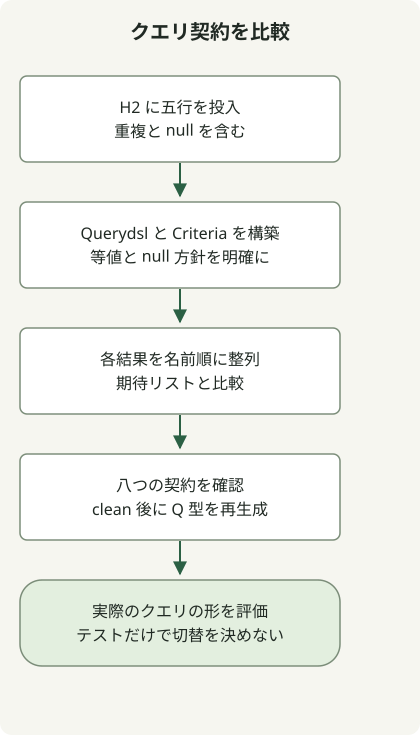

表現して検証したい処理に応じてクエリツールを選びます。リリース間隔は調査のきっかけになりますが、代替ツールがアプリのクエリ動作を維持する証明にはなりません。

当初の 2023 年の懸念は、その後の [Querydsl 5.1.0 リリース](https://github.com/querydsl/querydsl/releases/tag/QUERYDSL_5_1_0)より前のものです。タグはその版の存在を示しますが、採用する系列のリポジトリ、アーティファクト座標、互換性は別途評価します。以下は再現環境を固定した例で、現在の本番向けバージョンの推奨ではありません。

## 代表的な述語を比較する



同じ五行を投入し、両方の述語を構築して明示した期待結果を確認します。テスト対象は H2 上のこのエンティティです。移行判断には、実際のアプリで使う結合、射影、ページング、データベース動作も必要です。

[Spring Data JPA Specification](https://docs.spring.io/spring-data/jpa/reference/3.5/jpa/specifications.html) は Criteria の述語を組み合わせ、`JpaSpecificationExecutor` で実行します。単純なリポジトリの絞り込みなら、JPA の永続化モデルを置き換えずに対応できる場合があります。

## Querydsl の例に三ファイルを追加する

[完全な Jakarta Querydsl プロジェクト](/en/posts/2023-09-09-springboot3-querydsl/)の五ファイルすべてを出発点とし、`Employee.getName()` も含めます。再現環境は Java17、Gradle8.4、Boot3.5.7、Querydsl5.1.0 Jakarta、H2 です。以下の完全な三ファイルを追加します。この設定とガイド内の別の Boot4 例を混ぜないでください。

### `src/main/java/example/EmployeeRepository.java`

```java
package example;

import org.springframework.data.jpa.repository.JpaRepository;
import org.springframework.data.jpa.repository.JpaSpecificationExecutor;

public interface EmployeeRepository extends JpaRepository<Employee, Long>,
        JpaSpecificationExecutor<Employee> {}
```

### `src/main/java/example/EmployeeSpecs.java`

```java
package example;

import org.springframework.data.jpa.domain.Specification;

public final class EmployeeSpecs {
    private EmployeeSpecs() {}

    public static Specification<Employee> named(String name) {
        if (name == null) throw new IllegalArgumentException("Use withoutName for null");
        return (root, query, builder) -> builder.equal(root.get("name"), name);
    }

    public static Specification<Employee> withoutName() {
        return (root, query, builder) -> builder.isNull(root.get("name"));
    }
}
```

### `src/test/java/example/QueryStrategyTest.java`

```java
package example;

import java.util.Arrays;
import java.util.List;
import com.querydsl.core.types.Predicate;
import com.querydsl.jpa.impl.JPAQueryFactory;
import org.junit.jupiter.api.BeforeEach;
import org.junit.jupiter.api.Test;
import org.springframework.beans.factory.annotation.Autowired;
import org.springframework.boot.test.autoconfigure.orm.jpa.DataJpaTest;
import org.springframework.boot.test.autoconfigure.orm.jpa.TestEntityManager;
import org.springframework.dao.InvalidDataAccessApiUsageException;
import org.springframework.data.domain.Sort;
import org.springframework.data.jpa.domain.Specification;

import static org.assertj.core.api.Assertions.*;

@DataJpaTest
class QueryStrategyTest {
    @Autowired TestEntityManager entityManager;
    @Autowired EmployeeRepository employees;
    final QEmployee employee = QEmployee.employee;

    @BeforeEach
    void seed() {
        for (String name : Arrays.asList("Alice", "Bob", "Alice", "A_%", null)) {
            entityManager.persist(new Employee(name));
        }
        entityManager.flush();
    }

    void equivalent(Predicate predicate, Specification<Employee> specification,
                    List<String> expected) {
        var querydsl = new JPAQueryFactory(entityManager.getEntityManager())
                .select(employee.name).from(employee).where(predicate)
                .orderBy(employee.name.asc()).fetch();
        var criteria = employees.findAll(specification, Sort.by("name"))
                .stream().map(Employee::getName).toList();
        assertThat(querydsl).containsExactlyElementsOf(expected);
        assertThat(criteria).containsExactlyElementsOf(expected);
    }

    @Test
    void exactEqualityPreservesDuplicates() {
        equivalent(employee.name.eq("Alice"), EmployeeSpecs.named("Alice"),
                List.of("Alice", "Alice"));
    }

    @Test
    void missingValueReturnsNoRows() {
        equivalent(employee.name.eq("Missing"), EmployeeSpecs.named("Missing"), List.of());
    }

    @Test
    void wildcardCharactersAreLiteralForEquality() {
        equivalent(employee.name.eq("A_%"), EmployeeSpecs.named("A_%"), List.of("A_%"));
    }

    @Test
    void andCanEliminateAllRows() {
        equivalent(employee.name.eq("Alice").and(employee.name.eq("Bob")),
                EmployeeSpecs.named("Alice").and(EmployeeSpecs.named("Bob")), List.of());
    }

    @Test
    void orKeepsMatchesAndDuplicatesInOrder() {
        equivalent(employee.name.eq("Alice").or(employee.name.eq("Bob")),
                EmployeeSpecs.named("Alice").or(EmployeeSpecs.named("Bob")),
                List.of("Alice", "Alice", "Bob"));
    }

    @Test
    void nullRequiresAnExplicitPredicate() {
        equivalent(employee.name.isNull(), EmployeeSpecs.withoutName(),
                Arrays.asList((String) null));
    }

    @Test
    void stringAttributeTypoFailsAtRuntime() {
        Specification<Employee> typo = (root, query, builder) ->
                builder.equal(root.get("missingName"), "Alice");
        assertThatThrownBy(() -> employees.findAll(typo))
                .isInstanceOf(InvalidDataAccessApiUsageException.class);
    }

    @Test
    void equalityHelpersRejectNull() {
        assertThatThrownBy(() -> employee.name.eq((String) null))
                .isInstanceOf(IllegalArgumentException.class);
        assertThatThrownBy(() -> EmployeeSpecs.named(null))
                .isInstanceOf(IllegalArgumentException.class);
    }
}
```

JDK17 を選択し、プロジェクトのルートで実行します。

```sh
gradle --version
gradle --no-daemon clean test
```

テストは元の Querydsl の二件に、比較と契約の八件を加えた計十件です。結果を比較する六件では、両実装が独立に指定したリストと一致する必要があり、相互の一致だけでは不十分です。`clean test` を繰り返し、Q 型の再生成も確認します。

| ケース | 期待結果 |
| --- | --- |
| 名前が Alice | Alice が二件。重複を維持 |
| 存在しない名前 | 行なし |
| 名前が `A_%` | LIKE パターンではなくそのリテラル値 |
| Alice AND Bob | 行なし |
| Alice OR Bob | 名前順で Alice、Alice、Bob |
| 明示的な null 述語 | null の名前が一件 |

## 異なる契約を維持する

Querydsl が生成する `employee.name` は Java のメンバーです。この Specification 例の `root.get("name")` は文字列属性を使うため、意図的な誤記 `missingName` はコンパイルを通り、リポジトリの実行時に失敗します。Specification が必ず文字列を使うという意味ではなく、[JPA の静的メタモデル](https://docs.spring.io/spring-data/jpa/reference/3.5/jpa/specifications.html)も選べます。

この例の補助メソッド `named` は null を明示的に拒否し、Querydsl の等値呼び出しも拒否します。null 値には別の述語 `withoutName()`/`isNull()` を使います。これは例の入力方針です。実際の移行で null を無断でフィルター省略に変えないでください。

| ツール | 評価する点 |
| --- | --- |
| Querydsl JPA | 生成する Q 型、JPA クエリの形、プロセッサー互換性 |
| JPA Specification | 再利用可能な Criteria フィルターとリポジトリ統合 |
| [jOOQ](https://www.jooq.org/doc/latest/manual/getting-started/use-cases/jooq-as-a-sql-builder-without-codegeneration/) | SQL 中心の DSL とスキーマモデリング。生成は任意 |
| [Jdbi](https://jdbi.org/) | JDBC クエリと結果のマッピング |
| [Doma](https://docs.domaframework.org/en/latest/) | コンパイル時処理、SQL テンプレート、Criteria API |

これらのツールが担う層は異なります。このテストは jOOQ、Jdbi、Doma の比較、性能測定、本番データベースとの同等性確認をしていません。変更前に実際の結合、順序、ページング、null 方針、トランザクションのケースを加え、選択するデータベースとアーティファクトのライセンス条件を確認してください。

[Spring Boot 学習ガイド](/en/categories/springboot/)は、プロジェクト作成、永続化の確認、HTTP テスト、パッケージ化をつなぎます。各記事がそれぞれ再現用のバージョンを記録しています。
