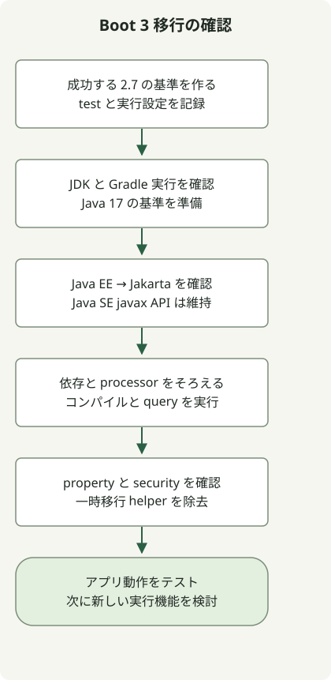

Spring Boot 2.7 から 3.0 へ移行するには、動作する 2.7 の基準を作り、Java 17 要件、Java EE から Jakarta への名前空間変更、ライブラリと実行環境の互換性を確認します。[公式 3.0 移行ガイド](https://github.com/spring-projects/spring-boot/wiki/Spring-Boot-3.0-Migration-Guide)がこの順序を説明しています。コンパイル成功だけでは DB マッピング、認可、設定の正しさは確認できません。

これは **2.7 から 3.0 への移行ガイド**で、元の 2023 年のテーマを維持しています。現在 Boot 3.0 を配備する推奨ではありません。実際の更新はサポート中の目標版を選び、間の移行ガイドも確認してください。

## 処理の流れ



これは本記事が提案する移行確認の順序です。コマンドは環境を調べるもので、アプリや DB を自動移行しません。

## 1. 動作する 2.7 の基準を作る

メジャー版を変更する前に、古い 2.x アプリを最新の 2.7.x に更新します。通ったテスト結果を保存し、Wrapper、ビルド JVM、依存関係を記録します。既存の Wrapper がある Gradle プロジェクトは次から始めます。

```sh
java -version
./gradlew --version
./gradlew clean test
./gradlew dependencies --configuration runtimeClasspath
```

更新後も同じ確認をします。複数プロジェクトではアプリのモジュールに対して依存レポートを実行します。例は `./gradlew :app:dependencies --configuration runtimeClasspath` です。モジュール名は自分のプロジェクトに合わせます。

有用な基準は、永続化、認証、シリアライズ、定期ジョブ、外向き HTTP を確認します。最後の境界には [ローカル MockWebServer を使う WebClient テスト](/en/posts/2023-09-19-springboot-test-webclient/)が再現可能な出発点になります。

## 2. Java EE の import と依存関係を一緒に変える

Boot 3.0 は Java 17 と Spring Framework 6 を必要とします。Java EE の `javax.persistence` や `javax.servlet` は `jakarta.persistence` や `jakarta.servlet` に変わります。Java SE の `javax.sql` や `javax.crypto` は名前を維持します。

| 既存の使用 | 移行時の対応 |
| --- | --- |
| `javax.persistence.Entity` | `jakarta.persistence.Entity` と互換性のある JPA 依存関係を使う。 |
| `javax.servlet.Filter` | `jakarta.servlet.Filter` と互換性のある servlet 依存関係を使う。 |
| `javax.sql.DataSource` | Java SE のパッケージ名を維持する。 |
| `javax.crypto.Cipher` | Java SE のパッケージ名を維持する。 |

import とともに解決後の依存グラフも調べます。たとえば `./gradlew dependencyInsight --dependency javax.servlet-api --configuration runtimeClasspath` は旧 servlet アーティファクトを探せます。空のレポートはアプリ全体の移行完了を証明しません。他のライブラリや設定も調べます。[Gradle の依存レポート](https://docs.gradle.org/current/userguide/viewing_debugging_dependencies.html)を参照してください。

Querydsl JPA では [JPA と注釈プロセッサーのアーティファクトをそろえ](/en/posts/2023-09-09-springboot3-querydsl/)、その系列で必要な Jakarta 版を選びます。期待する Q 型の生成と代表的なクエリ実行を確認します。Gradle の `configureEach` はタスク設定を制御しますが、非互換の Java EE 依存を Jakarta 依存へ変換はできません。

## 3. 名称変更されたプロパティと認可動作を確認する

Boot が依存関係を管理する Gradle プロジェクト向けに、公式ガイドは一時的なプロパティ補助ツールを用意しています。

```groovy
dependencies {
    runtimeOnly 'org.springframework.boot:spring-boot-properties-migrator'
}
```

テスト環境で起動し、起動時の診断を読んで該当プロパティを更新します。移行後は補助ツールを削除します。目標版の設定変更を読む代わりにはなりません。

Boot 3.0 は Spring Security 6 も使います。ガイドは 5.8 に Boot 2.7 上で移ってから 6.0 へ進むことを勧めます。許可、拒否、未認証のリクエストと、servlet アプリで使う error/forward ディスパッチもテストします。起動成功を認可テストの代わりにしないでください。

## 4. 仮想スレッドは別の変更として扱う

Boot の仮想スレッド設定は **Boot 3.2 と JDK 21** で導入され、Boot 3.0 の機能ではありません。

```properties
spring.threads.virtual.enabled=true
```

これは歴史上の版の境界で、今 Boot 3.2 を選ぶ推奨ではありません。まず名前空間と依存の移行を確認し、その後に選んだ版、接続プール、スレッドローカルの前提とともに仮想スレッドを評価します。設定だけで性能向上は証明されません。[Spring の Boot 3.2 の説明](https://spring.io/blog/2023/09/09/all-together-now-spring-boot-3-2-graalvm-native-images-java-21-and-virtual)。

JDK の言語プレビューにも独自の版の制約があります。[String Templates の互換性例](/en/posts/2023-09-23-jdk-21-string-templates/)は、プレビューの有効化が万能な更新対策でない理由を示します。

<span id="decide-whether-the-application-is-ready"></span>

## 移行の準備が整ったと判断するには？

| 確認対象 | 集める証拠 |
| --- | --- |
| ビルドと生成コード | Wrapper ビルド成功、期待する Q 型、解決された依存版。 |
| 実行時の動作 | 永続化、認証、代表的な HTTP テストの成功。 |
| 設定 | 更新済みのプロパティと移行補助ツールが不要なこと。 |
| 配備 | 代表的な環境で配備する成果物が検査を通ること。 |

これらはプロジェクト用の診断手順であり、あなたのアプリを移行した結果ではありません。ロールバック用に更新前の成果物と設定を残します。メジャー版の移行は保守に役立ちますが、安全性は配備する正確な版と設定に依存します。
