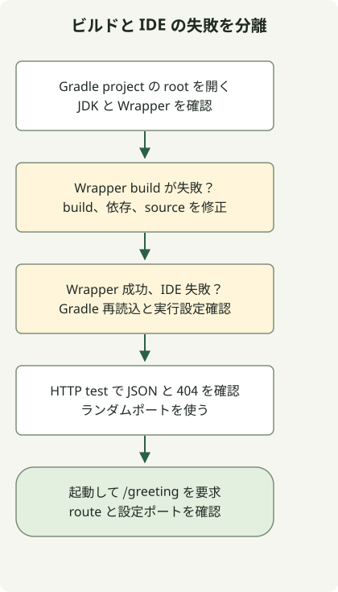

IntelliJ で Spring Boot を開いたら、まず Gradle 同期を確認し、Wrapper ビルドと IDE 実行を比較します。実行ボタンがなくても手動設定が必要とは限りません。有効な Java main は[エディターのガターアイコン](https://www.jetbrains.com/help/idea/running-applications.html)からも実行できます。

このガイドは Boot 4.1.2、Gradle 9.8.2、Java 17 の [Initializr 例](/en/posts/2023-09-07-springboot-initializer/)の続きです。ビルドと HTTP 動作はローカルで実行し、IDE 手順は JetBrains の文書と照合しました。特定版の IDE UI を実機操作で確認したという主張ではありません。

## 処理の流れ



Wrapper ビルドでプロジェクトの失敗と IDE 設定を区別します。HTTP テストはランダムポート、手動 bootRun は設定されたポートを使います。

## プロジェクトと JDK を確認する

1. File → Open で、`settings.gradle` と `build.gradle` を含む展開後のルートを開きます。
2. Gradle 同期を完了します。依存の取得や同期の失敗を先に直します。
3. プロジェクトの Wrapper 配布版を選び、Gradle JVM と Project SDK を確認します。この例は両方とも JDK 17 です。
4. 端末で `./gradlew --version` と `./gradlew test` を実行し、IDE 外の結果を得ます。

[Gradle 統合ガイド](https://www.jetbrains.com/help/idea/gradle.html)と [Gradle JVM 選択規則](https://www.jetbrains.com/help/idea/gradle-jvm-selection.html)を参照します。メニュー名は IDE の版と OS で変わります。Project SDK、Gradle を動かす JVM、Java ツールチェーン、実行設定の JRE は別設定で、自動で一致するとは限りません。

## エンドポイントと実 HTTP テストを追加する

既存の四ファイルを保ち、次の二つを追加します。コントローラーをアプリの `example.demo` パッケージに置けばコンポーネント走査の範囲に入ります。

### `src/main/java/example/demo/GreetingController.java`

```java
package example.demo;

import java.util.Map;
import org.springframework.web.bind.annotation.GetMapping;
import org.springframework.web.bind.annotation.RestController;

@RestController
public class GreetingController {
    @GetMapping("/greeting")
    public Map<String, String> greeting() {
        return Map.of("message", "Hello, Gradle");
    }
}
```

### `src/test/java/example/demo/GreetingHttpTest.java`

```java
package example.demo;

import java.net.URI;
import java.net.http.HttpClient;
import java.net.http.HttpRequest;
import java.net.http.HttpResponse;
import java.time.Duration;
import org.junit.jupiter.api.Test;
import org.springframework.beans.factory.annotation.Autowired;
import org.springframework.boot.test.context.SpringBootTest;
import org.springframework.core.env.Environment;

import static org.junit.jupiter.api.Assertions.*;

@SpringBootTest(webEnvironment = SpringBootTest.WebEnvironment.RANDOM_PORT)
class GreetingHttpTest {
    @Autowired Environment environment;

    HttpResponse<String> get(String path) throws Exception {
        String port = environment.getRequiredProperty("local.server.port");
        var request = HttpRequest.newBuilder(URI.create("http://127.0.0.1:" + port + path))
                .timeout(Duration.ofSeconds(10)).GET().build();
        return HttpClient.newHttpClient().send(request, HttpResponse.BodyHandlers.ofString());
    }

    @Test
    void greetingReturnsJson() throws Exception {
        var response = get("/greeting");
        assertEquals(200, response.statusCode());
        assertTrue(response.headers().firstValue("content-type").orElse("").contains("application/json"));
        assertEquals("{\"message\":\"Hello, Gradle\"}", response.body());
    }

    @Test
    void missingPathIsNotAnApplicationStartupFailure() throws Exception {
        assertEquals(404, get("/missing").statusCode());
    }
}
```

`./gradlew test` は元のコンテキストテストと HTTP テスト二件を実行します。HTTP テストはランダムポートに実サーバーを起動し、JSON 出力と不明パスの 404 を確認します。ローカルの 8080 が空いている必要はありません。

## Gradle と Application の実行を比較する

最初のコマンドで起動し、別の端末で二つ目を実行します。

```sh
./gradlew bootRun --args='--server.port=8081'
```

```sh
curl --fail --show-error http://localhost:8081/greeting
```

```json
{"message":"Hello, Gradle"}
```

IDE ではまず `DemoApplication.main()` の横の実行アイコンを試します。明示的な設定が必要なら、Run → Edit Configurations で Application 設定を作り、次を確認します。

| 設定 | 例 |
| --- | --- |
| Main class | `example.demo.DemoApplication` |
| Classpath module | `demo.main` など、プロジェクトの main ソースモジュール |
| JRE | JDK 17 |
| Program arguments | `--server.port=8081` |

既存のプロセスが 8081 を使用していれば、止めるか別ポートを選びます。Boot 専用のツールウィンドウや設定が使えることと、通常の Java Application 設定を動かすことは別です。

| 観測内容 | 最初の確認 |
| --- | --- |
| Wrapper も失敗する | JDK/Gradle 互換性、依存、ソースのエラー |
| Wrapper は成功するが IDE は失敗する | Gradle 再読込、モジュールのクラスパス、実行 JRE と引数 |
| 起動したが `/greeting` が 404 | コントローラーのパッケージとマッピング |
| ポート使用中で失敗 | 既存のプロセスと実行インスタンス |

コンパイルが通っても IDE が生成メソッドをエラー表示する場合は、[Lombok と注釈プロセッサーの確認](/en/posts/2023-09-15-springboot-intellij-lombok/)へ進みます。
