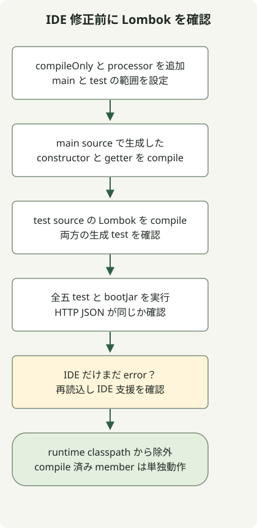

Lombok のメソッドが見つからない場合は、まず `./gradlew clean test` でビルドも失敗するか調べます。IDE 支援はエディターが生成メンバーを認識するためのもので、Gradle の注釈プロセッサー設定がコンパイル時に生成します。互いの代わりにはなりません。

この例は [Initializr プロジェクト](/en/posts/2023-09-07-springboot-initializer/)と [HTTP 例](/en/posts/2023-09-10-springboot-intellij-import/)の続きです。Boot 4.1.2、Gradle 9.8.2、JDK 17 を使い、BOM は Lombok 1.18.48 を選びました。動作する一組の記録であり、すべての JDK/Lombok の組み合わせを保証しません。

## 処理の流れ



main と test のコンパイルで、生成コンストラクターと getter をそれぞれ確認します。Wrapper のテストが通ってから IDE の認識を直します。

## Gradle のコンパイルを設定する

既存の `build.gradle` に次を追加します。既にあれば重複させません。

```groovy
dependencies {
    compileOnly 'org.projectlombok:lombok'
    annotationProcessor 'org.projectlombok:lombok'
    testCompileOnly 'org.projectlombok:lombok'
    testAnnotationProcessor 'org.projectlombok:lombok'
}
```

[公式 Gradle 設定](https://projectlombok.org/setup/gradle)は main と test のコンパイル依存とプロセッサーを分けます。test の二宣言が必要なのはテストソース自身が Lombok 注釈を使う場合です。以下のテストはその経路も試します。

ここで版を省けるのは、Boot プラグインと、[Boot BOM を取り込む](https://docs.spring.io/spring-boot/4.1/gradle-plugin/managing-dependencies.html) `io.spring.dependency-management` があるためです。通常の Gradle プロジェクトでは必要な宣言に同じ互換版を明示するか、各設定の依存管理を別途用意します。

## 生成されたコンストラクターと getter を使う

`Greeting` を追加し、既存のコントローラーをこの版で置き換え、HTTP テストを残して Lombok 専用テストクラスを追加します。

### `src/main/java/example/demo/Greeting.java`

```java
package example.demo;

import lombok.Getter;
import lombok.RequiredArgsConstructor;

@Getter
@RequiredArgsConstructor
public class Greeting {
    private final String message;
}
```

### `src/main/java/example/demo/GreetingController.java`

```java
package example.demo;

import org.springframework.web.bind.annotation.GetMapping;
import org.springframework.web.bind.annotation.RestController;

@RestController
public class GreetingController {
    @GetMapping("/greeting")
    public Greeting greeting() {
        return new Greeting("Hello, Gradle");
    }
}
```

### `src/test/java/example/demo/LombokGenerationTest.java`

```java
package example.demo;

import lombok.Getter;
import lombok.RequiredArgsConstructor;
import org.junit.jupiter.api.Test;

import static org.junit.jupiter.api.Assertions.*;

class LombokGenerationTest {
    @Getter
    @RequiredArgsConstructor
    static class Expected {
        private final String message;
    }

    @Test
    void mainSourceConstructorAndGetterAreGenerated() {
        assertEquals("Hello, Gradle", new Greeting("Hello, Gradle").getMessage());
    }

    @Test
    void testSourceConstructorAndGetterAreGenerated() {
        assertEquals("test fixture", new Expected("test fixture").getMessage());
    }
}
```

```sh
./gradlew clean test bootJar
./gradlew dependencyInsight --configuration annotationProcessor --dependency lombok
```

テストはコンテキスト一件、HTTP 二件、Lombok 生成二件の計五件です。main と test の生成コンストラクターと getter を呼びます。`/greeting` は同じ JSON を返し続ける必要があり、生成 getter によるシリアライズも確認します。

Lombok は `compileOnly` のため、この実行可能 JAR に実行時ライブラリとして入りません。IDE プラグインだけでは Gradle は通りません。この設定でコンパイル済み getter を使うために、Lombok を実行時の `implementation` にする必要はありません。

## IDE だけがエラーを出す場合

Wrapper のテストが通るなら Gradle を再読込します。[JetBrains の文書](https://www.jetbrains.com/help/idea/annotation-processors-support.html)では、ビルドファイルからプロセッサーを取り込むと注釈処理が自動で有効になります。手動のチェック変更が常に必要なわけではありません。

次に [Lombok IntelliJ ガイド](https://projectlombok.org/setup/intellij)で、自分の IDE 版の対応とプラグイン有効化を確認します。あるエディションは常に手動導入、別のものは常に同梱と一般化しないでください。IDE 独自のコンパイラーか Gradle 委任かも確認します。

Gradle も生成メンバー不足で失敗するなら、`compileOnly` だけで `annotationProcessor` がないか調べます。test だけ失敗するなら二つの test 設定を見ます。再現チェッカーは main と test のプロセッサーを別々に除去してコンパイル失敗を確認し、復元後に五件すべての成功を確認します。IDE UI 操作はこの実行確認の範囲外です。
