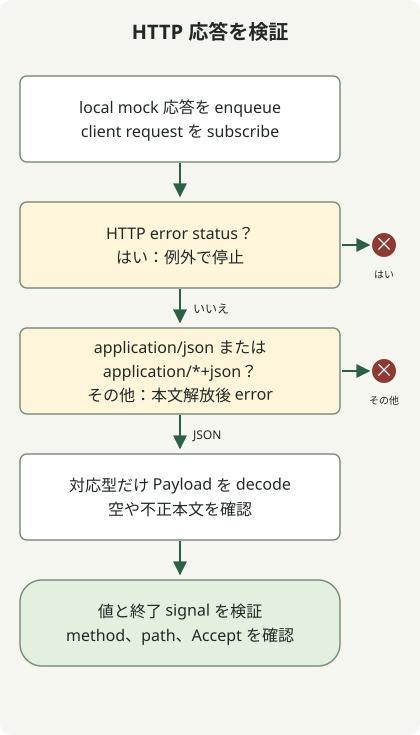

ローカル MockWebServer で WebClient を試し、HTTP 状態、応答 Content-Type、本文デコード、完了やエラーを一緒に確認します。HTML を含む `200 OK` は成功状態でも契約に違反する場合があり、`Accept: application/json` の送信は JSON 応答を強制しません。Spring は実 HTTP クライアントでの[モック Web サーバーテスト](https://docs.spring.io/spring-framework/reference/6.2/web/webflux-webclient/client-testing.html)を説明しています。

テストはメソッドチェーンのモックではなく、ローカル HTTP 経由の実 WebClient を使います。以下の応答契約が対象で、本番のタイムアウトと再試行方針には別のテストが必要です。

## 処理の流れ



クライアントはメディア型より先に状態を確認し、拒否する本文を解放し、対応する JSON をデコードします。StepVerifier は値だけでなく完了やエラーも確認します。

## 独立したテストプロジェクトを作る

再現環境は JDK 17.0.8.1、Gradle 8.4、Spring Boot **3.5.7 BOM**、MockWebServer **4.12.0** です。例の依存を固定したもので、現在の本番版の推奨ではありません。通常の Java テストプロジェクトなので、Spring Boot アプリの起動は不要です。

新しいディレクトリで、`rootProject.name = 'webclient-example'` を記した `settings.gradle` と、次の完全な `build.gradle` を作ります。

```groovy
plugins { id 'java' }
repositories { mavenCentral() }
dependencies {
    testImplementation platform('org.springframework.boot:spring-boot-dependencies:3.5.7')
    testImplementation 'org.springframework.boot:spring-boot-starter-webflux'
    testImplementation 'org.springframework.boot:spring-boot-starter-test'
    testImplementation 'io.projectreactor:reactor-test'
    testImplementation 'com.squareup.okhttp3:mockwebserver:4.12.0'
    testRuntimeOnly 'org.junit.platform:junit-platform-launcher'
}
test { useJUnitPlatform() }
```

Boot Gradle プラグインがなくても Spring と Reactor の版を与えるため、BOM を明示します。既に Boot 管理下のアプリでは、選択済み BOM にテスト依存を合わせます。

## 応答契約八件をテストする

この完全なクラスを `src/test/java/ExternalApiTest.java` に保存します。

```java
import java.io.IOException;
import java.time.Duration;
import java.util.concurrent.TimeUnit;
import okhttp3.mockwebserver.MockResponse;
import okhttp3.mockwebserver.MockWebServer;
import okhttp3.mockwebserver.RecordedRequest;
import org.junit.jupiter.api.AfterEach;
import org.junit.jupiter.api.BeforeEach;
import org.junit.jupiter.api.Test;
import org.springframework.http.MediaType;
import org.springframework.web.reactive.function.client.WebClient;
import reactor.core.publisher.Mono;
import reactor.test.StepVerifier;
import static org.junit.jupiter.api.Assertions.*;

class ExternalApiTest {
    private MockWebServer server;
    private WebClient client;
    record Payload(String message) {}

    @BeforeEach
    void start() throws IOException {
        server = new MockWebServer();
        server.start();
        client = WebClient.builder().baseUrl(server.url("/").toString()).build();
    }

    @AfterEach
    void stop() throws IOException {
        server.shutdown();
    }

    private Mono<Payload> fetch() {
        return client.get().uri("/employee/100")
            .accept(MediaType.APPLICATION_JSON)
            .exchangeToMono(response -> {
                if (response.statusCode().isError()) {
                    return response.createException().flatMap(Mono::error);
                }
                boolean json = response.headers().contentType()
                    .map(type -> "application".equals(type.getType())
                        && ("json".equals(type.getSubtype())
                            || type.getSubtype().endsWith("+json")))
                    .orElse(false);
                if (!json) {
                    return response.releaseBody().then(Mono.<Payload>error(
                        new IllegalStateException("Expected JSON response")));
                }
                return response.bodyToMono(Payload.class);
            });
    }

    @Test
    void rejectsHtmlEvenWhenStatusIs200() throws Exception {
        server.enqueue(new MockResponse().setResponseCode(200)
            .setHeader("Content-Type", "text/html; charset=UTF-8")
            .setBody("<html><body>Unknown failure</body></html>"));
        StepVerifier.create(fetch())
            .expectErrorMatches(error -> error instanceof IllegalStateException
                && error.getMessage().equals("Expected JSON response"))
            .verify(Duration.ofSeconds(5));
        RecordedRequest request = server.takeRequest(1, TimeUnit.SECONDS);
        assertNotNull(request);
        assertEquals("GET", request.getMethod());
        assertEquals("/employee/100", request.getPath());
        assertEquals("application/json", request.getHeader("Accept"));
    }

    @Test
    void preservesHttp500Error() {
        server.enqueue(new MockResponse().setResponseCode(500)
            .setHeader("Content-Type", "text/html")
            .setBody("<html>Unknown failure</html>"));
        StepVerifier.create(fetch())
            .expectError(org.springframework.web.reactive.function.client.WebClientResponseException.InternalServerError.class)
            .verify(Duration.ofSeconds(5));
    }

    @Test
    void decodesJson() {
        server.enqueue(new MockResponse().setResponseCode(200)
            .setHeader("Content-Type", "application/json")
            .setBody("{\"message\":\"ok\"}"));
        StepVerifier.create(fetch())
            .expectNextMatches(payload -> payload.message().equals("ok"))
            .expectComplete().verify(Duration.ofSeconds(5));
    }

    @Test
    void rejectsMissingContentType() {
        server.enqueue(new MockResponse().setResponseCode(200)
            .setBody("{\"message\":\"ok\"}"));
        StepVerifier.create(fetch())
            .expectErrorMatches(error -> error instanceof IllegalStateException
                && error.getMessage().equals("Expected JSON response"))
            .verify(Duration.ofSeconds(5));
    }

    @Test
    void rejectsMalformedJson() {
        server.enqueue(new MockResponse().setResponseCode(200)
            .setHeader("Content-Type", "application/json").setBody("{broken"));
        StepVerifier.create(fetch())
            .expectError(org.springframework.core.codec.DecodingException.class)
            .verify(Duration.ofSeconds(5));
    }

    @Test
    void decodesStructuredJsonSubtype() {
        server.enqueue(new MockResponse().setResponseCode(200)
            .setHeader("Content-Type", "application/vnd.example+json")
            .setBody("{\"message\":\"ok\"}"));
        StepVerifier.create(fetch())
            .expectNextMatches(payload -> payload.message().equals("ok"))
            .expectComplete().verify(Duration.ofSeconds(5));
    }

    @Test
    void completesWithoutPayloadForEmptyJsonBody() {
        server.enqueue(new MockResponse().setResponseCode(200)
            .setHeader("Content-Type", "application/json"));
        StepVerifier.create(fetch())
            .expectComplete().verify(Duration.ofSeconds(5));
    }

    @Test
    void rejectsNonApplicationJsonSubtype() {
        server.enqueue(new MockResponse().setResponseCode(200)
            .setHeader("Content-Type", "text/example+json")
            .setBody("{\"message\":\"ok\"}"));
        StepVerifier.create(fetch())
            .expectErrorMatches(error -> error instanceof IllegalStateException
                && error.getMessage().equals("Expected JSON response"))
            .verify(Duration.ofSeconds(5));
    }
}
```

JDK 17 を選び、Gradle 8.4 を導入して実行します。

```sh
java -version
gradle --version
gradle --no-daemon test
```

八件すべてが通るはずです。`build/reports/tests/test/index.html` で個別の結果を見ます。Gradle の出力に成功テストが一件ずつ並ぶ必要はありません。

| 応答 | この例が求める結果 |
| --- | --- |
| HTTP 200、JSON 本文 | ペイロードをデコード。 |
| HTTP 200、HTML 本文 | 想定外の型を拒否。 |
| HTTP 500、HTML 本文 | HTTP エラー型を維持。 |
| HTTP 200、Content-Type なし | 未指定の形式を拒否。 |
| HTTP 200、不正 JSON | デコードエラー。 |
| HTTP 200、`application/vnd.example+json` | 互換 JSON をデコード。 |
| HTTP 200、空 JSON 本文 | 値を出さず完了。 |
| HTTP 200、`text/example+json` | application 以外のメディア型を拒否。 |

空本文の動作は意図した契約です。ペイロード必須のエンドポイントなら `switchIfEmpty(Mono.error(...))` を追加し、そのテストでアプリのエラーを期待します。

<span id="why-status-and-decoding-are-checked-separately"></span>

## HTTP 200 でも応答検証が失敗する理由は？

`fetch()` は成功応答の形式より先にエラー状態を処理します。`createException()` は HTTP 500 を `WebClientResponseException.InternalServerError` として保持します。接続失敗は通常 `WebClientRequestException` の経路で、サーバーからの HTTP 応答ではありません。

エラー以外では `application/json` と `application/*+json` を受け入れ、デコーダーが本文を検証します。Content-Type の誤りと不正 JSON は別のエラーになります。例の契約であり、リダイレクトやすべての成功状態に対する完全な方針ではありません。

成功応答を拒否するときは本文を解放してからアプリのエラーを返します。`exchangeToMono` ではコールバック内で本文を消費、処理します。[Spring の exchange 文書](https://docs.spring.io/spring-framework/reference/6.2/web/webflux-webclient/client-exchange.html)は未消費の本文を完了後に解放することを説明しています。

`setBody(html)` は HTML を直接送ります。先に JSON 化するとテスト対象の応答が変わります。記録したリクエストへのアサーションは、送信したメソッド、パス、`Accept` ヘッダーも確認します。

`verify(Duration.ofSeconds(5))` は各テストの待機を制限し、本番クライアントの接続、応答タイムアウトは設定しません。API 契約に応じて通信タイムアウトと再試行のテストを追加します。この八件の対象外です。

上記環境で八件すべてが成功しました。このリポジトリでは `python3 scripts/check_webclient_example.py` で再確認できます。Jakarta の境界を越えるプロジェクトは、クライアント変更前に [Spring Boot 移行の基準](/en/posts/2023-09-08-springboot3-migration/)を作ります。

このクライアントテストはローカルモックサーバーを使い、配備済みアプリの静的ファイルは調べません。Vue を含めるなら [Gradle のフロントエンドパッケージ例](/en/posts/2021-07-23-multiple-gradle-build/)が JAR と HTML/JavaScript 応答を確認します。両例の固定環境は異なるため、依存を合わせずに組み合わせないでください。

MockWebServer API 参照：[OkHttp 4.12.0 のソースと例](https://github.com/square/okhttp/tree/parent-4.12.0/mockwebserver)。

時間制限と再試行回数は [WebClient のタイムアウトと上限付き再試行テスト](/en/posts/2026-10-30-webclient-timeout-retry/)へ進みます。この例は GET の 503 応答だけを再試行し、各試行の上限と全体の予算を分けます。
