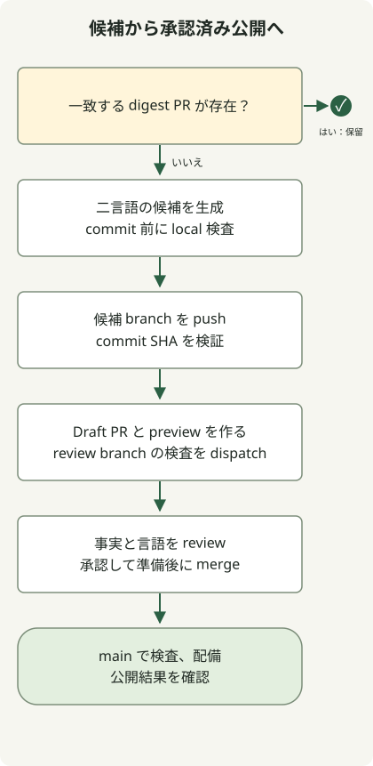

生成器はレビュー候補を作るべきです。このリポジトリでは生成と CI の成功が Draft PR につながり、公開には別途マージと main の Pages ワークフローが必要です。

四月の Jekyll パイプラインは Markdown を書いて生成物を push していました。現在は Astro を使い、新しい二言語ダイジェストを JSON に保存して、レビューまでは `main` に入れません。既存の `_posts` と Ruby ツールは旧サイトのもので、現行の公開コマンドではありません。

## 候補のコミットをたどる



[コンテンツワークフロー](https://github.com/youdozi/youdozi.github.io/blob/main/.github/workflows/dev-content-pipeline.yml)の生成は `main` のみです。まずこのリポジトリの未完了の `content/digest-review-` PR を探し、あればマージまたはクローズまで、手動プレビューも含め次の候補を止めます。

待機候補がなければ `scripts/generate_digest.py` が英韓版を準備します。生成物は `npm run check` と `npm run build` を通ってから新レビュー分岐へコミット、push します。共通検証はその SHA を確認し、レビューのジョブは生成と検証両方の成功に依存します。GitHub の[ジョブ依存動作](https://docs.github.com/en/actions/how-tos/write-workflows/choose-what-workflows-do/use-jobs)に従います。

レビューのジョブは証拠を描画し、Draft PR とプレビュー URL を作り、レビュー分岐のサイト処理を明示的に dispatch します。本番条件を満たさず分岐を検査できます。自動化で別処理を起こす際は[トークンのイベント規則](https://docs.github.com/en/actions/concepts/security/github_token)も関わり、API 成功だけで実行されたとは判断できません。

## GitHub を呼ばずレビュー処理を試す

Node 24 を使い、チェックアウトで `npm ci` を実行します。完全なファイルをルートの `review-contract.mjs` に保存し、次を実行します。

```sh
node review-contract.mjs
```

ハーネスは実際の YAML を読み、二つの JavaScript をローカルモックで動かし、保留 PR の五ケースと作成、更新、dispatch 順を確認します。モックにマージ操作はありません。YAML の実行、実ダイジェスト生成、API 呼出はしません。

### `review-contract.mjs`

```javascript
import assert from 'node:assert/strict';
import { readFileSync } from 'node:fs';
import YAML from 'yaml';

const workflow = YAML.parse(readFileSync('.github/workflows/dev-content-pipeline.yml', 'utf8'));
const { generate, validate, review } = workflow.jobs;
assert.equal(generate.if, "github.ref == 'refs/heads/main'");
assert.deepEqual(review.needs, ['generate', 'validate']);
assert.equal(validate.with.ref, '${{ needs.generate.outputs.commit_sha }}');
assert.equal(validate.uses, './.github/workflows/site-checks.yml');
assert.equal(workflow.jobs.publish, undefined);

const AsyncFunction = Object.getPrototypeOf(async function () {}).constructor;
const pendingScript = generate.steps.find(step => step.id === 'pending').with.script;
const runPending = new AsyncFunction('github', 'context', 'core', pendingScript);
const context = { repo: { owner: 'example', repo: 'blog' } };
const summary = { addRaw() { return this; }, async write() {} };
const cases = [
    [[], false],
    [[{ head: { repo: { full_name: 'example/blog' }, ref: 'content/digest-review-1' }, html_url: 'mock' }], true],
    [[{ head: { repo: { full_name: 'other/blog' }, ref: 'content/digest-review-1' } }], false],
    [[{ head: { repo: { full_name: 'example/blog' }, ref: 'content/manual-1' } }], false],
    [[{ head: { repo: null, ref: 'content/digest-review-1' } }], false],
];
for (const [pulls, expected] of cases) {
    let exists;
    const github = { rest: { pulls: { list() {} } }, paginate: async () => pulls };
    const core = { summary, setOutput(key, value) { if (key === 'exists') exists = value; } };
    await runPending(github, context, core);
    assert.equal(exists, expected);
}

const calls = [];
const github = { rest: {
    pulls: {
        async create(payload) { calls.push(['create', payload]); return { data: { number: 42, html_url: 'mock-pr' } }; },
        async update(payload) { calls.push(['update', payload]); },
    },
    actions: { async createWorkflowDispatch(payload) { calls.push(['dispatch', payload]); } },
} };
const core = { summary, setOutput() {} };
const requireMock = name => {
    assert.equal(name, 'node:fs');
    return { readFileSync: () => 'Mock review body' };
};
const script = review.steps.find(step => step.id === 'pr').with.script;
const runReview = new AsyncFunction('require', 'github', 'context', 'core', 'process', script);
await runReview(requireMock, github,
    { ...context, serverUrl: 'https://github.com', runId: 7 }, core,
    { env: { REVIEW_BRANCH: 'content/digest-review-7-1' } });
assert.deepEqual(calls.map(call => call[0]), ['create', 'update', 'dispatch']);
assert.equal(calls[0][1].draft, true);
assert.equal(calls[0][1].base, 'main');
assert.equal(calls[0][1].head, 'content/digest-review-7-1');
assert.equal(calls[2][1].workflow_id, 'site-quality-gates.yml');
assert.equal(calls[2][1].ref, calls[0][1].head);
console.log('5 pending-PR cases and the mocked draft/create-update-dispatch sequence passed.');
```

確認した出力は次のとおりです。

```text
5 pending-PR cases and the mocked draft/create-update-dispatch sequence passed.
```

五入力は、保留なし、一致するローカル PR、他リポジトリ、別のローカル分岐、head リポジトリ欠落です。成功が示すのは選んだスクリプト契約で、トークン権限、分岐保護、情報源の正確性、ホスト上の全処理ではありません。

## 候補を作り公開対象を決める

**Actions → Dev Content Pipeline → Run workflow** で `main` を選びます。`preview` をオフにするとレビュー候補を作り、オンにすると `--dry-run --force --max-items 2` の dry-run となり候補をコミットしません。保留中のものがあれば生成は止まります。[手動ワークフローの操作](https://docs.github.com/en/actions/how-tos/manage-workflow-runs/manually-run-a-workflow)は GitHub 文書を参照します。

Draft PR と二言語プレビューを開き、情報源の日付、元の主張と根拠、翻訳範囲、リンク、公開価値を確認します。自動のコードやスキーマ検査は編集判断を代行できません。必要なら修正してそのコミットの検査を確認し、公開承認後に ready にしてマージします。ready だけでは配備されません。

[品質ゲートの記事](/en/posts/2026-04-07-jekyll-quality-gates-proof-html-bundler-audit/)は、成功した PR が正しく配備をスキップする理由とマージ後の確認を説明します。旧 Ruby 環境は現在韓国語の [Jekyll トラブル記録](/ko/posts/2026-04-07-ruby-rbenv-jekyll-build-troubleshooting/)を参照します。
