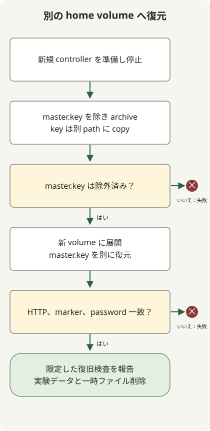

バックアップは新規ボリュームに復元し、そこから Jenkins を起動して確認します。アーカイブの存在だけでは使える証拠になりません。

新規で他用途に使っていないコントローラーを止めてからホームをコピーします。master.key は別保存し、非公開アーカイブを別の新規ボリュームへ復元して同じダイジェストで起動し、パスワード値を出さずマーカーと元の初期パスワードを確認します。本番、実行中ジョブ、プラグイン移行は試しません。

## 停止、コピー、復元、起動



[Jenkins バックアップガイド](https://www.jenkins.io/doc/book/system-administration/backing-up/)は保存内容と復旧検証を区別します。書込中のコピーを避けるため停止したソースを使いますが、外部 DB、agent、他の書込元との協調スナップショットではありません。

[コントローラー再作成実験](/en/posts/2023-09-28-jenkins-docker-install/)の完全な `jenkins_lab.py` を使い、次のファイルを隣に保存します。Python3 と稼働する Linux コンテナ用 Docker エンジンが必要です。

### `jenkins_restore.py`

```python
import json
import tempfile
from jenkins_lab import DockerLab

with DockerLab() as lab, \
        tempfile.TemporaryDirectory(prefix='jenkins-private-backup-') as backup, \
        tempfile.TemporaryDirectory(prefix='jenkins-private-key-') as keys:
    original = lab.start()
    password = lab.password(original)
    assert password, 'Missing initial password'
    lab.cli('exec', original, 'sh', '-c', 'printf restored > /var/jenkins_home/lab-marker')
    lab.cli('stop', '-t', '30', original)
    lab.cli('run', '--rm', '--user', '0:0', '--entrypoint', 'sh',
            '--mount', f'type=volume,source={lab.home},target=/source,readonly',
            '--mount', f'type=bind,source={backup},target=/backup',
            '--mount', f'type=bind,source={keys},target=/keys', lab.image,
            '-c', 'set -e; umask 077; tar -C /source --exclude=./secrets/master.key -czpf /backup/home.tgz .; cp -p /source/secrets/master.key /keys/master.key')
    members = lab.cli('run', '--rm', '--user', '0:0', '--entrypoint', 'tar',
                      '--mount', f'type=bind,source={backup},target=/backup,readonly', lab.image,
                      '-tzf', '/backup/home.tgz')
    assert './secrets/master.key' not in members.splitlines()
    restored_home = lab.volume()
    lab.cli('run', '--rm', '--user', '0:0', '--entrypoint', 'tar',
            '--mount', f'type=bind,source={backup},target=/backup,readonly',
            '--mount', f'type=volume,source={restored_home},target=/restore', lab.image,
            '-xzpf', '/backup/home.tgz', '-C', '/restore')
    lab.cli('run', '--rm', '--user', '0:0', '--entrypoint', 'cp',
            '--mount', f'type=bind,source={keys},target=/keys,readonly',
            '--mount', f'type=volume,source={restored_home},target=/restore', lab.image,
            '-p', '/keys/master.key', '/restore/secrets/master.key')
    restored = lab.start(restored_home)
    assert lab.marker(restored) == 'restored'
    assert lab.password(restored) == password
    print(json.dumps({'image': lab.image, 'jenkins': lab.version, 'sourceStopped': True,
                      'restoredToNewVolume': True, 'masterKeyExcluded': True, 'keyCopiedSeparately': True, 'markerRestored': True,
                      'passwordRestored': True, 'result': 'passed'}))
```

実行します。

```sh
python3 jenkins_restore.py
```

補助コンテナは entrypoint をコピー用ツールに変え、別 Jenkins は起動しません。所有者と権限の保持のためだけに root で動きます。アーカイブ一覧から master.key を除外し、別の補助処理が起動前に鍵を復元します。停止後の元ボリュームは読取専用、復元先は別の新規ボリュームです。ダイジェストは実験開始時に選んだものです。

成功結果は `sourceStopped`、`restoredToNewVolume`、`markerRestored`、`passwordRestored`、`masterKeyExcluded`、`keyCopiedSeparately`、`result: passed` を含みます。復元後は `DockerLab.start` の HTTP 準備完了も必要です。初期パスワード一致はその秘密の保持を確認するだけで、完了済みユーザー管理や全資格情報プラグインのテストではありません。

## アーカイブをコントローラーデータとして扱う

使い捨ての復旧演習です。`secrets/master.key` は除外し、別コピーして展開後に適用します。他の秘密はアーカイブに残ります。両一時ディレクトリは非公開で終了時に削除します。CI 成果物へのアップロード、コミット、本番バックアップ方針としての採用はしないでください。

本番では [Jenkins の鍵の案内](https://www.jenkins.io/doc/book/system-administration/backing-up/)が `master.key` と通常バックアップの分離を求めます。鍵復旧、暗号化、保持、アクセス、別ホスト保存、外部状態を決めてから採用します。同一マシンの一時アーカイブにその耐久性保証はありません。

復元したコントローラーも終了時に消し、演習を繰り返せます。マーカー、秘密、HTTP の成功は全ジョブ、プラグイン、資格情報、外部連携の復旧を証明しません。実システムの計画的演習に代表的処理と秘密の復号確認を加えます。
