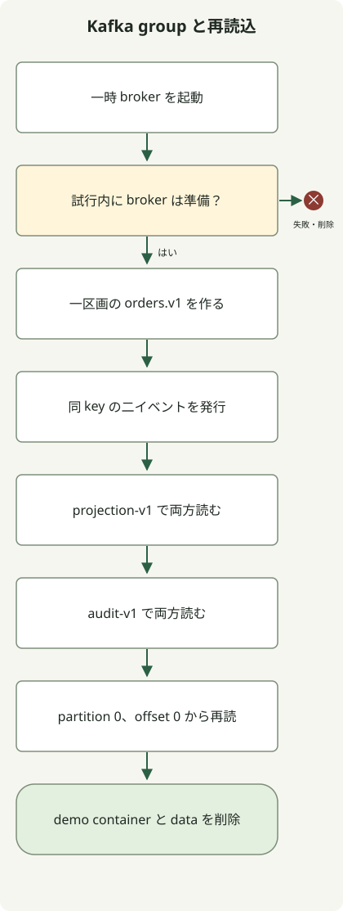

**Kafka のイベントストリーミングは事実をログに残し、複数の消費者が各自の位置から読んで処理する仕組みです。** 発送準備と分析は注文を独立に読み、新ロジックで再処理できます。ただし Kafka 保存と外部 DB や決済の exactly-once は別です。

HTTP API と DB に慣れた開発者向けに topic、partition、group をつなぎ、ローカルで発行、独立消費、再読込を動かします。**消費位置と障害後の再処理の意味**が中心で、Kafka Streams の集約、window、join の実装ではありません。

## イベントストリームと作業キューの違いは？

イベントは「注文が作成された」など既発生の事実です。「発送を始める」等の命令と分ければ、同じ記録を各業務で使えます。Kafka はグループ内でキューのように分担もできますが、消費で直ちに削除しません。他グループや再処理は保持方針内で再読できます。[Apache Kafka 入門](https://kafka.apache.org/intro/)

| 概念 | 役割 | 設計時の判断 |
| --- | --- | --- |
| Producer | Kafka にイベントを書く | キー、ID、スキーマ、発行失敗 |
| Topic | 関連イベントの論理ストリーム | 意味、保持、圧縮、権限 |
| Partition | 順序付きログの分割 | 順序範囲、キー分布、並列処理量 |
| Consumer group | 同じ業務を分担する消費者集合 | ID、処理とコミット時期、再処理方針 |
| Offset | パーティション内の記録位置 | 読取済み位置と再開点 |

`shipping-v1` と `analytics-v1` が `orders.v1` を読めば、両業務は同じイベントを独立に受けます。同じグループにすると記録を分担するため、各業務が全件を受ける構成ではなくなります。

通常のグループ購読ではパーティションはグループ内の一消費者へ割当てます。五消費者で 3 パーティションを読むと全員には割り当たりません。他グループの割当は独立です。記事は通常の `KafkaConsumer` 購読で、レコード単位の共有消費モデルとは異なります。[グループ購読](https://kafka.apache.org/41/javadoc/org/apache/kafka/clients/consumer/KafkaConsumer.html)

## 順序が重要ならキーから考える

Kafka が定めるのは**パーティション内**の順序です。同じ注文の状態順が重要なら注文 ID をキーに同じ区画へ送ります。キーは経路、イベント ID は重複識別で別の役目です。注文内の全イベントに同じ ID を使うと正当な後続まで破棄され得ます。

同キーの経路には直列化、分割方法、区画数の一致も必要です。区画追加で後続の行先は変わるため旧記録との順序を見ます。読取後の無制限並列化も完了順を変えます。ログ順と業務発生時刻順も同一とは限らず、複数発行元の遅延には業務版、発生時刻、順不同処理の規則が必要です。

大半を占める顧客など hot key は一区画に集中します。順序単位を勝手に小分けせず、必要な順序範囲と処理コストを確認します。

## ローカル実行：二グループで読み再読込する

Apache の `apache/kafka:4.1.2` 内のツールを使います。Bash と稼働 Docker が必要で、初回は取得します。同じコンテナで broker と CLI を動かしホストポートは公開しません。停止時にデータは消えます。broker 1、partition 1、複製係数 1 の機能実演です。[公式 Docker 手順](https://kafka.apache.org/41/getting-started/docker/)



図は正常時の順序です。準備やコマンドの失敗で止まり、作成済みなら終了時に削除します。二グループ読取と一直接再読を順次行い、外部 DB 処理や手動コミットは未実装です。

`kafka-demo.sh` に保存し `bash kafka-demo.sh` を実行します。

```sh
#!/usr/bin/env bash
set -euo pipefail

kafka_image=apache/kafka:4.1.2
kafka_name="kafka-stream-demo-$$-$RANDOM"
docker run -d --name "$kafka_name" "$kafka_image" >/dev/null
trap 'docker rm -f "$kafka_name" >/dev/null 2>&1 || true' EXIT

ready=false
for ((attempt=0; attempt<30; attempt++)); do
  if docker exec "$kafka_name" /opt/kafka/bin/kafka-topics.sh \
      --bootstrap-server localhost:9092 --list >/dev/null 2>&1; then
    ready=true
    break
  fi
  sleep 1
done
if [ "$ready" != true ]; then
  docker logs "$kafka_name" >&2
  exit 1
fi

docker exec "$kafka_name" /opt/kafka/bin/kafka-topics.sh \
  --bootstrap-server localhost:9092 --create --topic orders.v1 \
  --partitions 1 --replication-factor 1 >/dev/null

docker exec -i "$kafka_name" /opt/kafka/bin/kafka-console-producer.sh \
  --bootstrap-server localhost:9092 --topic orders.v1 \
  --producer-property acks=all --producer-property enable.idempotence=true \
  --property parse.key=true --property key.separator=: <<'EVENTS'
order-101:{"eventId":"evt-1","type":"OrderCreated","schemaVersion":1}
order-101:{"eventId":"evt-2","type":"PaymentConfirmed","schemaVersion":1}
EVENTS

for group in projection-v1 audit-v1; do
  printf 'group=%s\n' "$group"
  docker exec "$kafka_name" /opt/kafka/bin/kafka-console-consumer.sh \
    --bootstrap-server localhost:9092 --topic orders.v1 --group "$group" \
    --from-beginning --max-messages 2 --timeout-ms 15000 \
    --property print.key=true --property 'key.separator=|'
done

printf 'replay=partition-0-offset-0\n'
docker exec "$kafka_name" /opt/kafka/bin/kafka-console-consumer.sh \
  --bootstrap-server localhost:9092 --topic orders.v1 \
  --partition 0 --offset 0 --max-messages 2 --timeout-ms 15000 \
  --property print.key=true --property 'key.separator=|'
```

Docker Engine `24.0.5` と `apache/kafka:4.1.2` で確認した標準出力です。各消費コマンドは標準エラーに別途 `Processed a total of 2 messages` も出します。

```text
group=projection-v1
order-101|{"eventId":"evt-1","type":"OrderCreated","schemaVersion":1}
order-101|{"eventId":"evt-2","type":"PaymentConfirmed","schemaVersion":1}
group=audit-v1
order-101|{"eventId":"evt-1","type":"OrderCreated","schemaVersion":1}
order-101|{"eventId":"evt-2","type":"PaymentConfirmed","schemaVersion":1}
replay=partition-0-offset-0
order-101|{"eventId":"evt-1","type":"OrderCreated","schemaVersion":1}
order-101|{"eventId":"evt-2","type":"PaymentConfirmed","schemaVersion":1}
```

各グループと最後の直接再読が同じ二件を読みました。一グループの消費が他の読取や再読を妨げないことを確認します。一パーティションなので区画間順序やグループ内並列割当は確認しません。

既定の自動コミットでコンソール消費を確認します。業務後に手動コミットするアプリ、処理とコミット間の失敗、JSON スキーマ検証、外部 DB や決済、rebalance 中の処理は実装、検証していません。

## offset のコミットは業務完了を保証するか？

しません。`poll()` の受信で現在位置は進みますが、再起動時の**コミット位置**は別です。順次処理で offset 10 の完了後は通常次の 11 をコミットします。区画別に完了範囲を管理します。削除やトランザクション等で必ずしも連続整数の記録列ではありません。[位置とコミット](https://kafka.apache.org/41/javadoc/org/apache/kafka/clients/consumer/KafkaConsumer.html)

| 順序と失敗点 | 再起動後の可能性 | 必要な処理 |
| --- | --- | --- |
| commit → DB 変更前に停止 | 変更を飛ばして業務欠落 | 配信意味に合う順序へ変更 |
| DB 完了 → commit 前に停止 | 同イベントの再配信、再処理 | 冪等化や重複排除 |
| 一部失敗後に後続位置 commit | 失敗を飛ばす可能性 | 連続成功範囲だけ commit |
| 別消費者へ再割当 | 旧所有者と新所有者の作業重複 | 旧処理停止と重複副作用の防止 |

外部 DB では `(처리기 ID, eventId)` の一意性確認と実変更を**同じ DB トランザクション**にできます。印だけ先に保存して変更が失敗すると次を重複と誤認し、変更後に別保存すると間の失敗で重複更新します。他の外部 API は自動で含まれず、冪等キーと結果確認も必要です。

`enable.idempotence` は producer 再試行の重複に対応し、同じ業務イベントを新規発行として二重送信する全ケースは除けません。`acks=all` も他設定を問わない無損失保証ではありません。複製係数、`min.insync.replicas`、実 ISR を合わせて見ます。単 broker 実験は broker 喪失への耐性を試しません。[Producer 設定](https://kafka.apache.org/41/configuration/producer-configs/)

Kafka トランザクションで入力 offset と出力記録をまとめ `read_committed` で読む処理と、外部 DB や決済の exactly-once を分けます。外部の協力なしに Kafka だけで全部が exactly-once にはなりません。[配信意味とトランザクション](https://kafka.apache.org/41/design/design/)

## 再試行と再読を通常の運用経路にする

一時障害の再試行は回数、総時間、同時数を制限します。一件で全区画が詰まるなら延期経路も検討し、後続進行で業務順序を破らないか見ます。DLQ 送信は業務完了ではありません。元 ID、原因、スキーマ版、担当、解決期限を保ち、DLQ 書込と offset 更新間の失敗を扱います。

DB 確定と発行の間でも失敗します。同一トランザクションで DB 変更と outbox を保存し配信する方法がありますが消費側の重複対応は必要です。Kafka 追加で元 DB とログが一つのトランザクションにはなりません。[Transactional outbox](https://docs.aws.amazon.com/prescriptive-guidance/latest/cloud-design-patterns/transactional-outbox.html)

`--from-beginning` は有効コミットのあるグループを無条件に巻き戻しません。例は新グループを使い、最後は区画と開始 offset を直接指定し reset しません。既存位置を変える再読は停止後に対象、範囲、外部影響を確認する別手順が必要です。新グループでも決済や通知は再発し得るため出力隔離か冪等方針が必要です。[offset-reset 設定](https://kafka.apache.org/41/configuration/consumer-configs/)

保持期間より遅れれば必要記録は消えている場合があります。compaction も全履歴状態は残しません。保持、圧縮、必要スキーマの解釈能力と再読範囲を定めます。

一業務を選び、通常に加え DB 更新後 commit 前の停止、再起動、rebalance、不正スキーマ、依存遅延、再読の重複効果を試します。`lag` は選択終端と消費またはコミット位置の差なので、どの位置か定めます。lag とともに発生から業務更新の遅延、失敗、再試行、DLQ、rebalance、保存、複製を見て「読んだ」と「業務完了」を分けます。
