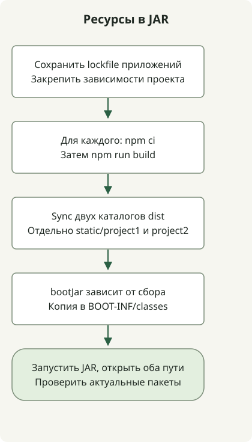

Чтобы упаковать несколько приложений Vue в JAR Spring Boot, создайте для каждого свою задачу `npm ci` и сборки, подготовьте сгенерированные файлы в `build/`, затем добавьте их в `bootJar`. Не используйте задачу установки одного приложения для остальных и не записывайте сгенерированные пакеты прямо в `src/main/resources`.

Этот исполняемый пример обслуживает два приложения по адресам `/project1/index.html` и `/project2/index.html`. Среда воспроизведения: JDK17.0.8.1, Gradle8.4, Node24.13.0/npm11.6.2, Boot3.5.7, Vue3.5.44 и Vite8.3.5. Это закреплённые версии для воспроизведения, а не рекомендации актуальных производственных зависимостей. Отдельно проверьте [требования Vite к среде выполнения](https://vite.dev/guide/) и выбранного выпуска Boot.

## Порядок обработки



Каждое приложение Vue создаёт собственный результат сборки. Задача Gradle Sync собирает только эти результаты, затем bootJar помещает их в отдельные статические пути.

## Задачи для каждого приложения и упаковка

Сохраните эти файлы в пустом проекте. У каждого приложения свои `package.json`, файл блокировки, `node_modules` и `dist`. Скрипт `prepare.sh` копирует общие HTML/JS во второе приложение и создаёт оба файла блокировки.

### `settings.gradle`

```groovy
rootProject.name = 'multi-frontend'
```

### `build.gradle`

```groovy
plugins {
    id 'java'
    id 'org.springframework.boot' version '3.5.7'
}
group = 'example'
version = '1.0.0'
repositories { mavenCentral() }
dependencies {
    implementation platform('org.springframework.boot:spring-boot-dependencies:3.5.7')
    implementation 'org.springframework.boot:spring-boot-starter-web'
}

def apps = ['project1', 'project2']
def npmCommand = System.getProperty('os.name').toLowerCase().contains('windows') ? 'npm.cmd' : 'npm'
def frontendBuilds = apps.collect { app ->
    def frontend = layout.projectDirectory.dir("frontend/${app}")
    def install = tasks.register("${app}NpmCi", Exec) {
        workingDir frontend
        commandLine npmCommand, 'ci', '--no-audit', '--no-fund'
        inputs.files(frontend.file('package.json'), frontend.file('package-lock.json'))
        outputs.dir(frontend.dir('node_modules'))
    }
    tasks.register("${app}Build", Exec) {
        dependsOn install
        workingDir frontend
        commandLine npmCommand, 'run', 'build'
        inputs.files(fileTree(frontend) {
            exclude 'node_modules/**', 'dist/**'
        })
        outputs.dir(frontend.dir('dist'))
    }
}
def collectFrontend = tasks.register('collectFrontend', Sync) {
    dependsOn frontendBuilds
    into layout.buildDirectory.dir('frontend-resources')
    apps.each { app ->
        from("frontend/${app}/dist") { into "static/${app}" }
    }
}
tasks.named('bootJar') {
    dependsOn collectFrontend
    from(collectFrontend) { into 'BOOT-INF/classes' }
}
```

### `src/main/java/example/Application.java`

```java
package example;

import org.springframework.boot.SpringApplication;
import org.springframework.boot.autoconfigure.SpringBootApplication;

@SpringBootApplication
public class Application {
    public static void main(String[] args) {
        SpringApplication.run(Application.class, args);
    }
}
```

### `frontend/project1/package.json`

```json
{
  "name": "project1",
  "private": true,
  "type": "module",
  "scripts": {
    "build": "vite build --base=/project1/"
  },
  "dependencies": {
    "vue": "3.5.44"
  },
  "devDependencies": {
    "vite": "8.3.5"
  }
}
```

### `frontend/project2/package.json`

```json
{
  "name": "project2",
  "private": true,
  "type": "module",
  "scripts": {
    "build": "vite build --base=/project2/"
  },
  "dependencies": {
    "vue": "3.5.44"
  },
  "devDependencies": {
    "vite": "8.3.5"
  }
}
```

### `frontend/project1/index.html`

```html
<!doctype html>
<html lang="en"><head><meta charset="UTF-8"><title>Vue build example</title></head>
<body><div id="app"></div><script type="module" src="/src/main.js"></script></body></html>
```

### `frontend/project1/src/main.js`

```js
import { createApp, h } from 'vue';
createApp({ render: () => h('h1', `Vue app at ${import.meta.env.BASE_URL}`) }).mount('#app');
```

### `prepare.sh`

```sh
#!/bin/sh
set -eu
mkdir -p frontend/project2/src
cp frontend/project1/index.html frontend/project2/index.html
cp frontend/project1/src/main.js frontend/project2/src/main.js
for app in project1 project2; do
    (cd "frontend/$app" && npm install --package-lock-only --ignore-scripts --no-audit --no-fund)
done
```

Выполните `prepare.sh` при первоначальной подготовке примера и сохраните оба созданных файла `package-lock.json` в репозитории. Последующие сборки CI используют `npm ci` с сохранёнными файлами блокировки. Не создавайте их заново при каждой сборке.

## Сборка и запуск

Из корня проекта выполните следующие команды; Node/npm должны быть доступны через PATH:

```sh
node --version
npm --version
sh prepare.sh
gradle --no-daemon clean bootJar
java -jar build/libs/multi-frontend-1.0.0.jar
```

В существующем проекте с wrapper используйте выбранную версию Gradle через `./gradlew`. После запуска откройте `http://localhost:8080/project1/index.html` и `http://localhost:8080/project2/index.html`. Страницы показывают соответственно `Vue app at /project1/` и `Vue app at /project2/`.

[Параметр base в Vite](https://vite.dev/guide/build.html#public-base-path) задаёт каждому приложению подходящие URL ресурсов. Он не настраивает серверную маршрутизацию SPA. В примере используются явные URL `index.html`; прямые переходы через history-router или другой контекстный путь требуют дополнительной настройки.

## Проверьте реальные пути в JAR

```text
BOOT-INF/classes/static/project1/index.html
BOOT-INF/classes/static/project1/assets/...
BOOT-INF/classes/static/project2/index.html
BOOT-INF/classes/static/project2/assets/...
```

После сборки приложений `collectFrontend` использует `Sync` для подготовки только актуальных результатов. Задача `bootJar` добавляет их в classpath исполняемого JAR. См. [работу с файлами в Gradle](https://docs.gradle.org/current/userguide/working_with_files.html) и [упаковку архивов Boot](https://docs.spring.io/spring-boot/3.5/gradle-plugin/packaging.html).

С этой конфигурацией оба приложения были собраны и упакованы, а запущенный JAR отдавал их HTML и JS по HTTP. Затем файл из каталога `public` одного приложения удалили и пересобрали JAR без `clean`, чтобы убедиться, что устаревший файл не сохранился. Файлы блокировки обоих приложений проверили отдельно.

## Адаптация к существующему проекту

- Согласуйте список `apps` с каталогами и предоставьте каждый файл блокировки.
- Держите пространства сгенерированных `static/project1` и `static/project2` отдельно от ресурсов, написанных вручную.
- Для Vue SFC добавьте плагин и конфигурацию Vite, подходящие этому приложению. В этом небольшом примере используются функции рендеринга Vue.
- Интеграция рассчитана на исполняемый `bootJar`, а не обычный `jar`. Проверяйте артефакт, который собираетесь развёртывать.

Для существующего приложения отдельно от упаковки проверьте [основу миграции Spring Boot на Java и Jakarta](/en/posts/2023-09-08-springboot3-migration/). Если оно также выполняет задания Batch, следуйте [проверкам миграции репозитория Batch и перезапуска](/en/posts/2023-10-27-springbatch5-migration/): обслуживание интерфейса из JAR не проверяет сохранённые данные заданий.

Для автоматизации по выпускам см. [выбор выпуска и ресурсов GitHub](/en/posts/2023-09-23-linux-shellscript-github-latest/) и [контракт входных данных числового компаратора](/en/posts/2023-11-17-linux-shellscript-version-compare/). [Руководство по функциям POSIX sh](/en/posts/2023-09-20-linux-shellscript-function-error/) описывает выбор интерпретатора для подготовительных скриптов.
