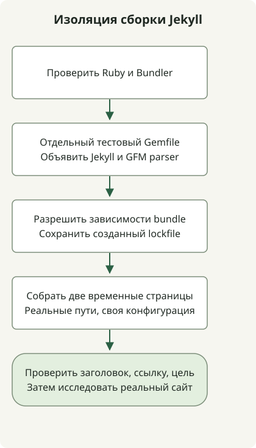

Прежде чем менять права, проверьте, какой Ruby запускается, какой Bundler задаёт контекст зависимостей и рендерится ли небольшой сайт. Рабочая сборка этого сайта использует Astro; пример Jekyll ниже предназначен для диагностики сохранённого архива Ruby.

Исходная установка использовала Ruby 3.2.2. Эта ветка уже [снята с поддержки](https://www.ruby-lang.org/en/downloads/branches/), поэтому старая версия служит воспроизведению совместимости, а не рекомендацией для новой установки. Перед внедрением выберите поддерживаемую версию Ruby, совместимую с gem вашего проекта.

## Выберите интерпретатор до установки gem



[Инструкция Jekyll для macOS](https://jekyllrb.com/docs/installation/macos/) рекомендует отдельную среду Ruby вместо системного Ruby. Ранняя настройка этого репозитория использовала rbenv. Его [правила выбора версии](https://github.com/rbenv/rbenv#readme) различают проектный `.ruby-version`, `RBENV_VERSION` и глобальное значение по умолчанию.

Выполните эти команды в каталоге проекта:

```sh
command -v ruby
ruby --version
rbenv version
rbenv which ruby
gem env home
bundle --version
```

Если `ruby` выбирается не через ожидаемый менеджер, исправьте инициализацию оболочки до установки чего-либо. Используйте `rbenv init` по инструкции установленной версии rbenv; не вставляйте домашний путь другого пользователя в профиль оболочки. Локальный выбор для проекта предпочтительнее изменения всех проектов Ruby через `rbenv global`.

## Проверка bundle с двумя отрендеренными страницами

Этот пример совместимости выполнен с Ruby3.2.2, Bundler2.4.19, Jekyll3.9.3 и kramdown-parser-gfm1.1.0. Это зафиксированные устаревшие версии, а не базовый набор поддерживаемых версий. Gemfile закрепляет два прямых gem; полученный Gemfile.lock фиксирует транзитивные версии для вашей платформы.

Создайте отдельный временный каталог и сохраните в нём эти полные файлы. Не заменяйте существующий Gemfile репозитория.

### `Gemfile`

```ruby
source 'https://rubygems.org'
gem 'jekyll', '= 3.9.3'
gem 'kramdown-parser-gfm', '= 1.1.0'
```

### `jekyll_probe.rb`

```ruby
require 'jekyll'
require 'tmpdir'
require 'fileutils'
require 'json'

Dir.mktmpdir('jekyll-probe-') do |root|
  root = File.realpath(root)
  source = File.join(root, 'source')
  destination = File.join(root, 'output')
  FileUtils.mkdir_p(File.join(source, '_layouts'))
  File.write(File.join(source, '_layouts', 'default.html'), '<!doctype html><html lang="en"><body>{{ content }}</body></html>')
  File.write(File.join(source, 'index.md'), "---\nlayout: default\ntitle: Probe\n---\n# Bundled build\n\n[Guide](/guide/)\n")
  File.write(File.join(source, 'guide.md'), "---\nlayout: default\npermalink: /guide/\n---\n# Local guide\n")
  config = Jekyll.configuration('config' => [], 'source' => source, 'destination' => destination, 'quiet' => true)
  Dir.chdir(source) { Jekyll::Site.new(config).process }
  home = File.read(File.join(destination, 'index.html'))
  guide = File.read(File.join(destination, 'guide', 'index.html'))
  raise 'Missing rendered heading' unless home.include?('<h1') && home.include?('Bundled build')
  raise 'Missing guide link' unless home.include?('href="/guide/"')
  raise 'Missing guide output' unless guide.include?('Local guide')
  puts JSON.generate('ruby' => RUBY_VERSION, 'jekyll' => Jekyll::VERSION, 'pages' => 2, 'result' => 'passed')
end
```

С выбранными Ruby и Bundler выполните из этого каталога:

```sh
bundle install
bundle exec ruby jekyll_probe.rb
```

Если нужные gem уже установлены, `bundle lock --local` может разрешить зависимости из локального набора перед той же командой выполнения. Получить отсутствующий gem эта команда не может. Сохраняйте файл блокировки при воспроизведении ошибки и проверяйте изменения перед обновлением. [Руководство Bundler для приложений](https://guides.rubygems.org/using_bundler_in_applications/) объясняет роль Gemfile и файла блокировки.

Наблюдаемый результат:

```json
{"ruby":"3.2.2","jekyll":"3.9.3","pages":2,"result":"passed"}
```

Проверка собирает сайт во временном каталоге, использует его реальный путь во избежание несовпадения символьной ссылки `/var` в macOS, отключает стандартный поиск конфигурационного файла и при рендеринге переходит в собственный исходный каталог. Она проверяет заголовок, ссылку и целевую страницу. Затем временные файлы удаляются; весь архив, его тема, плагины, CSS и развёртывание этой проверкой не охвачены.

## Отличайте наличие gem от включения в bundle

При воспроизведении Jekyll загружался, но преобразование Markdown завершалось ошибкой: bundle не объявлял `kramdown-parser-gfm`. Установка gem где-либо на машине и его доступность внутри `bundle exec` — разные условия. Добавление парсера в Gemfile этого примера позволило выполнить преобразование.

Успешная проверка двух страниц сужает дальнейший поиск до конфигурации, темы, плагинов и входных данных настоящего сайта. Ошибка загрузки нативного расширения относится к другому уровню: используйте [диагностическую проверку Ruby и C++](/en/posts/2026-04-07-ruby-rbenv-jekyll-build-troubleshooting/). Для действующего процесса публикации этого сайта используйте [процесс проверки кандидатов Astro](/en/posts/2026-04-07-jekyll-github-actions-content-pipeline/).
