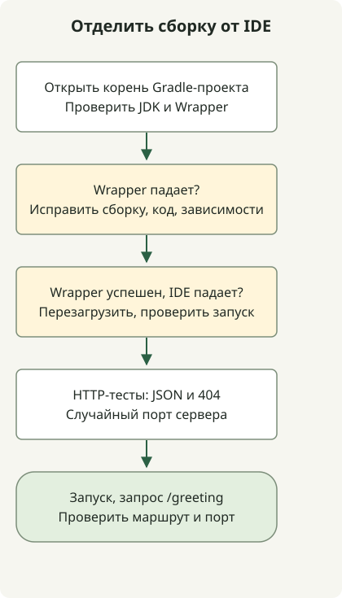

При открытии проекта Spring Boot в IntelliJ сначала проверьте синхронизацию Gradle и сравните сборку Wrapper с запуском IDE. Отсутствие кнопки запуска не всегда требует ручной конфигурации. Корректный Java main также можно запустить через [значок на полях редактора](https://www.jetbrains.com/help/idea/running-applications.html).

Руководство продолжает [пример Initializr](/en/posts/2023-09-07-springboot-initializer/) с Boot 4.1.2, Gradle 9.8.2 и Java 17. Сборка и HTTP-поведение проверены локально; шаги IDE сверены с документацией JetBrains. Это не утверждение о практической проверке интерфейса конкретного выпуска IDE.

## Порядок обработки



Используйте сборку Wrapper, чтобы отличить ошибки проекта от настройки IDE. HTTP-тесты используют случайный порт; ручной bootRun — настроенный.

## Проверьте проект и JDK

1. Через File → Open откройте корень распакованного проекта с `settings.gradle` и `build.gradle`.
2. Завершите синхронизацию Gradle. Сначала устраните ошибки загрузки зависимостей или синхронизации.
3. Выберите дистрибутив Wrapper проекта, затем проверьте Gradle JVM и Project SDK. Здесь оба используют JDK 17.
4. Выполните `./gradlew --version` и `./gradlew test` в терминале, чтобы получить результат вне IDE.

См. [руководство интеграции Gradle](https://www.jetbrains.com/help/idea/gradle.html) и [правила выбора Gradle JVM](https://www.jetbrains.com/help/idea/gradle-jvm-selection.html). Названия меню зависят от версии IDE и ОС. Project SDK, JVM для Gradle, Java toolchain и JRE конфигурации запуска — разные настройки, не всегда автоматически совпадающие.

## Добавьте эндпоинт и настоящие HTTP-тесты

Сохраните четыре существующих файла и добавьте эти два. Контроллер в пакете приложения `example.demo` остаётся в области сканирования компонентов.

### `src/main/java/example/demo/GreetingController.java`

```java
package example.demo;

import java.util.Map;
import org.springframework.web.bind.annotation.GetMapping;
import org.springframework.web.bind.annotation.RestController;

@RestController
public class GreetingController {
    @GetMapping("/greeting")
    public Map<String, String> greeting() {
        return Map.of("message", "Hello, Gradle");
    }
}
```

### `src/test/java/example/demo/GreetingHttpTest.java`

```java
package example.demo;

import java.net.URI;
import java.net.http.HttpClient;
import java.net.http.HttpRequest;
import java.net.http.HttpResponse;
import java.time.Duration;
import org.junit.jupiter.api.Test;
import org.springframework.beans.factory.annotation.Autowired;
import org.springframework.boot.test.context.SpringBootTest;
import org.springframework.core.env.Environment;

import static org.junit.jupiter.api.Assertions.*;

@SpringBootTest(webEnvironment = SpringBootTest.WebEnvironment.RANDOM_PORT)
class GreetingHttpTest {
    @Autowired Environment environment;

    HttpResponse<String> get(String path) throws Exception {
        String port = environment.getRequiredProperty("local.server.port");
        var request = HttpRequest.newBuilder(URI.create("http://127.0.0.1:" + port + path))
                .timeout(Duration.ofSeconds(10)).GET().build();
        return HttpClient.newHttpClient().send(request, HttpResponse.BodyHandlers.ofString());
    }

    @Test
    void greetingReturnsJson() throws Exception {
        var response = get("/greeting");
        assertEquals(200, response.statusCode());
        assertTrue(response.headers().firstValue("content-type").orElse("").contains("application/json"));
        assertEquals("{\"message\":\"Hello, Gradle\"}", response.body());
    }

    @Test
    void missingPathIsNotAnApplicationStartupFailure() throws Exception {
        assertEquals(404, get("/missing").statusCode());
    }
}
```

Теперь `./gradlew test` выполняет существующий контекстный тест и два HTTP-теста. HTTP-тесты запускают настоящий сервер на случайном порту и проверяют JSON и ответ 404 отсутствующего пути. Свободный локальный порт 8080 им не требуется.

## Сравните запуск через Gradle и Application

Запустите сервер первой командой, затем выполните вторую в другом терминале.

```sh
./gradlew bootRun --args='--server.port=8081'
```

```sh
curl --fail --show-error http://localhost:8081/greeting
```

```json
{"message":"Hello, Gradle"}
```

В IDE сначала попробуйте значок запуска рядом с `DemoApplication.main()`. Если нужна явная конфигурация, создайте Application через Run → Edit Configurations и проверьте значения.

| Настройка | Пример |
| --- | --- |
| Main class | `example.demo.DemoApplication` |
| Classpath module | Основной исходный модуль проекта, например `demo.main` |
| JRE | JDK 17 |
| Program arguments | `--server.port=8081` |

Если процесс уже занимает 8081, остановите его или выберите другой порт. Наличие специальных окон или конфигураций Boot не связано напрямую с запуском обычной конфигурации Java Application.

| Наблюдение | Что проверить сначала |
| --- | --- |
| Сборка Wrapper тоже падает | Совместимость JDK/Gradle, зависимости и ошибки исходного кода |
| Wrapper проходит, IDE падает | Перезагрузка Gradle, classpath модуля, JRE запуска и аргументы |
| Сервер запускается, но `/greeting` возвращает 404 | Пакет контроллера и путь mapping |
| Ошибка занятого порта | Существующие процессы и экземпляры запуска |

Если компиляция успешна, но IDE помечает сгенерированные методы как ошибки, перейдите к [проверкам Lombok и процессора аннотаций](/en/posts/2023-09-15-springboot-intellij-lombok/).
