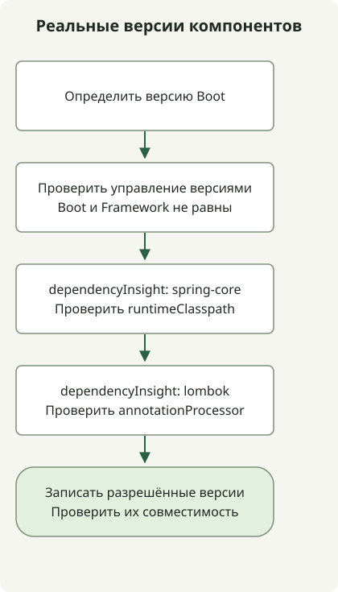

Spring Boot и Spring Framework — отдельные проекты с разными номерами версий. Boot добавляет к Framework автоконфигурацию, управление зависимостями и исполняемую упаковку. Поэтому трактовать Boot 3.1 как Framework 6.1 ненадёжно; проверяйте BOM выбранного выпуска Boot и разрешённый граф зависимостей.

## Порядок обработки



Схема показывает проверку зависимостей, а не хронологию выпусков. Boot, Framework и Lombok имеют отдельные версии и конфигурации зависимостей.

## Изменения выбранных финальных выпусков

Хронология выделяет изменения возможностей, а не перечисляет все выпуски. Отличайте первый финальный выпуск от расширенной совместимости JDK в последующих патчах.

| Spring Boot | Первый финальный выпуск | Избранные изменения и официальное объявление |
| --- | --- | --- |
| 1.2 | 2014-12-11 | [`@SpringBootApplication` и поддержка Servlet 3.1](https://spring.io/blog/2014/12/11/spring-boot-1-2-0-released/) |
| 1.3 | 2015-11-16 | [DevTools, автоконфигурация кэширования и напрямую исполняемые JAR](https://spring.io/blog/2015/11/16/spring-boot-1-3-0-released/) |
| 1.4 | 2016-07-28 | [Анализ ошибок запуска и улучшенное тестирование](https://spring.io/blog/2016/07/28/spring-boot-1-4-released/) |
| 2.0 | 2018-03-01 | [Framework 5.0, база Java 8 и реактивная веб-поддержка](https://spring.io/blog/2018/03/01/spring-boot-2-0-goes-ga/) |
| 3.0 | 2022-11-24 | [Framework 6.0, база Java 17, Jakarta и нативные образы](https://spring.io/blog/2022/11/24/spring-boot-3-0-goes-ga/) |
| 3.1 | 2023-05-18 | [Интеграция Testcontainers и Docker Compose при разработке](https://spring.io/blog/2023/05/18/spring-boot-3-1-0-available-now/) |
| 3.2 | 2023-11-23 | [Поддержка виртуальных потоков, RestClient и JdbcClient](https://spring.io/blog/2023/11/23/spring-boot-3-2-0-available-now/) |
| 4.0 | 2025-11-20 | [Framework 7, модульность, JSpecify и версионирование API](https://spring.io/blog/2025/11/20/spring-boot-4-0-0-available-now/) |

Например, [список управляемых зависимостей Boot 3.1.0](https://docs.spring.io/spring-boot/docs/3.1.0/reference/html/dependency-versions.html) задаёт `spring-core` 6.0.9. Совпадение младших номеров Boot и Framework не требуется. Сопоставлять Boot 2.4 с несуществующей веткой Framework 5.4 также неверно.

## Стартеры, BOM и плагины сборки

Стартер объединяет зависимости для некоторой возможности. BOM управляет версиями; он не добавляет все перечисленные библиотеки автоматически. Плагин сборки Boot предоставляет задачи вроде `bootRun` и упаковку исполняемого JAR.

Для Gradle [руководство управления зависимостями Boot](https://docs.spring.io/spring-boot/4.1/gradle-plugin/managing-dependencies.html) описывает плагин dependency-management и нативную поддержку BOM. Одного применения Boot plugin недостаточно, чтобы все конфигурации Gradle принимали зависимости без версий. Проверьте и отдельные конфигурации, например процессоры аннотаций.

## Проверьте реальные версии проекта

Выполните команды в итоговом проекте из руководств [Initializr](/en/posts/2023-09-07-springboot-initializer/) и [Lombok](/en/posts/2023-09-15-springboot-intellij-lombok/).

```sh
./gradlew dependencyInsight --configuration runtimeClasspath --dependency spring-core
./gradlew dependencyInsight --configuration annotationProcessor --dependency lombok
```

Локальный пример разрешает Boot 4.1.2, `spring-core` 7.0.10 и Lombok 1.18.48. Разные номера относятся к разным проектам. `dependencyInsight` показывает выбранную версию и определившие её пути зависимостей или правила, что полезно для поиска конфликтов. Значения фиксируют этот пример, а не будущие настройки по умолчанию или универсальную комбинацию.

Хронология не является актуальной таблицей сроков поддержки. При создании или обновлении проекта отдельно проверяйте требования выбранного выпуска, совместимость зависимостей и политику поддержки. См. [миграцию Java 17 и Jakarta](/en/posts/2023-09-08-springboot3-migration/) для перехода на Boot 3, а для локального запуска — [проверки IntelliJ и Gradle](/en/posts/2023-09-10-springboot-intellij-import/).
