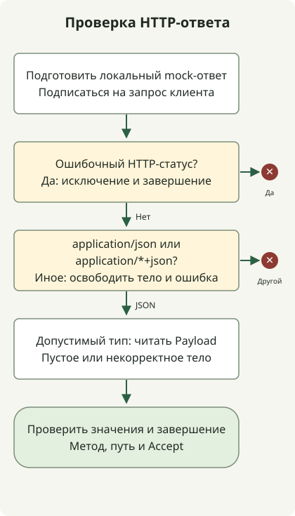

Тестируйте WebClient с локальным MockWebServer, проверяя вместе статус HTTP, Content-Type ответа, декодирование тела и завершение либо ошибку. Ответ `200 OK` с HTML может нарушить контракт клиента, хотя статус означает успех; отправка `Accept: application/json` не обязывает сервер отвечать JSON. Spring описывает [тестирование с mock-сервером](https://docs.spring.io/spring-framework/reference/6.2/web/webflux-webclient/client-testing.html) и настоящим HTTP-клиентом.

Тесты используют настоящий WebClient поверх локального HTTP, а не mock цепочки методов. Они охватывают контракты ответа ниже; производственные политики тайм-аутов и повторов требуют отдельных тестов.

## Порядок обработки



Клиент проверяет статус до типа содержимого, освобождает отклонённые тела и декодирует поддерживаемый JSON. StepVerifier проверяет завершение или ошибку вместе с выданными значениями.

## Подготовьте отдельный тестовый проект

Среда воспроизведения: JDK 17.0.8.1, Gradle 8.4, Spring Boot **3.5.7 BOM** и MockWebServer **4.12.0**. Они фиксируют зависимости примера, а не рекомендуемые актуальные версии. Это обычный тестовый Java-проект; работающее приложение Spring Boot не нужно.

В новом каталоге создайте `settings.gradle` с содержимым `rootProject.name = 'webclient-example'` и этот полный `build.gradle`:

```groovy
plugins { id 'java' }
repositories { mavenCentral() }
dependencies {
    testImplementation platform('org.springframework.boot:spring-boot-dependencies:3.5.7')
    testImplementation 'org.springframework.boot:spring-boot-starter-webflux'
    testImplementation 'org.springframework.boot:spring-boot-starter-test'
    testImplementation 'io.projectreactor:reactor-test'
    testImplementation 'com.squareup.okhttp3:mockwebserver:4.12.0'
    testRuntimeOnly 'org.junit.platform:junit-platform-launcher'
}
test { useJUnitPlatform() }
```

BOM задан явно, чтобы зависимости Spring и Reactor получили версии даже без Spring Boot Gradle plugin. Для приложения под управлением Boot адаптируйте тестовые зависимости к выбранному BOM приложения.

## Проверьте восемь контрактов ответа

Сохраните полный класс как `src/test/java/ExternalApiTest.java`:

```java
import java.io.IOException;
import java.time.Duration;
import java.util.concurrent.TimeUnit;
import okhttp3.mockwebserver.MockResponse;
import okhttp3.mockwebserver.MockWebServer;
import okhttp3.mockwebserver.RecordedRequest;
import org.junit.jupiter.api.AfterEach;
import org.junit.jupiter.api.BeforeEach;
import org.junit.jupiter.api.Test;
import org.springframework.http.MediaType;
import org.springframework.web.reactive.function.client.WebClient;
import reactor.core.publisher.Mono;
import reactor.test.StepVerifier;
import static org.junit.jupiter.api.Assertions.*;

class ExternalApiTest {
    private MockWebServer server;
    private WebClient client;
    record Payload(String message) {}

    @BeforeEach
    void start() throws IOException {
        server = new MockWebServer();
        server.start();
        client = WebClient.builder().baseUrl(server.url("/").toString()).build();
    }

    @AfterEach
    void stop() throws IOException {
        server.shutdown();
    }

    private Mono<Payload> fetch() {
        return client.get().uri("/employee/100")
            .accept(MediaType.APPLICATION_JSON)
            .exchangeToMono(response -> {
                if (response.statusCode().isError()) {
                    return response.createException().flatMap(Mono::error);
                }
                boolean json = response.headers().contentType()
                    .map(type -> "application".equals(type.getType())
                        && ("json".equals(type.getSubtype())
                            || type.getSubtype().endsWith("+json")))
                    .orElse(false);
                if (!json) {
                    return response.releaseBody().then(Mono.<Payload>error(
                        new IllegalStateException("Expected JSON response")));
                }
                return response.bodyToMono(Payload.class);
            });
    }

    @Test
    void rejectsHtmlEvenWhenStatusIs200() throws Exception {
        server.enqueue(new MockResponse().setResponseCode(200)
            .setHeader("Content-Type", "text/html; charset=UTF-8")
            .setBody("<html><body>Unknown failure</body></html>"));
        StepVerifier.create(fetch())
            .expectErrorMatches(error -> error instanceof IllegalStateException
                && error.getMessage().equals("Expected JSON response"))
            .verify(Duration.ofSeconds(5));
        RecordedRequest request = server.takeRequest(1, TimeUnit.SECONDS);
        assertNotNull(request);
        assertEquals("GET", request.getMethod());
        assertEquals("/employee/100", request.getPath());
        assertEquals("application/json", request.getHeader("Accept"));
    }

    @Test
    void preservesHttp500Error() {
        server.enqueue(new MockResponse().setResponseCode(500)
            .setHeader("Content-Type", "text/html")
            .setBody("<html>Unknown failure</html>"));
        StepVerifier.create(fetch())
            .expectError(org.springframework.web.reactive.function.client.WebClientResponseException.InternalServerError.class)
            .verify(Duration.ofSeconds(5));
    }

    @Test
    void decodesJson() {
        server.enqueue(new MockResponse().setResponseCode(200)
            .setHeader("Content-Type", "application/json")
            .setBody("{\"message\":\"ok\"}"));
        StepVerifier.create(fetch())
            .expectNextMatches(payload -> payload.message().equals("ok"))
            .expectComplete().verify(Duration.ofSeconds(5));
    }

    @Test
    void rejectsMissingContentType() {
        server.enqueue(new MockResponse().setResponseCode(200)
            .setBody("{\"message\":\"ok\"}"));
        StepVerifier.create(fetch())
            .expectErrorMatches(error -> error instanceof IllegalStateException
                && error.getMessage().equals("Expected JSON response"))
            .verify(Duration.ofSeconds(5));
    }

    @Test
    void rejectsMalformedJson() {
        server.enqueue(new MockResponse().setResponseCode(200)
            .setHeader("Content-Type", "application/json").setBody("{broken"));
        StepVerifier.create(fetch())
            .expectError(org.springframework.core.codec.DecodingException.class)
            .verify(Duration.ofSeconds(5));
    }

    @Test
    void decodesStructuredJsonSubtype() {
        server.enqueue(new MockResponse().setResponseCode(200)
            .setHeader("Content-Type", "application/vnd.example+json")
            .setBody("{\"message\":\"ok\"}"));
        StepVerifier.create(fetch())
            .expectNextMatches(payload -> payload.message().equals("ok"))
            .expectComplete().verify(Duration.ofSeconds(5));
    }

    @Test
    void completesWithoutPayloadForEmptyJsonBody() {
        server.enqueue(new MockResponse().setResponseCode(200)
            .setHeader("Content-Type", "application/json"));
        StepVerifier.create(fetch())
            .expectComplete().verify(Duration.ofSeconds(5));
    }

    @Test
    void rejectsNonApplicationJsonSubtype() {
        server.enqueue(new MockResponse().setResponseCode(200)
            .setHeader("Content-Type", "text/example+json")
            .setBody("{\"message\":\"ok\"}"));
        StepVerifier.create(fetch())
            .expectErrorMatches(error -> error instanceof IllegalStateException
                && error.getMessage().equals("Expected JSON response"))
            .verify(Duration.ofSeconds(5));
    }
}
```

Выполните с выбранным JDK 17 и установленным Gradle 8.4:

```sh
java -version
gradle --version
gradle --no-daemon test
```

Все восемь тестов должны пройти. Откройте `build/reports/tests/test/index.html` для результатов по каждому тесту; вывод задачи Gradle не обязан перечислять все успешные тесты.

| Ответ | Результат по контракту примера |
| --- | --- |
| HTTP 200, тело JSON | Декодировать данные. |
| HTTP 200, тело HTML | Отклонить неожиданный тип содержимого. |
| HTTP 500, тело HTML | Сохранить тип HTTP-ошибки. |
| HTTP 200, нет Content-Type | Отклонить неуказанный формат ответа. |
| HTTP 200, некорректный JSON | Сообщить об ошибке декодирования. |
| HTTP 200, `application/vnd.example+json` | Декодировать совместимый JSON. |
| HTTP 200, пустое тело JSON | Завершить без выдачи данных. |
| HTTP 200, `text/example+json` | Отклонить тип содержимого вне application. |

Поведение пустого тела намеренно задано контрактом примера. Если эндпоинту нужны данные, добавьте `switchIfEmpty(Mono.error(...))` и измените тест на ожидание ошибки приложения.

<span id="why-status-and-decoding-are-checked-separately"></span>

## Почему HTTP 200 может не пройти проверку ответа?

`fetch()` обрабатывает ошибочные статусы до проверки формата успешного ответа. `createException()` сохраняет HTTP 500 как `WebClientResponseException.InternalServerError`. Ошибка соединения обычно идёт через `WebClientRequestException`; это не HTTP-ответ сервера.

Для неошибочного статуса код принимает типы `application/json` и `application/*+json`, затем передаёт проверку тела декодеру. Поэтому неверный Content-Type и некорректный JSON дают разные ошибки. Это пример контракта, а не полная политика перенаправлений и всех успешных статусов.

Отклоняя успешный ответ, код освобождает тело до сообщения об ошибке приложения. При `exchangeToMono` потребляйте или обрабатывайте тело внутри callback; [документация exchange Spring](https://docs.spring.io/spring-framework/reference/6.2/web/webflux-webclient/client-exchange.html) объясняет освобождение непрочитанного тела после завершения.

`setBody(html)` отправляет HTML напрямую. Предварительная сериализация строки в JSON изменила бы проверяемый ответ. Проверки записанного запроса также сверяют реально отправленные метод, путь и заголовок `Accept`.

`verify(Duration.ofSeconds(5))` ограничивает ожидание каждого теста. Он не настраивает тайм-ауты соединения и ответа производственного клиента. Добавьте проверки транспортных тайм-аутов и повторов по контракту API; эти восемь случаев их не охватывают.

Все восемь тестов прошли в указанной среде. В этом репозитории `python3 scripts/check_webclient_example.py` повторяет проверку. Для проекта, переходящего на Jakarta, сначала установите [исходную проверку миграции Spring Boot](/en/posts/2023-09-08-springboot3-migration/), затем меняйте поведение клиента.

Эти клиентские тесты используют локальный mock-сервер; они не проверяют статические файлы развёрнутого приложения. Если приложение упаковывает Vue, [пример упаковки интерфейса Gradle](/en/posts/2021-07-23-multiple-gradle-build/) проверяет исполняемый JAR и ответы HTML/JavaScript. Примеры фиксируют разные среды; не объединяйте их без согласования зависимостей.

Справочник MockWebServer: [исходный код и примеры OkHttp 4.12.0](https://github.com/square/okhttp/tree/parent-4.12.0/mockwebserver).

Для ограничений времени и числа повторов продолжите [тестами тайм-аутов и ограниченных повторов WebClient](/en/posts/2026-10-30-webclient-timeout-retry/). Там повторяются только GET-ответы со статусом 503, а ограничения попытки отделены от общего бюджета повторов.
