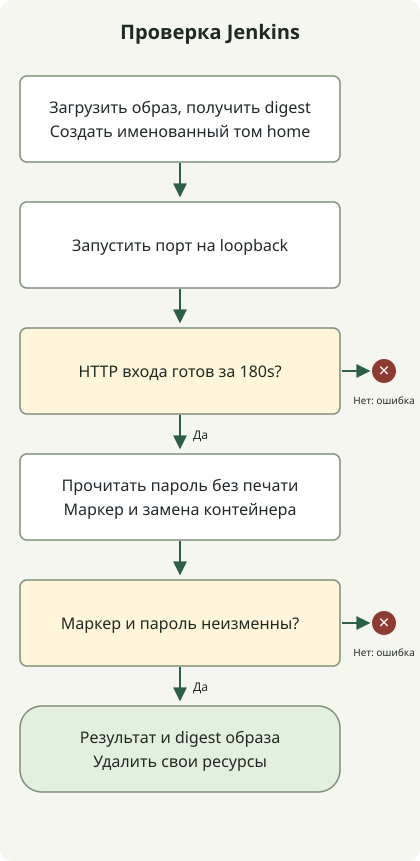

Запустите Jenkins с именованным домашним томом, проверьте HTTP-эндпоинт и пересоздайте контейнер с тем же томом. Экран настройки подтверждает запуск контроллера; повторный запуск проверяет сохранение домашних данных при замене контейнера.

Плавающий тег позже может указывать на другой образ. Один раз определите образ для эксперимента и сохраните начальный пароль в тайне. Временная лаборатория сообщает результаты сравнения без печати пароля.

## Закрепите образ для одного эксперимента



Нужны Python3 и Docker engine с Linux-контейнерами. [Инструкция образа Jenkins](https://github.com/jenkinsci/docker/blob/master/README.md) описывает `jenkins/jenkins` и домашний каталог. Лаборатория начинает с `jenkins/jenkins:lts-jdk21`, загружает образ и определяет digest репозитория. Каждый контроллер запуска использует digest без повторного поиска плавающего тега. При воспроизведении сохраните digest и полученную версию Jenkins; тег не задаёт постоянный выпуск.

[Публикация портов Docker](https://docs.docker.com/engine/network/port-publishing/) определяет доступ к сопоставленному порту. Скрипт запрашивает `127.0.0.1::8080`: Docker выбирает порт хоста на loopback, затем скрипт проверяет привязку. Он не публикует порт агента и не монтирует Docker socket. Это локальная лаборатория контроллера, а не установка Docker build agents или удалённого HTTPS-сервиса.

## Выполните полную лабораторию

Сохраните полный файл как `jenkins_lab.py`. Он создаёт собственные том и контейнеры с уникальными именами. Менеджер контекста удаляет эти ресурсы после теста, в том числе при ошибке готовности или проверки данных. Не подставляйте производственный том в этот временный пример.

### `jenkins_lab.py`

```python
import http.client
import json
import os
import subprocess
import time
import urllib.error
import urllib.request
import uuid


class DockerLab:
    def __init__(self):
        self.prefix = 'jenkins-proof-' + uuid.uuid4().hex[:12]
        self.containers, self.volumes = [], []

    def cli(self, *args):
        return subprocess.check_output(['docker', *args], text=True, stderr=subprocess.PIPE).strip()

    def volume(self):
        name = f'{self.prefix}-home-{len(self.volumes)}'
        existing = subprocess.run(['docker', 'volume', 'inspect', name], capture_output=True)
        if existing.returncode == 0:
            raise RuntimeError('Refusing an existing volume')
        self.cli('volume', 'create', name)
        self.volumes.append(name)
        return name

    def __enter__(self):
        self.cli('info')
        requested = os.environ.get('JENKINS_IMAGE', 'jenkins/jenkins:lts-jdk21')
        self.cli('pull', requested)
        self.image = self.cli('image', 'inspect', requested, '--format', '{{index .RepoDigests 0}}')
        if '@sha256:' not in self.image:
            raise RuntimeError('Expected a pulled repository digest')
        self.home = self.volume()
        return self

    def start(self, volume=None):
        name = f'{self.prefix}-controller-{len(self.containers)}'
        self.cli('run', '-d', '--name', name, '-p', '127.0.0.1::8080',
                 '--mount', f'type=volume,source={volume or self.home},target=/var/jenkins_home', self.image)
        self.containers.append(name)
        port = self.cli('port', name, '8080/tcp')
        if not port.startswith('127.0.0.1:'):
            raise RuntimeError('Expected a loopback binding')
        deadline = time.monotonic() + 180
        while time.monotonic() < deadline:
            try:
                with urllib.request.urlopen(f'http://{port}/login', timeout=5) as response:
                    self.version = response.headers.get('X-Jenkins')
                    if response.status == 200 and self.version and b'Jenkins' in response.read():
                        return name
            except (urllib.error.URLError, TimeoutError, ConnectionError, http.client.HTTPException):
                pass
            time.sleep(2)
        raise RuntimeError('Jenkins login was not ready within 180 seconds')

    def password(self, name):
        return self.cli('exec', name, 'cat', '/var/jenkins_home/secrets/initialAdminPassword')

    def marker(self, name):
        return self.cli('exec', name, 'cat', '/var/jenkins_home/lab-marker')

    def __exit__(self, *_):
        for name in reversed(self.containers):
            subprocess.run(['docker', 'rm', '-f', name], capture_output=True)
        for name in reversed(self.volumes):
            subprocess.run(['docker', 'volume', 'rm', name], capture_output=True)


if __name__ == '__main__':
    with DockerLab() as lab:
        first = lab.start()
        password = lab.password(first)
        assert password, 'Missing initial password'
        lab.cli('exec', first, 'sh', '-c', 'printf kept > /var/jenkins_home/lab-marker')
        lab.cli('rm', '-f', first)
        second = lab.start()
        assert lab.marker(second) == 'kept'
        assert lab.password(second) == password
        print(json.dumps({'image': lab.image, 'jenkins': lab.version, 'recreated': True,
                          'markerPersisted': True, 'passwordPersisted': True, 'result': 'passed'}))
```

Запустите с работающим Docker daemon:

```sh
python3 jenkins_lab.py
```

Каждый из двух запусков ждёт до 180 секунд HTTP200 на `/login`, заголовок `X-Jenkins` и тело с `Jenkins`. Сбросы соединений, временные HTTP-ошибки и незавершённые HTTP-handshake повторяются в пределах срока. Тест записывает маркер и приватно читает начальный пароль, заменяет первый контейнер и снова сверяет оба значения. Результат с `recreated`, `markerPersisted`, `passwordPersisted` и `result: passed` означает прохождение выбранных проверок. JSON также фиксирует digest и фактическую версию Jenkins; вымышленная расшифровка загрузки не нужна.

Лаборатория не разблокирует Jenkins, не ставит плагины, не завершает создание администратора и не запускает задания. Готовность проверяется по HTTP-ответу входа, а не завершённой настройке. На Mac без работающего Docker engine сначала запустите выбранный движок; одного Docker CLI недостаточно.

## Разделяйте установку и сохранность данных

Для интерактивной установки следуйте [официальному мастеру](https://www.jenkins.io/doc/book/installing/docker/) и создайте администратора. Читайте начальный пароль из `/var/jenkins_home/secrets/initialAdminPassword` своего контроллера; не используйте пример пароля и не публикуйте журналы с ним. Скрипт намеренно удаляет лабораторию и не подходит для сохранения интерактивной установки.

[Именованный том Docker](https://docs.docker.com/engine/storage/volumes/) переживает удаление контейнера, но не является резервной копией: потеря тома уничтожает данные. [Лаборатория резервирования и восстановления остановленного тома](/en/posts/2026-10-27-jenkins-home-backup-restore/) продолжает работу с тем же образом и другим целевым томом. Для процесса публикации блога см. [Astro Draft PR workflow](/en/posts/2026-04-07-jekyll-github-actions-content-pipeline/); пример Jenkins его не заменяет.
