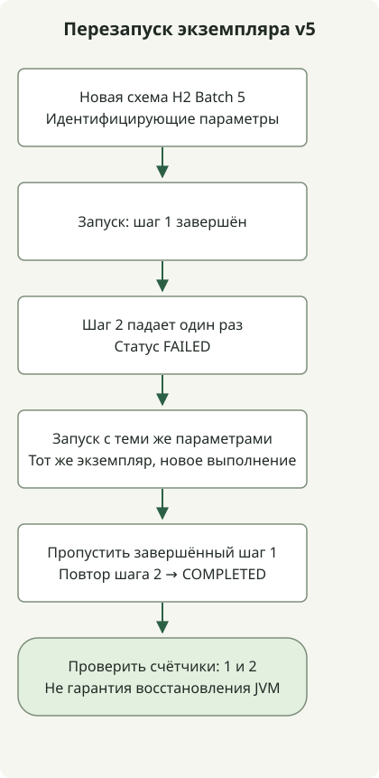

Миграция на Spring Batch 5 требует проверки схемы метаданных, формата сохранённых параметров Job, контекстов выполнения и политики перезапуска вместе с зависимостями. Удаление заполненных колонок вначале или простая замена кодов типов именами классов не завершает миграцию данных.

Статья рассматривает переход на Batch 5, а не новейшую основную версию. [Официальное руководство 5.0](https://github.com/spring-projects/spring-batch/wiki/Spring-Batch-5.0-Migration-Guide) определяет вопросы миграции; пример ниже проверяет поведение выполнения в среде Batch 5.

## Порядок обработки



Схема показывает тест перезапуска v5 с новой схемой, а не миграцию БД v4. Второе выполнение того же экземпляра повторяет ошибочный шаг; завершённый остаётся завершённым.

## До изменения существующего репозитория

Batch 5 требует Java 17 или новее. Переносите Java EE API `javax.*` на Jakarta, не заменяя Java SE API вроде `javax.sql.DataSource`.

`TYPE_CD` и колонки значений отдельных типов старой таблицы параметров отличаются от нового представления `PARAMETER_TYPE` и `PARAMETER_VALUE`. Одна замена `LONG` на `java.lang.Long` не сохраняет и не переинтерпретирует правильно существующие LONG, DOUBLE и DATE. Отрепетируйте преобразование на копии БД с целевой БД и версией Batch. Найдите [схемы и миграционные скрипты для своей БД в Core JAR](https://docs.spring.io/spring-batch/reference/5.2/schema-appendix.html). Повторный запуск скрипта новой схемы по производственным таблицам не заменяет миграцию.

Руководство также описывает [ограничения доступа к истории](https://github.com/spring-projects/spring-batch/wiki/Spring-Batch-5.0-Migration-Guide#historical-data-access-implications): некоторые вызовы JobExplorer v5 могут падать при чтении выполнений v4. Ошибочные экземпляры v4 должны успешно перезапускаться под v4 либо быть оставлены по решению бизнеса до миграции. Не считайте, что v5 может напрямую перезапустить старое ошибочное выполнение v4. Совместимость сериализации контекста проверяйте отдельно от преобразования параметров.

## Выберите исходную точку миграции

- **Существующий репозиторий Batch 4:** сделайте резервную копию и отрепетируйте преобразование схемы, параметров и контекстов на копии БД. Разрешите ошибочные экземпляры v4 под v4. Пример ниже не преобразует и не перезапускает репозиторий v4.
- **Новый репозиторий Batch 5:** выполните тесты типизированных параметров, завершённого экземпляра и ошибочного шага. Они проверяют три поведения в новой схеме H2 внутри одного процесса.
- **Приложение Boot с заданиями Batch:** решите, управляет настройкой и инициализацией схемы Boot или явная конфигурация Batch. Пример использует явную конфигурацию Spring, не автоконфигурацию Boot.

Если это также смена основной версии Boot, установите [исходную проверку Java и Jakarta](/en/posts/2023-09-08-springboot3-migration/) отдельно от миграции репозитория.

## Проверка нового репозитория Batch 5

Воспроизведение использует Gradle 8.4/JDK 17.0.8.1, Batch 5.2.4 и H2 2.3.232 под управлением Boot BOM 3.5.7. Версии фиксируют свидетельство выполнения, а не текущие производственные рекомендации. Сохраните три файла в пустом каталоге.

Проект создаёт тестовый контекст Spring напрямую, без запуска Boot. Он использует `@EnableBatchProcessing` и предоставляет DataSource и менеджер транзакций. Он не наследует одновременно `DefaultBatchConfiguration`; [документация Java-конфигурации](https://docs.spring.io/spring-batch/reference/5.2/job/java-config.html) описывает их как альтернативы.

### `settings.gradle`

```groovy
rootProject.name = 'batch5-restart-example'
```

### `build.gradle`

```groovy
plugins { id 'java' }
repositories { mavenCentral() }
dependencies {
    testImplementation platform('org.springframework.boot:spring-boot-dependencies:3.5.7')
    testImplementation 'org.springframework.batch:spring-batch-core'
    testImplementation 'org.springframework:spring-jdbc'
    testImplementation 'com.h2database:h2'
    testImplementation 'org.junit.jupiter:junit-jupiter'
    testRuntimeOnly 'org.junit.platform:junit-platform-launcher'
}
test { useJUnitPlatform() }
```

### `src/test/java/example/BatchRestartTest.java`

```java
package example;

import java.util.Date;
import java.util.Set;
import java.util.concurrent.atomic.AtomicBoolean;
import java.util.concurrent.atomic.AtomicInteger;
import javax.sql.DataSource;

import org.junit.jupiter.api.AfterEach;
import org.junit.jupiter.api.BeforeEach;
import org.junit.jupiter.api.Test;
import org.springframework.batch.core.BatchStatus;
import org.springframework.batch.core.Job;
import org.springframework.batch.core.JobExecution;
import org.springframework.batch.core.JobParameters;
import org.springframework.batch.core.JobParametersBuilder;
import org.springframework.batch.core.Step;
import org.springframework.batch.core.configuration.annotation.EnableBatchProcessing;
import org.springframework.batch.core.job.builder.JobBuilder;
import org.springframework.batch.core.launch.JobLauncher;
import org.springframework.batch.core.repository.JobInstanceAlreadyCompleteException;
import org.springframework.batch.core.repository.JobRepository;
import org.springframework.batch.core.step.builder.StepBuilder;
import org.springframework.batch.repeat.RepeatStatus;
import org.springframework.beans.factory.annotation.Qualifier;
import org.springframework.context.annotation.AnnotationConfigApplicationContext;
import org.springframework.context.annotation.Bean;
import org.springframework.context.annotation.Configuration;
import org.springframework.jdbc.core.JdbcTemplate;
import org.springframework.jdbc.datasource.DataSourceTransactionManager;
import org.springframework.jdbc.datasource.embedded.EmbeddedDatabase;
import org.springframework.jdbc.datasource.embedded.EmbeddedDatabaseBuilder;
import org.springframework.jdbc.datasource.embedded.EmbeddedDatabaseType;
import org.springframework.transaction.PlatformTransactionManager;

import static org.junit.jupiter.api.Assertions.*;

class BatchRestartTest {
    AnnotationConfigApplicationContext context;
    Config config;
    JobLauncher launcher;
    Job job;

    @BeforeEach
    void open() {
        context = new AnnotationConfigApplicationContext(Config.class);
        config = context.getBean(Config.class);
        launcher = context.getBean(JobLauncher.class);
        job = context.getBean(Job.class);
    }

    @AfterEach
    void close() { context.close(); }

    JobParameters parameters() {
        return new JobParametersBuilder()
                .addLong("run.id", 1L)
                .addString("source", "example")
                .addDouble("ratio", 1.5)
                .addDate("day", new Date(0))
                .toJobParameters();
    }

    @Test
    void completedJobPersistsTypedParameters() throws Exception {
        JobExecution execution = launcher.run(job, parameters());
        assertEquals(BatchStatus.COMPLETED, execution.getStatus());
        var jdbc = new JdbcTemplate(context.getBean(DataSource.class));
        var types = jdbc.queryForList("select PARAMETER_TYPE from BATCH_JOB_EXECUTION_PARAMS", String.class);
        assertEquals(Set.of("java.lang.Long", "java.lang.String", "java.lang.Double", "java.util.Date"), Set.copyOf(types));
        assertEquals(4, types.size());
        assertEquals("1", jdbc.queryForObject("select PARAMETER_VALUE from BATCH_JOB_EXECUTION_PARAMS where PARAMETER_NAME = 'run.id'", String.class));
    }

    @Test
    void completedInstanceRejectsSameIdentifyingParameters() throws Exception {
        assertEquals(BatchStatus.COMPLETED, launcher.run(job, parameters()).getStatus());
        assertThrows(JobInstanceAlreadyCompleteException.class, () -> launcher.run(job, parameters()));
        assertEquals(1, config.firstRuns.get());
        assertEquals(1, config.secondRuns.get());
    }

    @Test
    void failedInstanceRestartsOnlyItsFailedStep() throws Exception {
        config.failOnce.set(true);
        JobExecution failed = launcher.run(job, parameters());
        assertEquals(BatchStatus.FAILED, failed.getStatus());
        JobExecution restarted = launcher.run(job, parameters());
        assertEquals(BatchStatus.COMPLETED, restarted.getStatus());
        assertEquals(failed.getJobInstance().getInstanceId(), restarted.getJobInstance().getInstanceId());
        assertNotEquals(failed.getId(), restarted.getId());
        assertEquals(1, config.firstRuns.get());
        assertEquals(2, config.secondRuns.get());
    }

    @Configuration
    @EnableBatchProcessing
    static class Config {
        final AtomicInteger firstRuns = new AtomicInteger();
        final AtomicInteger secondRuns = new AtomicInteger();
        final AtomicBoolean failOnce = new AtomicBoolean();

        @Bean(destroyMethod = "shutdown")
        EmbeddedDatabase dataSource() {
            return new EmbeddedDatabaseBuilder().generateUniqueName(true)
                    .setType(EmbeddedDatabaseType.H2)
                    .addScript("org/springframework/batch/core/schema-h2.sql").build();
        }

        @Bean
        PlatformTransactionManager transactionManager(DataSource dataSource) {
            return new DataSourceTransactionManager(dataSource);
        }

        @Bean
        Step firstStep(JobRepository repository, PlatformTransactionManager transactionManager) {
            return new StepBuilder("first", repository).tasklet((contribution, chunkContext) -> {
                firstRuns.incrementAndGet();
                return RepeatStatus.FINISHED;
            }, transactionManager).build();
        }

        @Bean
        Step secondStep(JobRepository repository, PlatformTransactionManager transactionManager) {
            return new StepBuilder("second", repository).tasklet((contribution, chunkContext) -> {
                secondRuns.incrementAndGet();
                if (failOnce.getAndSet(false)) throw new IllegalStateException("fixture failure");
                return RepeatStatus.FINISHED;
            }, transactionManager).build();
        }

        @Bean
        Job job(JobRepository repository, @Qualifier("firstStep") Step first,
                @Qualifier("secondStep") Step second) {
            return new JobBuilder("migrationCheck", repository).start(first).next(second).build();
        }
    }
}
```

## Запуск и толкование проверок

```sh
gradle --no-daemon clean test
```

Три теста проверяют хранение типизированных параметров в новой H2, отклонение завершённого экземпляра с теми же идентифицирующими параметрами и новое выполнение того же ошибочного экземпляра с повтором только неудавшегося Step. При перезапуске первый Step выполняется один раз, второй — дважды. Счётчики живут в одном процессе: это не доказывает восстановление после перезапуска JVM или exactly-once внешних эффектов.

Пример **не преобразует БД v4 в v5**. Для производственной миграции сначала обеспечьте резервирование и восстановление, затем проверьте значения каждого типа, доступ к истории, контексты и бизнес-процедуры перезапуска на копии БД. Прохождение тестов новой схемы не подтверждает совместимость существующих данных.

При применении конфигурации к Boot есть ещё нюанс: [руководство Batch в Boot](https://docs.spring.io/spring-boot/3.5/how-to/batch.html) указывает, что добавление `@EnableBatchProcessing` или наследование `DefaultBatchConfiguration` отключает автоконфигурацию Batch и её инициализацию схемы. Решите, сохранить автоконфигурацию Boot или управлять напрямую.

О связанных решениях среды выполнения см. [финальные и preview-возможности JDK 21](/en/posts/2023-09-20-jdk-21-release/). О типизированном вводе конфигурации — [чтение YAML-порта из shell-скрипта](/en/posts/2021-07-27-parse-yaml/).
