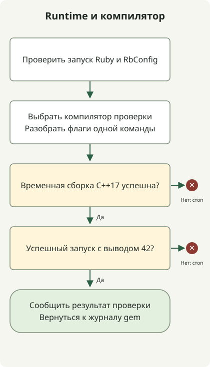

Разделяйте запуск Ruby и компиляцию нативного расширения. Работающий `ruby --version` не доказывает, что компилятор C++ найдёт заголовки; успешная отдельная C++-программа не доказывает компиляцию расширения gem.

Исходная запись касалась пути библиотеки Ruby другого пользователя и проблемы SDK/заголовков macOS. Это разные виды ошибок. Диагностика ниже сохраняет различие без удаления Ruby, смены Command Line Tools и глобальной подмены RbConfig. Сайт теперь использует Astro; проверки относятся к сохранённым инструментам Ruby.

## Начните с ошибочного уровня



Сначала сравните выбранный Ruby с записанной конфигурацией его сборки:

```sh
command -v ruby
ruby --version
rbenv which ruby
ruby -rrbconfig -e 'puts RbConfig.ruby; puts RbConfig::CONFIG.values_at("CXX", "CPPFLAGS", "CXXFLAGS")'
```

Если Ruby сам не запускается из-за отсутствующей библиотеки, изучите интерпретатор и связи библиотек до установки gem. На macOS `otool -L` проверяет исполняемый файл, выбранный `rbenv which ruby`. Не переустанавливайте все версии Ruby только из-за ошибки нативного gem.

[RbConfig](https://docs.ruby-lang.org/en/3.2/RbConfig.html) показывает конфигурацию сборки интерпретатора. В проверенной Ruby3.2.2 значение `CXX` было `false`, тогда как явно выбранный `c++` работал с подходящими флагами заголовков. Наблюдение относится к этому интерпретатору и хосту, не ко всем rbenv. Ruby3.2 уже [снят с поддержки](https://www.ruby-lang.org/en/downloads/branches/); это диагностика старой среды, не поддерживаемая основа.

## Компилируйте без изменения конфигурации Ruby

Сохраните полный скрипт стандартной библиотеки Ruby как `native_probe.rb`:

```ruby
require 'rbconfig'
require 'open3'
require 'shellwords'
require 'tmpdir'
require 'json'

compiler = Shellwords.split(ENV.fetch('CXX', 'c++'))
abort 'CXX must name a compiler' if compiler.empty?
flags = Shellwords.split(ENV.fetch('PROBE_CXXFLAGS', ''))
Dir.mktmpdir('ruby-cxx-probe-') do |root|
  source = File.join(root, 'probe.cpp')
  binary = File.join(root, 'probe')
  File.write(source, "#include <iostream>\nint main() { std::cout << 42 << '\\n'; }\n")
  _out, error, status = Open3.capture3(*compiler, '-std=c++17', *flags, source, '-o', binary)
  abort "C++ compilation failed:\n#{error}" unless status.success?
  output, error, status = Open3.capture3(binary)
  abort "Probe failed: #{error}" unless status.success? && output == "42\n"
  puts JSON.generate('ruby' => RUBY_VERSION, 'configured_cxx' => RbConfig::CONFIG['CXX'],
                     'probe_compiler' => compiler, 'output' => output.strip, 'result' => 'passed')
end
```

Запустите с выбранным компилятором проверки:

```sh
ruby native_probe.rb
```

Скрипт компилирует временную C++17-программу и требует ровно `42` в выводе. `CXX` выбирает команду проверки, `PROBE_CXXFLAGS` задаёт только её флаги. Скрипт выводит CXX конфигурации Ruby для сравнения, не заменяя его. Пустой `CXX`, ошибка компиляции или неожиданный вывод дают ненулевой код.

На проверенном Mac обычный запуск падал из-за отсутствия `iostream`. После проверки выбранного SDK и наличия каталога заголовков следующие флаги для одной команды обеспечили успех:

```sh
probe_sdk="$(xcrun --show-sdk-path)"
test -d "$probe_sdk/usr/include/c++/v1"
PROBE_CXXFLAGS="-isysroot $probe_sdk -isystem $probe_sdk/usr/include/c++/v1" ruby native_probe.rb
```

Путь проверен на том Mac. Это не универсальное исправление SDK; пути с пробелами требуют правильно заключённых в кавычки токенов внутри значения флагов. Начните с `xcode-select -p` и `xcrun --show-sdk-path`; не устанавливайте именованный пакет CLT из старого примера. [Руководство Apple](https://developer.apple.com/library/archive/technotes/tn2339/_index.html) объясняет каталог разработчика и SDK-инструменты.

## Вернитесь к реальной ошибке gem

Успешная проверка сужает поиск; расширение может использовать другие флаги, заголовки, библиотеки или ABI. Сохраните журнал сборки gem и сравните реально вызванную команду. `scripts/ruby_cxx_fix.rb` репозитория меняет RbConfig внутри процесса Ruby при явной загрузке; запасной путь Homebrew зависит от хоста. Применяйте обход только после сопоставления ошибки; сохраняйте существующие RUBYOPT, не перезаписывая вслепую.

Локальный успех не переустановил Ruby и не пересобрал нативные gem старого сайта. Для следующего уровня используйте [изолированный двухстраничный Jekyll bundle](/en/posts/2023-09-04-jekyll-install/). Для действующего сайта — [руководство контролей Astro](/en/posts/2026-04-07-jekyll-quality-gates-proof-html-bundler-audit/).
