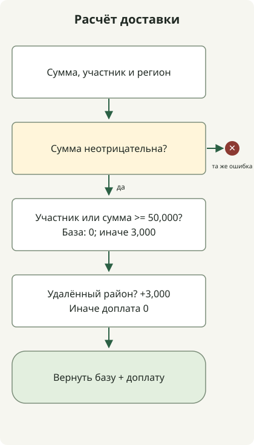

**Рефакторинг с ИИ-агентом начинается с определения сохраняемого поведения и области изменений, затем проверяет результат выполнением и diff.** Более короткая функция или сообщение «тесты прошли» не означают завершения. Проверьте сохранение значений, исключений и внешних эффектов и отсутствие ослабления самой проверки.

Руководство не зависит от инструмента и адресовано знакомым с Git и тестами. Конкретные интерфейс и модель не предполагаются. Запросы ниже — написанные примеры для копирования и адаптации, не диалоги продукта и не измерения производительности. Результаты выполнения Java выделены отдельно.

## Что включить в первый запрос?

[Мартин Фаулер определяет рефакторинг](https://refactoring.com/) как изменение внутренней структуры с сохранением наблюдаемого снаружи поведения. Если нужна новая политика или исправление ошибки, отделите их для оценки разницы до и после.

Передайте агенту файлы, вызывающий код, связанные тесты, соглашения репозитория и реальные команды проверки. Вместо безусловного чтения всего репозитория начните с нужных путей. Описание текущего поведения и оснований без правок сначала снижает риск расширения изменений из-за непонимания.

Политика доставки ниже — **требования для иллюстрации**, не реальная политика или отчёт об инциденте.

| Условие | Сохраняемое поведение |
| --- | --- |
| Отрицательная сумма заказа | Выбросить `IllegalArgumentException("subtotal")` |
| Участник или сумма не менее 50,000 KRW | Базовая доставка 0 KRW |
| Иначе | Базовая доставка 3,000 KRW |
| Островная или удалённая доставка | Добавить 3,000 KRW независимо от бесплатной базы |

Первый запрос можно написать так. Предположим, полный код далее сохранён как `ShippingRefactorDemo.java`. Для практики сначала скопируйте тело `before()` в `after()`. Полный пример ниже включает завершённый рефакторинг для сравнения.

```text
Прочитай before(), after() и main() в ShippingRefactorDemo.java и только проанализируй.
Пока не изменяй файлы.

Цель: сократить вложенные ветви after(), сохранив расчёт доставки before().
Входные суммы в KRW, используется long.
Проверь тип и сообщение исключения отрицательной суммы, границу 50,000 KRW,
сочетания бесплатной базовой доставки и доплаты удалённого района.

Укажи кодовые основания текущего поведения, уже охваченные тесты,
дополнительные граничные случаи и минимальное изменение только after().
Не меняй неясные правила на основе догадок.
```

Здесь нужен результат по каждому условию и места изменений, а не абстрактный «план качества». Например, «участники всегда платят 0 KRW» противоречит доплате удалённого района; исправьте понимание до реализации.

## Сделайте небольшое изменение и сравните поведение

Пример **разделяет расчёт базовой доставки и доплаты** из дублирующихся веток. Сохраняются входы, выходы и исключения без интерфейса стратегии и конфигурационного слоя. Небольшой diff помогает проверить изменение структуры без политики. [Рекомендации Google](https://google.github.io/eng-practices/review/developer/small-cls.html)



Схема показывает расчёт `after()`, не внутренности ИИ-инструмента. `before()` и `after()` иллюстративны; `main()` проверяет явные ожидания и сравнивает результаты. Работает на JDK 21 или новее без внешних зависимостей.

```java
public class ShippingRefactorDemo {
    static final long FREE_THRESHOLD = 50_000;
    record Case(long subtotal, boolean member, boolean remote, long expected) {}

    static long before(long subtotal, boolean member, boolean remote) {
        if (subtotal < 0) throw new IllegalArgumentException("subtotal");
        if (member) {
            if (remote) return 3_000;
            return 0;
        }
        if (subtotal >= 50_000) {
            if (remote) return 3_000;
            return 0;
        }
        if (remote) return 6_000;
        return 3_000;
    }

    static long after(long subtotal, boolean member, boolean remote) {
        if (subtotal < 0) throw new IllegalArgumentException("subtotal");
        long base = (member || subtotal >= FREE_THRESHOLD) ? 0 : 3_000;
        long surcharge = remote ? 3_000 : 0;
        return base + surcharge;
    }

    static void equal(long actual, long expected) {
        if (actual != expected) {
            throw new AssertionError("expected=" + expected + ", actual=" + actual);
        }
    }

    public static void main(String[] args) {
        Case[] examples = {
            new Case(0, false, false, 3_000),
            new Case(49_999, false, false, 3_000),
            new Case(50_000, false, false, 0),
            new Case(0, true, false, 0),
            new Case(49_999, false, true, 6_000),
            new Case(50_000, false, true, 3_000),
            new Case(0, true, true, 3_000),
            new Case(Long.MAX_VALUE, false, true, 3_000)
        };
        for (Case c : examples) {
            equal(before(c.subtotal(), c.member(), c.remote()), c.expected());
            equal(after(c.subtotal(), c.member(), c.remote()), c.expected());
        }
        System.out.println("examples=" + examples.length);

        int comparisons = 0;
        long[] amounts = {0, 1, 49_999, 50_000, 50_001, Long.MAX_VALUE};
        for (long subtotal : amounts) {
            for (boolean member : new boolean[] {false, true}) {
                for (boolean remote : new boolean[] {false, true}) {
                    equal(after(subtotal, member, remote), before(subtotal, member, remote));
                    comparisons++;
                }
            }
        }
        System.out.println("comparisons=" + comparisons);

        int rejected = 0;
        for (boolean refactored : new boolean[] {false, true}) {
            try {
                if (refactored) after(-1, false, false);
                else before(-1, false, false);
                throw new AssertionError("Negative amount was accepted");
            } catch (IllegalArgumentException e) {
                if (!"subtotal".equals(e.getMessage())) throw new AssertionError(e);
                rejected++;
            }
        }
        System.out.println("negative-inputs=" + rejected);
    }
}
```

```sh
javac --release 21 ShippingRefactorDemo.java
java ShippingRefactorDemo
```

Вывод получен на Zulu JDK `21.0.1+12-LTS`. Начальная версия с одинаковым телом `after()` и `before()` и завершённая ниже дали этот вывод.

```text
examples=8
comparisons=24
negative-inputs=2
```

Вместо Java `assert`, отключаемого в зависимости от `-ea`, код напрямую бросает `AssertionError` при разнице. Числа относятся к заданным случаям и комбинациям, а не покрытию всей производственной базы.

Запрашивая реализацию, свяжите проверенные условия с областью правок и командами.

```text
Выполни рефакторинг только after(), сохранив установленный контракт доставки.
Не меняй before(), main(), ожидаемые значения и FREE_THRESHOLD.
Сохрани публичные входы и выходы, типы и сообщения исключений; не добавляй зависимости и слои.
Если нужны изменения вне файла, объясни причины, не применяя их.

Выполни javac --release 21 ShippingRefactorDemo.java и java ShippingRefactorDemo.
Предоставь реальные команды, коды выхода, наблюдаемый вывод и diff.
При ошибке сузь условие и причину и исправь; не удаляй проверки и не подгоняй ожидания.
```

Если среда агента не редактирует файлы или не запускает команды, примените патч и выполните команды сами. «Не менять» в запросе задаёт область, не реальные права инструмента и файловые ограничения.

## Равны ли успешные тесты сохранению поведения?

Проверяются 8 явных ожиданий, 24 комбинации до и после и исключения обоих методов на отрицательных входах. Это не доказательство эквивалентности всех `long`. Одна эталонная `before()` может сохранять старые ошибки; нужны независимые ожидания и бизнес-требования. Найдя дефект, отдельно решите, исправлять ли его и какое поведение изменится.

Контрпример проверит чувствительность тестов. Замена `subtotal >= FREE_THRESHOLD` в `after()` на `subtotal > FREE_THRESHOLD` исключит ровно 50,000 KRW для неучастника из бесплатной базы. Проверка ожидания должна упасть.

Временная копия с этой единственной неверной границей проверенно упала с `AssertionError: expected=0, actual=3000`. Это подтверждает обнаружение конкретной ошибки, не всех неверных изменений. В завершённом коде мутации нет.

В проекте кроме значений проверяйте исключения, запросы и транзакции БД, число и порядок внешних вызовов, сериализацию и освобождение ресурсов. Успех чистой функции не проверяет БД и HTTP. Для производительности нужны отдельные измерения с фиксированными входами и средой.

## Начните финальную проверку с diff, а не объяснения

До описания агента просмотрите diff и результаты. Ищите лишние файлы, удалённые или пропущенные тесты, проглоченные исключения и несвязанные зависимости. `git diff --check` проверяет пробелы и подобное, не бизнес-поведение.

В отдельный контекст проверки передайте исходные требования, код до и после, diff и выполнение вместо исходного заявления об успехе. Рецензия тоже ошибается; сверяйте замечания с кодом и требованиями. [Документация GitHub об ограничениях](https://docs.github.com/en/copilot/responsible-use/agents) также предупреждает о неточности кода и замечаний.

```text
Проверь изменение без правок.
Вход: требования доставки, код до и после, diff, команды тестов и реальные результаты.

Найди контрпримеры изменения значений, исключений, границы 50,000 KRW и удалённых доплат.
Проверь выход за область и ослабление тестов.
Для замечания укажи место, пример входа, наблюдаемую разницу и основание.
Не называй невыполненные проверки выполненными.
```

В краткой передаче опишите структуру, сохранённое поведение, выполненные проверки и остаток. При провале уточните вход и ожидание и сузьте исправление; выросшие изменения разделите. **Размер, при котором проверяющий объяснит сохранение поведения**, остаётся полезной единицей завершения с ИИ-агентом.
