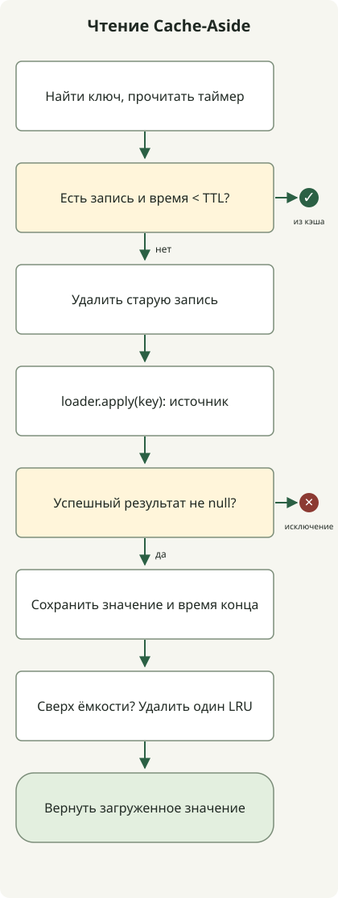

**Кэширование повторно использует ранее полученные результаты, сокращая обращения к источнику и вычисления.** Для правильного применения сначала определите, какие запросы могут разделять результат, как долго допустимо его использовать и как обновлять при изменении источника. Высокая доля попаданий не делает кэш правильным, если он возвращает чужие данные или использует старую цену для окончательного оформления покупки.

Статья адресована разработчикам, рассматривающим кэш для API чтения. Она объясняет Cache-Aside на данных с допустимой задержкой, например описаниях товаров, и выполняет TTL и ограничения ёмкости в Java. Операции, требующие актуального состояния, например окончательное подтверждение оплаты или запасов, отделены от кэша чтения. Политики допустимых устаревших данных при сбоях связаны со [статьёй о fallback](/ko/posts/2026-10-31-failure-fallback/).

## Что и где кэшировать?

Начните с путей с повторными чтениями, дорогим доступом к источнику и допустимостью устаревших ответов на ограниченное время. Данные для однократного использования или почти полностью разные у каждого пользователя могут стоить в хранении и инвалидации больше, чем экономят попадания.

| Место | Какие расходы сокращает | Условия, которые нужно задать |
| --- | --- | --- |
| HTTP-кэш браузера или CDN | Сетевые обмены и запросы к API | Допустимость совместного использования, URL и `Vary`, `Cache-Control` |
| Локальный кэш приложения | Обращения к удалённому кэшу, чтения БД, повторные вычисления | Предел памяти процесса, различия значений реплик |
| Общий кэш, например Redis | Повторные чтения источника разными репликами | Сетевая задержка, поведение при сбое, сериализация, ёмкость |

Не нужны все уровни сразу. Локальный кэш быстр, но каждая реплика хранит свою копию. Общий кэш уменьшает дублирование хранения, добавляя сетевую и операционную зависимость. При нескольких уровнях инвалидация также должна достигать каждого.

## Как работает Cache-Aside?

Приложение сначала проверяет кэш. Если запись отсутствует или истекла, оно читает источник и сохраняет результат. Это **Cache-Aside**. Запись обычно фиксирует изменение источника перед инвалидацией соответствующей записи кэша. Данные источника переживают потерю кэша; это отличается от кэша как единственной записи. [Объяснение Cache-Aside Microsoft](https://learn.microsoft.com/en-us/azure/architecture/patterns/cache-aside)

Ключ должен включать входы, меняющие результат. Например, `Key(tenant, product, language)` задаёт разные записи для разных арендаторов, товаров и языков. Если ответ меняют валюта, права пользователя или версия формата, разделите ключи или область кэширования. Склейка строк без разделителей может дать коллизии, поэтому используйте структурированные ключи или однозначное кодирование.

ID арендатора в ключе не завершает авторизацию. Определяйте арендатора из доверенного контекста аутентификации и проверяйте доступ до кэша. Не помещайте токены доступа и пароли напрямую в ключи или журналы.

**TTL — время допустимого повторного использования; предел ёмкости — объём хранения.** При одном TTL записи могут накапливаться до истечения. При одном ограничении размера старые значения могут продолжать давать попадания. Число записей отличается от байтов; для больших ответов учитывайте размеры объектов и сериализации.

## Пример Java: разделение ключей, срок действия, инвалидация и ёмкость

Код — небольшая **демонстрация семантики локального кэша** описаний товаров по арендаторам. TTL 5 секунд и максимум 2 записи служат наблюдению поведения, не рекомендациями для производства. Порядок доступа `LinkedHashMap` удаляет запись, к которой дольше всего не обращались. [Документация Java 21](https://docs.oracle.com/en/java/javase/21/docs/api/java.base/java/util/LinkedHashMap.html)



Схема показывает `get()`. Если загрузчик источника падает, исключение передаётся дальше и новое значение не сохраняется. `invalidate()` — отдельная операция после изменения источника.

Сохраните как `CacheDemo.java` и запустите на JDK 21 или новее. Внешний сервер или библиотека не нужны.

```java
import java.time.Duration;
import java.util.LinkedHashMap;
import java.util.Objects;
import java.util.concurrent.atomic.AtomicInteger;
import java.util.concurrent.atomic.AtomicLong;
import java.util.function.Function;
import java.util.function.LongSupplier;

public class CacheDemo {
    record Key(String tenant, String product, String language) {}
    record Entry(String value, long loadedAt) {}

    static final class LocalCache {
        private final LinkedHashMap<Key, Entry> entries =
                new LinkedHashMap<>(16, 0.75f, true);
        private final LongSupplier ticker;
        private final long ttl = Duration.ofSeconds(5).toNanos();
        private final int maximumSize = 2;

        LocalCache(LongSupplier ticker) { this.ticker = ticker; }

        synchronized String get(Key key, Function<Key, String> loader) {
            Entry entry = entries.get(key);
            long now = ticker.getAsLong();
            if (entry != null && now - entry.loadedAt() < ttl) {
                return entry.value();
            }
            entries.remove(key);
            String value = Objects.requireNonNull(loader.apply(key));
            entries.put(key, new Entry(value, ticker.getAsLong()));
            if (entries.size() > maximumSize) {
                entries.remove(entries.keySet().iterator().next());
            }
            return value;
        }

        synchronized void invalidate(Key key) { entries.remove(key); }
    }

    static void expect(String actual, String expected) {
        if (!actual.equals(expected)) throw new AssertionError(actual);
        System.out.println(actual);
    }

    public static void main(String[] args) {
        AtomicLong clock = new AtomicLong();
        AtomicInteger loads = new AtomicInteger();
        LocalCache cache = new LocalCache(clock::get);
        Function<Key, String> loader = key ->
                key.tenant() + "/" + key.language() + "/v" + loads.incrementAndGet();
        Key ko = new Key("shop-a", "p1", "ko");
        Key en = new Key("shop-a", "p1", "en");
        Key other = new Key("shop-b", "p1", "ko");

        expect(cache.get(ko, loader), "shop-a/ko/v1");
        expect(cache.get(ko, loader), "shop-a/ko/v1");
        clock.set(Duration.ofSeconds(5).toNanos() - 1);
        expect(cache.get(ko, loader), "shop-a/ko/v1");
        clock.incrementAndGet();
        expect(cache.get(ko, loader), "shop-a/ko/v2");
        cache.invalidate(ko);
        expect(cache.get(ko, loader), "shop-a/ko/v3");
        expect(cache.get(en, loader), "shop-a/en/v4");
        expect(cache.get(ko, loader), "shop-a/ko/v3");
        expect(cache.get(other, loader), "shop-b/ko/v5");
        expect(cache.get(en, loader), "shop-a/en/v6");

        Key failing = new Key("shop-c", "p1", "ko");
        try {
            cache.get(failing, key -> { throw new IllegalStateException("origin"); });
            throw new AssertionError("Failure was swallowed");
        } catch (IllegalStateException expected) {
            expect(expected.getMessage(), "origin");
        }
        expect(cache.get(failing, loader), "shop-c/ko/v7");
    }
}
```

```sh
javac --release 21 CacheDemo.java
java CacheDemo
```

Следующий вывод получен с Zulu JDK `21.0.1+12-LTS`.

```text
shop-a/ko/v1
shop-a/ko/v1
shop-a/ko/v1
shop-a/ko/v2
shop-a/ko/v3
shop-a/en/v4
shop-a/ko/v3
shop-b/ko/v5
shop-a/en/v6
origin
shop-c/ko/v7
```

Первые три чтения одного ключа читают источник лишь раз. За 1ns до истечения возвращается то же значение; ровно через 5 секунд оно загружается заново. Следующие случаи проверяют явную инвалидацию, разделение по языкам и арендаторам и вытеснение по порядку доступа. Есть успешное чтение после ошибки загрузчика. Значения вроде `v1` обозначают порядок вызовов тестового загрузчика, не реальные версии БД.

Время воспроизводит вручную продвигаемый монотонный таймер вместо сна. В реальном процессе можно передать таймер прошедшего времени через `new LocalCache(System::nanoTime)`. Истёкшие записи обрабатываются при доступе, а не немедленно удаляются фоном. Ограничено число записей, не байты.

Для краткости загрузчик тоже выполняется внутри `synchronized`. Вызовы одного экземпляра сериализуются даже для разных ключей, а число ожидающих медленный загрузчик не ограничено. Это не высокопроизводительный производственный кэш. Не реализованы описанные ниже single-flight по ключу, пределы вызовов источника, тайм-ауты и распространение инвалидации по репликам. Проверки последовательные; конкурентного нагрузочного теста не было.

## Гарантируют ли TTL и инвалидация актуальность?

Нет. Здесь TTL измеряется **с окончания чтения источника и сохранения в кэш**. Если источник — задержанная читающая реплика или старый снимок, TTL 5 секунд не означает появления актуального значения в течение 5 секунд после изменения. Задержки чтения, репликации и инвалидации нужно учитывать отдельно.

При нескольких репликах с общим кэшем гонка возможна даже после обновления БД и удаления записи. Чтение A начинает получать старое значение; запись B фиксирует новое и удаляет кэш; A завершается позже и снова сохраняет старое. TTL сокращает срок его жизни, но не устраняет гонку.

Пути с требованием актуальности должны перепроверять данные в транзакции источника либо не позволять позднему старому результату перезаписывать новое значение, например версиями и условной записью. При событийной инвалидации учитывайте потерю, дубликаты и задержку между commit и доставкой. Если изменение затрагивает несколько ключей — списки, детали, агрегаты — определите их область инвалидации.

Различайте `expire-after-write` и `expire-after-access`. Продление срока при каждом доступе может надолго сохранять часто читаемое устаревшее значение. Для перепроверки через фиксированное время после сохранения независимо от числа чтений оцените срок от записи. [Политики истечения и вытеснения Caffeine](https://github.com/ben-manes/caffeine/wiki/Eviction)

## Что при одновременном истечении или сбое кэша?

Если каждый запрос читает источник при истечении популярного ключа, возможен **cache stampede**. Сокращайте дубли через single-flight, объединяющий чтения одного ключа в одну текущую операцию, и ограничивайте конкурентность и ожидание источника. Дедупликация одного процесса не охватывает все реплики. В Java рассмотрите [атомарные API чтения и загрузки Caffeine](https://github.com/ben-manes/caffeine/wiki/Population), но они сами не задают общесервисный предел нагрузки источника.

Джиттер распределяет истечение множества ключей. При пределе свежести 60 секунд распределяйте в пределах не более 60 секунд. Он не решает концентрацию запросов на одном популярном ключе. Stale-while-revalidate возвращает старое во время обновления; применяйте его лишь там, где это разрешено, и задайте отдельный максимальный возраст при продолжающихся ошибках обновления.

Отправлять все запросы в БД при сбое кэша тоже опасно. Для примера, при чтении 10,000 RPS и попаданиях 90% источник получает около 1,000 RPS. Потеря всех попаданий поднимает это до 10,000 RPS даже при том же распределении. Это расчёт, не измерение; повторы и обновления не учтены.

Если источник не выдержит, ограничьте обход, используйте разрешённые локальные копии или сокращённые функции либо отклоняйте избыток. Наблюдайте сбои отдельно от промахов и ограничивайте массовую загрузку при восстановлении. Короткое negative caching полезно для повторных несуществующих ID, но не сохраняйте сбой источника как «данных нет». Задайте и этому кэшу TTL и инвалидацию, чтобы новые данные читались.

## Разделяйте HTTP-кэш и кэш приложения

HTTP-кэш браузера и CDN передаёт политику повторного использования заголовками ответа. Это отдельный уровень от TTL объектов JVM.

| Директива | Значение |
| --- | --- |
| `max-age=60` | Ответ свежий, пока возраст менее 60 секунд |
| `s-maxage=60` | Срок свежести общего кэша, заменяющий там `max-age` и связанные настройки |
| `private` | Ограничивает хранение общим кэшем; личный, например браузер, может хранить |
| `no-cache` | Разрешает хранить, но перед использованием нужна успешная проверка источником |
| `no-store` | Не сохранять этот запрос или ответ; это не удаление уже имеющихся копий |

При выборе языка через `Accept-Language` настройка `Vary` и реальный кэш должны учитывать различие. Если язык разделён URL, он тоже часть ключа. `ETag` и условные запросы сокращают передачу неизменённого контента, но не всегда стоимость проверки источника. `private` и `no-store` не заменяют аутентификацию, авторизацию и шифрование. [RFC 9111: HTTP Caching](https://www.rfc-editor.org/rfc/rfc9111.html)

Начните с одного пути чтения. Кроме попаданий проверьте границы TTL, чтение сразу после записи, одинаковый ID разных арендаторов и языков, максимальную ёмкость, конкурентные промахи, сбой и восстановление. В производстве вместе с попаданиями отслеживайте число, задержку и ошибки обращений к источнику, текущие загрузки, вытеснения, память и задержку инвалидации. Оценить пользу можно, только проверив, **правильны ли ответы и выдерживает ли источник без кэша**.
