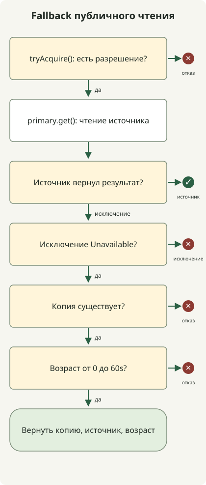

При сбое **fallback должен предоставлять ответ заранее разрешённого качества по посильной системе стоимости**. Можно убрать рекомендации или вернуть публичные данные в пределах согласованного возраста. Сообщать об успехе неизвестного платежа или отправлять всё в БД при сбое кэша — значит создавать другие проблемы.

Это руководство для разработчиков HTTP API. Продолжая контроль перегрузки из [статьи об архитектуре 10k RPS](/ko/posts/2026-10-31-jdk-10k-rps-architecture/), оно рассматривает ответы при сбоях. Java-пример выполняет политику без внешнего сервера; он не измеряет пропускную способность и восстановление производственного сбоя.

## Разные сбои допускают разные результаты

Сначала решите, что можно сократить относительно нормального результата. Ниже примеры проектирования; реальные пределы возраста и сокращения функций должны соответствовать контракту сервиса.

| Сбой | Допустимая альтернатива | Когда остановить или ограничить |
| --- | --- | --- |
| Задержка или сбой API рекомендаций | Убрать необязательные рекомендации или использовать подготовленные общие | Не помещать основные чтения товаров в ту же очередь |
| Сбой чтения публичного описания | Последние успешные данные того же товара и языка со временем обновления | Превышен возраст, нет данных или неверный ключ |
| Недоступен весь кэш | Ограниченное чтение источника, разрешённая локальная копия или отказ лишним запросам | Не допускать неограниченный обход сверх бюджетов соединений и конкурентности БД |
| Сбой проверки аутентификации или авторизации | Временная ошибка без защищённой операции | Не путать сбой с отсутствием прав и не заменять разрешением доступа |
| Потерян ответ после запроса оплаты или заказа | Проверка статуса и сверка по тому же ID операции | Не считать неудачей с созданием нового платежа и не выдумывать успех |
| Запасной сервер использует ту же БД | Переключать только в пределах отдельно проверенной ёмкости | Переключение не устраняет узкое место общей БД |

Отделяйте критичные к точности пути — авторизацию, окончательную цену, списание запасов — от простого устаревшего чтения. Статус платежа «проверяется» имеет смысл лишь при реальном отслеживании и опросе запроса. Переименование сообщения или ответа не управляет неопределённым результатом.

AWS описывает недостаточную проверку редких путей и новые проблемы альтернатив среди [рисков fallback в распределённых системах](https://aws.amazon.com/builders-library/avoiding-fallback-in-distributed-systems/). Выполняйте fallback как нормальные пути и проверяйте зависимость от общих ресурсов.

## Что делают тайм-ауты, повторы и circuit breaker?

Тайм-аут ограничивает ожидание вызывающего. **Окончание ожидания не означает отмену удалённой операции или платежа.** Повтор снова пробует ту же операцию; failover переключает реплику. Fallback переходит к сокращённому ответу или другому способу обработки. Circuit breaker при заданных условиях блокирует вызовы зависимости после накопления сбоев; отдельная политика определяет безопасный ответ.

Общий срок включает соединение, ожидание пула, ответа, повторы и альтернативную обработку. Например, при бюджете 300ms и первом вызове 250ms нельзя ждать ещё 250ms. Это иллюстрация, не рекомендуемые настройки. Также проверьте, что реально включает тайм-аут каждого этапа в клиенте.

Как объясняет [руководство повторов AWS](https://aws.amazon.com/builders-library/timeouts-retries-and-backoff-with-jitter/), повторы добавляют нагрузку, а побочные эффекты могли произойти даже при потере ответа. Закрепите повторы за одним уровнем и ограничьте оставшееся время и попытки только для временных сбоев безопасно повторяемых операций. Экспоненциальная задержка и джиттер распределяют повторы, но не увеличивают ёмкость насыщенной БД.

## Пример Java: только разрешённые публичные данные на ограниченное время

Пример читает **одно фиксированное публичное описание товара**. Он предпочитает нормальный ответ и использует последнюю успешную копию лишь при сбое зависимости `Unavailable`. Возраст не более 60 секунд, будущее время отклоняется. Предел 2 и окно 60 секунд демонстрационные. Нескольким товарам, языкам и арендаторам нужны отдельные ключи; не используйте неизменённый пример для данных аутентифицированных пользователей.



Схема показывает решения `read()`. Каждый получивший разрешение путь возвращает его через `finally` при результате или исключении. Тайм-ауты, circuit breaker и обновление кэша не реализованы. HTTP-адаптер должен преобразовывать в `Unavailable` лишь разрешённые сбои — соединения и тайм-ауты. Превращение 401, 403, 404, ошибок схемы и программирования в одно исключение меняет смысл политики.

Сохраните как `FallbackDemo.java`. Работает на JDK 21 или новее без внешних зависимостей.

```java
import java.time.Clock;
import java.time.Duration;
import java.time.Instant;
import java.time.ZoneOffset;
import java.util.concurrent.Semaphore;
import java.util.function.Supplier;

public class FallbackDemo {
    record Snapshot(String value, Instant observedAt) {}
    record Reply(String value, String source, long ageSeconds) {}
    static class Unavailable extends RuntimeException {}
    static class Rejected extends RuntimeException {
        Rejected(String reason) { super(reason); }
    }

    static final class Catalog {
        private final Semaphore slots = new Semaphore(2);
        private final Clock clock;
        private final Duration maxAge = Duration.ofSeconds(60);

        Catalog(Clock clock) { this.clock = clock; }

        Reply read(Supplier<String> primary, Snapshot snapshot) {
            if (!slots.tryAcquire()) throw new Rejected("capacity");
            try {
                try {
                    return new Reply(primary.get(), "primary", 0);
                } catch (Unavailable failure) {
                    if (snapshot == null) throw new Rejected("missing");
                    Duration age = Duration.between(
                            snapshot.observedAt(), clock.instant());
                    if (age.isNegative() || age.compareTo(maxAge) > 0) {
                        throw new Rejected("age");
                    }
                    return new Reply(snapshot.value(), "snapshot", age.toSeconds());
                }
            } finally {
                slots.release();
            }
        }
    }

    static void rejected(String reason, Runnable action) {
        try {
            action.run();
        } catch (Rejected e) {
            if (!reason.equals(e.getMessage())) throw new AssertionError(e);
            System.out.println("rejected=" + reason);
            return;
        }
        throw new AssertionError("Expected rejection: " + reason);
    }

    public static void main(String[] args) {
        Instant now = Instant.parse("2026-10-31T00:00:00Z");
        Catalog catalog = new Catalog(Clock.fixed(now, ZoneOffset.UTC));
        Snapshot recent = new Snapshot("saved-description", now.minusSeconds(30));
        Supplier<String> down = () -> { throw new Unavailable(); };

        System.out.println(catalog.read(() -> "live-description", recent));
        System.out.println(catalog.read(down, recent));
        System.out.println(catalog.read(down,
                new Snapshot("boundary", now.minusSeconds(60))));
        rejected("age", () -> catalog.read(down,
                new Snapshot("old", now.minusSeconds(60).minusNanos(1))));
        rejected("age", () -> catalog.read(down,
                new Snapshot("future", now.plusSeconds(1))));
        rejected("missing", () -> catalog.read(down, null));

        try {
            catalog.read(() -> { throw new IllegalStateException("schema"); }, recent);
            throw new AssertionError("Unexpected fallback");
        } catch (IllegalStateException expected) {
            System.out.println("propagated=" + expected.getMessage());
        }

        // Hold both permits through nested calls; the third call must not run.
        catalog.read(() -> catalog.read(() -> {
            rejected("capacity", () -> catalog.read(() -> {
                throw new AssertionError("Primary ran without a permit");
            }, recent));
            return "inner";
        }, recent).value(), recent);
        System.out.println(catalog.read(() -> "recovered", recent));
    }
}
```

```sh
javac --release 21 FallbackDemo.java
java FallbackDemo
```

Вывод получен на Zulu JDK `21.0.1+12-LTS`.

```text
Reply[value=live-description, source=primary, ageSeconds=0]
Reply[value=saved-description, source=snapshot, ageSeconds=30]
Reply[value=boundary, source=snapshot, ageSeconds=60]
rejected=age
rejected=age
rejected=missing
propagated=schema
rejected=capacity
Reply[value=recovered, source=primary, ageSeconds=0]
```

`source=snapshot` и `ageSeconds` — метаданные приложения о снижении качества для клиента. Это не реализация HTTP-заголовка `Age`. Максимальный возраст сравнивается точным `Duration`; лишь отображение округлено до целых секунд.

[`tryAcquire()` Semaphore](https://docs.oracle.com/en/java/javase/21/docs/api/java.base/java/util/concurrent/Semaphore.html) отказывает без ожидания при отсутствии разрешения. Fallback включён в тот же предел допуска, поэтому при насыщении не возвращается даже копия. Дешёвому отдельному пути копий в производстве тоже нужен свой предел. Вложенные вызовы детерминированно исчерпывают разрешения; это не конкурентный нагрузочный тест.

Пример не хранит и не обновляет успешные чтения, не ограничивает хранилище и вытеснение, не объединяет запросы и не восстанавливает копии после перезапуска. В производстве обновляйте копии лишь после успешного чтения и **не переписывайте время при возврате копии**. Иначе старое значение может разрешаться вечно. Долгоживущим копиям нужна политика свежести с учётом коррекции часов.

## Определите также завершение сбоя

[Руководство перегрузки Google SRE](https://sre.google/sre-book/handling-overload/) объясняет необходимость ошибки, когда даже ухудшенный ответ слишком дорог. Если отказ допуска или отсутствие копии временно исключают сервис, используйте 503 по HTTP-контракту. При надёжном времени повтора можно отправить `Retry-After`, но заголовок не предотвращает наплыв. 504 — несвоевременный ответ upstream шлюзу или прокси, а не любой тайм-аут приложения. [RFC 9110](https://www.rfc-editor.org/rfc/rfc9110.html#name-server-error-5xx)

Возврат всех запросов к источнику сразу после закрытия circuit breaker может снова обрушить восстановление. Проверяйте состояние ограниченными half-open вызовами и постепенно увеличивайте трафик, ограничивая обновление копий и заполнение кэша. Заранее определите остановку расширения или возврат этапа при недопустимых задержке, ошибках, ожидании соединений БД и очереди. Доли и интервалы определяйте нагрузочным тестом.

При первом внедрении выберите одно необязательное чтение и внедрите сбои зависимости. Затем проверьте отсутствие копии, границу возраста, будущее время, полное насыщение допуска, неклассифицированные исключения и восстановление. На реальных серверах также проверьте медленные ответы, исчерпание пула, весь кэш, совместный сбой основного и запасного путей и одновременные повторы при восстановлении.

Разделяйте нормальные результаты, fallback, отказы и ошибки в метриках. Один показатель HTTP 200 может скрыть сбой с большинством старых ответов. Следите вместе за долей fallback, возрастом, ошибками зависимостей, отказами допуска и текущими запросами. **Отличайте реально завершившие бизнес-функцию запросы от обработанных со снижением качества**, чтобы оценить уменьшение ущерба.
