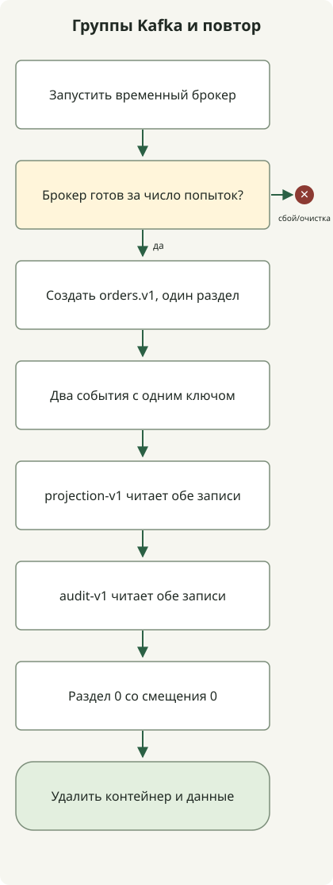

**Потоки событий Kafka сохраняют факты в журнале, а несколько потребителей читают и обрабатывают их со своих позиций.** Подготовка доставки и аналитика независимо читают заказы, сохранённые записи можно обрабатывать заново новой логикой. Однако запись события в Kafka и изменение внешней БД или платежа ровно один раз — разные вещи.

Статья для знакомых с HTTP API и БД. Она связывает топики, разделы и группы потребителей, затем выполняет публикацию, независимое чтение и воспроизведение локально. Акцент — **позиции потребителей и смысл обработки после сбоя**, а не агрегаты, окна и соединения Kafka Streams.

## Чем поток событий отличается от очереди задач?

Событие — уже произошедший факт, например «заказ создан». Различие с командой «начать доставку» позволяет нескольким потребителям использовать одну запись в своей работе. Kafka тоже делит работу группы как очередь, но чтение не удаляет запись сразу. Другие группы и воспроизведение читают её снова в рамках политики хранения. [Введение Apache Kafka](https://kafka.apache.org/intro/)

| Понятие | Роль | Что решить при проектировании |
| --- | --- | --- |
| Производитель | Записывает события в Kafka | Ключи, ID событий, схемы, ошибки публикации |
| Топик | Логический поток связанных событий | Смысл событий, хранение и уплотнение, доступ |
| Раздел | Часть упорядоченного журнала | Область порядка, распределение ключей, параллельная производительность |
| Группа потребителей | Потребители одной бизнес-задачи | ID группы, обработка и commit, политика повторной обработки |
| Смещение | Позиция записи в разделе | Докуда прочитано и откуда продолжить |

Например, группы `shipping-v1` и `analytics-v1`, читающие `orders.v1`, независимо получают те же события. Если поместить доставку и аналитику в одну группу, записи разделятся, и каждая задача не будет получать все события.

При обычной подписке раздел назначается одному потребителю группы. Не все пять потребителей группы с 3 разделами получат раздел. Другие группы имеют независимые назначения. Статья описывает обычные подписки `KafkaConsumer`, отличные от совместного потребления на уровне записей. [Подписки KafkaConsumer](https://kafka.apache.org/41/javadoc/org/apache/kafka/clients/consumer/KafkaConsumer.html)

## При важном порядке начните с ключа

Kafka определяет порядок **внутри раздела**. Для изменений одного заказа начните с ID заказа как ключа маршрутизации в один раздел. Ключ задаёт маршрут, ID события — дубликаты; роли разные. Один ID у нескольких событий заказа удалит как дубликаты и правильные последующие события.

Маршрутизация одного ключа требует согласованных сериализации, partitioner и числа разделов. Увеличение числа меняет размещение последующих записей; проверьте порядок с прежними. Неограниченная параллельная обработка после чтения тоже меняет порядок завершения. Порядок журнала не всегда совпадает со временем бизнес-событий. Поздним событиям разных производителей нужны версии, время возникновения и правила нарушения порядка.

Горячий ключ, например клиент с большинством событий, концентрирует нагрузку в разделе. Вместо произвольного дробления единицы порядка рассмотрите необходимую область порядка вместе со стоимостью обработки.

## Локальный запуск: два независимых чтения и воспроизведение

Пример использует инструменты образа Apache `apache/kafka:4.1.2`. Нужны Bash и работающий Docker; первый запуск скачивает образ. Брокер и CLI в одном контейнере, порты хоста не открываются. Данные удаляются при остановке. Для функциональной проверки: 1 брокер, 1 раздел и коэффициент репликации 1. [Официальная инструкция Docker](https://kafka.apache.org/41/getting-started/docker/)



Схема показывает успешный порядок скрипта. При ошибке готовности или команды он останавливается и удаляет созданный контейнер при выходе. Два групповых чтения и прямое воспроизведение последовательны. Внешняя БД и ручной commit не реализованы.

Сохраните как `kafka-demo.sh` и выполните `bash kafka-demo.sh`.

```sh
#!/usr/bin/env bash
set -euo pipefail

kafka_image=apache/kafka:4.1.2
kafka_name="kafka-stream-demo-$$-$RANDOM"
docker run -d --name "$kafka_name" "$kafka_image" >/dev/null
trap 'docker rm -f "$kafka_name" >/dev/null 2>&1 || true' EXIT

ready=false
for ((attempt=0; attempt<30; attempt++)); do
  if docker exec "$kafka_name" /opt/kafka/bin/kafka-topics.sh \
      --bootstrap-server localhost:9092 --list >/dev/null 2>&1; then
    ready=true
    break
  fi
  sleep 1
done
if [ "$ready" != true ]; then
  docker logs "$kafka_name" >&2
  exit 1
fi

docker exec "$kafka_name" /opt/kafka/bin/kafka-topics.sh \
  --bootstrap-server localhost:9092 --create --topic orders.v1 \
  --partitions 1 --replication-factor 1 >/dev/null

docker exec -i "$kafka_name" /opt/kafka/bin/kafka-console-producer.sh \
  --bootstrap-server localhost:9092 --topic orders.v1 \
  --producer-property acks=all --producer-property enable.idempotence=true \
  --property parse.key=true --property key.separator=: <<'EVENTS'
order-101:{"eventId":"evt-1","type":"OrderCreated","schemaVersion":1}
order-101:{"eventId":"evt-2","type":"PaymentConfirmed","schemaVersion":1}
EVENTS

for group in projection-v1 audit-v1; do
  printf 'group=%s\n' "$group"
  docker exec "$kafka_name" /opt/kafka/bin/kafka-console-consumer.sh \
    --bootstrap-server localhost:9092 --topic orders.v1 --group "$group" \
    --from-beginning --max-messages 2 --timeout-ms 15000 \
    --property print.key=true --property 'key.separator=|'
done

printf 'replay=partition-0-offset-0\n'
docker exec "$kafka_name" /opt/kafka/bin/kafka-console-consumer.sh \
  --bootstrap-server localhost:9092 --topic orders.v1 \
  --partition 0 --offset 0 --max-messages 2 --timeout-ms 15000 \
  --property print.key=true --property 'key.separator=|'
```

Это стандартный вывод, проверенный с Docker Engine `24.0.5` и `apache/kafka:4.1.2`. Каждая команда потребления отдельно пишет `Processed a total of 2 messages` в stderr.

```text
group=projection-v1
order-101|{"eventId":"evt-1","type":"OrderCreated","schemaVersion":1}
order-101|{"eventId":"evt-2","type":"PaymentConfirmed","schemaVersion":1}
group=audit-v1
order-101|{"eventId":"evt-1","type":"OrderCreated","schemaVersion":1}
order-101|{"eventId":"evt-2","type":"PaymentConfirmed","schemaVersion":1}
replay=partition-0-offset-0
order-101|{"eventId":"evt-1","type":"OrderCreated","schemaVersion":1}
order-101|{"eventId":"evt-2","type":"PaymentConfirmed","schemaVersion":1}
```

Каждая группа прочитала оба события, прямое воспроизведение — те же две записи. Это подтверждает независимость групп и воспроизведения журнала. Один раздел не проверяет межраздельный порядок или параллельное назначение группы.

Пример проверяет консольное чтение с auto-commit по умолчанию. Он не реализует ручной commit после бизнес-обработки и не проверяет сбои между ней и commit. Не реализованы валидация JSON, внешняя БД или платежи и обработка при rebalance.

## Гарантирует ли commit завершение бизнеса?

Нет. Текущая позиция продвигается с получением записей `poll()`, но **зафиксированная позиция** перезапуска отдельна. После последовательной обработки смещения 10 обычно фиксируют 11 — следующее чтение. Для нескольких разделов ведите завершённые диапазоны отдельно. Из-за удаления, транзакций и других причин смещения не обязательно означают непрерывную последовательность записей. [Позиции и commit KafkaConsumer](https://kafka.apache.org/41/javadoc/org/apache/kafka/clients/consumer/KafkaConsumer.html)

| Порядок и точка сбоя | Возможный итог перезапуска | Необходимая обработка |
| --- | --- | --- |
| Commit → выход до изменения БД | Изменение пропущено, бизнес-результат отсутствует | Изменить порядок по нужной семантике доставки |
| Изменение БД → выход до commit | Повторная доставка и обработка | Идемпотентность или дедупликация |
| Commit поздней позиции после ошибки | Ошибочные записи могут быть пропущены | Фиксировать лишь непрерывный успешный диапазон |
| Передача раздела другому потребителю | Старые и новые работы могут пересечься | Остановить прежнего владельца, исключить повторные внешние эффекты |

Потребитель внешней БД может проверять уникальность `(처리기 ID, eventId)` и выполнять бизнес-изменение **в одной транзакции БД**. Отдельная запись отметки до неудавшегося изменения ошибочно объявит следующую доставку дубликатом. Отдельная отметка после изменения допускает дубли при сбое между ними. Другие внешние API не входят автоматически в транзакцию; им нужны ключи идемпотентности и проверка результата.

`enable.idempotence` производителя решает дубли журнала при повторах производителя, не все случаи новой двойной публикации события приложением. `acks=all` тоже не гарантирует отсутствие потерь при любых настройках. Смотрите коэффициент репликации, `min.insync.replicas` и фактический ISR вместе. Одноброкерный пример не проверяет переносимость потери брокера. [Настройки производителя](https://kafka.apache.org/41/configuration/producer-configs/)

Различайте транзакции Kafka, объединяющие входные смещения и выходной топик с чтением `read_committed`, и ровно однократные эффекты внешней БД или платежей. Без сотрудничества внешних систем Kafka не делает всё exactly-once. [Семантика доставки и транзакции Kafka](https://kafka.apache.org/41/design/design/)

## Проектируйте повторы и воспроизведение как штатные пути

При временных сбоях ограничьте число, общее время и конкурентность повторов. Если одно событие блокирует раздел, рассмотрите отложенную обработку, проверив сохранение бизнес-порядка при пропуске вперёд. Отправка в DLQ не завершает бизнес-задачу. Сохраните исходный ID, причину, версию схемы, ответственного и срок решения; обработайте сбои между записью DLQ и продвижением смещения.

Производитель с раздельными commit БД и публикацией Kafka тоже может упасть между ними. Одно решение — сохранить изменение и outbox в общей транзакции, затем доставить; потребители всё ещё обрабатывают дубли. Добавление Kafka не объединяет исходную БД и журнал в транзакцию. [Transactional outbox](https://docs.aws.amazon.com/prescriptive-guidance/latest/cloud-design-patterns/transactional-outbox.html)

`--from-beginning` не сбрасывает безусловно группу с действующим commit. Пример использует новые группы, финал задаёт раздел и смещение напрямую. Производственное изменение позиции требует отдельной процедуры: остановить потребителей, проверить цель, диапазон и эффекты. Новая группа тоже может повторить платежи и уведомления; нужны изоляция выхода или идемпотентность. [Сброс смещения потребителя](https://kafka.apache.org/41/configuration/consumer-configs/)

При отставании за срок хранения нужные записи могут уже исчезнуть. Уплотнение не сохраняет все прошлые состояния ключа. Определите диапазон воспроизведения вместе с хранением, уплотнением и способностью читать нужные схемы.

Сначала выберите один поток и проверьте норму, выход после БД до commit, перезапуски, rebalance, неверные схемы, медленные зависимости и дубли при воспроизведении. `lag` — разница выбранного конца и позиции чтения или commit; укажите основу метрики. Вместе с lag наблюдайте задержку от события до бизнеса, ошибки, повторы, DLQ, rebalance, место брокера и репликацию, отличая «читаем» от «завершили работу».
