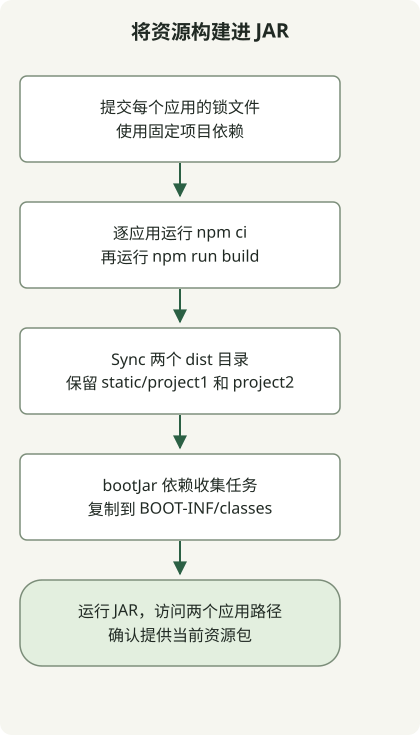

要将多个 Vue 应用打包进 Spring Boot JAR，应为每个应用分别设置 `npm ci` 和构建任务，将生成文件暂存在 `build/` 下，再加入 `bootJar`。不要让其他应用共用某个应用的安装任务，也不要将生成的包直接写入 `src/main/resources`。

此可运行示例在 `/project1/index.html` 和 `/project2/index.html` 提供两个应用。复现环境为 JDK17.0.8.1、Gradle8.4、Node24.13.0/npm11.6.2、Boot3.5.7、Vue3.5.44 和 Vite8.3.5。这些是固定的复现版本，并非当前生产依赖的推荐版本。请分别检查 [Vite 的运行时要求](https://vite.dev/guide/)以及所选 Boot 版本的要求。

## 处理流程



每个 Vue 应用各自生成构建产物。Gradle Sync 任务仅收集这些产物，随后 bootJar 将其放入各自独立的静态资源路径。

## 各应用的任务与打包

将这些文件保存到空项目中。每个应用都有自己的 `package.json`、锁文件、`node_modules` 和 `dist`。`prepare.sh` 将共用的 HTML/JS 复制到第二个应用，并创建两个锁文件。

### `settings.gradle`

```groovy
rootProject.name = 'multi-frontend'
```

### `build.gradle`

```groovy
plugins {
    id 'java'
    id 'org.springframework.boot' version '3.5.7'
}
group = 'example'
version = '1.0.0'
repositories { mavenCentral() }
dependencies {
    implementation platform('org.springframework.boot:spring-boot-dependencies:3.5.7')
    implementation 'org.springframework.boot:spring-boot-starter-web'
}

def apps = ['project1', 'project2']
def npmCommand = System.getProperty('os.name').toLowerCase().contains('windows') ? 'npm.cmd' : 'npm'
def frontendBuilds = apps.collect { app ->
    def frontend = layout.projectDirectory.dir("frontend/${app}")
    def install = tasks.register("${app}NpmCi", Exec) {
        workingDir frontend
        commandLine npmCommand, 'ci', '--no-audit', '--no-fund'
        inputs.files(frontend.file('package.json'), frontend.file('package-lock.json'))
        outputs.dir(frontend.dir('node_modules'))
    }
    tasks.register("${app}Build", Exec) {
        dependsOn install
        workingDir frontend
        commandLine npmCommand, 'run', 'build'
        inputs.files(fileTree(frontend) {
            exclude 'node_modules/**', 'dist/**'
        })
        outputs.dir(frontend.dir('dist'))
    }
}
def collectFrontend = tasks.register('collectFrontend', Sync) {
    dependsOn frontendBuilds
    into layout.buildDirectory.dir('frontend-resources')
    apps.each { app ->
        from("frontend/${app}/dist") { into "static/${app}" }
    }
}
tasks.named('bootJar') {
    dependsOn collectFrontend
    from(collectFrontend) { into 'BOOT-INF/classes' }
}
```

### `src/main/java/example/Application.java`

```java
package example;

import org.springframework.boot.SpringApplication;
import org.springframework.boot.autoconfigure.SpringBootApplication;

@SpringBootApplication
public class Application {
    public static void main(String[] args) {
        SpringApplication.run(Application.class, args);
    }
}
```

### `frontend/project1/package.json`

```json
{
  "name": "project1",
  "private": true,
  "type": "module",
  "scripts": {
    "build": "vite build --base=/project1/"
  },
  "dependencies": {
    "vue": "3.5.44"
  },
  "devDependencies": {
    "vite": "8.3.5"
  }
}
```

### `frontend/project2/package.json`

```json
{
  "name": "project2",
  "private": true,
  "type": "module",
  "scripts": {
    "build": "vite build --base=/project2/"
  },
  "dependencies": {
    "vue": "3.5.44"
  },
  "devDependencies": {
    "vite": "8.3.5"
  }
}
```

### `frontend/project1/index.html`

```html
<!doctype html>
<html lang="en"><head><meta charset="UTF-8"><title>Vue build example</title></head>
<body><div id="app"></div><script type="module" src="/src/main.js"></script></body></html>
```

### `frontend/project1/src/main.js`

```js
import { createApp, h } from 'vue';
createApp({ render: () => h('h1', `Vue app at ${import.meta.env.BASE_URL}`) }).mount('#app');
```

### `prepare.sh`

```sh
#!/bin/sh
set -eu
mkdir -p frontend/project2/src
cp frontend/project1/index.html frontend/project2/index.html
cp frontend/project1/src/main.js frontend/project2/src/main.js
for app in project1 project2; do
    (cd "frontend/$app" && npm install --package-lock-only --ignore-scripts --no-audit --no-fund)
done
```

首次准备此示例时运行 `prepare.sh`，并提交生成的两个 `package-lock.json` 文件。后续 CI 构建针对已保存的锁文件使用 `npm ci`。不要每次构建都重新生成锁文件。

## 构建与运行

确保 PATH 中可找到 Node/npm，然后在项目根目录运行：

```sh
node --version
npm --version
sh prepare.sh
gradle --no-daemon clean bootJar
java -jar build/libs/multi-frontend-1.0.0.jar
```

对于已有的 wrapper 项目，通过 `./gradlew` 使用项目选定的 Gradle 版本。启动后访问 `http://localhost:8080/project1/index.html` 和 `http://localhost:8080/project2/index.html`。页面分别显示 `Vue app at /project1/` 和 `Vue app at /project2/`。

[Vite 的 base 选项](https://vite.dev/guide/build.html#public-base-path)为各应用设置合适的资源 URL，但不会配置服务端 SPA 路由。此示例使用明确的 `index.html` URL；直接访问 history-router 路由或使用其他上下文路径时，需要额外配置。

## 检查实际的 JAR 路径

```text
BOOT-INF/classes/static/project1/index.html
BOOT-INF/classes/static/project1/assets/...
BOOT-INF/classes/static/project2/index.html
BOOT-INF/classes/static/project2/assets/...
```

各应用构建完成后，`collectFrontend` 使用 `Sync` 暂存当前产物。`bootJar` 将其加入可执行 JAR 的类路径下。参见 [Gradle 文件处理](https://docs.gradle.org/current/userguide/working_with_files.html)和 [Boot 归档打包](https://docs.spring.io/spring-boot/3.5/gradle-plugin/packaging.html)。

已使用此配置构建并打包两个应用，运行中的 JAR 通过 HTTP 提供了它们的 HTML 和 JS 资源。随后删除某个应用 `public` 目录中的一个文件，并在不执行 `clean` 的情况下重新构建 JAR，确认旧文件没有残留。两个应用的锁文件也分别进行了检查。

## 应用于现有项目

- 让 `apps` 列表与目录对应，并为每个应用提供锁文件。
- 将生成的 `static/project1` 和 `static/project2` 命名空间与手写资源分开。
- 使用 Vue SFC 时，为对应应用添加适当的插件和 Vite 配置。这个小示例使用 Vue 渲染函数。
- 此集成面向可执行的 `bootJar`，而非普通的 `jar`。检查最终要部署的产物。

对于现有应用，请独立于打包工作检查 [Spring Boot 的 Java 和 Jakarta 迁移基线](/en/posts/2023-09-08-springboot3-migration/)。如果还运行 Batch 作业，请按照 [Batch 仓库迁移与重启检查](/en/posts/2023-10-27-springbatch5-migration/)进行验证；从 JAR 提供前端资源并不能验证持久化的作业数据。

关于按发布版本自动化，参见 [GitHub 发布版本和资源选择](/en/posts/2023-09-23-linux-shellscript-github-latest/)以及[数值比较器的输入契约](/en/posts/2023-11-17-linux-shellscript-version-compare/)。[POSIX sh 函数指南](/en/posts/2023-09-20-linux-shellscript-function-error/)说明了准备脚本的解释器选择。
