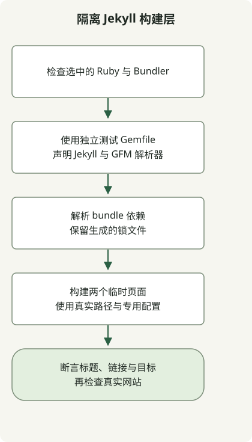

更改权限前，先检查实际运行的 Ruby、管理依赖上下文的 Bundler，以及小型站点能否渲染。本网站的线上构建使用 Astro；下面的 Jekyll 示例用于诊断保留的 Ruby 归档。

最初安装的是 Ruby 3.2.2。该版本分支现已[终止维护](https://www.ruby-lang.org/en/downloads/branches/)，因此旧版本用于复现兼容性，并非新安装的推荐版本。采用之前，请选择仍在维护且兼容项目 gem 的 Ruby。

## 安装 gem 前先选择解释器



[Jekyll 的 macOS 说明](https://jekyllrb.com/docs/installation/macos/)建议使用独立的 Ruby 环境，而非系统 Ruby。此仓库早期使用 rbenv，其[版本选择规则](https://github.com/rbenv/rbenv#readme)区分项目级 `.ruby-version`、`RBENV_VERSION` 和全局默认版本。

在项目目录运行这些命令：

```sh
command -v ruby
ruby --version
rbenv version
rbenv which ruby
gem env home
bundle --version
```

如果 `ruby` 未通过预期的管理器选中，应在安装任何内容前修正 shell 初始化。按照已安装 rbenv 版本的说明使用 `rbenv init`；不要把其他用户的主目录路径粘贴进 shell 配置。优先使用项目内的版本选择，而不是用 `rbenv global` 改变所有 Ruby 项目。

## 用两个渲染页面测试 bundle

此兼容性测试样例使用 Ruby3.2.2、Bundler2.4.19、Jekyll3.9.3 和 kramdown-parser-gfm1.1.0 执行。这些是记录的旧版本，并非受支持版本的基线。Gemfile 固定两个直接依赖的 gem；生成的 Gemfile.lock 记录适用于所在平台的传递依赖版本。

新建独立的临时工作目录，将以下完整文件保存在其中。不要替换仓库现有的 Gemfile。

### `Gemfile`

```ruby
source 'https://rubygems.org'
gem 'jekyll', '= 3.9.3'
gem 'kramdown-parser-gfm', '= 1.1.0'
```

### `jekyll_probe.rb`

```ruby
require 'jekyll'
require 'tmpdir'
require 'fileutils'
require 'json'

Dir.mktmpdir('jekyll-probe-') do |root|
  root = File.realpath(root)
  source = File.join(root, 'source')
  destination = File.join(root, 'output')
  FileUtils.mkdir_p(File.join(source, '_layouts'))
  File.write(File.join(source, '_layouts', 'default.html'), '<!doctype html><html lang="en"><body>{{ content }}</body></html>')
  File.write(File.join(source, 'index.md'), "---\nlayout: default\ntitle: Probe\n---\n# Bundled build\n\n[Guide](/guide/)\n")
  File.write(File.join(source, 'guide.md'), "---\nlayout: default\npermalink: /guide/\n---\n# Local guide\n")
  config = Jekyll.configuration('config' => [], 'source' => source, 'destination' => destination, 'quiet' => true)
  Dir.chdir(source) { Jekyll::Site.new(config).process }
  home = File.read(File.join(destination, 'index.html'))
  guide = File.read(File.join(destination, 'guide', 'index.html'))
  raise 'Missing rendered heading' unless home.include?('<h1') && home.include?('Bundled build')
  raise 'Missing guide link' unless home.include?('href="/guide/"')
  raise 'Missing guide output' unless guide.include?('Local guide')
  puts JSON.generate('ruby' => RUBY_VERSION, 'jekyll' => Jekyll::VERSION, 'pages' => 2, 'result' => 'passed')
end
```

选定的 Ruby 和 Bundler 可用后，在该目录运行：

```sh
bundle install
bundle exec ruby jekyll_probe.rb
```

如果所需的确切 gem 版本已安装，可以先通过 `bundle lock --local` 从本地清单解析，再执行相同的运行命令。它无法获取缺失的 gem。复现失败时保留锁文件，更新前检查变更。[Bundler 应用指南](https://guides.rubygems.org/using_bundler_in_applications/)说明了 Gemfile 和锁文件的作用。

实际观察到的结果：

```json
{"ruby":"3.2.2","jekyll":"3.9.3","pages":2,"result":"passed"}
```

探针在临时目录构建，使用真实路径避免 macOS 上 `/var` 符号链接不一致，禁用默认配置文件发现，并在渲染时切换到自身的源目录。它检查标题、链接和目标页面。完成后移除临时文件；此检查不涵盖完整归档、主题、插件、CSS 和部署。

## 区分可用性与 bundle 成员资格

此次复现中，Jekyll 可以加载，但 bundle 未声明 `kramdown-parser-gfm`，因此 Markdown 转换失败。某个 gem 已安装在机器上，与它在 `bundle exec` 内可用，是两个独立条件。将解析器加入此测试样例的 Gemfile 后，转换成功。

双页面探针成功后，后续调查可缩小到实际网站的配置、主题、插件和输入。加载原生扩展时失败属于另一层问题：请使用 [Ruby 和 C++ 诊断探针](/en/posts/2026-04-07-ruby-rbenv-jekyll-build-troubleshooting/)。本网站当前的发布流程请参见 [Astro 候选内容审核工作流](/en/posts/2026-04-07-jekyll-github-actions-content-pipeline/)。
