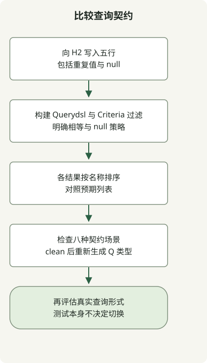

根据需要表达和验证的工作来选择查询工具。发布间隔可以促使调查，但不能证明替代工具会保留应用的查询行为。

最初在 2023 年提出的担忧早于后来发布的 [Querydsl 5.1.0](https://github.com/querydsl/querydsl/releases/tag/QUERYDSL_5_1_0)。发布标签只能证明该版本存在；应分别评估计划采用分支的仓库、制品坐标和兼容性。以下示例固定一个复现环境，并非推荐当前生产版本。

## 比较有代表性的谓词



写入相同的五行数据，构建两种谓词并检查明确的预期结果。测试仅涵盖 H2 上的此实体。迁移决策还需验证应用实际使用的连接、投影、分页和数据库行为。

[Spring Data JPA Specification](https://docs.spring.io/spring-data/jpa/reference/3.5/jpa/specifications.html)组合 Criteria 谓词，并通过 `JpaSpecificationExecutor` 执行。对于简单的仓库过滤，这可能已经足够，无需替换 JPA 持久化模型。

## 为 Querydsl 示例添加三个文件

以[完整 Jakarta Querydsl 项目](/en/posts/2023-09-09-springboot3-querydsl/)的全部五个文件为起点，其中包括 `Employee.getName()`。其复现环境使用 Java17、Gradle8.4、Boot3.5.7、Querydsl5.1.0 Jakarta 和 H2。添加以下三个完整文件；不要将此配置与指南中独立的 Boot4 示例混用。

### `src/main/java/example/EmployeeRepository.java`

```java
package example;

import org.springframework.data.jpa.repository.JpaRepository;
import org.springframework.data.jpa.repository.JpaSpecificationExecutor;

public interface EmployeeRepository extends JpaRepository<Employee, Long>,
        JpaSpecificationExecutor<Employee> {}
```

### `src/main/java/example/EmployeeSpecs.java`

```java
package example;

import org.springframework.data.jpa.domain.Specification;

public final class EmployeeSpecs {
    private EmployeeSpecs() {}

    public static Specification<Employee> named(String name) {
        if (name == null) throw new IllegalArgumentException("Use withoutName for null");
        return (root, query, builder) -> builder.equal(root.get("name"), name);
    }

    public static Specification<Employee> withoutName() {
        return (root, query, builder) -> builder.isNull(root.get("name"));
    }
}
```

### `src/test/java/example/QueryStrategyTest.java`

```java
package example;

import java.util.Arrays;
import java.util.List;
import com.querydsl.core.types.Predicate;
import com.querydsl.jpa.impl.JPAQueryFactory;
import org.junit.jupiter.api.BeforeEach;
import org.junit.jupiter.api.Test;
import org.springframework.beans.factory.annotation.Autowired;
import org.springframework.boot.test.autoconfigure.orm.jpa.DataJpaTest;
import org.springframework.boot.test.autoconfigure.orm.jpa.TestEntityManager;
import org.springframework.dao.InvalidDataAccessApiUsageException;
import org.springframework.data.domain.Sort;
import org.springframework.data.jpa.domain.Specification;

import static org.assertj.core.api.Assertions.*;

@DataJpaTest
class QueryStrategyTest {
    @Autowired TestEntityManager entityManager;
    @Autowired EmployeeRepository employees;
    final QEmployee employee = QEmployee.employee;

    @BeforeEach
    void seed() {
        for (String name : Arrays.asList("Alice", "Bob", "Alice", "A_%", null)) {
            entityManager.persist(new Employee(name));
        }
        entityManager.flush();
    }

    void equivalent(Predicate predicate, Specification<Employee> specification,
                    List<String> expected) {
        var querydsl = new JPAQueryFactory(entityManager.getEntityManager())
                .select(employee.name).from(employee).where(predicate)
                .orderBy(employee.name.asc()).fetch();
        var criteria = employees.findAll(specification, Sort.by("name"))
                .stream().map(Employee::getName).toList();
        assertThat(querydsl).containsExactlyElementsOf(expected);
        assertThat(criteria).containsExactlyElementsOf(expected);
    }

    @Test
    void exactEqualityPreservesDuplicates() {
        equivalent(employee.name.eq("Alice"), EmployeeSpecs.named("Alice"),
                List.of("Alice", "Alice"));
    }

    @Test
    void missingValueReturnsNoRows() {
        equivalent(employee.name.eq("Missing"), EmployeeSpecs.named("Missing"), List.of());
    }

    @Test
    void wildcardCharactersAreLiteralForEquality() {
        equivalent(employee.name.eq("A_%"), EmployeeSpecs.named("A_%"), List.of("A_%"));
    }

    @Test
    void andCanEliminateAllRows() {
        equivalent(employee.name.eq("Alice").and(employee.name.eq("Bob")),
                EmployeeSpecs.named("Alice").and(EmployeeSpecs.named("Bob")), List.of());
    }

    @Test
    void orKeepsMatchesAndDuplicatesInOrder() {
        equivalent(employee.name.eq("Alice").or(employee.name.eq("Bob")),
                EmployeeSpecs.named("Alice").or(EmployeeSpecs.named("Bob")),
                List.of("Alice", "Alice", "Bob"));
    }

    @Test
    void nullRequiresAnExplicitPredicate() {
        equivalent(employee.name.isNull(), EmployeeSpecs.withoutName(),
                Arrays.asList((String) null));
    }

    @Test
    void stringAttributeTypoFailsAtRuntime() {
        Specification<Employee> typo = (root, query, builder) ->
                builder.equal(root.get("missingName"), "Alice");
        assertThatThrownBy(() -> employees.findAll(typo))
                .isInstanceOf(InvalidDataAccessApiUsageException.class);
    }

    @Test
    void equalityHelpersRejectNull() {
        assertThatThrownBy(() -> employee.name.eq((String) null))
                .isInstanceOf(IllegalArgumentException.class);
        assertThatThrownBy(() -> EmployeeSpecs.named(null))
                .isInstanceOf(IllegalArgumentException.class);
    }
}
```

选中 JDK17 后，在项目根目录运行：

```sh
gradle --version
gradle --no-daemon clean test
```

项目现在有十项测试：原来的两项 Querydsl 检查和八项比较及契约检查。六项结果比较中，两种实现都必须符合独立指定的列表；仅相互一致并不足够。再次执行 `clean test`，还可确认 Q 类型能重新生成。

| 场景 | 预期结果 |
| --- | --- |
| 名称等于 Alice | 两个 Alice；保留重复值 |
| 名称不存在 | 无行 |
| 名称等于 `A_%` | 该字面值，而非 LIKE 模式 |
| Alice AND Bob | 无行 |
| Alice OR Bob | 按名称排序的 Alice、Alice、Bob |
| 显式 null 谓词 | 一个 null 名称 |

## 保留不同的契约

Querydsl 生成的 `employee.name` 是 Java 成员。在此 Specification 示例中，`root.get("name")` 使用字符串属性，因此故意写错的 `missingName` 能通过编译，却会在仓库执行时失败。这不表示 Specification 必须使用字符串：[JPA 静态元模型](https://docs.spring.io/spring-data/jpa/reference/3.5/jpa/specifications.html)是另一个选择。

示例的 `named` 辅助方法显式拒绝 null，Querydsl 的相等调用也会拒绝它。null 值应使用单独的 `withoutName()`/`isNull()` 谓词。这是示例的输入策略；实际迁移时不要悄悄将 null 改成省略过滤条件。

| 工具 | 评估内容 |
| --- | --- |
| Querydsl JPA | 生成的 Q 类型、JPA 查询形式和处理器兼容性 |
| JPA Specification | 可复用的 Criteria 过滤条件与仓库集成 |
| [jOOQ](https://www.jooq.org/doc/latest/manual/getting-started/use-cases/jooq-as-a-sql-builder-without-codegeneration/) | 以 SQL 为中心的 DSL 和模式建模；代码生成可选 |
| [Jdbi](https://jdbi.org/) | JDBC 查询与结果映射 |
| [Doma](https://docs.domaframework.org/en/latest/) | 编译期处理、SQL 模板与 Criteria API |

这些工具处于不同层次。此测试没有比较 jOOQ、Jdbi 或 Doma，没有基准测试性能，也没有证明生产数据库等价。更换工具前，请添加实际的连接、排序、分页、null 策略和事务场景，并检查所选数据库以及制品的许可条款。

[Spring Boot 学习指南](/en/categories/springboot/)串联项目初始化、持久化检查、HTTP 测试和打包。每篇文章分别记录自身的复现版本。
