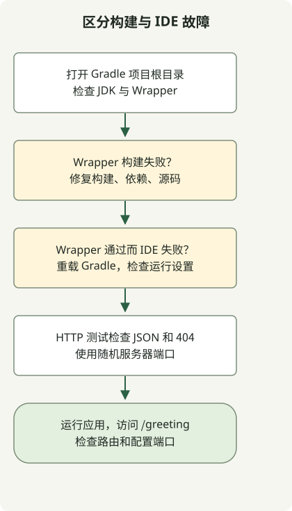

在 IntelliJ 中打开 Spring Boot 项目时，先检查 Gradle 同步，再比较 Wrapper 构建和 IDE 执行。缺少运行按钮不一定需要手动创建配置，也可以通过[编辑器边栏图标](https://www.jetbrains.com/help/idea/running-applications.html)运行有效的 Java main 方法。

本指南接续 Boot 4.1.2、Gradle 9.8.2、Java 17 的 [Initializr 示例](/en/posts/2023-09-07-springboot-initializer/)。构建和 HTTP 行为在本地实际运行；IDE 步骤对照 JetBrains 文档检查。这并不表示已在某个特定 IDE 版本中实际操作验证 UI。

## 处理流程



通过 Wrapper 构建区分项目问题与 IDE 设置问题。HTTP 测试使用随机端口；手动 bootRun 使用配置端口。

## 检查项目与 JDK

1. 用 File → Open 打开解压后的项目根目录，其中应包含 `settings.gradle` 和 `build.gradle`。
2. 完成 Gradle 同步。优先解决依赖下载或同步失败。
3. 选择项目的 Wrapper 发行版，再检查 Gradle JVM 和 Project SDK。本例两者均使用 JDK 17。
4. 在终端运行 `./gradlew --version` 和 `./gradlew test`，建立 IDE 之外的结果。

参见 [Gradle 集成指南](https://www.jetbrains.com/help/idea/gradle.html)和 [Gradle JVM 选择规则](https://www.jetbrains.com/help/idea/gradle-jvm-selection.html)。菜单名称随 IDE 版本和操作系统变化。Project SDK、运行 Gradle 的 JVM、Java 工具链以及运行配置的 JRE 是不同设置，并不总会自动一致。

## 添加端点与真实 HTTP 测试

保留现有四个文件，再添加以下两个文件。将控制器放在应用的 `example.demo` 包内，可确保它处于组件扫描范围。

### `src/main/java/example/demo/GreetingController.java`

```java
package example.demo;

import java.util.Map;
import org.springframework.web.bind.annotation.GetMapping;
import org.springframework.web.bind.annotation.RestController;

@RestController
public class GreetingController {
    @GetMapping("/greeting")
    public Map<String, String> greeting() {
        return Map.of("message", "Hello, Gradle");
    }
}
```

### `src/test/java/example/demo/GreetingHttpTest.java`

```java
package example.demo;

import java.net.URI;
import java.net.http.HttpClient;
import java.net.http.HttpRequest;
import java.net.http.HttpResponse;
import java.time.Duration;
import org.junit.jupiter.api.Test;
import org.springframework.beans.factory.annotation.Autowired;
import org.springframework.boot.test.context.SpringBootTest;
import org.springframework.core.env.Environment;

import static org.junit.jupiter.api.Assertions.*;

@SpringBootTest(webEnvironment = SpringBootTest.WebEnvironment.RANDOM_PORT)
class GreetingHttpTest {
    @Autowired Environment environment;

    HttpResponse<String> get(String path) throws Exception {
        String port = environment.getRequiredProperty("local.server.port");
        var request = HttpRequest.newBuilder(URI.create("http://127.0.0.1:" + port + path))
                .timeout(Duration.ofSeconds(10)).GET().build();
        return HttpClient.newHttpClient().send(request, HttpResponse.BodyHandlers.ofString());
    }

    @Test
    void greetingReturnsJson() throws Exception {
        var response = get("/greeting");
        assertEquals(200, response.statusCode());
        assertTrue(response.headers().firstValue("content-type").orElse("").contains("application/json"));
        assertEquals("{\"message\":\"Hello, Gradle\"}", response.body());
    }

    @Test
    void missingPathIsNotAnApplicationStartupFailure() throws Exception {
        assertEquals(404, get("/missing").statusCode());
    }
}
```

`./gradlew test` 现在运行原有上下文测试和两项 HTTP 测试。HTTP 测试在随机端口启动真实服务器，检查 JSON 输出和不存在路径的 404 响应，不要求本地 8080 端口空闲。

## 比较 Gradle 与 Application 执行

用第一条命令启动服务器，然后在另一终端运行第二条命令。

```sh
./gradlew bootRun --args='--server.port=8081'
```

```sh
curl --fail --show-error http://localhost:8081/greeting
```

```json
{"message":"Hello, Gradle"}
```

在 IDE 中，先尝试 `DemoApplication.main()` 旁的运行图标。如果需要显式配置，在 Run → Edit Configurations 中创建 Application 配置并检查以下值。

| 设置 | 示例 |
| --- | --- |
| Main class | `example.demo.DemoApplication` |
| Classpath module | 项目的主源码模块，如 `demo.main` |
| JRE | JDK 17 |
| Program arguments | `--server.port=8081` |

如果已有进程占用 8081，停止它或选择其他端口。是否提供 Boot 专用工具窗口或配置，与运行普通 Java Application 配置是两回事。

| 观察结果 | 优先检查 |
| --- | --- |
| Wrapper 构建也失败 | JDK/Gradle 兼容性、依赖与源码错误 |
| Wrapper 通过但 IDE 失败 | Gradle 重新加载、模块类路径、运行 JRE 和参数 |
| 服务器启动但 `/greeting` 返回 404 | 控制器包和映射路径 |
| 端口占用失败 | 现有进程和运行实例 |

如果编译成功，但 IDE 将生成的方法标为错误，请继续进行 [Lombok 与注解处理器检查](/en/posts/2023-09-15-springboot-intellij-lombok/)。
