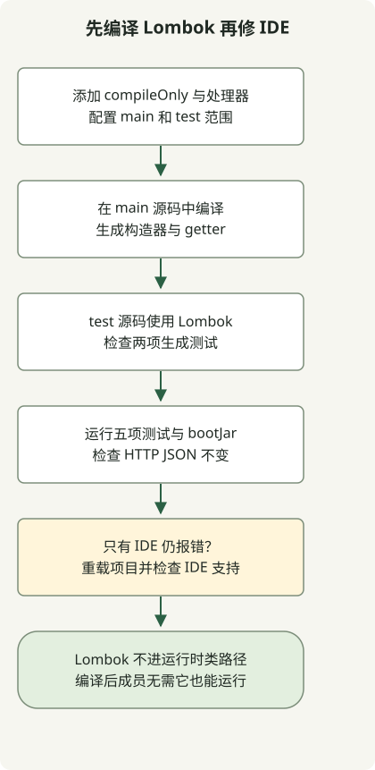

如果 Lombok 方法似乎缺失，先运行 `./gradlew clean test`，确定构建是否也失败。IDE 支持帮助编辑器识别生成的成员；Gradle 注解处理器配置在编译时生成这些成员，两者不能互相替代。

此示例接续 [Initializr 项目](/en/posts/2023-09-07-springboot-initializer/)和 [HTTP 示例](/en/posts/2023-09-10-springboot-intellij-import/)。使用 Boot 4.1.2、Gradle 9.8.2 和 JDK 17；BOM 选中了 Lombok 1.18.48。它记录一个可工作的组合，不保证所有 JDK/Lombok 搭配都兼容。

## 处理流程



分别检查主代码和测试编译中的生成构造器与 getter。Wrapper 测试通过后再修复 IDE 识别。

## 配置 Gradle 编译

将此代码块添加到现有 `build.gradle`，已有声明时避免重复。

```groovy
dependencies {
    compileOnly 'org.projectlombok:lombok'
    annotationProcessor 'org.projectlombok:lombok'
    testCompileOnly 'org.projectlombok:lombok'
    testAnnotationProcessor 'org.projectlombok:lombok'
}
```

[官方 Gradle 配置](https://projectlombok.org/setup/gradle)区分主代码和测试的编译依赖与处理器。两项测试声明仅在测试源码本身使用 Lombok 注解时需要。下面的测试也覆盖了此路径。

无版本声明在这里有效，是因为项目应用了 Boot 插件和 `io.spring.dependency-management`，后者[导入 Boot BOM](https://docs.spring.io/spring-boot/4.1/gradle-plugin/managing-dependencies.html)。普通 Gradle 项目需在相关声明中使用相同且兼容的显式版本，或单独为这些配置设置依赖管理。

## 使用生成的构造器与 getter

添加 `Greeting`，用此版本替换现有控制器，保留 HTTP 测试，并添加 Lombok 专项测试类。

### `src/main/java/example/demo/Greeting.java`

```java
package example.demo;

import lombok.Getter;
import lombok.RequiredArgsConstructor;

@Getter
@RequiredArgsConstructor
public class Greeting {
    private final String message;
}
```

### `src/main/java/example/demo/GreetingController.java`

```java
package example.demo;

import org.springframework.web.bind.annotation.GetMapping;
import org.springframework.web.bind.annotation.RestController;

@RestController
public class GreetingController {
    @GetMapping("/greeting")
    public Greeting greeting() {
        return new Greeting("Hello, Gradle");
    }
}
```

### `src/test/java/example/demo/LombokGenerationTest.java`

```java
package example.demo;

import lombok.Getter;
import lombok.RequiredArgsConstructor;
import org.junit.jupiter.api.Test;

import static org.junit.jupiter.api.Assertions.*;

class LombokGenerationTest {
    @Getter
    @RequiredArgsConstructor
    static class Expected {
        private final String message;
    }

    @Test
    void mainSourceConstructorAndGetterAreGenerated() {
        assertEquals("Hello, Gradle", new Greeting("Hello, Gradle").getMessage());
    }

    @Test
    void testSourceConstructorAndGetterAreGenerated() {
        assertEquals("test fixture", new Expected("test fixture").getMessage());
    }
}
```

```sh
./gradlew clean test bootJar
./gradlew dependencyInsight --configuration annotationProcessor --dependency lombok
```

现在共有五项测试：一项上下文测试、两项 HTTP 测试和两项 Lombok 生成测试。它们调用主代码和测试源码中的生成构造器及 getter。`/greeting` 必须继续返回相同 JSON，同时也检查通过生成 getter 完成的序列化。

由于 Lombok 是 `compileOnly`，本例的可执行 JAR 不包含它作为运行时库。仅安装 IDE 插件无法让 Gradle 编译通过。在此配置中，使用已编译的 getter 无需将 Lombok 添加为运行时 `implementation` 依赖。

## 仅 IDE 报错时

如果 Wrapper 测试通过，重新加载 Gradle 项目。[JetBrains 文档](https://www.jetbrains.com/help/idea/annotation-processors-support.html)说明，从构建文件导入处理器会自动启用注解处理。因此手动勾选选项并非普遍必需步骤。

接着按照 [Lombok IntelliJ 指南](https://projectlombok.org/setup/intellij)检查所用 IDE 版本的 Lombok 支持和插件启用状态。不要概括为某个版本始终需要手动安装、另一个版本始终自带。还应确定 IDE 使用自身编译器还是委托 Gradle 构建。

如果 Gradle 也因缺少生成成员而失败，检查是否只有 `compileOnly` 而没有 `annotationProcessor`。如果仅测试失败，检查两项测试配置。复现检查器分别移除主代码处理器和测试处理器，确认编译失败，然后恢复并验证全部五项测试再次通过。IDE UI 操作不在这些执行检查范围内。
