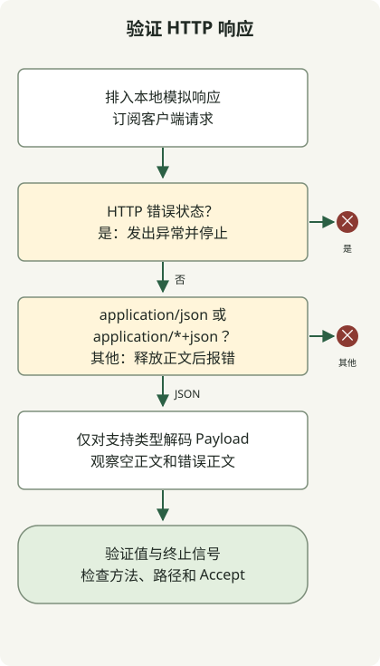

使用本地 MockWebServer 测试 WebClient，同时检查 HTTP 状态、响应 Content-Type、正文解码及完成或错误。包含 HTML 的 `200 OK` 响应即使状态成功，也可能违反客户端响应契约；发送 `Accept: application/json` 不会强制得到 JSON 响应。Spring 文档介绍了使用真实 HTTP 客户端的[模拟 Web 服务器测试](https://docs.spring.io/spring-framework/reference/6.2/web/webflux-webclient/client-testing.html)。

测试通过本地 HTTP 使用真实 WebClient，而非模拟其链式方法。它们覆盖下文的响应契约；生产环境超时与重试策略需单独测试。

## 处理流程



客户端先检查状态，再检查媒体类型，释放被拒绝的正文并解码支持的 JSON。StepVerifier 既检查发出的值，也检查完成或错误。

## 设置独立测试项目

复现环境为 JDK 17.0.8.1、Gradle 8.4、Spring Boot **3.5.7 BOM** 和 MockWebServer **4.12.0**。这些版本固定示例依赖，并非当前生产版本推荐。这是普通 Java 测试项目，无需运行 Spring Boot 应用。

在新目录创建内容为 `rootProject.name = 'webclient-example'` 的 `settings.gradle`，以及以下完整 `build.gradle`：

```groovy
plugins { id 'java' }
repositories { mavenCentral() }
dependencies {
    testImplementation platform('org.springframework.boot:spring-boot-dependencies:3.5.7')
    testImplementation 'org.springframework.boot:spring-boot-starter-webflux'
    testImplementation 'org.springframework.boot:spring-boot-starter-test'
    testImplementation 'io.projectreactor:reactor-test'
    testImplementation 'com.squareup.okhttp3:mockwebserver:4.12.0'
    testRuntimeOnly 'org.junit.platform:junit-platform-launcher'
}
test { useJUnitPlatform() }
```

显式指定 BOM，确保即使不使用 Spring Boot Gradle 插件，Spring 和 Reactor 依赖也有版本。已由 Boot 管理的应用，应让测试依赖适配该应用选定的 BOM。

## 测试八项响应契约

将此完整类保存为 `src/test/java/ExternalApiTest.java`：

```java
import java.io.IOException;
import java.time.Duration;
import java.util.concurrent.TimeUnit;
import okhttp3.mockwebserver.MockResponse;
import okhttp3.mockwebserver.MockWebServer;
import okhttp3.mockwebserver.RecordedRequest;
import org.junit.jupiter.api.AfterEach;
import org.junit.jupiter.api.BeforeEach;
import org.junit.jupiter.api.Test;
import org.springframework.http.MediaType;
import org.springframework.web.reactive.function.client.WebClient;
import reactor.core.publisher.Mono;
import reactor.test.StepVerifier;
import static org.junit.jupiter.api.Assertions.*;

class ExternalApiTest {
    private MockWebServer server;
    private WebClient client;
    record Payload(String message) {}

    @BeforeEach
    void start() throws IOException {
        server = new MockWebServer();
        server.start();
        client = WebClient.builder().baseUrl(server.url("/").toString()).build();
    }

    @AfterEach
    void stop() throws IOException {
        server.shutdown();
    }

    private Mono<Payload> fetch() {
        return client.get().uri("/employee/100")
            .accept(MediaType.APPLICATION_JSON)
            .exchangeToMono(response -> {
                if (response.statusCode().isError()) {
                    return response.createException().flatMap(Mono::error);
                }
                boolean json = response.headers().contentType()
                    .map(type -> "application".equals(type.getType())
                        && ("json".equals(type.getSubtype())
                            || type.getSubtype().endsWith("+json")))
                    .orElse(false);
                if (!json) {
                    return response.releaseBody().then(Mono.<Payload>error(
                        new IllegalStateException("Expected JSON response")));
                }
                return response.bodyToMono(Payload.class);
            });
    }

    @Test
    void rejectsHtmlEvenWhenStatusIs200() throws Exception {
        server.enqueue(new MockResponse().setResponseCode(200)
            .setHeader("Content-Type", "text/html; charset=UTF-8")
            .setBody("<html><body>Unknown failure</body></html>"));
        StepVerifier.create(fetch())
            .expectErrorMatches(error -> error instanceof IllegalStateException
                && error.getMessage().equals("Expected JSON response"))
            .verify(Duration.ofSeconds(5));
        RecordedRequest request = server.takeRequest(1, TimeUnit.SECONDS);
        assertNotNull(request);
        assertEquals("GET", request.getMethod());
        assertEquals("/employee/100", request.getPath());
        assertEquals("application/json", request.getHeader("Accept"));
    }

    @Test
    void preservesHttp500Error() {
        server.enqueue(new MockResponse().setResponseCode(500)
            .setHeader("Content-Type", "text/html")
            .setBody("<html>Unknown failure</html>"));
        StepVerifier.create(fetch())
            .expectError(org.springframework.web.reactive.function.client.WebClientResponseException.InternalServerError.class)
            .verify(Duration.ofSeconds(5));
    }

    @Test
    void decodesJson() {
        server.enqueue(new MockResponse().setResponseCode(200)
            .setHeader("Content-Type", "application/json")
            .setBody("{\"message\":\"ok\"}"));
        StepVerifier.create(fetch())
            .expectNextMatches(payload -> payload.message().equals("ok"))
            .expectComplete().verify(Duration.ofSeconds(5));
    }

    @Test
    void rejectsMissingContentType() {
        server.enqueue(new MockResponse().setResponseCode(200)
            .setBody("{\"message\":\"ok\"}"));
        StepVerifier.create(fetch())
            .expectErrorMatches(error -> error instanceof IllegalStateException
                && error.getMessage().equals("Expected JSON response"))
            .verify(Duration.ofSeconds(5));
    }

    @Test
    void rejectsMalformedJson() {
        server.enqueue(new MockResponse().setResponseCode(200)
            .setHeader("Content-Type", "application/json").setBody("{broken"));
        StepVerifier.create(fetch())
            .expectError(org.springframework.core.codec.DecodingException.class)
            .verify(Duration.ofSeconds(5));
    }

    @Test
    void decodesStructuredJsonSubtype() {
        server.enqueue(new MockResponse().setResponseCode(200)
            .setHeader("Content-Type", "application/vnd.example+json")
            .setBody("{\"message\":\"ok\"}"));
        StepVerifier.create(fetch())
            .expectNextMatches(payload -> payload.message().equals("ok"))
            .expectComplete().verify(Duration.ofSeconds(5));
    }

    @Test
    void completesWithoutPayloadForEmptyJsonBody() {
        server.enqueue(new MockResponse().setResponseCode(200)
            .setHeader("Content-Type", "application/json"));
        StepVerifier.create(fetch())
            .expectComplete().verify(Duration.ofSeconds(5));
    }

    @Test
    void rejectsNonApplicationJsonSubtype() {
        server.enqueue(new MockResponse().setResponseCode(200)
            .setHeader("Content-Type", "text/example+json")
            .setBody("{\"message\":\"ok\"}"));
        StepVerifier.create(fetch())
            .expectErrorMatches(error -> error instanceof IllegalStateException
                && error.getMessage().equals("Expected JSON response"))
            .verify(Duration.ofSeconds(5));
    }
}
```

选中 JDK 17，并在安装 Gradle 8.4 后运行：

```sh
java -version
gradle --version
gradle --no-daemon test
```

八项测试应全部通过。打开 `build/reports/tests/test/index.html` 查看各项结果；Gradle 任务输出不一定逐项列出通过的测试。

| 响应 | 此示例要求的结果 |
| --- | --- |
| HTTP 200，JSON 正文 | 解码载荷。 |
| HTTP 200，HTML 正文 | 拒绝意外的内容类型。 |
| HTTP 500，HTML 正文 | 保留 HTTP 错误类型。 |
| HTTP 200，缺少 Content-Type | 拒绝未指定的响应格式。 |
| HTTP 200，错误 JSON | 报告解码错误。 |
| HTTP 200，`application/vnd.example+json` | 解码兼容的 JSON 载荷。 |
| HTTP 200，空 JSON 正文 | 不发出载荷，直接完成。 |
| HTTP 200，`text/example+json` | 拒绝非 application 媒体类型。 |

空正文行为是此示例有意采用的契约。如果端点必须返回载荷，添加 `switchIfEmpty(Mono.error(...))`，并将该测试改为预期应用错误。

<span id="why-status-and-decoding-are-checked-separately"></span>

## 为什么 HTTP 200 仍会验证失败？

`fetch()` 先处理错误状态，再检查成功响应格式。`createException()` 将 HTTP 500 保留为 `WebClientResponseException.InternalServerError`。连接失败通常走 `WebClientRequestException` 路径，它不是服务器返回的 HTTP 响应。

对非错误状态，代码接受 `application/json` 和 `application/*+json` 媒体类型，再由解码器验证正文。因此错误 Content-Type 与格式错误的 JSON 会产生不同错误。这只是示例契约，并非重定向或所有成功状态的完整策略。

拒绝成功响应时，先释放正文，再报告应用错误。使用 `exchangeToMono` 时，在回调内消费或处理正文；[Spring exchange 文档](https://docs.spring.io/spring-framework/reference/6.2/web/webflux-webclient/client-exchange.html)说明未消费正文会在完成后释放。

`setBody(html)` 直接发送 HTML。先将该字符串序列化为 JSON 会改变测试的响应。记录请求的断言还检查实际发送的方法、路径和 `Accept` 头。

`verify(Duration.ofSeconds(5))` 限制每项测试的等待时间，不配置生产客户端的连接或响应超时。应按 API 契约添加传输超时与重试测试；这八项不涵盖这些内容。

在上述复现环境中，八项测试全部通过。此仓库可通过 `python3 scripts/check_webclient_example.py` 重复检查。跨越 Jakarta 边界的项目，应在改变客户端行为前建立 [Spring Boot 迁移基线](/en/posts/2023-09-08-springboot3-migration/)。

这些客户端测试使用本地模拟服务器，不检查已部署应用的静态文件。如果应用打包 Vue，[Gradle 前端打包示例](/en/posts/2021-07-23-multiple-gradle-build/)可检查可执行 JAR 及其 HTML/JavaScript 响应。两个示例固定不同环境，未对齐依赖前不应混合。

MockWebServer API 参考：[OkHttp 4.12.0 源码与示例](https://github.com/square/okhttp/tree/parent-4.12.0/mockwebserver)。

关于时间限制与重试次数，继续阅读 [WebClient 超时与有界重试测试](/en/posts/2026-10-30-webclient-timeout-retry/)。该示例仅重试状态为 503 的 GET 响应，并区分单次尝试时限与总重试预算。
