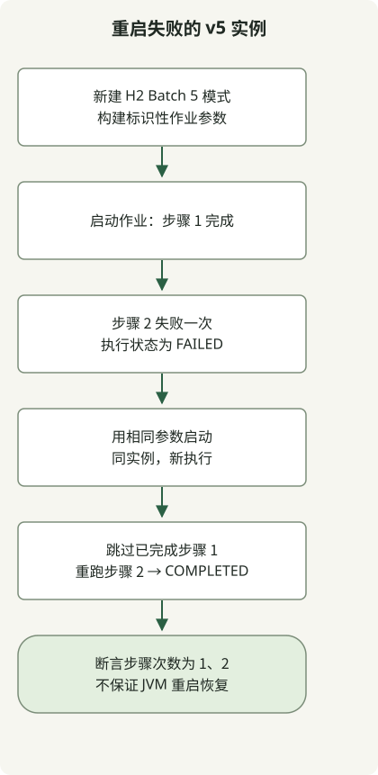

迁移到 Spring Batch 5 时，除依赖外，还需检查元数据模式、持久化的作业参数格式、执行上下文和重启策略。先删除已有数据的列，或仅将类型代码替换为类名，都不构成完整数据迁移。

本文讨论迁移至 Batch 5，而非采用最新主版本。[官方 5.0 迁移指南](https://github.com/spring-projects/spring-batch/wiki/Spring-Batch-5.0-Migration-Guide)定义迁移注意事项；以下示例检查 Batch 5 环境中的执行行为。

## 处理流程



此图概括新模式上的 v5 重启测试，并非 v4 数据库迁移。同一实例第二次执行时，仅重跑失败步骤，已完成步骤保持完成。

## 修改现有仓库前

Batch 5 要求 Java 17 或更高版本。将 Java EE 的 `javax.*` API 迁移为对应 Jakarta API，但不要替换 `javax.sql.DataSource` 等 Java SE API。

旧参数表的 `TYPE_CD` 和各类型值列不同于新的 `PARAMETER_TYPE`、`PARAMETER_VALUE` 表示。只将 `LONG` 改为 `java.lang.Long`，既不能保留也不能正确重解释现有 LONG、DOUBLE 和 DATE 值。使用目标数据库与 Batch 版本，在数据库副本上演练转换。在 [Core JAR 中查找数据库专用模式及迁移脚本](https://docs.spring.io/spring-batch/reference/5.2/schema-appendix.html)。在生产表上重跑新建模式脚本不能替代迁移。

官方指南也说明了[历史数据访问限制](https://github.com/spring-projects/spring-batch/wiki/Spring-Batch-5.0-Migration-Guide#historical-data-access-implications)：某些 v5 JobExplorer 调用读取 v4 执行时可能失败。指南要求在迁移前，先在 v4 下成功重启失败的 v4 实例，或按业务决策放弃它们。不要假设 v5 能直接重启已有的失败 v4 执行。执行上下文序列化兼容性需与参数转换分开检查。

## 选择迁移起点

- **现有 Batch 4 仓库：** 先备份，在数据库副本上演练模式、参数和执行上下文转换。在 v4 下处理失败的 v4 实例。以下示例不转换或重启 v4 仓库。
- **新建 Batch 5 仓库：** 运行类型参数、已完成实例和失败步骤测试。它们在单一进程中的新建 H2 模式上检查三种行为。
- **带 Batch 作业的 Boot 应用：** 决定由 Boot 还是显式 Batch 配置负责设置与模式初始化。示例使用显式 Spring 配置，而非 Boot 自动配置。

如果还涉及 Boot 主版本升级，应独立于仓库迁移建立 [Java 与 Jakarta 迁移基线](/en/posts/2023-09-08-springboot3-migration/)。

## 检查新 Batch 5 仓库中的行为

复现环境使用 Gradle 8.4/JDK 17.0.8.1，Batch 5.2.4 和 H2 2.3.232 由 Boot BOM 3.5.7 管理。这些版本固定执行证据，并非当前生产推荐。将以下三个文件保存在空目录。

此项目直接创建 Spring 测试上下文，不启动 Boot 应用。使用 `@EnableBatchProcessing`，自行提供 DataSource 和事务管理器。不同时继承 `DefaultBatchConfiguration`；[Java 配置文档](https://docs.spring.io/spring-batch/reference/5.2/job/java-config.html)将两者定义为替代方案。

### `settings.gradle`

```groovy
rootProject.name = 'batch5-restart-example'
```

### `build.gradle`

```groovy
plugins { id 'java' }
repositories { mavenCentral() }
dependencies {
    testImplementation platform('org.springframework.boot:spring-boot-dependencies:3.5.7')
    testImplementation 'org.springframework.batch:spring-batch-core'
    testImplementation 'org.springframework:spring-jdbc'
    testImplementation 'com.h2database:h2'
    testImplementation 'org.junit.jupiter:junit-jupiter'
    testRuntimeOnly 'org.junit.platform:junit-platform-launcher'
}
test { useJUnitPlatform() }
```

### `src/test/java/example/BatchRestartTest.java`

```java
package example;

import java.util.Date;
import java.util.Set;
import java.util.concurrent.atomic.AtomicBoolean;
import java.util.concurrent.atomic.AtomicInteger;
import javax.sql.DataSource;

import org.junit.jupiter.api.AfterEach;
import org.junit.jupiter.api.BeforeEach;
import org.junit.jupiter.api.Test;
import org.springframework.batch.core.BatchStatus;
import org.springframework.batch.core.Job;
import org.springframework.batch.core.JobExecution;
import org.springframework.batch.core.JobParameters;
import org.springframework.batch.core.JobParametersBuilder;
import org.springframework.batch.core.Step;
import org.springframework.batch.core.configuration.annotation.EnableBatchProcessing;
import org.springframework.batch.core.job.builder.JobBuilder;
import org.springframework.batch.core.launch.JobLauncher;
import org.springframework.batch.core.repository.JobInstanceAlreadyCompleteException;
import org.springframework.batch.core.repository.JobRepository;
import org.springframework.batch.core.step.builder.StepBuilder;
import org.springframework.batch.repeat.RepeatStatus;
import org.springframework.beans.factory.annotation.Qualifier;
import org.springframework.context.annotation.AnnotationConfigApplicationContext;
import org.springframework.context.annotation.Bean;
import org.springframework.context.annotation.Configuration;
import org.springframework.jdbc.core.JdbcTemplate;
import org.springframework.jdbc.datasource.DataSourceTransactionManager;
import org.springframework.jdbc.datasource.embedded.EmbeddedDatabase;
import org.springframework.jdbc.datasource.embedded.EmbeddedDatabaseBuilder;
import org.springframework.jdbc.datasource.embedded.EmbeddedDatabaseType;
import org.springframework.transaction.PlatformTransactionManager;

import static org.junit.jupiter.api.Assertions.*;

class BatchRestartTest {
    AnnotationConfigApplicationContext context;
    Config config;
    JobLauncher launcher;
    Job job;

    @BeforeEach
    void open() {
        context = new AnnotationConfigApplicationContext(Config.class);
        config = context.getBean(Config.class);
        launcher = context.getBean(JobLauncher.class);
        job = context.getBean(Job.class);
    }

    @AfterEach
    void close() { context.close(); }

    JobParameters parameters() {
        return new JobParametersBuilder()
                .addLong("run.id", 1L)
                .addString("source", "example")
                .addDouble("ratio", 1.5)
                .addDate("day", new Date(0))
                .toJobParameters();
    }

    @Test
    void completedJobPersistsTypedParameters() throws Exception {
        JobExecution execution = launcher.run(job, parameters());
        assertEquals(BatchStatus.COMPLETED, execution.getStatus());
        var jdbc = new JdbcTemplate(context.getBean(DataSource.class));
        var types = jdbc.queryForList("select PARAMETER_TYPE from BATCH_JOB_EXECUTION_PARAMS", String.class);
        assertEquals(Set.of("java.lang.Long", "java.lang.String", "java.lang.Double", "java.util.Date"), Set.copyOf(types));
        assertEquals(4, types.size());
        assertEquals("1", jdbc.queryForObject("select PARAMETER_VALUE from BATCH_JOB_EXECUTION_PARAMS where PARAMETER_NAME = 'run.id'", String.class));
    }

    @Test
    void completedInstanceRejectsSameIdentifyingParameters() throws Exception {
        assertEquals(BatchStatus.COMPLETED, launcher.run(job, parameters()).getStatus());
        assertThrows(JobInstanceAlreadyCompleteException.class, () -> launcher.run(job, parameters()));
        assertEquals(1, config.firstRuns.get());
        assertEquals(1, config.secondRuns.get());
    }

    @Test
    void failedInstanceRestartsOnlyItsFailedStep() throws Exception {
        config.failOnce.set(true);
        JobExecution failed = launcher.run(job, parameters());
        assertEquals(BatchStatus.FAILED, failed.getStatus());
        JobExecution restarted = launcher.run(job, parameters());
        assertEquals(BatchStatus.COMPLETED, restarted.getStatus());
        assertEquals(failed.getJobInstance().getInstanceId(), restarted.getJobInstance().getInstanceId());
        assertNotEquals(failed.getId(), restarted.getId());
        assertEquals(1, config.firstRuns.get());
        assertEquals(2, config.secondRuns.get());
    }

    @Configuration
    @EnableBatchProcessing
    static class Config {
        final AtomicInteger firstRuns = new AtomicInteger();
        final AtomicInteger secondRuns = new AtomicInteger();
        final AtomicBoolean failOnce = new AtomicBoolean();

        @Bean(destroyMethod = "shutdown")
        EmbeddedDatabase dataSource() {
            return new EmbeddedDatabaseBuilder().generateUniqueName(true)
                    .setType(EmbeddedDatabaseType.H2)
                    .addScript("org/springframework/batch/core/schema-h2.sql").build();
        }

        @Bean
        PlatformTransactionManager transactionManager(DataSource dataSource) {
            return new DataSourceTransactionManager(dataSource);
        }

        @Bean
        Step firstStep(JobRepository repository, PlatformTransactionManager transactionManager) {
            return new StepBuilder("first", repository).tasklet((contribution, chunkContext) -> {
                firstRuns.incrementAndGet();
                return RepeatStatus.FINISHED;
            }, transactionManager).build();
        }

        @Bean
        Step secondStep(JobRepository repository, PlatformTransactionManager transactionManager) {
            return new StepBuilder("second", repository).tasklet((contribution, chunkContext) -> {
                secondRuns.incrementAndGet();
                if (failOnce.getAndSet(false)) throw new IllegalStateException("fixture failure");
                return RepeatStatus.FINISHED;
            }, transactionManager).build();
        }

        @Bean
        Job job(JobRepository repository, @Qualifier("firstStep") Step first,
                @Qualifier("secondStep") Step second) {
            return new JobBuilder("migrationCheck", repository).start(first).next(second).build();
        }
    }
}
```

## 运行并理解检查结果

```sh
gradle --no-daemon clean test
```

三项测试检查新 H2 模式中类型参数的持久化、拒绝以相同标识参数重跑已完成实例，以及同一失败实例的新执行仅重跑失败 Step。重启案例中，第一步执行一次，第二步执行两次。计数器位于单一进程，因此不能证明 JVM 重启恢复或外部副作用的恰好一次执行。

此示例**不将 v4 数据库转换为 v5**。生产迁移先建立备份恢复，再在副本上检查各类型值、历史访问、执行上下文和业务重启流程。新模式测试通过不能证明与现有数据兼容。

在 Boot 中应用配置还需注意：[Boot Batch 指南](https://docs.spring.io/spring-boot/3.5/how-to/batch.html)说明，添加 `@EnableBatchProcessing` 或继承 `DefaultBatchConfiguration` 会关闭 Batch 自动配置及其模式初始化支持。应决定保留 Boot 自动配置还是直接控制。

相关运行时决策参见 [JDK 21 正式与预览功能](/en/posts/2023-09-20-jdk-21-release/)。类型化配置输入参见[从 shell 脚本读取 YAML 端口](/en/posts/2021-07-27-parse-yaml/)。
