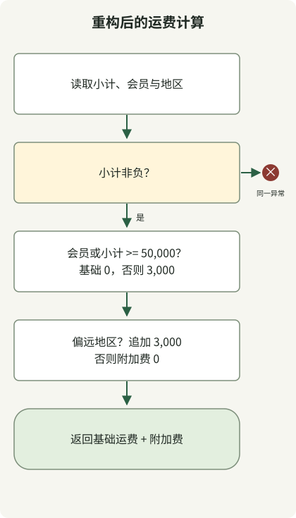

**使用 AI 智能体重构，应先定义要保留的行为与变更范围，再通过执行证据和差异检查结果。** 函数变短或智能体说“测试通过”都不足以完成。需检查返回值、异常、外部副作用是否相同，以及验证本身是否被削弱。

本指南面向熟悉 Git 和测试的开发者，不依赖特定工具、产品界面或模型。下列提示词是可复制调整的自拟示例，不是特定产品记录或性能测量。Java 示例执行结果单独标明。

## 第一次请求应包含什么？

[Martin Fowler 将重构定义为](https://refactoring.com/)在保留外部可观察行为的同时改变内部结构。若需要改策略或修 bug，应与重构分开，以评估前后差异。

除目标文件，还要提供调用方、相关测试、仓库惯例与实际验证命令。不必无条件读完整仓库，先从当前判断所需路径开始。先让它不编辑文件，仅描述当前行为和证据，可减少误解导致的范围膨胀。

示例运费策略由以下**为说明而定义的需求**组成，并非真实服务策略或事故报告。

| 条件 | 应保留行为 |
| --- | --- |
| 订单小计为负 | 抛出 `IllegalArgumentException("subtotal")` |
| 会员或小计至少 50,000 KRW | 基础运费 0 KRW |
| 否则 | 基础运费 3,000 KRW |
| 岛屿或偏远地区 | 不论基础运费是否免费，追加 3,000 KRW |

首次请求可如下编写。假设后面的完整代码已保存为 `ShippingRefactorDemo.java`。要练习让智能体编辑，先将 `before()` 正文复制到 `after()`。下面完整代码也包含完成重构的版本供比较。

```text
读取 ShippingRefactorDemo.java 中的 before()、after() 和 main()，仅做分析。
暂不修改文件。

目标：减少 after() 嵌套分支，同时保留 before() 的运费行为。
输入金额以 KRW 为单位，使用 long。
检查负数金额的异常类型与消息、50,000 KRW 边界，
以及基础免邮与偏远地区附加费的组合。

提供当前行为的代码证据、现有测试覆盖范围、
应补查的边界，以及只修改 after() 的最小变更。
不要猜测并改变不明确的策略。
```

此阶段有用的是各条件的当前行为和待改位置，而非抽象“代码质量改善计划”。例如“会员运费始终为 0 KRW”与偏远附加费冲突，应在实现前纠正。

## 小步修改并比较行为

示例从重复分支中**分离基础运费与附加费计算**，保留输入、输出和异常，不添加策略接口或配置层。小变更让审核者集中判断是否只改结构而保留策略。[Google 小型变更指南](https://google.github.io/eng-practices/review/developer/small-cls.html)



图示对应下方 `after()` 计算顺序，不描绘 AI 工具内部。`before()` 和 `after()` 为说明编写；`main()` 检查显式预期值并比较结果。JDK 21 或以上可运行，无外部依赖。

```java
public class ShippingRefactorDemo {
    static final long FREE_THRESHOLD = 50_000;
    record Case(long subtotal, boolean member, boolean remote, long expected) {}

    static long before(long subtotal, boolean member, boolean remote) {
        if (subtotal < 0) throw new IllegalArgumentException("subtotal");
        if (member) {
            if (remote) return 3_000;
            return 0;
        }
        if (subtotal >= 50_000) {
            if (remote) return 3_000;
            return 0;
        }
        if (remote) return 6_000;
        return 3_000;
    }

    static long after(long subtotal, boolean member, boolean remote) {
        if (subtotal < 0) throw new IllegalArgumentException("subtotal");
        long base = (member || subtotal >= FREE_THRESHOLD) ? 0 : 3_000;
        long surcharge = remote ? 3_000 : 0;
        return base + surcharge;
    }

    static void equal(long actual, long expected) {
        if (actual != expected) {
            throw new AssertionError("expected=" + expected + ", actual=" + actual);
        }
    }

    public static void main(String[] args) {
        Case[] examples = {
            new Case(0, false, false, 3_000),
            new Case(49_999, false, false, 3_000),
            new Case(50_000, false, false, 0),
            new Case(0, true, false, 0),
            new Case(49_999, false, true, 6_000),
            new Case(50_000, false, true, 3_000),
            new Case(0, true, true, 3_000),
            new Case(Long.MAX_VALUE, false, true, 3_000)
        };
        for (Case c : examples) {
            equal(before(c.subtotal(), c.member(), c.remote()), c.expected());
            equal(after(c.subtotal(), c.member(), c.remote()), c.expected());
        }
        System.out.println("examples=" + examples.length);

        int comparisons = 0;
        long[] amounts = {0, 1, 49_999, 50_000, 50_001, Long.MAX_VALUE};
        for (long subtotal : amounts) {
            for (boolean member : new boolean[] {false, true}) {
                for (boolean remote : new boolean[] {false, true}) {
                    equal(after(subtotal, member, remote), before(subtotal, member, remote));
                    comparisons++;
                }
            }
        }
        System.out.println("comparisons=" + comparisons);

        int rejected = 0;
        for (boolean refactored : new boolean[] {false, true}) {
            try {
                if (refactored) after(-1, false, false);
                else before(-1, false, false);
                throw new AssertionError("Negative amount was accepted");
            } catch (IllegalArgumentException e) {
                if (!"subtotal".equals(e.getMessage())) throw new AssertionError(e);
                rejected++;
            }
        }
        System.out.println("negative-inputs=" + rejected);
    }
}
```

```sh
javac --release 21 ShippingRefactorDemo.java
java ShippingRefactorDemo
```

以下输出使用 Zulu JDK `21.0.1+12-LTS` 获得。初始版本中 `after()` 和 `before()` 正文相同，与下列完成重构版本均产生此输出。

```text
examples=8
comparisons=24
negative-inputs=2
```

代码不用可能因 `-ea` 选项而禁用的 Java `assert`，而在发现差异时直接抛 `AssertionError`。报告数量为指定案例和输入组合数，不代表整个生产代码库覆盖率。

请求实现时，将此前验证条件与编辑范围、执行命令连接。

```text
仅重构 after()，保留前述运费契约。
不要修改 before()、main()、预期值或 FREE_THRESHOLD。
保留公开输入输出及异常类型、消息，不增加依赖或新层。
如需修改此文件以外内容，先说明原因，不要应用。

运行 javac --release 21 ShippingRefactorDemo.java 和 java ShippingRefactorDemo。
提供实际执行命令、退出码、观察到的输出及变更 diff。
检查失败时缩小并修复失败条件及原因；不要删检查或改预期来使其通过。
```

若智能体环境不能编辑或运行命令，自行应用建议补丁并运行同命令。提示词的“不要修改”只传达范围，不替代工具权限或文件访问限制。

## 测试通过等于行为保留吗？

示例检查 8 个明确预期值、24 个输入组合的前后结果，以及两方法负输入异常，不是所有 `long` 输入等价证明。只用 `before()` 结果作答案可能保留旧缺陷，还需独立预期值和业务需求。发现旧缺陷时，另行决定是否修复及改变何种行为。

可引入反例检查验证是否能捕获相关差异。例如将 `after()` 中 `subtotal >= FREE_THRESHOLD` 改为 `subtotal > FREE_THRESHOLD`，会让恰好 50,000 KRW 的非会员订单不再免基础运费，预期值检查应失败。

已验证临时副本中仅错误改变此边界会以 `AssertionError: expected=0, actual=3000` 失败。这只确认能检测一种具体错误，不保证所有错误变更都能检测。本文完成代码未应用此变异。

实际项目还需检查返回值以外的调用者可见行为：异常、DB 查询与事务边界、外调次数顺序、序列化结果和资源释放。纯函数例通过不验证 DB 或 HTTP 路径。性能目标还需固定输入环境的单独测量。

## 最终审核先看变更，再看解释

读智能体说明前先检查 diff 和执行结果，查找无关文件变更、删除或跳过测试、吞异常和无关依赖。`git diff --check` 检查空白等问题，不是业务测试。

若有独立审核上下文，提供原始需求、前后代码、diff 与执行证据，而不是最初的成功宣称。审核也可能错，应逐条对照代码和需求证据。[GitHub 智能体限制文档](https://docs.github.com/en/copilot/responsible-use/agents)也说明生成代码和审核意见可能不准确。

```text
审核此变更，不要修改。
输入：运费需求、前后代码、diff、测试命令与实际结果。

查找会改变返回值、异常、50,000 KRW 边界或偏远地区费用的反例。
同时检查超范围变更和测试削弱。
每个发现提供位置、示例输入、可观察差异及支持证据。
不要声称执行了未实际执行的检查。
```

最后简短交接结构变化、保留行为、实际检查和未验证范围。测试失败时加强失败输入与预期，再缩小修复；变更膨胀则拆分。**小到审核者能解释为何保留行为的变更**，在 AI 协作中仍是有用完成单位。
