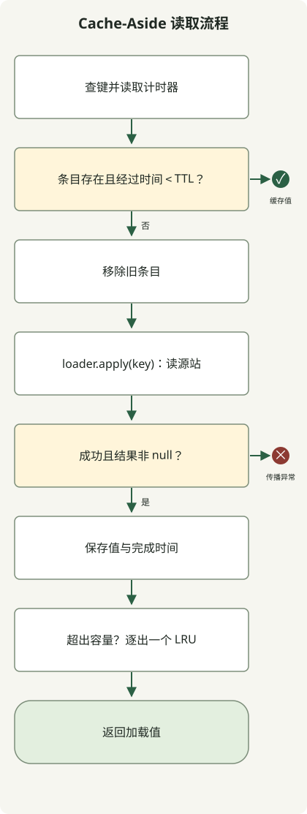

**缓存复用先前获得的结果，减少源站读取与计算。** 正确应用前，先定义哪些请求可共享结果、允许复用多久，以及源数据变化后如何刷新。若返回了其他用户的数据，或用旧价格完成购买，命中率再高也不代表缓存正确。

本文面向考虑为读取 API 添加缓存的开发者，以商品描述等容忍一定延迟的数据解释 Cache-Aside，并用 Java 运行 TTL 与容量限制。支付或库存最终确认等必须使用当前状态的操作，应与此读取缓存分开。故障时允许陈旧数据的策略可衔接[降级设计文章](/ko/posts/2026-10-31-failure-fallback/)。

## 缓存什么，放在哪里？

从重复读取多、源站访问昂贵且允许短时陈旧响应的路径开始。只使用一次或几乎完全因用户而异的数据，存储和失效成本可能超过命中节省的成本。

| 位置 | 可减少的成本 | 同时需定义的条件 |
| --- | --- | --- |
| 浏览器或 CDN 的 HTTP 缓存 | 网络往返与到达 API 的请求 | 是否允许共享、URL 与 `Vary`、`Cache-Control` |
| 应用本地缓存 | 远程缓存往返、DB 读取和重复计算 | 每进程内存限制、副本间值的差异 |
| Redis 等共享缓存 | 跨副本重复读取源站 | 网络延迟、故障行为、序列化和存储容量 |

不必一次使用所有层。本地缓存快，但每个副本各持一份不同拷贝。共享缓存可减少重复存储，却增加网络与运维依赖。多层缓存的失效也必须传播至每一层。

## Cache-Aside 如何工作？

应用先查缓存；条目不存在或过期时，读取源站并将结果存入缓存，这称为 **Cache-Aside**。写入通常先提交源数据变更，再使对应条目失效。丢失缓存不会丢源数据，这不同于将缓存当作唯一记录。[Microsoft 对 Cache-Aside 的说明](https://learn.microsoft.com/en-us/azure/architecture/patterns/cache-aside)

缓存键必须包含影响结果的输入。例如 `Key(tenant, product, language)` 为不同租户、商品和语言表示不同条目。如果货币、用户权限或表示格式版本也改变响应，就相应区分键或缓存作用域。无分隔符拼接可能碰撞，应使用结构化键或无歧义编码。

键中有租户 ID 不代表授权完成。应从可信认证上下文确定租户，在查询缓存前验证访问权限。不要将访问令牌或密码直接放入键或日志。

**TTL 是值可复用的时间；容量限制是可存多少。** 只有 TTL，条目可能持续累积直到过期；只有大小限制，旧值可能一直命中。条目数与实际字节数不同，存大响应时需计入对象和序列化大小。

## Java 示例：键隔离、过期、失效与容量限制

以下是按租户缓存商品描述的**本地缓存语义小型演示**。5 秒 TTL 和最多 2 条是观察行为的数值，并非生产推荐。它使用 `LinkedHashMap` 的访问顺序，优先逐出最久未访问条目。[Java 21 文档](https://docs.oracle.com/en/java/javase/21/docs/api/java.base/java/util/LinkedHashMap.html)



图示对应 `get()`。源站加载器失败时，异常向外传播，不存入新值。`invalidate()` 是源数据变更后调用的独立操作。

保存为 `CacheDemo.java`，在 JDK 21 或更高版本运行，无需外部服务器或库。

```java
import java.time.Duration;
import java.util.LinkedHashMap;
import java.util.Objects;
import java.util.concurrent.atomic.AtomicInteger;
import java.util.concurrent.atomic.AtomicLong;
import java.util.function.Function;
import java.util.function.LongSupplier;

public class CacheDemo {
    record Key(String tenant, String product, String language) {}
    record Entry(String value, long loadedAt) {}

    static final class LocalCache {
        private final LinkedHashMap<Key, Entry> entries =
                new LinkedHashMap<>(16, 0.75f, true);
        private final LongSupplier ticker;
        private final long ttl = Duration.ofSeconds(5).toNanos();
        private final int maximumSize = 2;

        LocalCache(LongSupplier ticker) { this.ticker = ticker; }

        synchronized String get(Key key, Function<Key, String> loader) {
            Entry entry = entries.get(key);
            long now = ticker.getAsLong();
            if (entry != null && now - entry.loadedAt() < ttl) {
                return entry.value();
            }
            entries.remove(key);
            String value = Objects.requireNonNull(loader.apply(key));
            entries.put(key, new Entry(value, ticker.getAsLong()));
            if (entries.size() > maximumSize) {
                entries.remove(entries.keySet().iterator().next());
            }
            return value;
        }

        synchronized void invalidate(Key key) { entries.remove(key); }
    }

    static void expect(String actual, String expected) {
        if (!actual.equals(expected)) throw new AssertionError(actual);
        System.out.println(actual);
    }

    public static void main(String[] args) {
        AtomicLong clock = new AtomicLong();
        AtomicInteger loads = new AtomicInteger();
        LocalCache cache = new LocalCache(clock::get);
        Function<Key, String> loader = key ->
                key.tenant() + "/" + key.language() + "/v" + loads.incrementAndGet();
        Key ko = new Key("shop-a", "p1", "ko");
        Key en = new Key("shop-a", "p1", "en");
        Key other = new Key("shop-b", "p1", "ko");

        expect(cache.get(ko, loader), "shop-a/ko/v1");
        expect(cache.get(ko, loader), "shop-a/ko/v1");
        clock.set(Duration.ofSeconds(5).toNanos() - 1);
        expect(cache.get(ko, loader), "shop-a/ko/v1");
        clock.incrementAndGet();
        expect(cache.get(ko, loader), "shop-a/ko/v2");
        cache.invalidate(ko);
        expect(cache.get(ko, loader), "shop-a/ko/v3");
        expect(cache.get(en, loader), "shop-a/en/v4");
        expect(cache.get(ko, loader), "shop-a/ko/v3");
        expect(cache.get(other, loader), "shop-b/ko/v5");
        expect(cache.get(en, loader), "shop-a/en/v6");

        Key failing = new Key("shop-c", "p1", "ko");
        try {
            cache.get(failing, key -> { throw new IllegalStateException("origin"); });
            throw new AssertionError("Failure was swallowed");
        } catch (IllegalStateException expected) {
            expect(expected.getMessage(), "origin");
        }
        expect(cache.get(failing, loader), "shop-c/ko/v7");
    }
}
```

```sh
javac --release 21 CacheDemo.java
java CacheDemo
```

以下输出使用 Zulu JDK `21.0.1+12-LTS` 获得。

```text
shop-a/ko/v1
shop-a/ko/v1
shop-a/ko/v1
shop-a/ko/v2
shop-a/ko/v3
shop-a/en/v4
shop-a/ko/v3
shop-b/ko/v5
shop-a/en/v6
origin
shop-c/ko/v7
```

同键前三次读取只访问源站一次。过期前 1ns 返回同值，恰好 5 秒时重新加载。随后检查显式失效、语言与租户隔离和访问顺序逐出，还包括加载器失败后的成功读取。`v1` 等值表示测试加载器调用顺序，并非真实 DB 版本。

时间由手动推进的单调计时器复现，不使用睡眠。实际进程可传入 `new LocalCache(System::nanoTime)` 作为经过时间计时器。示例访问时处理过期，不在后台立即删除；限制条目数而非字节数。

为简化代码，加载器也在 `synchronized` 范围内运行。同实例调用即使键不同也会串行，等待慢加载器的请求数没有限制。因此它不是高性能生产缓存实现，未实现下文的逐键 single-flight、源调用限制、超时和跨副本失效传播。执行检查为顺序场景，未进行并发负载测试。

## TTL 与失效能保证最新值吗？

不能。本例从**源站读取完成并存入缓存时**开始计 TTL。如果源站本身是延迟的只读副本或旧快照，5 秒 TTL 不代表变更后 5 秒内可见最新值。读取延迟、复制延迟和失效传播需单独考虑。

多副本共享缓存时，即使先更新 DB 再删除条目，也会竞争：读取 A 开始取旧值；写入 B 提交新值并删缓存；A 随后完成又存回旧值。TTL 缩短残留时间，但不消除竞争。

必须使用当前状态的路径需在源事务内重新验证，或通过数据版本与条件写入等防止迟到结果覆盖新值。事件失效要处理丢失、重复以及提交到交付间延迟。如果变更影响列表、详情、聚合等多个键，也需定义这些键的失效范围。

区分 `expire-after-write` 和 `expire-after-access`。每次访问延长有效期，可能让常读旧值长期存在。若要不论读取次数，都在存储后固定时间重新检查，应评估写入后过期是否符合目标。[Caffeine 过期与逐出策略](https://github.com/ben-manes/caffeine/wiki/Eviction)

## 集中过期或缓存故障时怎么办？

热门键过期瞬间，所有请求都读源站会造成**缓存击穿（cache stampede）**。用 single-flight 将同键读取合并为一个在途操作，并限制源调用并发和等待时间。进程内去重不等于所有副本去重。Java 可考虑 [Caffeine 原子查找与加载 API](https://github.com/ben-manes/caffeine/wiki/Population)，但仅靠它不能建立全服务源负载上限。

大量键同时到期时，可用抖动分散时间。新鲜度上限为 60 秒，就在不超过 60 秒的范围内分散。抖动不能解决单热门键集中请求。仅在允许陈旧响应的路径使用 stale-while-revalidate，即返回旧值同时刷新，并为持续刷新失败另设最大数据年龄。

缓存故障时将所有请求送到 DB 也危险。例如读取 10,000 RPS、正常命中率 90% 时，源流量约 1,000 RPS；全部失去命中后，即使请求分布不变也升到 10,000 RPS。这是计算示例，不是测量，不含重试与刷新调用。

源站承受不了时，应限制绕过缓存的请求，使用获准本地副本或缩减功能，或拒绝超额请求。分别观测缓存故障与未命中，并限制恢复时批量加载。对反复请求不存在 ID 的路径，短期负缓存可能有帮助，但不要将源故障缓存为“无数据”。也应定义其 TTL 和失效，让新建数据能被读取。

## 区分 HTTP 缓存与应用缓存

浏览器和 CDN 的 HTTP 缓存通过响应头传达复用策略，是与 JVM 内对象 TTL 不同的层。

| 指令 | 含义 |
| --- | --- |
| `max-age=60` | 响应年龄小于 60 秒时视为新鲜 |
| `s-maxage=60` | 指定共享缓存新鲜期，在该处覆盖 `max-age` 等设置 |
| `private` | 限制共享缓存存储；浏览器等私有缓存可存储 |
| `no-cache` | 允许存储，但复用前必须成功向源站验证 |
| `no-store` | 指示缓存不存储此请求或响应，不是删除已有副本的命令 |

若用 `Accept-Language` 选择语言，`Vary` 和实际缓存配置必须反映差异。URL 本身区分语言时，它也属于键。内容不变时，`ETag` 与条件请求能减少传输，却不总能消除源验证成本。`private` 与 `no-store` 不能替代认证、授权或加密。[RFC 9111：HTTP 缓存](https://www.rfc-editor.org/rfc/rfc9111.html)

从一条读取路径开始验证。除正常命中，还需检查 TTL 边界、写后立即读取、跨租户和语言同 ID、最大容量、并发未命中、故障与恢复。生产中除命中率，还应跟踪源调用量、延迟、失败率、在途加载、逐出、内存及失效延迟。只有确认**响应正确，且没有缓存时源站也能存活**，才能判断收益。
