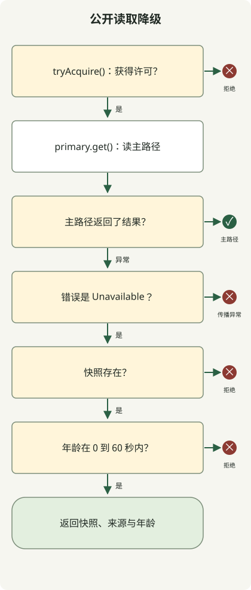

故障期间，**降级应在系统可承担的成本内，提供预先定义且可接受质量的响应**。例如省略推荐区域，或返回约定年龄限制内的公开读取数据。支付结果未知时报告成功，或缓存失败后把全部请求发送 DB，都会制造其他问题。

本文面向运行 HTTP API 的开发者，接续 [10k RPS 架构文章](/ko/posts/2026-10-31-jdk-10k-rps-architecture/)的过载控制，讨论故障期间该返回什么响应。Java 示例在没有外部服务器时运行降级策略，不测量吞吐量或生产故障恢复。

## 不同故障允许不同结果

先决定正常结果中哪些内容可缩减。下表是设计示例，实际年龄上限与缩减范围必须遵循服务契约。

| 故障 | 可接受替代 | 停止或限制条件 |
| --- | --- | --- |
| 推荐 API 延迟或失败 | 省略可选推荐，或使用预备通用推荐 | 不让核心商品读取进入同一队列 |
| 公开商品描述读取失败 | 返回同商品、同语言的最后成功数据并附更新时间 | 超龄、无数据或键错误 |
| 整个缓存不可用 | 限量读取源站、获准本地副本或拒绝超额请求 | 不允许超出 DB 连接与并发预算的无限绕过 |
| 认证或授权检查失败 | 不执行受保护操作，返回临时错误 | 不与无权限混淆，也不改为批准访问 |
| 支付或订单请求后响应丢失 | 用同一操作标识查询并核对状态 | 不假设失败后新建支付，也不虚构成功 |
| 替代服务器使用相同 DB | 仅在独立验证的容量内切换 | 换服务器不能解决共享 DB 瓶颈 |

将授权、最终价格、扣库存等正确性关键路径与简单陈旧读取分开。支付“查询中”只有在真正能追踪并查询请求时才有意义。改消息或响应名称不能管理未决结果。

AWS 在[分布式系统降级风险](https://aws.amazon.com/builders-library/avoiding-fallback-in-distributed-systems/)中指出，罕用路径可能测试不足，替代方案也会带来额外问题。像正常路径一样运行降级路径，并检查是否依赖相同资源。

## 超时、重试与熔断器各做什么？

超时限制调用方等待多久。**等待结束不代表远程操作或支付已取消。** 重试再次尝试同一操作，故障转移切换到其他副本，降级切换到缩减响应或不同处理方式。熔断器在失败累积后按条件阻止依赖调用；哪些替代响应安全由另一策略决定。

总请求截止时间须包含建连、连接池等待、响应等待、重试和替代处理。例如总预算 300ms，首次已用 250ms，就不能再等 250ms。这些数字仅说明概念，不是推荐值。还需确认客户端各阶段超时实际包含什么。

[AWS 重试指南](https://aws.amazon.com/builders-library/timeouts-retries-and-backoff-with-jitter/)说明，重试增加负载，且响应失败时副作用仍可能已发生。将重试责任交给单一层；只有重复安全时，才对瞬时故障限制剩余时间与尝试次数后重试。指数退避和抖动分散同时重试，但不增加饱和 DB 容量。

## Java 示例：仅在有限时间内返回获准公开数据

示例读取**一份固定公开商品描述**，优先正常响应，仅当依赖故障分类为 `Unavailable` 时使用最后成功副本。副本不得超过 60 秒，未来时间戳被拒绝。上限 2 与 60 秒窗口是演示策略。多商品、语言或租户需独立键；不要原样用于认证用户数据缓存。



图示对应 `read()` 的判断。获得许可的所有路径，不论返回主结果或抛异常，均通过 `finally` 释放。未实现超时、熔断器或缓存刷新。真实 HTTP 适配器仅应将连接失败、超时等获准故障转为 `Unavailable`。将 401、403、404、模式错误和编程错误转为同一异常，会改变策略含义。

保存为 `FallbackDemo.java`，在 JDK 21 或更高版本运行，无外部依赖。

```java
import java.time.Clock;
import java.time.Duration;
import java.time.Instant;
import java.time.ZoneOffset;
import java.util.concurrent.Semaphore;
import java.util.function.Supplier;

public class FallbackDemo {
    record Snapshot(String value, Instant observedAt) {}
    record Reply(String value, String source, long ageSeconds) {}
    static class Unavailable extends RuntimeException {}
    static class Rejected extends RuntimeException {
        Rejected(String reason) { super(reason); }
    }

    static final class Catalog {
        private final Semaphore slots = new Semaphore(2);
        private final Clock clock;
        private final Duration maxAge = Duration.ofSeconds(60);

        Catalog(Clock clock) { this.clock = clock; }

        Reply read(Supplier<String> primary, Snapshot snapshot) {
            if (!slots.tryAcquire()) throw new Rejected("capacity");
            try {
                try {
                    return new Reply(primary.get(), "primary", 0);
                } catch (Unavailable failure) {
                    if (snapshot == null) throw new Rejected("missing");
                    Duration age = Duration.between(
                            snapshot.observedAt(), clock.instant());
                    if (age.isNegative() || age.compareTo(maxAge) > 0) {
                        throw new Rejected("age");
                    }
                    return new Reply(snapshot.value(), "snapshot", age.toSeconds());
                }
            } finally {
                slots.release();
            }
        }
    }

    static void rejected(String reason, Runnable action) {
        try {
            action.run();
        } catch (Rejected e) {
            if (!reason.equals(e.getMessage())) throw new AssertionError(e);
            System.out.println("rejected=" + reason);
            return;
        }
        throw new AssertionError("Expected rejection: " + reason);
    }

    public static void main(String[] args) {
        Instant now = Instant.parse("2026-10-31T00:00:00Z");
        Catalog catalog = new Catalog(Clock.fixed(now, ZoneOffset.UTC));
        Snapshot recent = new Snapshot("saved-description", now.minusSeconds(30));
        Supplier<String> down = () -> { throw new Unavailable(); };

        System.out.println(catalog.read(() -> "live-description", recent));
        System.out.println(catalog.read(down, recent));
        System.out.println(catalog.read(down,
                new Snapshot("boundary", now.minusSeconds(60))));
        rejected("age", () -> catalog.read(down,
                new Snapshot("old", now.minusSeconds(60).minusNanos(1))));
        rejected("age", () -> catalog.read(down,
                new Snapshot("future", now.plusSeconds(1))));
        rejected("missing", () -> catalog.read(down, null));

        try {
            catalog.read(() -> { throw new IllegalStateException("schema"); }, recent);
            throw new AssertionError("Unexpected fallback");
        } catch (IllegalStateException expected) {
            System.out.println("propagated=" + expected.getMessage());
        }

        // Hold both permits through nested calls; the third call must not run.
        catalog.read(() -> catalog.read(() -> {
            rejected("capacity", () -> catalog.read(() -> {
                throw new AssertionError("Primary ran without a permit");
            }, recent));
            return "inner";
        }, recent).value(), recent);
        System.out.println(catalog.read(() -> "recovered", recent));
    }
}
```

```sh
javac --release 21 FallbackDemo.java
java FallbackDemo
```

以下输出使用 Zulu JDK `21.0.1+12-LTS` 获得。

```text
Reply[value=live-description, source=primary, ageSeconds=0]
Reply[value=saved-description, source=snapshot, ageSeconds=30]
Reply[value=boundary, source=snapshot, ageSeconds=60]
rejected=age
rejected=age
rejected=missing
propagated=schema
rejected=capacity
Reply[value=recovered, source=primary, ageSeconds=0]
```

`source=snapshot` 和 `ageSeconds` 是向客户端传达降级质量的应用元数据，不实现 HTTP `Age` 头。最大年龄比较使用精确的 `Duration`；只有显示年龄取整秒。

[Semaphore 的 `tryAcquire()`](https://docs.oracle.com/en/java/javase/21/docs/api/java.base/java/util/concurrent/Semaphore.html)在无许可时不等待而失败。此例将降级响应纳入同一准入限制，所以已饱和时连副本也不返回。生产中若允许低成本副本专用路径，也需独立上限。嵌套调用确定性演示许可耗尽，并非并发负载测试。

示例未实现成功读取的存储刷新、存储上限与逐出、请求合并或重启后副本恢复。生产中仅从成功读取更新副本，**返回副本时不得重写存储时间戳**，否则每次降级更新时间会让旧值永远合格。长期副本还需考虑时钟调整的新鲜度策略。

## 同时定义结束故障的条件

[Google SRE 过载处理指南](https://sre.google/sre-book/handling-overload/)说明，连降级都无法承担时，可能必须返回错误。若准入拒绝或无有效副本导致暂不可用，可按 HTTP 契约使用 503。有可靠重试时间可发送 `Retry-After`，但头本身不能防止客户端洪峰。504 表示网关或代理未及时收到上游响应，不是所有应用超时的通用代码。[RFC 9110](https://www.rfc-editor.org/rfc/rfc9110.html#name-server-error-5xx)

熔断器一关闭就将全部流量送回主路径，可能再次压垮恢复中的服务。用有限半开探测检查状态，逐步放量，同时限制快照刷新和缓存回填。预先定义正常延迟、失败率、DB 连接等待或队列积压超标时，何时停止扩量或退回前阶段。具体比例与观察期通过真实负载测试确定。

首次上线先选一个可选读取路径并注入依赖故障，检查无副本、允许年龄边界、未来时间、完全饱和、未分类异常和依赖恢复。实际服务器还需测试慢响应、连接池耗尽、缓存全故障、主备路径同时失败及恢复时同时重试。

运维指标应区分正常结果、降级结果、拒绝和失败。只看 HTTP 200 比率会隐藏大部分响应陈旧的故障。一起跟踪降级比例、数据年龄、按依赖分类的失败、准入拒绝与在途请求。**区分真正完成业务与降低质量处理的请求**，才能判断降级是否减轻故障影响。
