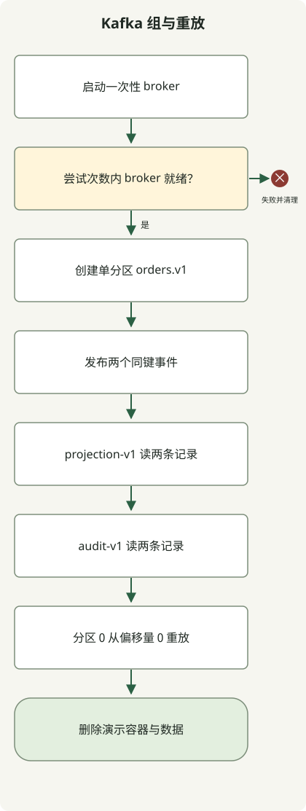

**Kafka 事件流将已发生事实记录在日志中，让多个消费者从各自位置读取处理。** 发货准备与分析可独立读取订单事件，已存记录也可用新逻辑重新处理。但将事件存入 Kafka，与恰好一次修改外部 DB 或支付，是不同问题。

本文面向熟悉 HTTP API 和数据库的开发者，串联主题、分区、消费者组，并在本地 Kafka 运行事件发布、独立消费和重放。重点是**消费者位置与失败后重新处理的含义**，不是实现 Kafka Streams 聚合、窗口或连接。

## 事件流与任务队列有何不同？

事件是已发生事实，如“订单已创建”。将它与“开始发货”等要求动作的命令区分，可让多个消费者按各自业务使用同一记录。Kafka 也能像队列一样在组内分工，但消费不立即删除记录；其他组和重放作业可在保留策略内再次读取。[Apache Kafka 简介](https://kafka.apache.org/intro/)

| 概念 | 作用 | 设计时决定 |
| --- | --- | --- |
| 生产者 | 向 Kafka 写事件 | 键、事件 ID、模式、发布失败处理 |
| 主题 | 相关事件的逻辑流 | 事件语义、保留与压缩策略、权限 |
| 分区 | 有序日志的划分 | 顺序范围、键分布、并行吞吐量 |
| 消费者组 | 共同承担同一业务的消费者集合 | 组 ID、处理及提交时机、重处理策略 |
| 偏移量 | 分区内记录位置 | 已读到哪里、从何恢复 |

例如 `shipping-v1`、`analytics-v1` 两组读取 `orders.v1` 时，两个业务可独立收到相同事件。若把发货和分析消费者放在同组，它们会分摊记录，无法配置为各自接收全部事件。

普通组订阅中，一个分区分配给组内一个消费者。五个消费者读 3 个分区，不会全部分到分区。其他组独立分配。本文使用普通 `KafkaConsumer` 组订阅，不同于逐记录共享消费模型。[KafkaConsumer 组订阅](https://kafka.apache.org/41/javadoc/org/apache/kafka/clients/consumer/KafkaConsumer.html)

## 顺序重要时先确定键

Kafka 定义**分区内**记录顺序。若同订单状态变更顺序重要，先以订单 ID 为键路由到同一分区。键决定路由，事件 ID 识别重复，用途不同。同订单多个事件若共用事件 ID，合法后续事件也可能被当成重复丢弃。

同键路由还要求键序列化、分区算法和分区数一致。增加分区会改变后续记录去向，应检查与旧记录的顺序。读取一个分区后无限并行也会改变完成顺序。日志顺序也不总等于业务发生时间顺序；多个发布者的迟到事件需业务版本、发生时间及乱序处理规则。

占大部分事件的单客户等热键会将负载集中在一个分区。不要任意将顺序单元拆为更小键，应结合处理成本检查必要顺序范围。

## 本地运行：两个组读取相同记录再重放

示例使用 Apache 的 `apache/kafka:4.1.2` 镜像内置工具。需要 Bash 和运行中的 Docker，首次需下载镜像。broker 和 CLI 在同容器，不暴露主机端口。容器停止后实验数据删除。此功能演示使用 1 个 broker、1 个分区和复制因子 1。[官方 Docker 说明](https://kafka.apache.org/41/getting-started/docker/)



图示为脚本成功时的执行顺序。就绪或命令失败时停止，容器创建成功后退出会清理。两次组读取与一次直接重放顺序运行。未实现外部 DB 处理和手动偏移提交。

保存为 `kafka-demo.sh`，运行 `bash kafka-demo.sh`。

```sh
#!/usr/bin/env bash
set -euo pipefail

kafka_image=apache/kafka:4.1.2
kafka_name="kafka-stream-demo-$$-$RANDOM"
docker run -d --name "$kafka_name" "$kafka_image" >/dev/null
trap 'docker rm -f "$kafka_name" >/dev/null 2>&1 || true' EXIT

ready=false
for ((attempt=0; attempt<30; attempt++)); do
  if docker exec "$kafka_name" /opt/kafka/bin/kafka-topics.sh \
      --bootstrap-server localhost:9092 --list >/dev/null 2>&1; then
    ready=true
    break
  fi
  sleep 1
done
if [ "$ready" != true ]; then
  docker logs "$kafka_name" >&2
  exit 1
fi

docker exec "$kafka_name" /opt/kafka/bin/kafka-topics.sh \
  --bootstrap-server localhost:9092 --create --topic orders.v1 \
  --partitions 1 --replication-factor 1 >/dev/null

docker exec -i "$kafka_name" /opt/kafka/bin/kafka-console-producer.sh \
  --bootstrap-server localhost:9092 --topic orders.v1 \
  --producer-property acks=all --producer-property enable.idempotence=true \
  --property parse.key=true --property key.separator=: <<'EVENTS'
order-101:{"eventId":"evt-1","type":"OrderCreated","schemaVersion":1}
order-101:{"eventId":"evt-2","type":"PaymentConfirmed","schemaVersion":1}
EVENTS

for group in projection-v1 audit-v1; do
  printf 'group=%s\n' "$group"
  docker exec "$kafka_name" /opt/kafka/bin/kafka-console-consumer.sh \
    --bootstrap-server localhost:9092 --topic orders.v1 --group "$group" \
    --from-beginning --max-messages 2 --timeout-ms 15000 \
    --property print.key=true --property 'key.separator=|'
done

printf 'replay=partition-0-offset-0\n'
docker exec "$kafka_name" /opt/kafka/bin/kafka-console-consumer.sh \
  --bootstrap-server localhost:9092 --topic orders.v1 \
  --partition 0 --offset 0 --max-messages 2 --timeout-ms 15000 \
  --property print.key=true --property 'key.separator=|'
```

以下标准输出由 Docker Engine `24.0.5` 和 `apache/kafka:4.1.2` 验证。每条消费者命令还向标准错误单独写入 `Processed a total of 2 messages`。

```text
group=projection-v1
order-101|{"eventId":"evt-1","type":"OrderCreated","schemaVersion":1}
order-101|{"eventId":"evt-2","type":"PaymentConfirmed","schemaVersion":1}
group=audit-v1
order-101|{"eventId":"evt-1","type":"OrderCreated","schemaVersion":1}
order-101|{"eventId":"evt-2","type":"PaymentConfirmed","schemaVersion":1}
replay=partition-0-offset-0
order-101|{"eventId":"evt-1","type":"OrderCreated","schemaVersion":1}
order-101|{"eventId":"evt-2","type":"PaymentConfirmed","schemaVersion":1}
```

每组均读取两个事件，最终直接重放也读到相同两条记录，证明一个组消费不阻止其他组读取或日志重放。只有一个分区，无法验证跨分区顺序或组内并行分配。

示例以默认自动提交检查控制台工具消费，不实现业务处理后手动提交的应用，也不测试处理与提交之间失败。输入 JSON 模式校验、外部 DB 或支付更新以及重平衡中处理也未实现。

## 提交偏移量能保证业务完成吗？

不能。`poll()` 收到记录时当前位置可前进，但重启使用的**已提交位置**独立。顺序处理完成偏移量 10 后，通常提交下一读取位置 11。多分区需分别管理完成范围。删除、事务等原因使偏移量不一定是连续整数记录序列。[KafkaConsumer 位置与提交](https://kafka.apache.org/41/javadoc/org/apache/kafka/clients/consumer/KafkaConsumer.html)

| 执行顺序及失败点 | 重启后可能结果 | 所需处理 |
| --- | --- | --- |
| 提交偏移 → DB 变更前终止 | 跳过变更导致业务遗漏 | 按交付语义改变提交顺序 |
| 完成 DB 变更 → 提交偏移前终止 | 同事件再次交付处理 | 幂等或去重 |
| 部分失败后提交更晚位置 | 失败记录可能跳过 | 只提交连续成功范围 |
| 分区改分配给其他消费者 | 旧工作与新所有者重叠 | 停止旧所有者并防重复外部副作用 |

更新外部 DB 的消费者可在**同一 DB 事务**中检查 `(처리기 ID, eventId)` 唯一性并应用业务变更。仅先存处理标记、业务失败，会让下次交付被误判重复；变更后单独存标记，中途失败又可能重复变更。其他外部 API 不自动包含于事务，还需幂等键和结果核验。

生产者的 `enable.idempotence` 处理生产者重试导致的日志重复，不能去掉应用将同一业务事件作为新发布发送两次的所有情况。`acks=all` 也不是不论其他设置都防丢失的保证。应结合复制因子、`min.insync.replicas` 与实际 ISR 状态检查。上述单 broker 实验不验证 broker 丢失容错。[生产者配置](https://kafka.apache.org/41/configuration/producer-configs/)

应区分 Kafka 事务结合输入偏移与输出主题记录、并使用 `read_committed` 消费的处理，与外部 DB 或支付恰好一次副作用。没有外部系统协作，使用 Kafka 不会让一切都 exactly-once。[Kafka 交付语义与事务](https://kafka.apache.org/41/design/design/)

## 将重试与重放设计为常规运维路径

临时外部故障按次数、总时间和并发限制重试。持续失败事件堵整个分区时可考虑延迟处理，但检查原流程推进后续是否破坏顺序。发至 DLQ 主题不代表业务完成。保留原事件 ID、原因、模式版本、重处理负责人和解决期限，并处理写 DLQ 与推进输入偏移之间失败。

DB 提交与 Kafka 发布分开的生产者，也会在两步间失败。同事务保存 DB 变更与 outbox，再交付是一种办法；消费者仍须去重。添加 Kafka 不会让源 DB 与日志自动处于同一事务。[事务性 outbox 模式](https://docs.aws.amazon.com/prescriptive-guidance/latest/cloud-design-patterns/transactional-outbox.html)

`--from-beginning` 不会无条件倒退已有有效提交位置的组。实验用新组，末步直接指定分区和起点，不重置组。修改现有组位置的运维重放需独立流程：先停消费者并核实目标、范围和外部影响。新组重放也可能再次支付或通知，须输出隔离或幂等策略。[消费者偏移重置配置](https://kafka.apache.org/41/configuration/consumer-configs/)

落后超过保留期，所需记录可能已删除。日志压缩也不保留键的所有历史状态。结合保留、压缩和必要模式解释能力定义可重放范围。

初期选一个业务流程，除正常处理，还检查 DB 更新后提交前终止、重启、重平衡、无效模式、外部依赖延迟与重放重复副作用。`lag` 是选定末端位置与消费或提交位置之差，需明确使用哪种位置。除 lag，还观测事件发生至业务更新延迟、失败、重试、DLQ、重平衡、broker 存储和复制状态，区分“读记录”与“业务完成”。
