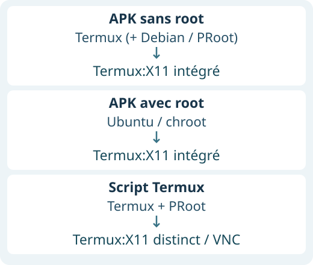

---
{
  "state": "draft",
  "language": "fr",
  "translationKey": "2026-11-27-droiddesk-android-linux-desktop",
  "title": "DroidDesk · Comment un bureau Linux fonctionne-t-il sur un téléphone Android ?",
  "description": "L’APK autonome et le script Termux n’utilisent pas le même environnement ni le même mode d’affichage. Voici comment choisir un premier essai sur son téléphone.",
  "sourcePath": "src/content/posts/en/2026-11-27-droiddesk-android-linux-desktop.md",
  "sourceSha256": "656b9e1b21a758a366d894876650b607e9bd2eadcb535e4a0565a68566807a1f"
}
---

Peut-on brancher un clavier sur un ancien téléphone Android pour travailler avec un éditeur et un navigateur Linux ? DroidDesk est un projet open source qui fait tourner un bureau Linux sur Android. Avant de choisir son mode d’installation, il faut savoir que l’APK autonome et le script d’installation pour Termux suivent des chemins différents.

Cet article s’appuie sur les notes de version et le code source d’orailnoor/DroidDesk v1.3.1, consultés le 27 novembre 2026. Je n’ai pas installé l’APK sur un appareil physique ni mesuré les performances des applications. [Notes de version](https://github.com/orailnoor/DroidDesk/releases/tag/v1.3.1)

## Qu’est-ce qui distingue l’APK du script Termux ?

| Installation | Environnement d’exécution | Affichage |
| --- | --- | --- |
| APK autonome sans accès root | Bureau par défaut dans le Termux intégré, avec Debian en option via PRoot | Termux:X11 intégré |
| APK autonome avec accès root | Système de fichiers Ubuntu ARM64 dans un environnement chroot | Termux:X11 intégré |
| Script d’installation pour Termux | Termux installé séparément, avec PRoot pour les paquets de la distribution | Application Termux:X11 distincte ou VNC en option |

D’après le README, l’APK n’utilise pas PRoot sur un appareil sans accès root. C’est bien le cas du bureau par défaut, qui tourne directement dans Termux. Toutefois, dans la v1.3.1, LinuxRuntime permet aussi d’installer Debian en option et inclut un lanceur PRoot. Au sein de la même application, les conditions d’exécution d’un programme peuvent donc varier selon qu’on le lance depuis le bureau par défaut ou dans Debian. [README](https://github.com/orailnoor/DroidDesk/blob/v1.3.1/README.md) · [LinuxRuntime](https://github.com/orailnoor/DroidDesk/blob/v1.3.1/app/android/app/src/main/kotlin/com/orailnoor/droiddesk/runtime/LinuxRuntime.kt) · [ChrootRuntime](https://github.com/orailnoor/DroidDesk/blob/v1.3.1/app/android/app/src/main/kotlin/com/orailnoor/droiddesk/runtime/ChrootRuntime.kt)

## Que peut-on utiliser sur son téléphone ?

Le plus simple est de partir d’un programme dont on a besoin. Le projet cite notamment Firefox, LibreOffice et VS Code. Les notes de la v1.3.1 signalent aussi des correctifs pour des échecs d’installation ou de démarrage qui touchaient, entre autres, un paquet nécessaire à Firefox et VS Code. Une fois l’icône de l’éditeur affichée, reste à vérifier les extensions, la méthode de saisie et les chemins d’accès utilisés au quotidien. [Notes de version](https://github.com/orailnoor/DroidDesk/releases/tag/v1.3.1)

Les capacités graphiques varient aussi selon l’appareil. Le code prévoit un rendu avec Turnip et Zink pour les GPU Adreno et un rendu logiciel avec llvmpipe. Pour un logiciel aussi exigeant que Blender, vérifiez si l’accélération fonctionne sur votre appareil et si vous pouvez manipuler votre projet sans saccades. Si vous comptez compiler sous PRoot, les accès fréquents aux fichiers peuvent ralentir le travail. [Limites de PRoot](https://github.com/termux/proot-distro#limitations)

Avant de brancher un moniteur externe, vérifiez que le téléphone prend en charge la sortie vidéo par USB-C. Dans le montage avec un Raspberry Pi décrit par le projet, le Pi reçoit la session VNC fournie par le script Termux et l’affiche sur le moniteur. L’APK autonome utilise pour sa part son affichage X11 intégré. [Connexion au moniteur](https://github.com/orailnoor/DroidDesk/blob/v1.3.1/README.md#for-monitor-output--optional-)

## Par quelle tâche commencer ?

Sur un appareil Android ARM64, cherchez l’APK sur la page officielle des versions et faites un premier essai sur l’écran du téléphone. Écrivez par exemple un texte en coréen dans l’éditeur, enregistrez le fichier, rouvrez la session et chargez ce même fichier. Si cela fonctionne, poursuivez votre travail habituel avec un clavier et une souris ou un moniteur externe. L’intérêt de DroidDesk est de découvrir quels outils Linux vous pouvez utiliser sur un téléphone que vous possédez déjà. Pour la bureautique, commencez par la saisie et l’enregistrement. Pour le développement, vérifiez les paquets et les extensions nécessaires. Pour le graphisme, testez l’accélération et la réactivité de l’affichage. [Configuration de compilation Android](https://github.com/orailnoor/DroidDesk/blob/v1.3.1/app/android/app/build.gradle.kts)

[Vérifier l’espace disque utilisé par Docker Desktop sur Mac](../2026-11-27-docker-desktop-mac-disk-space/)
