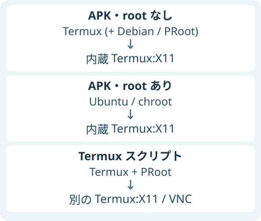

---
{
  "state": "draft",
  "language": "ja",
  "translationKey": "2026-11-27-droiddesk-android-linux-desktop",
  "title": "DroidDesk を読み解く · Android スマートフォンで Linux デスクトップはどう動く？",
  "description": "単体 APK と Termux インストールスクリプトの実行環境や画面出力の違いを踏まえ、手元の端末で最初に試す作業を考えます。",
  "sourcePath": "src/content/posts/en/2026-11-27-droiddesk-android-linux-desktop.md",
  "sourceSha256": "656b9e1b21a758a366d894876650b607e9bd2eadcb535e4a0565a68566807a1f"
}
---

使わなくなった Android スマートフォンにキーボードをつなぎ、Linux のエディターとブラウザーで作業できるでしょうか。DroidDesk は Android 上で Linux デスクトップを動かすオープンソースプロジェクトです。インストール方法を選ぶ前に押さえたいのは、単体 APK と Termux インストールスクリプトでは実行経路が違うことです。

本稿では orailnoor/DroidDesk v1.3.1 のリリース情報とソースコードを 2026年11月27日に確認しました。実機への APK のインストールやアプリごとの性能測定は行っていません。 [リリース情報](https://github.com/orailnoor/DroidDesk/releases/tag/v1.3.1)

## APK と Termux スクリプトはどう違う？

| インストール方法 | 実行環境 | 画面出力 |
| --- | --- | --- |
| 単体 APK・root 権限なし | 標準デスクトップはアプリ内の Termux で実行。Debian を追加して PRoot で実行することも可能 | 内蔵の Termux:X11 |
| 単体 APK・root 権限あり | ARM64 Ubuntu のファイルシステムを chroot で実行 | 内蔵の Termux:X11 |
| Termux インストールスクリプト | 別途インストールした Termux を使用。ディストリビューションのパッケージには PRoot を使用 | 別アプリの Termux:X11、または任意で VNC |

README には、root 権限のない端末では APK は PRoot を使わないとあります。確かに標準デスクトップは Termux 上で直接動きます。一方、v1.3.1 の LinuxRuntime には任意で Debian をインストールする機能と PRoot ランチャーもあります。同じアプリでも、プログラムを標準デスクトップから起動する場合と Debian 内で起動する場合とで、動作条件が変わることがあります。 [README](https://github.com/orailnoor/DroidDesk/blob/v1.3.1/README.md) · [LinuxRuntime](https://github.com/orailnoor/DroidDesk/blob/v1.3.1/app/android/app/src/main/kotlin/com/orailnoor/droiddesk/runtime/LinuxRuntime.kt) · [ChrootRuntime](https://github.com/orailnoor/DroidDesk/blob/v1.3.1/app/android/app/src/main/kotlin/com/orailnoor/droiddesk/runtime/ChrootRuntime.kt)

## 手元のスマートフォンでどこまで使える？

まずは必要なプログラムを一つ選びましょう。プロジェクトは Firefox、LibreOffice、VS Code などを動作例に挙げています。v1.3.1 のリリース情報には、Firefox に必要なパッケージや VS Code などでインストールや起動に失敗する不具合を修正した記録もあります。エディターのアイコンが表示されたら、普段使う拡張機能や入力メソッド、ファイルパスでも作業できるか確かめてください。 [リリース情報](https://github.com/orailnoor/DroidDesk/releases/tag/v1.3.1)

グラフィックスの挙動も端末によって異なります。ソースには Adreno 向けに Turnip と Zink を使う経路と、llvmpipe でソフトウェアレンダリングを行う経路があります。Blender のように負荷の高いアプリでは、起動後に手元の端末でアクセラレーションが効くか、実際の作業が滑らかかを見てください。PRoot でビルドする場合は、ファイルアクセスが多い処理にオーバーヘッドが生じる可能性もあります。 [PRoot の制約](https://github.com/termux/proot-distro#limitations)

外部モニターを使うには、まず端末が USB-C の映像出力に対応しているかを確認します。プロジェクトの文書で紹介されている Raspberry Pi を使う構成では、Termux スクリプトが提供する VNC セッションを Pi が受け取り、モニターに表示します。単体 APK の内蔵 X11 画面とは接続方法が異なります。 [モニターへの出力](https://github.com/orailnoor/DroidDesk/blob/v1.3.1/README.md#for-monitor-output--optional-)

## 最初はどんな作業を試す？

ARM64 の Android 端末なら、プロジェクトの公式リリースページで APK を確認し、まずは端末の画面で試してみましょう。たとえばエディターで韓国語の文章を書いてファイルを保存し、セッションを開き直して同じファイルを読み込みます。ここまでできたら、キーボードとマウス、あるいは外部モニターをつなぎ、普段の作業を続けてみてください。手持ちの端末で Linux のツールがどこまで使えるかを探れるのが DroidDesk の魅力です。文書編集なら入力と保存、開発なら必要なパッケージと拡張機能、グラフィックスならアクセラレーションと画面の応答を先に確かめると、自分の環境に合うか判断できます。 [Android のビルド設定](https://github.com/orailnoor/DroidDesk/blob/v1.3.1/app/android/app/build.gradle.kts)

[Mac で Docker Desktop のディスク使用量を調べる](../2026-11-27-docker-desktop-mac-disk-space/)
