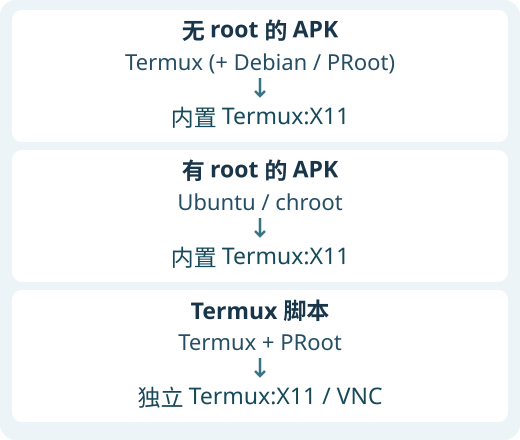

---
{
  "state": "draft",
  "language": "zh-CN",
  "translationKey": "2026-11-27-droiddesk-android-linux-desktop",
  "title": "走近 DroidDesk：安卓手机怎样运行 Linux 桌面？",
  "description": "对比独立 APK 和 Termux 安装脚本的运行环境与显示方式，看看哪些日常任务值得先在手机上试一试。",
  "sourcePath": "src/content/posts/en/2026-11-27-droiddesk-android-linux-desktop.md",
  "sourceSha256": "656b9e1b21a758a366d894876650b607e9bd2eadcb535e4a0565a68566807a1f"
}
---

给闲置的安卓手机接上键盘，能用 Linux 编辑器和浏览器办公吗？DroidDesk 是一个在安卓上运行 Linux 桌面的开源项目。选择安装方式之前，先要弄清一点：独立 APK 和 Termux 安装脚本走的是两条不同的运行路径。

本文依据 orailnoor/DroidDesk v1.3.1 的发行说明和源代码撰写，查阅日期为 2026年11月27日。本文未在真机上安装 APK，也未实测各应用的性能。 [发行说明](https://github.com/orailnoor/DroidDesk/releases/tag/v1.3.1)

## APK 和 Termux 脚本有何区别？

| 安装方式 | 运行环境 | 显示方式 |
| --- | --- | --- |
| 独立 APK，无 root 权限 | 默认桌面直接在应用内的 Termux 中运行，也可选装 Debian 并通过 PRoot 运行 | 内置 Termux:X11 |
| 独立 APK，有 root 权限 | 在 chroot 环境中运行 ARM64 Ubuntu 文件系统 | 内置 Termux:X11 |
| Termux 安装脚本 | 单独安装的 Termux，通过 PRoot 使用发行版软件包 | 独立的 Termux:X11 应用，也可选用 VNC |

README 提到，无 root 权限时 APK 不使用 PRoot。默认桌面的确直接在 Termux 中运行。不过，v1.3.1 的 LinuxRuntime 还提供可选的 Debian 安装功能和 PRoot 启动器。即使在同一个应用内，从默认桌面启动程序和在 Debian 中启动程序，运行条件也可能不同。 [README](https://github.com/orailnoor/DroidDesk/blob/v1.3.1/README.md) · [LinuxRuntime](https://github.com/orailnoor/DroidDesk/blob/v1.3.1/app/android/app/src/main/kotlin/com/orailnoor/droiddesk/runtime/LinuxRuntime.kt) · [ChrootRuntime](https://github.com/orailnoor/DroidDesk/blob/v1.3.1/app/android/app/src/main/kotlin/com/orailnoor/droiddesk/runtime/ChrootRuntime.kt)

## 自己的手机能做到什么程度？

不妨先挑一个自己需要的程序。项目列举了 Firefox、LibreOffice 和 VS Code 等运行实例。v1.3.1 的发行说明也记录了对安装或启动故障的修复，涉及 Firefox 所需的软件包以及 VS Code 等。看到编辑器图标之后，还要检查日常使用的扩展、输入法和文件路径是否可用。 [发行说明](https://github.com/orailnoor/DroidDesk/releases/tag/v1.3.1)

图形性能也会因设备而异。源码中既有在 Adreno 上使用 Turnip 和 Zink 的路径，也有通过 llvmpipe 进行软件渲染的路径。对于 Blender 这类图形负载较重的应用，除了能否启动，还要看手机有没有用上加速、操作实际项目时是否流畅。如果打算在 PRoot 中编译软件，还要考虑频繁访问文件可能带来的额外开销。 [PRoot 的局限](https://github.com/termux/proot-distro#limitations)

想接外部显示器，先确认手机是否支持 USB-C 视频输出。项目文档中的 Raspberry Pi 方案是让树莓派接收 Termux 脚本提供的 VNC 会话，再显示到外接屏幕上。独立 APK 用的是内置 X11 显示，两者的连接方式不同。 [显示器连接方案](https://github.com/orailnoor/DroidDesk/blob/v1.3.1/README.md#for-monitor-output--optional-)

## 第一次用，先试什么任务？

如果手头有 ARM64 安卓设备，可以去项目的官方发行页面查看 APK，先在手机屏幕上做个小测试。例如，在编辑器里输入一段韩文并保存，重新打开会话，再载入同一个文件。如果顺利，再接上键鼠或外部显示器，继续平时的工作。DroidDesk 的吸引力在于，可以用已有的手机试出哪些 Linux 工具适合自己。编辑文档先试输入和保存，做开发先查依赖的软件包和扩展，做图形工作则先看加速和屏幕响应。 [Android 构建配置](https://github.com/orailnoor/DroidDesk/blob/v1.3.1/app/android/app/build.gradle.kts)

[查看 Mac 上 Docker Desktop 的磁盘占用](../2026-11-27-docker-desktop-mac-disk-space/)
