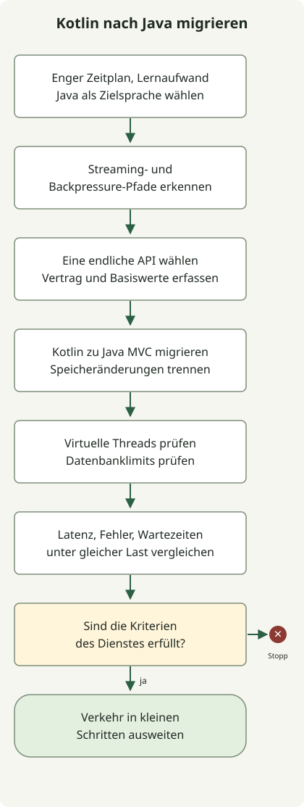

**Diese Migration führt von Kotlin, WebFlux und Coroutines zu Java, Spring MVC und virtuellen Threads.** Ausschlaggebend für den Wechsel von Kotlin zu Java waren ein enger Liefertermin und die Lernkurve, die das bestehende Team bei Kotlin erwartet hätte. Die Sprachwahl berücksichtigte die Lieferzeit und den Lernaufwand des Teams; das Ausführungsmodell des Servers wechselte zu MVC mit virtuellen Threads.

Der Lieferkontext hinter der Sprachwahl und die Leistungseffekte virtueller Threads müssen getrennt erklärt werden. Der folgende Code veranschaulicht die Form der Migration; er bildet weder Produktionscode noch gemessene Ergebnisse ab.

Dieser Leitfaden beschreibt eine schrittweise Migration für Java 21 oder neuer und Spring Boot 3.2 oder neuer. Er verspricht weder höheren Durchsatz noch geringere Latenz. Messen Sie das tatsächliche Ergebnis anhand des Warte-/CPU-Profils der Anfragen, des Datenbank-Verbindungslimits, der Kapazität nachgelagerter Systeme und eines repräsentativen Lasttests.

<span id="separate-the-three-choices"></span>

## Sprachwahl und Ausführungsmodell getrennt betrachten

**WebFlux und MVC sind Optionen für die Web-Laufzeit.** WebFlux basiert auf Reactive Streams und asynchroner, nicht blockierender E/A; MVC nutzt das Servlet-Anfragemodell. **Coroutines sind Kotlins asynchrones Programmiermodell**, daher können Sie `suspend`-Funktionen bei der Wahl von MVC beibehalten. Spring unterstützt Kotlin-Coroutines in annotierten Controllern sowohl für MVC als auch für WebFlux. Die Coroutine-Unterstützung benötigt `kotlinx-coroutines-core` und `kotlinx-coroutines-reactor`. [Coroutine-Unterstützung im Spring Framework](https://docs.spring.io/spring-framework/reference/languages/kotlin/coroutines.html)

Virtuelle Threads sind leichtgewichtige Java-Threads. In einem Thread-pro-Anfrage-Entwurf mit blockierenden Aufrufen können sie die Kosten wartender Plattform-Threads verringern. Ihre Aktivierung macht JDBC weder nicht blockierend noch vergrößert sie den Datenbank-Verbindungspool. Spring Boot 3.2 und neuer kann unter JDK 21 oder neuer mit `spring.threads.virtual.enabled=true` die Ausführung auf Basis virtueller Threads aktivieren. Boot empfiehlt Java 24 oder neuer für die beste Nutzung und nennt Pinning, vorhandene Threadpool-Einstellungen und das Verhalten von Daemon-Threads als Prüfpunkte. [Spring-Boot-Einstellungen und Hinweise zu virtuellen Threads](https://docs.spring.io/spring-boot/reference/features/spring-application.html)

Diese Migration verändert Sprache, Web-Laufzeit und Nebenläufigkeitsmodell gemeinsam. Validieren Sie jede Änderung getrennt. Eine Speichermigration ist, wie die Tabelle zeigt, eine eigene Entscheidung; daraus folgt nicht, dass der tatsächliche Dienst R2DBC nutzte oder zu JPA wechselte.

| Änderung | Was sich ändert | Was getrennt zu validieren ist |
| --- | --- | --- |
| Kotlin → Java | Implementierungssprache und Form asynchroner APIs | Null-Behandlung, Datenobjekte, Ausnahmen, Abbruch und vorhandene API-Verträge |
| WebFlux → MVC | Modell der serverseitigen Anfrageverarbeitung | Filter, Sicherheit, Ausnahmeabbildung, SSE und WebSocket |
| R2DBC → JDBC/JPA (falls nötig) | Datenbankzugriffsmodell | Transaktionsgrenzen, Abfragen, Verbindungslimits und Zeitlimits |
| Coroutine-basierte Ausführung → synchrone Aufrufe und virtuelle Threads | Ausführungs- und Wartemodell | Bibliothekskompatibilität, ThreadLocal-Nutzung, Pinning und Betriebssignale |

## Welche Pfade sollten migriert werden?

MVC mit virtuellen Threads sollte geprüft werden, wenn ein gewöhnlicher Anfrage-/Antwortpfad JPA oder JDBC nutzt und viel Zeit mit dem Warten auf eine Datenbank oder eine nachgelagerte HTTP-Antwort verbringt. Pfade hingegen, deren Kernvertrag ein hochgradig nebenläufiger Stream, Server-Sent Events (SSE), WebSocket oder die Nachfragesteuerung von Reactive Streams ist, bleiben möglicherweise besser auf WebFlux oder werden in einen eigenen Pfad ausgelagert. Dass `Flow` ein MVC-Rückgabetyp sein kann, garantiert nicht in jeder Umgebung identisches Streaming-, Abbruch- oder Backpressure-Verhalten.



Das Diagramm zeigt die Migrationsfolge für einen gewöhnlichen Anfragepfad. Verschieben Sie die Migration von Pfaden, die weiterhin Streaming benötigen, und behalten Sie diese bei oder trennen Sie sie ab. Weiten Sie den Verkehr erst aus, wenn Tests und Beobachtungen die Kriterien erfüllen; bewahren Sie einen Rückweg zum bisherigen Pfad, falls sich die Vergleichswerte verschlechtern.

<span id="you-can-keep-coroutine-controllers"></span>

## Einen Kotlin-Coroutine-Controller zu Java MVC migrieren

Diese Auszüge zeigen einen Endpunkt zum Abrufen einer einzelnen Bestellung. Vor der Migration wartet der Kotlin-Controller über eine `suspend`-Funktion auf den Dienst.

```kotlin
@RestController
class OrderController(private val orders: OrderService) {
    @GetMapping("/orders/{id}")
    suspend fun get(@PathVariable id: Long): OrderDto = orders.get(id)
}
```

Nach der Migration ruft ein Java-MVC-Controller eine synchrone Dienstmethode auf und liefert dasselbe Antwort-DTO zurück. Das setzt voraus, dass auch `orders.get(id)` zu einem aus Java aufrufbaren synchronen Vertrag geworden ist. Der Controller ruft keine Kotlin-`suspend`-Methode direkt aus Java auf.

```java
@RestController
public class OrderController {
    private final OrderService orders;

    public OrderController(OrderService orders) {
        this.orders = orders;
    }

    @GetMapping("/orders/{id}")
    public OrderDto get(@PathVariable("id") Long id) {
        return orders.get(id);
    }
}
```

Die Spring-Annotationen stammen aus `org.springframework.web.bind.annotation`; `OrderService` und `OrderDto` sind anwendungseigene Dienst- und Antworttypen. Diese Auszüge sind keine vollständige ausführbare Anwendung. Aktivieren Sie virtuelle Threads über die folgende Boot-Einstellung und prüfen Sie die Ausführung während einer echten HTTP-Anfrage.

Prüfen Sie, wie nullable Kotlin-Typen auf Java abgebildet werden und wie Gleichheits- und Serialisierungsverträge von `data class` erhalten bleiben. Werden Coroutine-`async`-Aufrufe durch sequenzielle Java-Aufrufe ersetzt, können sich Reihenfolge nachgelagerter Anfragen und Antwortzeit ändern; validieren Sie Parallelität, Zeitlimits und Abbruch daher getrennt. Vorhandene Coroutine-Aufrufe lediglich in `runBlocking` einzuschließen, schließt die Migration zu synchronen Java-Diensten nicht ab.

Spring MVC selbst unterstützt auch Kotlin-`suspend` und `Flow`; Coroutines müssen für MVC also nicht entfernt werden. In diesem Fall war **Java wegen des engen Zeitplans und der Kotlin-Lernkurve des bestehenden Teams die Zielsprache**, daher wechseln auch Controller- und Dienstverträge in diese Richtung.

## Die Repository-Migration getrennt validieren

Falls auch das Datenbankzugriffsmodell geändert werden muss, zeigt das Folgende als separates Beispiel den Wechsel von Kotlins R2DBC-`CoroutineCrudRepository` zu Spring Data JPA in Java. Begrenzen Sie die Ergebnismenge, statt jede Zeile im Speicher zu sammeln, und erhalten Sie Sortierung, Seitengröße und Berechtigungsfilter der vorhandenen API.

```kotlin
interface OrderRepository : CoroutineCrudRepository<Order, Long> {
    fun findByCustomerId(customerId: Long): Flow<Order>
}
```

Ein synchrones JPA-Repository kann seitenweise abfragen:

```java
public interface OrderRepository extends JpaRepository<Order, Long> {
    Page<Order> findByCustomerId(Long customerId, Pageable pageable);
}
```

Diese Ausschnitte zeigen Repository-Formen; sie sind keine vollständige Anwendung. Prüfen Sie in einem echten Projekt auch die Ladestrategie für Entitäten, den Transaktionsumfang, N+1-Abfragen, stabile Seitensortierung sowie Abbruch oder teilweisen Verbrauch des bisherigen `Flow`. Beginnen Sie mit einer API mit endlicher Antwort und ergänzen Sie Vertragstests und Abfragebeobachtungen, bevor Sie weitere Pfade migrieren.

## Virtuelle Threads aktivieren und prüfen

Mit Spring Boot 3.2 oder neuer und JDK 21 oder neuer können Sie diese Einstellung anwenden:

```yaml
spring:
  threads:
    virtual:
      enabled: true
```

Prüfen Sie danach, ob der Thread, der eine Anfrage verarbeitet, tatsächlich virtuell ist. Zeichnen Sie zur vorübergehenden Diagnose `Thread.currentThread().isVirtual()` in einem MVC-Interceptor oder Controller auf. Das prüft nur diesen Anfragepfad; es beweist nicht, dass jede Anwendungsaufgabe oder jeder Coroutine-Dispatcher virtuelle Threads nutzt.

Für einen Java-Controller-Pfad prüft dieser Ausdruck den aktuellen Anfrage-Thread:

```java
public class RequestThreadProbe {
    public static boolean isVirtual() {
        return Thread.currentThread().isVirtual();
    }
}
```

Boot weist darauf hin, dass Threadpool-Eigenschaften mit virtuellen Threads ihre bisherige Wirkung verlieren können und dass Pinning in manchen synchronisierten Abschnitten oder nativen Aufrufen den Durchsatz beeinflussen kann. Umgehen Sie Datenbank-Verbindungslimits oder Nebenläufigkeitsgrenzen nachgelagerter Systeme nicht mit einer größeren Anzahl virtueller Threads. Begrenzen Sie den Datenbankpool auf die Kapazität der Datenbank und konfigurieren Sie Fristen für Verbindungsbezug, Abfragen, nachgelagerte Aufrufe und die gesamte Anfrage.

## Schrittweise migrieren und Rückkehrkriterien festlegen

1. **Vergleichswerte erfassen.** Sammeln Sie Anfragerate, p50/p95/p99-Latenz, Fehlerrate, CPU, Heap, Wartezeiten am Datenbankpool und Latenz nachgelagerter Aufrufe für repräsentative Endpunkte unter gleichen Lastbedingungen.
2. **Rein reaktive Pfade kennzeichnen.** Listen Sie Pfade auf, die von SSE, WebSocket, unbegrenzten Streams, Backpressure oder Reactive-Streams-Operationen abhängen, und nehmen Sie sie von der ersten Migration aus.
3. **Eine endliche API migrieren.** Übersetzen Sie Kotlin in Java und validieren Sie die Änderung der Server-Laufzeit sowie nötige Speicheränderungen getrennt; testen Sie danach Verträge für Anfrage, Antwort, Fehler, Abbruch und Berechtigung.
4. **Ausführung auf virtuellen Threads prüfen.** Prüfen Sie Laufzeit-Threads und den JDBC-Aufrufpfad, nicht nur die Deployment-Eigenschaft. Prüfen Sie Executor für Hintergrundaufgaben getrennt.
5. **Unter gleicher Last vergleichen.** Vergleichen Sie Latenzverteilung, Fehler, CPU, Datenbankwartezeiten und Verbindungsnutzung bei gleicher Datenmenge und Last. Virtuelle Threads schaffen keine zusätzliche CPU-Kapazität für CPU-lastige Arbeit; achten Sie daher auch auf CPU-Sättigung.
6. **Mit einem kleinen Verkehrsanteil ausweiten.** Überschreiten fachliche Fehler, Latenz, Wartezeiten am Datenbankpool oder Ressourcenverbrauch vorab festgelegte Kriterien, stoppen Sie die Ausweitung und untersuchen Sie die Ursache oder kehren Sie zum bisherigen Pfad zurück. Das Team sollte Schwellen anhand seines Service-SLO und der Vergleichswerte festlegen.

Berichten Sie keine Durchsatz- oder Latenzgewinne, die nicht in der Zielumgebung gemessen wurden. Messen Sie den geänderten Pfad zunächst mit denselben Eingaben. Verbessert sich das Ergebnis nicht, gibt es keinen Grund, die MVC-Migration selbst zum Ziel zu machen.

## Entscheidungskriterien

Nutzt gewöhnlicher Anfrage-/Antwortverkehr JDBC/JPA und sind gleichzeitige blockierende Wartezeiten ein plausibler Engpass, evaluieren Sie MVC und virtuelle Threads an einem kleinen Pfad. Hier wurde Java wegen des engen Zeitplans und der Kotlin-Lernkurve des bestehenden Teams gewählt. Setzen Sie den Sprachwechsel nicht mit einem Durchsatzgewinn durch virtuelle Threads gleich. Ist Streaming oder das Verhalten von Reactive Streams eine Produktanforderung, behalten Sie WebFlux bei, statt diesen Vertrag für einen Wechsel des Threadmodells abzuschwächen. Entscheiden Sie durch den Vergleich von Latenz, Fehlern, Datenbankwartezeiten und Betriebskomplexität unter gleicher Last.
