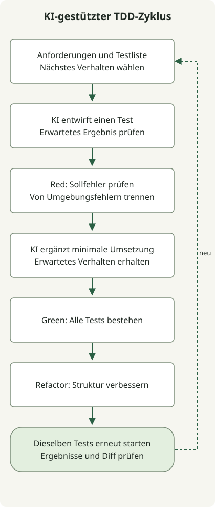

**Wenn Sie KI mit TDD verbinden, leiten Sie erwartete Ergebnisse aus Anforderungen ab, beobachten Sie einen fehlschlagenden Test und wiederholen Sie dann kleine Implementierungs- und Refactoring-Schritte.** KI kann Tests und Implementierungen vorschlagen, doch beide können mit demselben Missverständnis bestehen. Prüfen Sie, woher jede Erwartung stammt und was der Testrunner tatsächlich meldet.

Der grundlegende TDD-Zyklus wählt das nächste Verhalten aus einer Testliste und wiederholt Red → Green → Refactor. [Martin Fowlers Erklärung von TDD](https://www.martinfowler.com/bliki/TestDrivenDevelopment.html) betont Testliste, kleine Zyklen und Refactoring. Das folgende Java-Beispiel ergänzt diesen Prozess um KI, ohne ein bestimmtes Werkzeug vorauszusetzen. Die Prompts sind verfasste Beispiele, weder ein Protokoll aus einem KI-Produkt noch eine Produktivitätsmessung.

## Erwartetes Verhalten vor der Implementierung definieren

Das Beispiel ist eine reine Funktion, die aus Bestand und angeforderter Menge den Restbestand berechnet. Dies sind beispielhafte Anforderungen und keine tatsächliche Dienstrichtlinie. Die Funktion aktualisiert keine Datenbank, speichert keine Reservierungen und gewährleistet keine Atomarität zwischen gleichzeitigen Anfragen.

| Bedingung | Erwartetes Verhalten |
| --- | --- |
| Bestand 10, angefordert 3 | 7 zurückgeben |
| Bestand 10, angefordert 10 | 0 zurückgeben |
| Anfrage übersteigt den Bestand, einschließlich Anforderung von 1 bei Bestand 0 | `IllegalStateException("insufficient_stock")` |
| Negativer Bestand | `IllegalArgumentException("stock")` |
| Angeforderte Menge ist null oder negativ | `IllegalArgumentException("requested")` |
| Beide Eingaben sind ungültig | Bestand zuerst validieren |
| Bestand `Integer.MAX_VALUE`, angefordert 1 | `Integer.MAX_VALUE - 1` zurückgeben |

Diese Tabelle ist das Testorakel. Wer eine KI-generierte Implementierung liest und ihren Rückgabewert in eine Assertion kopiert, kann auch ihren Fehler übernehmen. Beginnen Sie mit den Anforderungen und dem API-Vertrag:

```text
Implementiere noch nichts.
Schlage Testfälle für StockPolicy.remaining(int stock, int requested) vor.
Ordne jede Eingabe, jedes erwartete Ergebnis und jede Ausnahme einer Regel der Anforderungstabelle zu.

Führe keinen externen Speicher und keine Datenbank ein.
Trenne normale Eingaben, Grenzfälle und ungültige Eingaben. Schreibe in der ersten Iteration
nur einen Test: Die Anforderung von 3 bei Bestand 10 liefert 7.
Erfinde keine Regeln, wenn die Anforderungen unklar sind.
```

## Red, Green und Refactor durch kleine Ausführungen verbinden



Das Diagramm beschreibt einen vom Entwickler gesteuerten Ablauf, keine KI-Interna. Beobachten Sie zunächst, wie das neue Verhalten fehlschlägt, und ergänzen Sie dann eine minimale Implementierung. Führen Sie nach dem Refactoring dieselben Tests erneut aus, bevor Sie einen weiteren Fall auswählen. Verursachten Downloads von Abhängigkeiten oder die Ausführungsumgebung den Fehler, beheben Sie dieses Problem und wiederholen Sie dieselbe Stufe.

Die Reproduktionsumgebung ist **JDK 17.0.8.1, Gradle 8.4 und JUnit Jupiter 5.12.2**. Diese feste Kombination dokumentiert die verwendete Umgebung; sie empfiehlt keine aktuellen Produktionsversionen. Erstellen Sie die folgenden Dateien in einem leeren Verzeichnis. Beim ersten Lauf können Testabhängigkeiten von Maven Central heruntergeladen werden; die Tests selbst rufen weder eine externe API noch eine Datenbank auf. Befolgen Sie in einem bestehenden Projekt dessen Gradle-Wrapper- und Abhängigkeitsrichtlinien.

### `settings.gradle`

```groovy
rootProject.name = 'ai-tdd-stock'
```

### `build.gradle`

```groovy
plugins { id 'java' }
repositories { mavenCentral() }
dependencies {
    testImplementation platform('org.junit:junit-bom:5.12.2')
    testImplementation 'org.junit.jupiter:junit-jupiter'
    testRuntimeOnly 'org.junit.platform:junit-platform-launcher'
}
java {
    sourceCompatibility = JavaVersion.VERSION_17
    targetCompatibility = JavaVersion.VERSION_17
}
test {
    useJUnitPlatform()
    testLogging { events 'passed', 'failed' }
}
```

JUnit prüft mit `@Test`, `assertEquals` und `assertThrows` Rückgabewerte und Ausnahmen. Erfassen Sie das Ausnahmeobjekt, um auch seine Meldung zu prüfen. Siehe [JUnit-5.12.2-Benutzerhandbuch](https://docs.junit.org/5.12.2/user-guide/) und [Gradles Leitfaden für JVM-Tests](https://docs.gradle.org/current/userguide/java_testing.html).

### Erster Test: `src/test/java/StockPolicyTest.java`

```java
import org.junit.jupiter.api.Test;
import static org.junit.jupiter.api.Assertions.assertEquals;
import static org.junit.jupiter.api.Assertions.assertThrows;

class StockPolicyTest {
    @Test
    void reservesPartOfStock() {
        assertEquals(7, StockPolicy.remaining(10, 3));
    }
}
```

### Erstes Red: `src/main/java/StockPolicy.java`

Erstellen Sie eine aufrufbare API mit einer Implementierung, die noch nichts abzieht. Führen Sie den Test aus und prüfen Sie, dass er fehlschlägt, weil er `7` erwartet, aber `10` erhält.

```java
public class StockPolicy {
    public static int remaining(int stock, int requested) {
        return stock;
    }
}
```

Führen Sie diesen Befehl im Projektstamm aus. In dieser Stufe sind ein Testfehler und ein von null verschiedener Exitcode zu erwarten.

```sh
gradle --no-daemon --console=plain clean test
```

Unterscheiden Sie Download- oder Kompilierungsfehler vom Scheitern des geforderten Verhaltens. Das beabsichtigte Red ist hier die abweichende Assertion in `reservesPartOfStock()`. Ein defekter Runner ist kein Nachweis, dass das Verhalten getestet wurde.

### Erstes Green: dieselbe `StockPolicy.java` ersetzen

```java
public class StockPolicy {
    public static int remaining(int stock, int requested) {
        return stock - requested;
    }
}
```

Beim erneuten Ausführen desselben Befehls besteht der erste Test. Diese Implementierung behandelt weiterhin weder negative Eingaben noch unzureichenden Bestand. Der erste bestandene Test schließt die Funktion nicht ab; ergänzen Sie die nächste Anforderung.

Sie können der KI folgende Änderungsgrenze vorgeben:

```text
Der fehlschlagende Test ist reservesPartOfStock: expected=7, actual=10.
Ändere nur StockPolicy.java, damit dieser Test besteht.
Ändere weder Tests noch erwartete Werte oder Build-Einstellungen.
Ergänze keine unangeforderte Datenbank, Schnittstelle oder Konfigurationsebene.
Berichte den tatsächlich geprüften Befehl, Exitcode und die Testergebnisse.
```

### Nächstes Red: Methoden innerhalb der bestehenden Testklasse ergänzen

Ergänzen Sie diese Methoden **innerhalb** der letzten schließenden Klammer von `StockPolicyTest`. Bei tatsächlichem TDD ergänzen Sie jeweils einen Fall und wiederholen den Zyklus. Der Artikel fasst die verbleibenden Fälle in einem Block zusammen, um die Reproduktionsdateien kurz zu halten.

```java
    @Test
    void reservesAllStock() {
        assertEquals(0, StockPolicy.remaining(10, 10));
    }

    @Test
    void rejectsInsufficientStock() {
        var error = assertThrows(IllegalStateException.class,
                () -> StockPolicy.remaining(2, 3));
        assertEquals("insufficient_stock", error.getMessage());
    }

    @Test
    void rejectsEmptyStock() {
        var error = assertThrows(IllegalStateException.class,
                () -> StockPolicy.remaining(0, 1));
        assertEquals("insufficient_stock", error.getMessage());
    }

    @Test
    void rejectsNegativeStock() {
        var error = assertThrows(IllegalArgumentException.class,
                () -> StockPolicy.remaining(-1, 1));
        assertEquals("stock", error.getMessage());
    }

    @Test
    void rejectsZeroRequest() {
        var error = assertThrows(IllegalArgumentException.class,
                () -> StockPolicy.remaining(10, 0));
        assertEquals("requested", error.getMessage());
    }

    @Test
    void rejectsNegativeRequest() {
        var error = assertThrows(IllegalArgumentException.class,
                () -> StockPolicy.remaining(10, -1));
        assertEquals("requested", error.getMessage());
    }

    @Test
    void validatesStockBeforeRequest() {
        var error = assertThrows(IllegalArgumentException.class,
                () -> StockPolicy.remaining(-1, 0));
        assertEquals("stock", error.getMessage());
    }

    @Test
    void supportsMaximumStock() {
        assertEquals(Integer.MAX_VALUE - 1,
                StockPolicy.remaining(Integer.MAX_VALUE, 1));
    }
```

Wird dieser zusätzliche Block mit der ersten Green-Implementierung ausgeführt, schlagen 6 von 9 Tests fehl.

### Green für die zusätzlichen Fälle: `StockPolicy.java` ersetzen

```java
public class StockPolicy {
    public static int remaining(int stock, int requested) {
        if (stock >= 0) {
            if (requested > 0) {
                if (requested <= stock) {
                    return stock - requested;
                }
                throw new IllegalStateException("insufficient_stock");
            }
            throw new IllegalArgumentException("requested");
        }
        throw new IllegalArgumentException("stock");
    }
}
```

Prüfen Sie mit demselben Befehl, dass alle 9 Tests bestehen. Diese Implementierung erfüllt nun das festgelegte Verhalten. Vereinfachen Sie als Nächstes die verschachtelten Verzweigungen und erhalten Sie dabei die Tests.

### Refactor: Guard Clauses in derselben Datei verwenden

```java
public class StockPolicy {
    public static int remaining(int stock, int requested) {
        if (stock < 0) throw new IllegalArgumentException("stock");
        if (requested <= 0) throw new IllegalArgumentException("requested");
        if (requested > stock) throw new IllegalStateException("insufficient_stock");
        return stock - requested;
    }
}
```

Die Verschachtelung wird reduziert; Validierungsreihenfolge, Rückgabewerte und Ausnahmen bleiben erhalten. Führen Sie in dieser Stufe keine neue Regel ein. Geben Sie bei einer Refactoring-Anfrage an die KI das zu erhaltende Verhalten und den Ausführungsumfang an:

```text
Aktuell bestehen alle 9 Tests.
Ersetze nur die verschachtelten Verzweigungen in StockPolicy.java durch Guard Clauses.
Erhalte die Bestandsvalidierung vor der Validierung der angeforderten Menge,
Rückgabewerte, Ausnahmetypen, Meldungen und vorhandene Tests.
Führe vor und nach der Änderung dieselbe vollständige Testsuite aus
und berichte Ergebnisse und Diff.
```

Jede Quellversion vom ersten Red bis Refactor wurde separat ausgeführt. Folgende Ergebnisse wurden aus JUnit-XML-Berichten gelesen:

| Stufe | Tests | Fehler | Übersprungen | Gradle-Exitcode |
| --- | ---: | ---: | ---: | ---: |
| Erstes Red | 1 | 1 | 0 | 1 |
| Erstes Green | 1 | 0 | 0 | 0 |
| Zusätzliche Fälle Red | 9 | 6 | 0 | 1 |
| Zusätzliche Fälle Green | 9 | 0 | 0 | 0 |
| Refactor | 9 | 0 | 0 | 0 |

Der HTML-Bericht wird unter `build/reports/tests/test/index.html` erzeugt; maschinenlesbares XML liegt unter `build/test-results/test/`. Diese Ergebnisse prüfen eine lokale Regelfunktion. Sie messen weder die Qualität eines KI-Produkts noch Produktivität oder die Korrektheit eines Produktionssystems.

## Tests und Implementierungen können gemeinsam falsch liegen

Die **Validierungsrangfolge** bei ungültigem Bestand zusammen mit ungültiger Anforderung wird durch `validatesStockBeforeRequest()` festgelegt. Ohne diesen Fall könnte eine Regression unbemerkt bleiben, die die Rangfolge der Ausnahmemeldungen umkehrt. Prüfen Sie, ob den Regeln der Anforderungstabelle Tests entsprechen, statt lediglich weitere Beispiele für normale Eingaben hinzuzufügen.

Sie können auch prüfen, ob die Tests Grenzfallregressionen erkennen. Wird in der endgültigen Implementierung `requested > stock` fälschlich zu `requested >= stock` geändert, sollte `reservesAllStock()` fehlschlagen. Der Wechsel von `requested <= 0` zu `requested < 0` sollte `rejectsZeroRequest()` scheitern lassen. Eine Mutation, die die Eingabevalidierung umkehrte, wurde ebenfalls ausgeführt und ließ `validatesStockBeforeRequest()` fehlschlagen. Alle drei Mutationen wurden tatsächlich ausgeführt; das garantiert nicht die Erkennung jedes Fehlers.

Geben Sie bei einer KI-gestützten Prüfung die ursprünglichen Anforderungen erneut vor und fragen Sie, welche Regel jeder Test prüft. Ein anderer Agent kann denselben Fehler wiederholen, wenn er dieselben falschen Anforderungen teilt. Rollentrennung und unabhängiges Festlegen des erwarteten Verhaltens sind unterschiedliche Anliegen.

```text
Vergleiche die ursprüngliche Anforderungstabelle mit den aktuellen Tests.
Ändere Tests und Implementierung noch nicht.
Benenne geprüfte Regeln, fehlende Regeln, Grenzen und unbeobachtete Bedingungen.
Prüfe, ob ein Test lediglich die Ausgabe der aktuellen Implementierung
als erwartetes Ergebnis kopiert hat.
Ordne vorgeschlagene Änderungen zuerst jeweils ihrer Regel und ihrem Nachweis zu.
```

## Verhindern, dass KI die Prüfung für bestandene Tests abschwächt

Ein fehlschlagender Test kann gelöscht, mit `@Disabled` übersprungen, seine Erwartung an eine fehlerhafte Implementierung angepasst oder jede Ausnahme verschluckt werden: Das kann ein grünes Ergebnis liefern, ohne Anforderungen zu erfüllen. Bleiben Anforderungen beim Refactoring gleich, erhalten Sie das erwartete Verhalten. Ist ein Test selbst falsch, klären Sie Regel und Nachweis und unterscheiden Sie diese Korrektur dann von einer Implementierungsänderung. [GitHubs Hinweise zur Prüfung KI-generierten Codes](https://docs.github.com/en/copilot/tutorials/review-ai-generated-code) empfehlen ebenfalls, auf gelöschte oder übersprungene Tests sowie Abweichungen von den beabsichtigten Anforderungen zu achten.

Unterscheiden Sie die Behauptung einer KI, Tests hätten bestanden, von den Ergebnissen des Runners. Prüfen Sie tatsächlichen Befehl, Exitcode, JUnit-Berichte und Diff. Null ausgeführte Tests oder ein Teillauf sind kein vollständiger Erfolg. Führen Sie in CI die endgültige Implementierung und die vollständige Testsuite mit gewöhnlichen Erfolgsbedingungen aus. Halten Sie das didaktische Prüfgerüst für erwartete Red-Fehler von normaler CI getrennt und lassen Sie CI nicht durch bedingungsloses Ignorieren fehlschlagender Befehle bestehen.

Beschaffen Sie für bestehenden Code zuerst Tests, die das aktuelle Verhalten erfassen, und wählen Sie dann ein zu änderndes Verhalten. Diese Reihenfolge und ihre Erhaltungskriterien stehen in Verbindung mit [Refactoring durch KI-Agenten](/en/posts/2026-10-31-ai-agent-refactoring/). Auch Tests und Builds führen Code aus; begrenzen Sie deshalb Arbeitsverzeichnisse und Zugangsdaten wie unter [Berechtigungsgrenzen für KI-Agenten](/en/posts/2026-11-01-ai-agent-permission-boundaries/) beschrieben.

Die Erweiterung dieses Beispiels zu tatsächlichen Bestandsreservierungen erfordert eigene Integrationstests für gleichzeitige Anfragen, Transaktionen, doppelte Anfragen und Wiederholungen. Das Bestehen dieser 9 Tests einer reinen Funktion belegt keinen Schutz vor Überverkäufen.
