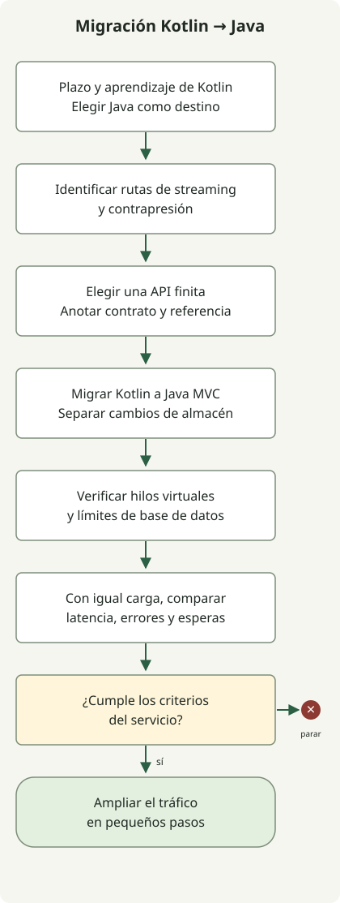

**Esta migración pasa de Kotlin, WebFlux y corrutinas a Java, Spring MVC e hilos virtuales.** El cambio de Kotlin a Java se debió al plazo de entrega ajustado y a la curva de aprendizaje de Kotlin para el equipo existente. La decisión sobre el lenguaje tuvo en cuenta el tiempo de entrega y el esfuerzo de aprendizaje; el modelo de ejecución del servidor pasó a MVC con hilos virtuales.

El contexto de entrega que motivó la elección del lenguaje y los efectos de los hilos virtuales en el rendimiento requieren explicaciones separadas. El código siguiente ilustra la forma de la migración; no reproduce código de producción ni resultados medidos.

Esta guía describe una migración gradual para Java 21 o posterior y Spring Boot 3.2 o posterior. No promete mayor rendimiento ni menor latencia. Mida el resultado real considerando el perfil de espera/CPU de las solicitudes, el límite de conexiones de base de datos, la capacidad de los servicios dependientes y una prueba de carga representativa.

<span id="separate-the-three-choices"></span>

## Separe la elección del lenguaje del modelo de ejecución

**WebFlux y MVC son opciones de entorno de ejecución web.** WebFlux se centra en Reactive Streams y en E/S asíncrona no bloqueante; MVC usa el modelo de solicitudes de Servlet. **Las corrutinas son el modelo de programación asíncrona de Kotlin**, por lo que puede conservar funciones `suspend` al elegir MVC. Spring admite corrutinas de Kotlin en controladores anotados tanto de MVC como de WebFlux. Este soporte requiere `kotlinx-coroutines-core` y `kotlinx-coroutines-reactor`. [Soporte de corrutinas de Spring Framework](https://docs.spring.io/spring-framework/reference/languages/kotlin/coroutines.html)

Los hilos virtuales son hilos ligeros de Java. Pueden reducir el coste de mantener hilos de plataforma en espera en un diseño de un hilo por solicitud con llamadas bloqueantes. Activarlos no convierte JDBC en no bloqueante ni amplía el pool de conexiones de base de datos. Spring Boot 3.2 y posteriores permiten activar la ejecución con hilos virtuales en JDK 21 o posterior mediante `spring.threads.virtual.enabled=true`. Boot recomienda Java 24 o posterior para una mejor experiencia y destaca el pinning, la configuración existente de pools de hilos y el comportamiento de los hilos daemon como aspectos que revisar. [Configuración y advertencias de hilos virtuales de Spring Boot](https://docs.spring.io/spring-boot/reference/features/spring-application.html)

Esta migración cambia a la vez el lenguaje, el entorno web y el modelo de concurrencia. Valide cada cambio por separado. Como muestra la tabla, migrar el almacenamiento es una decisión aparte; esto no demuestra que el servicio real usara R2DBC o migrara a JPA.

| Cambio | Qué cambia | Qué validar por separado |
| --- | --- | --- |
| Kotlin → Java | Lenguaje de implementación y forma de la API asíncrona | Manejo de null, objetos de datos, excepciones, cancelación y contratos de API existentes |
| WebFlux → MVC | Modelo de procesamiento de solicitudes del servidor | Filtros, seguridad, mapeo de excepciones, SSE y WebSocket |
| R2DBC → JDBC/JPA (si hace falta) | Modelo de acceso a base de datos | Límites de transacciones, consultas, límites de conexiones y tiempos de espera |
| Ejecución con corrutinas → llamadas síncronas e hilos virtuales | Modelo de ejecución y espera | Compatibilidad de bibliotecas, uso de ThreadLocal, pinning y señales operativas |

## ¿Qué rutas conviene migrar?

Conviene evaluar MVC con hilos virtuales cuando una ruta habitual de solicitud/respuesta usa JPA o JDBC y dedica gran parte del tiempo a esperar a la base de datos o una respuesta HTTP de un servicio dependiente. En cambio, las rutas cuyo contrato principal exige flujos con alta concurrencia, eventos enviados por el servidor (SSE), WebSocket o control de demanda de Reactive Streams pueden mantenerse en WebFlux o separarse en una ruta específica. Que `Flow` pueda ser un tipo de retorno de MVC no garantiza un comportamiento idéntico de streaming, cancelación o contrapresión en todos los entornos.



El diagrama muestra la secuencia de migración de una ruta habitual de solicitudes. Posponga la migración de las rutas que aún necesitan streaming y consérvelas o sepárelas. Amplíe el tráfico solo cuando las pruebas y observaciones cumplan los criterios; mantenga una forma de volver a la ruta anterior si el resultado empeora respecto a la referencia.

<span id="you-can-keep-coroutine-controllers"></span>

## Migre un controlador de corrutinas Kotlin a Java MVC

Estos fragmentos ilustran un endpoint de consulta de un pedido. Antes de la migración, el controlador Kotlin espera al servicio mediante una función `suspend`.

```kotlin
@RestController
class OrderController(private val orders: OrderService) {
    @GetMapping("/orders/{id}")
    suspend fun get(@PathVariable id: Long): OrderDto = orders.get(id)
}
```

Después, un controlador Java MVC llama a un método síncrono del servicio y devuelve el mismo DTO de respuesta. Esto presupone que `orders.get(id)` también se ha convertido en un contrato síncrono invocable desde Java. No llama directamente a un método Kotlin `suspend` desde Java.

```java
@RestController
public class OrderController {
    private final OrderService orders;

    public OrderController(OrderService orders) {
        this.orders = orders;
    }

    @GetMapping("/orders/{id}")
    public OrderDto get(@PathVariable("id") Long id) {
        return orders.get(id);
    }
}
```

Las anotaciones Spring proceden de `org.springframework.web.bind.annotation`; `OrderService` y `OrderDto` son los tipos del servicio de aplicación y de respuesta. Estos fragmentos no constituyen una aplicación ejecutable completa. Active los hilos virtuales con la configuración de Boot siguiente y verifique la ejecución durante una solicitud HTTP real.

Compruebe cómo se trasladan a Java los tipos anulables de Kotlin y cómo conservar los contratos de igualdad y serialización de `data class`. Sustituir llamadas de corrutinas `async` por llamadas secuenciales de Java puede cambiar el orden de las solicitudes a servicios dependientes y el tiempo de respuesta; valide por separado el paralelismo, los tiempos de espera y la cancelación. Envolver las llamadas de corrutinas existentes en `runBlocking` no completa por sí solo una migración a servicios Java síncronos.

Spring MVC también admite Kotlin `suspend` y `Flow`, así que eliminar las corrutinas no es un requisito previo para MVC. En este caso, **Java fue el lenguaje de destino por el plazo ajustado y la curva de aprendizaje de Kotlin para el equipo existente**, por lo que los contratos del controlador y del servicio también cambian en esa dirección.

## Valide por separado la migración del repositorio

Si también debe cambiar el modelo de acceso a base de datos, este es un ejemplo independiente de migración de `CoroutineCrudRepository` de R2DBC en Kotlin a Spring Data JPA en Java. Limite el tamaño del resultado en lugar de reunir todas las filas en memoria y conserve la ordenación, el tamaño de página y los filtros de autorización de la API existente.

```kotlin
interface OrderRepository : CoroutineCrudRepository<Order, Long> {
    fun findByCustomerId(customerId: Long): Flow<Order>
}
```

Un repositorio JPA síncrono puede consultar por páginas:

```java
public interface OrderRepository extends JpaRepository<Order, Long> {
    Page<Order> findByCustomerId(Long customerId, Pageable pageable);
}
```

Estos fragmentos ilustran la forma de los repositorios; no son una aplicación completa. En un proyecto real, revise también la estrategia de carga de entidades, el alcance de las transacciones, las consultas N+1, el orden estable entre páginas y la semántica de cancelación o consumo parcial del `Flow` anterior. Empiece por una API con respuesta finita y añada pruebas de contrato y observaciones de consultas antes de seguir migrando.

## Active los hilos virtuales y verifíquelos

Con Spring Boot 3.2 o posterior y JDK 21 o posterior, puede aplicar esta configuración:

```yaml
spring:
  threads:
    virtual:
      enabled: true
```

Después de aplicarla, compruebe si el hilo que atiende una solicitud es realmente virtual. Como diagnóstico temporal, registre `Thread.currentThread().isVirtual()` desde un interceptor o controlador MVC. Esto solo comprueba esa ruta; no demuestra que todas las tareas de la aplicación o todos los dispatchers de corrutinas utilicen hilos virtuales.

En una ruta de controlador Java, esta expresión comprueba el hilo de la solicitud actual:

```java
public class RequestThreadProbe {
    public static boolean isVirtual() {
        return Thread.currentThread().isVirtual();
    }
}
```

Boot advierte que las propiedades de los pools de hilos pueden dejar de tener su efecto anterior con hilos virtuales, y que el pinning en algunas secciones sincronizadas o llamadas nativas puede afectar al rendimiento. No aumente el número de hilos virtuales para eludir límites de conexiones de base de datos o de concurrencia de servicios dependientes. Ajuste el pool de base de datos a su capacidad y configure plazos de adquisición de conexión, consulta, llamada dependiente y solicitud completa.

## Migre por etapas y defina criterios de reversión

1. **Registre una referencia.** Recopile la tasa de solicitudes, latencias p50/p95/p99, tasa de errores, CPU, heap, esperas del pool de base de datos y latencia de llamadas dependientes para endpoints representativos bajo las mismas condiciones de carga.
2. **Marque las rutas exclusivamente reactivas.** Enumere las rutas que dependen de SSE, WebSocket, flujos ilimitados, contrapresión u operaciones de Reactive Streams y exclúyalas de la migración inicial.
3. **Migre una API finita.** Traduzca Kotlin a Java validando por separado el cambio del entorno del servidor y cualquier cambio necesario de almacenamiento; después pruebe los contratos de solicitud, respuesta, error, cancelación y autorización.
4. **Verifique la ejecución con hilos virtuales.** Revise los hilos en ejecución y la ruta de llamadas JDBC, además de la propiedad de despliegue. Revise por separado los ejecutores de tareas en segundo plano.
5. **Compare bajo la misma carga.** Compare distribución de latencia, errores, CPU, esperas de base de datos y uso de conexiones con el mismo volumen de datos y carga. Los hilos virtuales no añaden capacidad de CPU para tareas limitadas por CPU, así que vigile también su saturación.
6. **Amplíe desde una pequeña parte del tráfico.** Si los errores de negocio, la latencia, las esperas del pool de base de datos o el uso de recursos superan los criterios predefinidos, detenga la ampliación e investigue o vuelva a la ruta anterior. El equipo debe fijar umbrales basados en el SLO del servicio y la referencia.

No comunique mejoras de rendimiento o latencia que no se hayan medido en el entorno de destino. Primero mida la ruta modificada con las mismas entradas. Si el resultado no mejora, no hay motivo para considerar la propia migración a MVC como objetivo.

## Criterios de decisión

Si el tráfico habitual de solicitud/respuesta usa JDBC/JPA y las esperas bloqueantes concurrentes son un posible cuello de botella, evalúe MVC e hilos virtuales en una ruta pequeña. En este caso se eligió Java por el plazo ajustado y la curva de aprendizaje de Kotlin para el equipo existente. No equipare el cambio de lenguaje con una mejora de rendimiento debida a los hilos virtuales. Si el streaming o el comportamiento de Reactive Streams son requisitos del producto, conserve WebFlux en lugar de debilitar ese contrato para cambiar el modelo de hilos. Decida comparando latencia, errores, esperas de base de datos y complejidad operativa bajo la misma carga.
