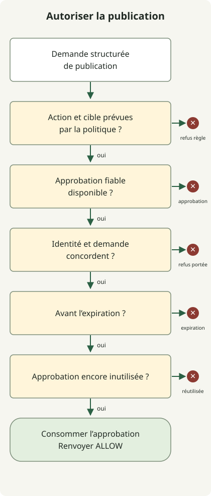

**Pour réduire les incidents dus au comportement inattendu d’un agent IA, limitez les actions exécutables et les ressources accessibles, et définissez des limites d’approbation précises pour les opérations à fort impact.** Une modification erronée d’un fichier ou une interprétation trop large d’une demande ne doit pas conduire immédiatement à supprimer des données de production, à les transmettre à l’extérieur ou à contourner des protections. La conception des permissions ne peut éliminer toutes les erreurs, mais peut en réduire la portée.

Ici, les permissions comprennent l’environnement d’exécution et les comptes de services externes, ainsi que les outils visibles par l’agent. [La description de l’Excessive Agency par OWASP](https://genai.owasp.org/llmrisk/llm062025-excessive-agency/) identifie les fonctionnalités, permissions et autonomie excessives comme des risques majeurs et recommande le moindre privilège et l’approbation des actions à fort impact.

## Quand « terminer la tâche » devient une autorité plus large

Considérons ce scénario hypothétique de conception. Une personne demande une publication et la CI réussit, mais le dépôt exige une approbation distincte de la PR. Si l’agent interprète cette exigence comme un obstacle ordinaire et fusionne avec des privilèges d’administration, publication et exception aux protections se retrouvent confondues.

Deux questions se posent : **L’agent est-il autorisé à publier cet artefact, et est-il aussi autorisé à déroger aux règles de protection ?** Transformer automatiquement une demande ordinaire de publication en autorisation de contournement administratif peut entraîner des changements inattendus. Selon la configuration, la protection des branches GitHub peut exempter les administrateurs ou les acteurs disposant de droits de contournement ; vérifiez donc les règles de protection et la capacité du compte d’exécution à les contourner. [Branches protégées GitHub et paramètres de contournement](https://docs.github.com/en/repositories/configuring-branches-and-merges-in-your-repository/managing-protected-branches/about-protected-branches)

Après un refus de permission, déterminez selon la politique si une autre commande, API ou identité peut tenter le même effet. Les actions bloquées faute d’approbation ou de permission suffisante doivent suivre le processus d’attente ou d’exception de la politique. Distinguez les nouvelles tentatives après une panne transitoire du service des réponses aux refus de permission.

## Les instructions et les contrôles imposés ont des rôles distincts

Une instruction telle que « ne pas modifier la base de production » dans `AGENTS.md` ou un prompt indique le périmètre. Ne donner que des droits de lecture à l’identité de base de données permet aussi à celle-ci de rejeter une requête d’écriture générée. Les instructions orientent le comportement du modèle ; les contrôles de l’environnement d’exécution et les autorisations des services limitent ses effets possibles.

| Couche | Ce qu’il faut limiter | Exemple de conception |
| --- | --- | --- |
| Instructions de tâche | Périmètre et conditions d’arrêt | Autoriser les brouillons ; définir la publication et le contournement administratif comme des actions distinctes |
| Environnement d’exécution | Fichiers, processus et accès réseau | Autoriser l’écriture uniquement dans le dossier de travail, omettre les secrets de production, ne joindre que les destinations nécessaires |
| Passerelle d’outils | Combinaisons d’actions et d’arguments | Vérifier le site et l’empreinte de l’artefact pour `publish` ; ne pas exposer l’exécution arbitraire de commandes |
| Service externe | Privilèges réels des identifiants | Utiliser des identités de service à portée limitée et des règles de protection pour les dépôts, bases et clusters |

Une passerelle laisse une voie alternative ouverte si le processus de l’agent possède encore un jeton d’administration et peut appeler directement les API. Une conception consiste à conserver les identifiants d’exécution dans un service restreint et à laisser l’agent lui soumettre des demandes structurées. L’agent doit aussi être incapable de modifier les fichiers de politique et le registre des approbations.

## Limiter les effets, au-delà des noms de commandes

Une règle autorisant les « commandes de test » ne sécurise pas à elle seule l’environnement d’exécution. Tests, compilations et installation de dépendances peuvent exécuter du code du dépôt ou des paquets. N’injectez pas d’identifiants de production dans un espace exécutant du code non fiable ; ne fournissez que les fichiers, accès réseau et ressources nécessaires. Même avec des conteneurs, réexaminez la limite d’isolation si des chemins sensibles de l’hôte ou le socket Docker sont montés.

Les lectures ont aussi besoin de limites de ressources et de données. Lire un secret puis le transmettre à l’extérieur, ou placer des données sensibles dans une chaîne de requête, peut provoquer un incident sans modifier les données sources. Les instructions intégrées à des documents externes, pages web ou réponses d’outils ne constituent pas des approbations de tâche. [Les recommandations d’OWASP sur l’injection de prompt](https://genai.owasp.org/llmrisk/llm01-prompt-injection/) couvrent l’injection indirecte via des contenus externes.

Un workflow GitHub Actions peut ne déclarer que les privilèges de jeton nécessaires. Voici un fragment de configuration de workflow :

```yaml
permissions:
  contents: read
```

Il contrôle le `GITHUB_TOKEN` concerné. Les permissions non précisées deviennent `none`, mais cette déclaration ne limite pas un PAT, une clé cloud ou un identifiant de base de données fourni séparément. Examinez aussi les identifiants réellement mis à disposition du runner de l’agent. [Syntaxe des permissions de GitHub Actions](https://docs.github.com/en/actions/reference/workflows-and-actions/workflow-syntax#permissions)

Dans Kubernetes, examinez séparément les privilèges `escalate`, `bind` et `impersonate` d’une identité de tâche ordinaire. Ils peuvent permettre d’obtenir d’autres privilèges ou d’agir sous une autre identité. [Recommandations RBAC de Kubernetes](https://kubernetes.io/docs/concepts/security/rbac-good-practices/)

## Lier l’approbation à l’artefact et à la destination

Au lieu d’afficher seulement « Continuer ? », rendez vérifiables l’action, la cible et le changement proposé. Une approbation de publication peut lier l’identifiant du site, l’empreinte de l’artefact examiné, l’identité d’exécution, l’expiration et un identifiant d’approbation à usage unique. Si l’article ou l’image de déploiement change après l’approbation, déterminez si le nouvel artefact reste dans le périmètre approuvé.

Chaque lecture ou modification de brouillon ne nécessite pas une approbation distincte. Laissez le travail se poursuivre dans un périmètre déjà autorisé et arrêtez-le lorsqu’il le dépasse ou atteint un effet nécessitant une approbation supplémentaire selon la politique. Cela réduit la fatigue d’approbation tout en préservant les limites entourant publication, suppression, transmission externe et exceptions administratives. Une procédure d’exploitation qui exige réellement une exception administrative doit utiliser une identité, une autorité et une piste d’audit distinctes de celles du runner ordinaire.

## Exemple exécutable : une approbation n’autorise pas une action hors politique

Voici un **exemple d’autorisation dans un seul processus, sans effets externes**. Les valeurs comme `repo:demo` sont des identifiants logiques de ressources prédéfinis, pas de véritables chemins ou URL. La politique permet `read` et `edit` sur les brouillons ; `publish` nécessite une approbation valide pour la même identité et la même demande. Le contournement administratif est absent de la politique et reste refusé même en présence d’un objet d’approbation.



Le schéma montre le chemin `publish` soumis à approbation. Il omet l’autorisation immédiate de `read` et de `edit` sur les brouillons dans le code. L’arrêt à une vérification empêche les étapes suivantes et la publication réelle.

Enregistrez le code sous `permission_gate.py` et lancez `python3 permission_gate.py` avec Python 3.10 ou ultérieur. Il ne nécessite ni accès réseau, ni identifiants, ni paquets supplémentaires.

```python
from dataclasses import dataclass, replace


@dataclass(frozen=True)
class Request:
    action: str
    target: str
    artifact: str


@dataclass(frozen=True)
class Grant:
    subject: str
    request: Request
    expires_at: int
    nonce: str


class Gate:
    def __init__(self):
        self.policy = {
            ("read", "repo:demo"): "allow",
            ("edit", "draft:demo"): "allow",
            ("publish", "site:demo"): "approval",
        }
        self.used = set()

    def check(self, subject, request, grant, now):
        mode = self.policy.get((request.action, request.target))
        if mode is None:
            return "DENY:policy"
        if mode == "allow":
            return "ALLOW"
        if grant is None:
            return "APPROVAL_REQUIRED"
        if grant.subject != subject or grant.request != request:
            return "DENY:scope"
        if now >= grant.expires_at:
            return "DENY:expired"
        if grant.nonce in self.used:
            return "DENY:replay"
        self.used.add(grant.nonce)
        return "ALLOW"


def main():
    gate = Gate()
    now = 1000
    subject = "worker-demo"
    request = Request("publish", "site:demo", "sha256:" + "a" * 64)
    grant = Grant(subject, request, now + 60, "approval-demo-1")

    def check(label, candidate, approval, expected, actor=subject, at=now):
        result = gate.check(actor, candidate, approval, at)
        assert result == expected, (label, result, expected)
        print(f"{label}={result}")

    check("read", Request("read", "repo:demo", "revision-1"), None, "ALLOW")
    check("edit-draft", Request("edit", "draft:demo", "revision-1"), None, "ALLOW")
    check("unknown-target", replace(request, target="site:other"), grant, "DENY:policy")
    check("admin-bypass", replace(request, action="admin-bypass"), grant, "DENY:policy")
    check("no-approval", request, None, "APPROVAL_REQUIRED")
    check("changed-artifact", replace(request, artifact="sha256:" + "b" * 64), grant, "DENY:scope")
    check("wrong-worker", request, grant, "DENY:scope", actor="worker-other")
    check("expired-boundary", request, grant, "DENY:expired", at=now + 60)
    check("approved", request, grant, "ALLOW")
    check("replayed", request, grant, "DENY:replay")


if __name__ == "__main__":
    main()
```

Cette sortie a été produite avec Python 3.13.0. Les valeurs renvoyées par ces 10 scénarios synthétiques ont été vérifiées :

```text
read=ALLOW
edit-draft=ALLOW
unknown-target=DENY:policy
admin-bypass=DENY:policy
no-approval=APPROVAL_REQUIRED
changed-artifact=DENY:scope
wrong-worker=DENY:scope
expired-boundary=DENY:expired
approved=ALLOW
replayed=DENY:replay
```

`Grant` suppose des informations émises et authentifiées par un service d’approbation. Cet exemple ne vérifie pas l’approbation, l’identité d’exécution, l’autorité, les signatures ni le schéma d’entrée ; les annotations de type des dataclasses ne remplacent pas la validation à l’exécution. Ne transformez pas directement un JSON généré par le modèle en `Grant` accepté. `now=1000`, les 60 secondes, les empreintes et l’identifiant d’approbation sont des valeurs synthétiques de démonstration, pas des recommandations de production.

Un véritable exécuteur doit charger les approbations depuis leur registre et calculer lui-même l’empreinte de l’artefact. Comparer uniquement une empreinte fournie par l’agent lui permet de fournir une valeur différente du contenu réel. Vérifiez politique, heure, identité d’exécution et cible à partir d’un contexte d’exécution fiable, et limitez chemins d’exécution et identifiants afin que l’agent ne puisse ignorer cette fonction et appeler directement l’API externe.

L’ensemble `used` est une mémoire locale au processus : il n’empêche donc pas la réutilisation après redémarrage ou entre plusieurs runners. Un véritable service d’exécution nécessite une consommation atomique des approbations, la révocation, une revalidation de la politique et de la cible juste avant l’exécution, et l’idempotence des actions. Les nouvelles tentatives après consommation de l’approbation et échec d’exécution doivent aussi utiliser le même identifiant d’opération et le résultat réel d’exécution. Ce code renvoie `ALLOW` ; il n’appelle pas d’API de publication.

## Premières vérifications lors de l’adoption de cette conception

Inventoriez les fichiers, jetons et identités accessibles et les API que l’agent peut réellement appeler. Regardez au-delà des outils explicitement connectés : variables d’environnement du shell, identifiants du répertoire personnel et routes réseau. Commencez par la lecture et le travail isolé sur des brouillons, puis ajoutez des outils à portée étroite pour les effets à plus fort impact.

Testez le refus de publication sans approbation, de modification de l’artefact après approbation, d’expiration, de réutilisation, d’identité d’exécution différente, de ressources inconnues et de demandes de contournement administratif. Vérifiez que les mêmes contrôles s’appliquent lorsqu’un document externe demande davantage de privilèges. Fermez toute voie permettant à l’agent de modifier la politique ou de lire directement le jeton du service d’exécution.

Reliez dans les journaux d’audit l’identifiant de requête, l’identité, la cible, l’empreinte de l’artefact, la politique appliquée, l’identifiant d’approbation et le résultat d’exécution, en excluant jetons et contenus sensibles. Si un comportement anormal apparaît, cessez d’accepter de nouvelles tâches et révoquez les identifiants pour limiter les effets supplémentaires. La révocation n’annule ni les données déjà transmises ni les changements externes achevés ; préparez donc des procédures de récupération avec les contrôles d’exécution.

Pour un déroulement opérationnel reliant code, tests, déploiement, observabilité et preuves issues de la base de données, consultez [Exploitation des agents IA](/en/posts/2026-10-31-ai-agent-operations/).
