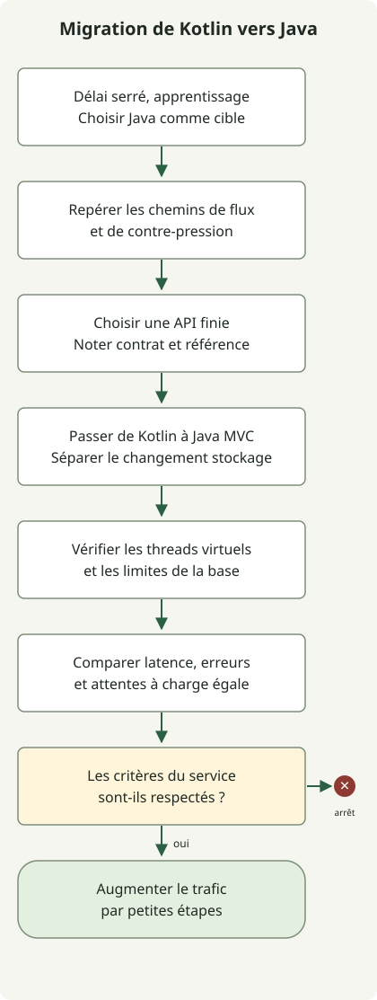

**Cette migration passe de Kotlin, WebFlux et des coroutines à Java, Spring MVC et aux threads virtuels.** Le passage de Kotlin à Java a été motivé par un délai de livraison serré et par l’apprentissage de Kotlin que devrait entreprendre l’équipe existante. Le choix du langage a tenu compte du délai de livraison et de la charge d’apprentissage de l’équipe ; le modèle d’exécution du serveur est passé à MVC avec des threads virtuels.

Le contexte de livraison qui explique le choix du langage et les effets des threads virtuels sur les performances nécessitent des explications distinctes. Le code ci-dessous illustre la forme de la migration ; il ne reproduit ni le code de production ni des résultats mesurés.

Ce guide décrit une migration progressive pour Java 21 ou ultérieur et Spring Boot 3.2 ou ultérieur. Il ne promet ni un débit supérieur ni une latence moindre. Mesurez le résultat réel selon le profil d’attente et d’utilisation du CPU des requêtes, la limite des connexions à la base de données, la capacité des services en aval et un test de charge représentatif.

<span id="separate-the-three-choices"></span>

## Distinguer le choix du langage du modèle d’exécution

**WebFlux et MVC sont des choix d’environnement d’exécution web.** WebFlux repose sur Reactive Streams et les E/S asynchrones non bloquantes ; MVC utilise le modèle de requêtes Servlet. **Les coroutines sont le modèle de programmation asynchrone de Kotlin**, vous pouvez donc conserver les fonctions `suspend` en choisissant MVC. Spring prend en charge les coroutines Kotlin dans les contrôleurs annotés pour MVC comme pour WebFlux. Cette prise en charge nécessite `kotlinx-coroutines-core` et `kotlinx-coroutines-reactor`. [Prise en charge des coroutines par Spring Framework](https://docs.spring.io/spring-framework/reference/languages/kotlin/coroutines.html)

Les threads virtuels sont des threads Java légers. Ils peuvent réduire le coût des threads de plateforme en attente dans une conception à un thread par requête utilisant des appels bloquants. Les activer ne rend pas JDBC non bloquant et n’agrandit pas le pool de connexions à la base de données. Spring Boot 3.2 et ultérieur peut activer l’exécution sur des threads virtuels sous JDK 21 ou ultérieur avec `spring.threads.virtual.enabled=true`. Boot recommande Java 24 ou ultérieur pour une meilleure expérience et signale le pinning, les paramètres existants des pools de threads et le comportement des threads démons parmi les points à examiner. [Paramètres et précautions de Spring Boot pour les threads virtuels](https://docs.spring.io/spring-boot/reference/features/spring-application.html)

Cette migration change ensemble le langage, l’environnement d’exécution web et le modèle de concurrence. Validez chaque changement séparément. Une migration du stockage est une décision distincte, comme l’indique le tableau ; cela ne démontre pas que le service réel utilisait R2DBC ou est passé à JPA.

| Changement | Ce qui change | Ce qu’il faut valider séparément |
| --- | --- | --- |
| Kotlin → Java | Langage d’implémentation et forme des API asynchrones | Gestion des valeurs nulles, objets de données, exceptions, annulation et contrats d’API existants |
| WebFlux → MVC | Modèle de traitement des requêtes du serveur | Filtres, sécurité, correspondance des exceptions, SSE et WebSocket |
| R2DBC → JDBC/JPA (si nécessaire) | Modèle d’accès à la base de données | Limites transactionnelles, requêtes, limites de connexions et délais |
| Exécution par coroutines → appels synchrones et threads virtuels | Modèle d’exécution et d’attente | Compatibilité des bibliothèques, utilisation de ThreadLocal, pinning et signaux d’exploitation |

## Quels chemins migrer ?

MVC avec des threads virtuels mérite une évaluation lorsqu’un chemin requête/réponse ordinaire utilise JPA ou JDBC et passe une grande partie de son temps à attendre une base de données ou une réponse HTTP en aval. À l’inverse, les chemins dont le contrat central repose sur un flux fortement concurrent, les événements envoyés par le serveur (SSE), WebSocket ou le contrôle de la demande de Reactive Streams peuvent gagner à rester sur WebFlux ou à être isolés dans un chemin dédié. Le fait que `Flow` puisse être un type de retour MVC ne garantit pas un comportement identique de streaming, d’annulation ou de contre-pression dans tous les environnements.



Le schéma montre la séquence de migration d’un chemin de requête ordinaire. Reportez la migration des chemins qui nécessitent encore du streaming et conservez-les ou isolez-les. N’augmentez le trafic qu’après satisfaction des critères par les tests et les observations ; gardez un moyen de revenir au chemin précédent en cas de régression par rapport à la référence.

<span id="you-can-keep-coroutine-controllers"></span>

## Migrer un contrôleur à coroutines Kotlin vers Java MVC

Ces extraits illustrent un point de terminaison de consultation d’une commande unique. Avant la migration, le contrôleur Kotlin attend le service au moyen d’une fonction `suspend`.

```kotlin
@RestController
class OrderController(private val orders: OrderService) {
    @GetMapping("/orders/{id}")
    suspend fun get(@PathVariable id: Long): OrderDto = orders.get(id)
}
```

Après la migration, un contrôleur Java MVC appelle une méthode de service synchrone et renvoie le même DTO de réponse. Cela suppose que `orders.get(id)` soit aussi devenu un contrat synchrone appelable depuis Java. Il n’appelle pas directement une méthode Kotlin `suspend` depuis Java.

```java
@RestController
public class OrderController {
    private final OrderService orders;

    public OrderController(OrderService orders) {
        this.orders = orders;
    }

    @GetMapping("/orders/{id}")
    public OrderDto get(@PathVariable("id") Long id) {
        return orders.get(id);
    }
}
```

Les annotations Spring proviennent de `org.springframework.web.bind.annotation` ; `OrderService` et `OrderDto` sont des types de service applicatif et de réponse. Ces extraits ne constituent pas une application complète exécutable. Activez les threads virtuels avec le paramètre Boot ci-dessous et vérifiez l’exécution pendant une véritable requête HTTP.

Vérifiez la correspondance des types Kotlin acceptant les valeurs nulles avec Java et la préservation des contrats d’égalité et de sérialisation des `data class`. Remplacer les appels de coroutines `async` par des appels Java séquentiels peut changer l’ordre des requêtes en aval et le temps de réponse ; validez donc séparément le parallélisme, les délais et l’annulation. Envelopper simplement les appels existants de coroutines dans `runBlocking` ne termine pas une migration vers des services Java synchrones.

Spring MVC prend lui-même en charge Kotlin `suspend` et `Flow` ; supprimer les coroutines n’est donc pas une condition préalable à MVC. Ici, **Java était le langage cible en raison du délai serré et de l’apprentissage de Kotlin par l’équipe existante**, les contrats des contrôleurs et des services évoluent donc aussi dans cette direction.

## Valider séparément la migration du dépôt

Si le modèle d’accès à la base de données doit aussi changer, voici un exemple distinct de passage du `CoroutineCrudRepository` R2DBC de Kotlin à Spring Data JPA en Java. Limitez la taille du résultat au lieu de rassembler toutes les lignes en mémoire et préservez le tri, la taille des pages et les filtres d’autorisation de l’API existante.

```kotlin
interface OrderRepository : CoroutineCrudRepository<Order, Long> {
    fun findByCustomerId(customerId: Long): Flow<Order>
}
```

Un dépôt JPA synchrone peut effectuer des requêtes page par page :

```java
public interface OrderRepository extends JpaRepository<Order, Long> {
    Page<Order> findByCustomerId(Long customerId, Pageable pageable);
}
```

Ces extraits illustrent la forme des dépôts ; ils ne constituent pas une application complète. Dans un projet réel, vérifiez aussi la stratégie de chargement des entités, la portée des transactions, les requêtes N+1, l’ordre stable des pages et les sémantiques d’annulation ou de consommation partielle du `Flow` précédent. Commencez par une API à réponse finie et ajoutez des tests de contrat et des observations des requêtes avant de poursuivre la migration.

## Activer et vérifier les threads virtuels

Avec Spring Boot 3.2 ou ultérieur et JDK 21 ou ultérieur, vous pouvez appliquer ce paramètre :

```yaml
spring:
  threads:
    virtual:
      enabled: true
```

Après l’avoir appliqué, vérifiez si le thread qui traite une requête est réellement virtuel. Pour un diagnostic temporaire, enregistrez `Thread.currentThread().isVirtual()` depuis un intercepteur MVC ou un contrôleur. Cela ne vérifie que ce chemin de requête ; cela ne prouve pas que chaque tâche applicative ou répartiteur de coroutines utilise des threads virtuels.

Pour un chemin de contrôleur Java, cette expression vérifie le thread courant de la requête :

```java
public class RequestThreadProbe {
    public static boolean isVirtual() {
        return Thread.currentThread().isVirtual();
    }
}
```

Boot précise que les propriétés des pools de threads peuvent perdre leur effet antérieur avec les threads virtuels et que le pinning dans certaines sections synchronisées ou certains appels natifs peut affecter le débit. N’utilisez pas davantage de threads virtuels pour contourner les limites de connexions à la base de données ou les plafonds de concurrence en aval. Limitez le pool à la capacité de la base et configurez les échéances d’acquisition de connexion, de requête, d’appel en aval et de requête globale.

## Migrer par étapes et définir les critères de retour arrière

1. **Établir une référence.** Recueillez le débit de requêtes, la latence p50/p95/p99, le taux d’erreur, le CPU, le tas, les attentes du pool de connexions et la latence des appels en aval pour des points de terminaison représentatifs sous les mêmes conditions de charge.
2. **Repérer les chemins exclusivement réactifs.** Listez ceux qui dépendent de SSE, WebSocket, de flux illimités, de la contre-pression ou d’opérations Reactive Streams, et excluez-les de la migration initiale.
3. **Migrer une API finie.** Traduisez Kotlin en Java en validant séparément le changement d’environnement serveur et tout changement de stockage nécessaire, puis testez les contrats de requête, réponse, erreur, annulation et autorisation.
4. **Vérifier l’exécution sur threads virtuels.** Vérifiez les threads à l’exécution et le chemin d’appel JDBC, pas seulement la propriété de déploiement. Examinez séparément les exécuteurs des tâches d’arrière-plan.
5. **Comparer à charge égale.** Comparez distribution de latence, erreurs, CPU, attentes de la base et utilisation des connexions avec les mêmes volumes de données et charges. Les threads virtuels n’ajoutent pas de capacité CPU aux traitements limités par le CPU ; surveillez aussi sa saturation.
6. **Élargir à partir d’une petite part du trafic.** Si les erreurs métier, la latence, les attentes du pool ou l’utilisation des ressources dépassent les critères fixés à l’avance, arrêtez l’élargissement et enquêtez ou revenez au chemin précédent. L’équipe doit définir les seuils selon le SLO de son service et sa référence.

Ne rapportez pas de gains de débit ou de latence non mesurés dans l’environnement cible. Mesurez d’abord le chemin modifié avec les mêmes entrées. Si le résultat ne s’améliore pas, rien ne justifie de faire de la migration MVC un objectif en soi.

## Critères de décision

Si le trafic requête/réponse ordinaire utilise JDBC/JPA et que les attentes bloquantes concurrentes constituent un goulot plausible, évaluez MVC et les threads virtuels sur un petit chemin. Ici, Java a été choisi en raison du délai serré et de l’apprentissage de Kotlin par l’équipe existante. N’assimilez pas le changement de langage à un gain de débit apporté par les threads virtuels. Si le streaming ou le comportement de Reactive Streams est une exigence produit, conservez WebFlux plutôt que d’affaiblir ce contrat pour changer le modèle de threads. Décidez en comparant latence, erreurs, attentes de la base et complexité d’exploitation à charge égale.
