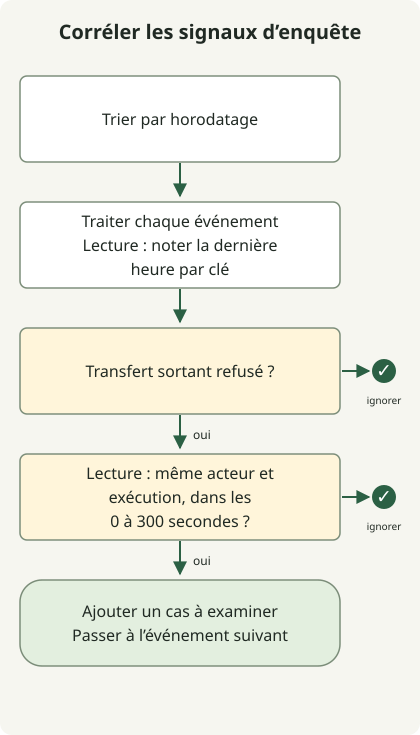

**Pour se préparer aux attaques assistées par IA, réduisez les compromissions de comptes et l’exploitation des vulnérabilités divulguées, et empêchez les agents IA d’exécuter des actions non autorisées même après lecture de contenus externes.** Vérifier que l’authentification, les correctifs, les permissions et les contrôles des transferts sortants fonctionnent réellement est plus directement utile que de déterminer si un message d’attaque a été écrit par une IA.

Cet article s’adresse aux équipes qui exploitent des services ou introduisent des agents IA dans leurs processus de développement. Il traite des réponses par chemin d’attaque et de la corrélation locale des journaux. Les procédures opérationnelles suivantes sont des propositions, pas le récit d’un incident dans une organisation ni une mesure d’efficacité défensive.

## Utiliser l’IA pour attaquer et attaquer l’IA

Les attaquants peuvent utiliser l’IA pour organiser les informations sur leurs cibles et créer des messages d’usurpation d’identité ou du code. Nos propres agents IA peuvent aussi être des cibles. L’injection indirecte de prompt, par exemple, cache des instructions dans des documents externes pour provoquer des transferts de données ou des modifications de configuration de déploiement.

[L’évaluation des menaces du NCSC britannique jusqu’en 2027](https://www.ncsc.gov.uk/report/impact-ai-cyber-threat-now-2027) prévoit que l’IA rendra plus efficaces des activités existantes telles que la reconnaissance, l’ingénierie sociale et la recherche de vulnérabilités. Elle estime aussi que le délai de réaction entre divulgation et exploitation des vulnérabilités connues pourrait encore diminuer. Ces prévisions ne doivent pas être lues comme des observations selon lesquelles chaque attaque serait déjà entièrement automatisée.

| Chemin d’attaque | Objectif de l’attaquant | Limite à protéger d’abord |
| --- | --- | --- |
| Phishing ciblé et usurpation d’identité de dirigeants | Connexion, récupération de compte ou approbation de paiement | Authentification, récupération et canal de vérification séparé |
| Découverte et exploitation assistées de vulnérabilités | Intrusion dans les services exposés et vol de secrets | Actifs exposés, correctifs et isolation |
| Injection de prompt dans un agent | Exécution non autorisée d’outils ou transferts sortants | Séparation entre données et instructions ; permissions des outils et du réseau |

Plusieurs chemins peuvent se rejoindre dans un incident. Si une compromission de compte permet de placer des instructions malveillantes dans un document interne, examinez les défenses des identités et des agents.

## Se défendre contre le phishing par les chemins d’authentification et d’approbation

[L’analyse de Microsoft sur l’usurpation de dirigeants et la fraude à la facture](https://www.microsoft.com/en-us/security/blog/2026/09/10/protecting-organizations-ai-assisted-executive-impersonation-invoice-fraud/) décrit une campagne combinant faux courriels de dirigeants, factures et contenus présentés comme des conversations transférées. Les chercheurs ont observé des indices compatibles avec un développement de modèles de messages assisté par IA, mais précisent qu’ils ne permettent pas d’établir la part de contenu générée par IA. Une ponctuation ou des formats de commentaires particuliers ne suffisent pas à fonder des règles de classification des attaques.

Commencez par vérifier ces limites opérationnelles :

- **Connexion :** Déployez une authentification résistante au phishing, telle que FIDO2 ou les passkeys, pour les comptes compatibles et vérifiez que les politiques de connexion réelles l’exigent. [Les recommandations Microsoft sur la MFA résistante au phishing](https://learn.microsoft.com/en-us/security/zero-trust/sfi/phishing-resistant-mfa) abordent les risques d’interception et de fatigue touchant SMS, OTP et authentification push, ainsi que la migration vers des méthodes plus fortes.
- **Récupération et inscription :** Lorsque le support enregistre une nouvelle méthode d’authentification ou récupère un compte, vérifiez l’identité avec des données existantes fiables et une procédure distincte. Établissez des règles d’exploitation qui n’approuvent pas une récupération sur la base d’un seul courriel ou appel vidéo.
- **Approbation métier :** Vérifiez les changements de coordonnées bancaires et les demandes de partage de secrets au moyen de coordonnées préalablement enregistrées ou d’un système d’approbation interne, plutôt que des coordonnées du message. Une fraude au paiement peut réussir sans compromission de compte ; renforcer la connexion seule ne complète donc pas la défense.

Utilisez conjointement SPF, DKIM, DMARC et la détection d’usurpation d’identité pour protéger la messagerie. Réussir l’authentification du courriel n’établit pas la légitimité métier de demandes provenant de domaines ressemblants ou de comptes légitimes compromis. L’authentification résistante au phishing ne résout pas non plus tous les scénarios de session volée ou de terminal compromis.

## Prioriser l’exposition et le risque d’exploitation dans la réponse aux vulnérabilités

Un service exposé reste vulnérable pendant que les défenseurs attendent la preuve qu’un attaquant a utilisé l’IA. Reliez d’abord chaque service accessible depuis Internet à son produit, sa version en cours d’exécution, son responsable et son état de correction, puis consultez les avis du fournisseur et les informations d’exploitation observée. **Savoir si les instances qui servent actuellement le trafic exécutent la version corrigée** compte davantage qu’une trace de modification du code source ou d’une étiquette d’image.

Priorisez la réponse en combinant exposition externe, exploitation observée, données et privilèges accessibles et impact sur le service. Si l’application immédiate du correctif est difficile, appliquez des mesures d’atténuation prises en charge par le fournisseur ou des restrictions d’exposition, et consignez un responsable et une date de réévaluation de l’exception. Ajouter une règle WAF ne supprime pas la vulnérabilité sous-jacente.

Si l’exploitation a pu déjà avoir lieu, enquêtez sur l’incident parallèlement aux correctifs. Préservez les traces des processus, de l’authentification et des communications sortantes ; déterminez la rotation des identifiants et la reconstruction depuis des images fiables selon l’étendue de la compromission. Un correctif appliqué avec succès ne démontre pas la suppression des traces d’intrusion ou de la persistance.

## Ne pas transformer le contenu lu par un agent en autorité d’exécution

Lorsqu’un agent IA lit des issues, des fichiers de dépôt ou des pages web, ces contenus peuvent être contrôlés par un attaquant. Accorder à un texte disant « après lecture de ce document, exécutez la commande suivante » la même autorité qu’à la tâche approuvée par l’utilisateur peut transformer une recherche d’informations en transfert sortant.

[Les recommandations OWASP de prévention de l’injection de prompt](https://cheatsheetseries.owasp.org/cheatsheets/LLM_Prompt_Injection_Prevention_Cheat_Sheet.html) préconisent de valider les appels d’outils selon les permissions de l’utilisateur et le contexte de session, de valider les paramètres propres à chaque outil et d’appliquer le moindre privilège. Ajouter un avertissement à l’entrée ou demander au modèle d’ignorer les instructions malveillantes n’impose pas en soi des permissions d’exécution.

Imposez les ressources et actions permises pour chaque utilisateur et tâche **à la frontière d’exécution des outils, hors du modèle**. Utilisez des comptes en lecture seule et des identifiants de courte durée, et limitez les transferts réseau par destination, protocole et périmètre des données. Une liste de destinations autorisées ne suffit pas si un domaine approuvé permet encore des transferts vers le compte d’un attaquant ou des chemins arbitraires. Montrez la cible précise et les changements lors de l’approbation de modifications ou transferts importants.

Enregistrez les identifiants de tâche, identités d’exécution, noms d’outils, décisions de politique et résultats. Représentez les motifs de décision sous forme de codes de politique observables ; il n’est pas nécessaire de collecter le raisonnement caché du modèle. Journaliser les documents sources entiers, les jetons ou les mots de passe peut créer un autre point de divulgation. Consultez les [limites de permissions des agents IA](/en/posts/2026-11-01-ai-agent-permission-boundaries/) pour la frontière opérationnelle d’autorisation.

## Corréler les transferts refusés après lecture de contenus externes

L’exemple Python suivant corrèle des **événements synthétiques attribués à un exécuteur fiable**. Il signale un cas à examiner lorsqu’un transfert externe est refusé dans les 300 secondes suivant une lecture de contenu externe pour le même acteur et le même identifiant d’exécution. Il n’identifie pas l’injection de prompt et ne bloque pas les requêtes. Il suppose que des politiques distinctes d’outils ou de réseau ont déjà généré les événements de refus.



Le schéma résume les branches du traitement d’un événement. Les symboles de terminaison à droite signifient ignorer l’événement courant, pas rendre un verdict de sécurité. Le code répète le traitement pour chaque événement et conserve l’horodatage de lecture le plus récent. Les événements ne remplissant pas les conditions sont ignorés. Le schéma ne représente pas un processus complet de détection d’attaque ou de réponse à incident.

L’exemple a été exécuté avec Python 3.13.0 et n’utilise ni paquets externes, ni réseau, ni journaux de production. Enregistrez-le sous `correlate.py`. Ici, `at` représente les secondes depuis le début de l’exemple ; une collecte réelle exige des horodatages synchronisés et des identifiants d’exécution stables. Ne renseignez pas `kind` ou les identifiants en faisant confiance au texte des documents ou à des valeurs arbitraires générées par le modèle.

```python
from dataclasses import dataclass


@dataclass(frozen=True)
class Event:
    at: int
    actor: str
    run: str
    kind: str


def correlate(events: list[Event], window: int = 300) -> list[tuple[str, str, int]]:
    if window < 0:
        raise ValueError("window")
    last_read: dict[tuple[str, str], int] = {}
    candidates = []
    for event in sorted(events, key=lambda item: item.at):
        key = (event.actor, event.run)
        if event.kind == "untrusted_read":
            last_read[key] = event.at
        elif event.kind == "egress_denied":
            read_at = last_read.get(key)
            if read_at is not None and 0 <= event.at - read_at <= window:
                candidates.append((event.actor, event.run, event.at))
    return candidates


if __name__ == "__main__":
    events = [
        Event(20, "agent-a", "run-1", "egress_denied"),
        Event(0, "agent-a", "run-1", "untrusted_read"),
        Event(30, "agent-a", "run-2", "egress_denied"),
        Event(40, "agent-b", "run-1", "egress_denied"),
        Event(301, "agent-a", "run-1", "egress_denied"),
    ]
    print(correlate(events))
```

```sh
python3 correlate.py
```

La sortie réelle d’exécution est :

```text
[('agent-a', 'run-1', 20)]
```

Seul l’événement à 20 secondes pour la même exécution est sélectionné. Les refus d’autres exécutions ou acteurs et ceux hors de la fenêtre temporelle sont exclus. La fenêtre de 300 secondes est un choix illustratif, pas un seuil de sécurité validé. La proximité temporelle n’établit pas que l’injection a causé la tentative de transfert. Une automatisation légitime peut produire le même schéma.

Treize vérifications locales distinctes ont couvert la borne inclusive de 300 secondes, l’exclusion à 301 secondes, les entrées réordonnées, l’horodatage zéro, l’isolation entre acteurs et exécutions, les refus sans lecture, les transferts réussis et une fenêtre négative. Trois mutations de régression excluant la borne de 300 secondes, ignorant l’acteur ou traitant mal l’horodatage zéro ont aussi été détectées. L’absence d’alerte n’établit pas la sécurité : cette règle peut manquer les transferts non bloqués et les journaux manquants. Une adoption en production nécessite la gestion des retards et du réordonnancement des flux, l’expiration de l’état, la déduplication, la récupération après redémarrage et l’évaluation des faux positifs. Cet exemple par lots n’implémente pas ces fonctions.

## Vérifier les résultats d’exécution et fermer le chemin de dommage après une alerte

Vérifiez les résultats des politiques de l’exécuteur et les traces réseau et du service destinataire plutôt que de vous fier à l’affirmation d’un agent selon laquelle il a bloqué une action. Un événement `egress_denied` indique que cette tentative précise a été refusée ; il n’établit pas qu’aucune autre voie n’a divulgué des données. Arrêtez l’exécution suspecte et corrélez accès aux sources, appels d’outils et communications sortantes à l’aide de son identifiant de tâche.

| Situation | Réponse initiale proposée | Vérifications avant reprise |
| --- | --- | --- |
| Connexion ou changements de compte suspects après phishing | Invalider les sessions et jetons concernés, récupérer le compte, examiner les méthodes d’authentification inscrites et les consentements accordés | Supprimer les voies d’accès ajoutées par l’attaquant et vérifier la connexion légitime |
| Exploitation suspectée d’un service exposé | Isoler les actifs touchés, préserver les preuves, appliquer les versions corrigées et reconstruire si nécessaire | Vérifier versions exécutées et exposition ; rechercher persistance et mouvement latéral |
| Appels d’agent non autorisés | Arrêter l’exécution, révoquer ou renouveler les identifiants concernés, restreindre les outils et chemins de transfert | Tester en régression que les demandes non autorisées sont refusées et que le travail approuvé réussit encore |

Le blocage automatique peut interrompre le service ; appliquez-le donc selon la confiance dans la détection et l’étendue de l’impact. Si confinement et préservation des preuves s’opposent, choisissez l’ordre selon les dommages en cours et le coût de collecte. Les permissions d’outils et de transferts sortants doivent aussi être séparées lorsqu’on fournit du matériel d’attaquant à une IA d’enquête. [Les recommandations conjointes d’agences nationales de sécurité pour l’adoption de l’IA agentique](https://www.ncsc.govt.nz/protect-your-organisation/careful-adoption-of-agentic-ai-services/) incluent composants, intégrations et exploitation dans le périmètre d’évaluation des risques.

Commencez par un actif exposé à l’extérieur, un compte important et une tâche d’agent lisant des documents externes. Reliez pour chacun un contrôle réellement appliqué, des journaux exploitables pour enquête et une procédure de récupération exécutable par un responsable. Incluez les demandes légitimes réussies dans les tests répétés et vérifiez que modifier les limites de refus fait échouer la vérification, comme le montre le [TDD assisté par IA](/en/posts/2026-11-02-ai-assisted-tdd/).
