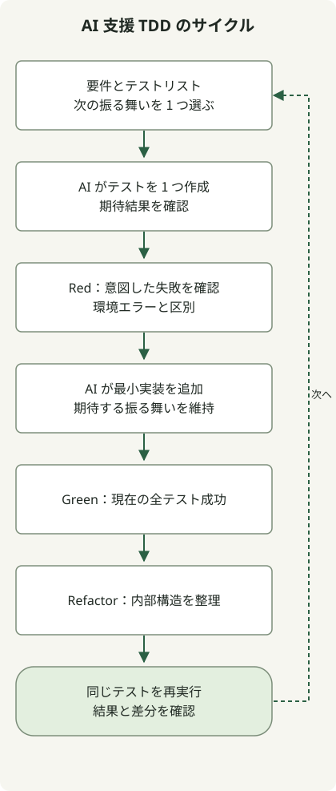

**AI と TDD を組み合わせるときは、期待結果を要件から導き、テストの失敗を観測してから、小さな実装とリファクタリングを繰り返します。** AI はテストと実装を提案できますが、両方が同じ誤解を持ったままテストに通ることもあります。各期待値の根拠と、テストランナーが実際に報告する内容を確認してください。

基本的な TDD のサイクルでは、テストリストから次の振る舞いを一つ選び、Red → Green → Refactor を繰り返します。[Martin Fowler による TDD の説明](https://www.martinfowler.com/bliki/TestDrivenDevelopment.html)は、テストリスト、小さなサイクル、リファクタリングを重視しています。以下の Java 例では、特定のツールに依存せず、この過程に AI を加えます。プロンプトは執筆した例であり、AI 製品の会話記録や生産性の測定結果ではありません。

## 実装を見せる前に期待する振る舞いを定義する

例は、在庫数と要求数から残りの在庫を計算する純粋関数です。要件は説明用で、実際のサービスのポリシーではありません。データベースの更新、予約の永続化、並行リクエスト間の原子性は提供しません。

| 条件 | 期待する振る舞い |
| --- | --- |
| 在庫 10、要求 3 | 7 を返す |
| 在庫 10、要求 10 | 0 を返す |
| 要求が在庫を超える。要求 1 に対して在庫 0 の場合も含む | `IllegalStateException("insufficient_stock")` |
| 在庫が負 | `IllegalArgumentException("stock")` |
| 要求数がゼロまたは負 | `IllegalArgumentException("requested")` |
| 両方の入力が不正 | 在庫を先に検証する |
| 在庫が `Integer.MAX_VALUE`、要求 1 | `Integer.MAX_VALUE - 1` を返す |

この表がテストオラクル、つまり結果の判定基準です。AI が生成した実装を読み、その戻り値をアサーションにコピーすると、バグまで写す可能性があります。要件と API 契約から始めます。

```text
まだ実装はしないでください。
StockPolicy.remaining(int stock, int requested) のテストケースを提案してください。
各入力、期待結果、例外を、要件表のルールと結び付けてください。

外部ストレージやデータベースを導入しないでください。
正常入力、境界、不正入力を分けてください。最初の反復では、
要求 3 に対して在庫 10 から引き、7 が返るテストだけを書いてください。
要件が不明確な箇所でポリシーを作り出さないでください。
```

## 小さな実行で Red・Green・Refactor をつなぐ



図は、AI の内部ではなく、開発者が制御するワークフローを示しています。新たな振る舞いが失敗するのを確認し、最小実装を追加します。リファクタリング後は、同じテストを再実行してから別のケースを選びます。依存関係のダウンロードや実行環境が失敗の原因なら、その問題を直し、同じ段階を再実行してください。

再現環境は **JDK 17.0.8.1、Gradle 8.4、JUnit Jupiter 5.12.2** です。この固定した組み合わせは使用環境の記録であり、現在の本番向けバージョンの推奨ではありません。空のディレクトリに以下のファイルを作成します。初回実行では Maven Central からテスト依存関係をダウンロードする場合がありますが、テスト自体は外部 API やデータベースを呼びません。既存プロジェクトでは、その Gradle Wrapper と依存関係管理の方針に従ってください。

### `settings.gradle`

```groovy
rootProject.name = 'ai-tdd-stock'
```

### `build.gradle`

```groovy
plugins { id 'java' }
repositories { mavenCentral() }
dependencies {
    testImplementation platform('org.junit:junit-bom:5.12.2')
    testImplementation 'org.junit.jupiter:junit-jupiter'
    testRuntimeOnly 'org.junit.platform:junit-platform-launcher'
}
java {
    sourceCompatibility = JavaVersion.VERSION_17
    targetCompatibility = JavaVersion.VERSION_17
}
test {
    useJUnitPlatform()
    testLogging { events 'passed', 'failed' }
}
```

JUnit の `@Test`、`assertEquals`、`assertThrows` で戻り値と例外を確認します。例外オブジェクトを受け取り、メッセージも確認してください。[JUnit 5.12.2 ユーザーガイド](https://docs.junit.org/5.12.2/user-guide/)と [Gradle の JVM テストガイド](https://docs.gradle.org/current/userguide/java_testing.html)を参照してください。

### 最初のテスト：`src/test/java/StockPolicyTest.java`

```java
import org.junit.jupiter.api.Test;
import static org.junit.jupiter.api.Assertions.assertEquals;
import static org.junit.jupiter.api.Assertions.assertThrows;

class StockPolicyTest {
    @Test
    void reservesPartOfStock() {
        assertEquals(7, StockPolicy.remaining(10, 3));
    }
}
```

### 最初の Red：`src/main/java/StockPolicy.java`

呼び出せる API を作りますが、実装ではまだ何も引きません。テストを実行し、期待値が `7` なのに `10` が返ったために失敗することを確認します。

```java
public class StockPolicy {
    public static int remaining(int stock, int requested) {
        return stock;
    }
}
```

プロジェクトのルートからこのコマンドを実行します。この段階ではテストの失敗とゼロ以外の終了コードが期待されます。

```sh
gradle --no-daemon --console=plain clean test
```

ダウンロードやコンパイルのエラーと、要件で定めた振る舞いの失敗を区別します。ここで意図する Red は、`reservesPartOfStock()` のアサーション不一致です。ランナーの故障は、その振る舞いをテストした証拠にはなりません。

### 最初の Green：同じ `StockPolicy.java` を置き換える

```java
public class StockPolicy {
    public static int remaining(int stock, int requested) {
        return stock - requested;
    }
}
```

同じコマンドを再実行すると、最初のテストが通ります。この実装はまだ負の入力や在庫不足を扱っていません。最初のテストが通っても機能は完成していないので、次の要件を追加します。

AI には、次のように変更範囲を伝えられます。

```text
失敗したテストは reservesPartOfStock で、expected=7, actual=10 です。
このテストを通すために、StockPolicy.java だけを変更してください。
テスト、期待値、ビルド設定は変更しないでください。
依頼していないデータベース、インターフェース、設定層を追加しないでください。
実際に確認したコマンド、終了コード、テスト結果を報告してください。
```

### 次の Red：既存のテストクラス内にメソッドを追加する

これらのメソッドを、`StockPolicyTest` の最後の閉じ波括弧の**内側**に追加します。実際の TDD では 一ケースずつ追加してサイクルを繰り返してください。この記事では、再現用ファイルを簡潔にするため、残りのケースを 一つのブロックにまとめています。

```java
    @Test
    void reservesAllStock() {
        assertEquals(0, StockPolicy.remaining(10, 10));
    }

    @Test
    void rejectsInsufficientStock() {
        var error = assertThrows(IllegalStateException.class,
                () -> StockPolicy.remaining(2, 3));
        assertEquals("insufficient_stock", error.getMessage());
    }

    @Test
    void rejectsEmptyStock() {
        var error = assertThrows(IllegalStateException.class,
                () -> StockPolicy.remaining(0, 1));
        assertEquals("insufficient_stock", error.getMessage());
    }

    @Test
    void rejectsNegativeStock() {
        var error = assertThrows(IllegalArgumentException.class,
                () -> StockPolicy.remaining(-1, 1));
        assertEquals("stock", error.getMessage());
    }

    @Test
    void rejectsZeroRequest() {
        var error = assertThrows(IllegalArgumentException.class,
                () -> StockPolicy.remaining(10, 0));
        assertEquals("requested", error.getMessage());
    }

    @Test
    void rejectsNegativeRequest() {
        var error = assertThrows(IllegalArgumentException.class,
                () -> StockPolicy.remaining(10, -1));
        assertEquals("requested", error.getMessage());
    }

    @Test
    void validatesStockBeforeRequest() {
        var error = assertThrows(IllegalArgumentException.class,
                () -> StockPolicy.remaining(-1, 0));
        assertEquals("stock", error.getMessage());
    }

    @Test
    void supportsMaximumStock() {
        assertEquals(Integer.MAX_VALUE - 1,
                StockPolicy.remaining(Integer.MAX_VALUE, 1));
    }
```

最初の Green の実装でこの追加ブロックを実行すると、6 テストが失敗し、実行したテストは計 9 件です。

### 追加ケースの Green：`StockPolicy.java` を置き換える

```java
public class StockPolicy {
    public static int remaining(int stock, int requested) {
        if (stock >= 0) {
            if (requested > 0) {
                if (requested <= stock) {
                    return stock - requested;
                }
                throw new IllegalStateException("insufficient_stock");
            }
            throw new IllegalArgumentException("requested");
        }
        throw new IllegalArgumentException("stock");
    }
}
```

同じコマンドで 9 テストすべてが通ることを確認します。実装は指定された振る舞いを満たしました。次に、テストを維持しながら分岐の入れ子を簡素化します。

### Refactor：同じファイルでガード節を使う

```java
public class StockPolicy {
    public static int remaining(int stock, int requested) {
        if (stock < 0) throw new IllegalArgumentException("stock");
        if (requested <= 0) throw new IllegalArgumentException("requested");
        if (requested > stock) throw new IllegalStateException("insufficient_stock");
        return stock - requested;
    }
}
```

検証順序、戻り値、例外を保ったまま、入れ子を減らしています。この段階で新たなポリシーを導入しないでください。AI にリファクタリングを頼むときは、維持する振る舞いと実行範囲を指定します。

```text
現在、9 件のテストはすべて通っています。
StockPolicy.java の分岐の入れ子だけをガード節に置き換えてください。
要求数より stock を先に検証する順序、
戻り値、例外の型、メッセージ、既存テストを維持してください。
変更の前後で同じ完全なテストスイートを実行し、
結果と差分を報告してください。
```

最初の Red から Refactor まで、各ソースの版を別々に実行しました。以下の結果は JUnit XML レポートから読み取ったものです。

| 段階 | テスト数 | 失敗数 | スキップ数 | Gradle 終了コード |
| --- | ---: | ---: | ---: | ---: |
| 最初の Red | 1 | 1 | 0 | 1 |
| 最初の Green | 1 | 0 | 0 | 0 |
| 追加ケース Red | 9 | 6 | 0 | 1 |
| 追加ケース Green | 9 | 0 | 0 | 0 |
| Refactor | 9 | 0 | 0 | 0 |

HTML レポートは `build/reports/tests/test/index.html` に生成され、機械可読な XML は `build/test-results/test/` にあります。これらの結果が検証するのはローカルのポリシー関数です。AI 製品の品質、生産性、本番システムの正しさを測定するものではありません。

## テストと実装は一緒に間違うことがある

在庫と要求の両方が不正な場合の**検証の優先順位**は、`validatesStockBeforeRequest()` で固定しています。このケースがなければ、例外メッセージの優先順位を逆にする回帰を見逃す可能性があります。正常入力の例を増やすだけでなく、要件表のルールに対応するテストがあるか確認してください。

テストが境界の回帰を検出するかも確認できます。最終実装の `requested > stock` を誤って `requested >= stock` に変えると、`reservesAllStock()` が失敗するはずです。`requested <= 0` を `requested < 0` に変えると、`rejectsZeroRequest()` が失敗するはずです。入力の検証順序を逆転させる変異も実行し、`validatesStockBeforeRequest()` が失敗しました。三つの変異はすべて実際に実行していますが、あらゆる欠陥の検出を保証するものではありません。

AI 支援のレビューでは、元の要件を改めて渡し、各テストがどのルールを確認するか尋ねます。別のエージェントも同じ誤った要件を共有していれば、同じ間違いを繰り返す可能性があります。役割を分けることと、期待する振る舞いを独立に確立することは、別の問題です。

```text
元の要件表と現在のテストを比較してください。
まだテストや実装を変更しないでください。
検証済みのルール、欠けているルール、境界、未観測の条件を挙げてください。
現在の実装の出力を期待結果として
そのままコピーしたテストがないか確認してください。
変更を提案するときは、まず各変更をそのルールと根拠に結び付けてください。
```

## テストを通すために AI が検証を弱めるのを防ぐ

失敗したテストの削除、`@Disabled` によるスキップ、誤った実装に合わせた期待値の変更、すべての例外の握りつぶしは、要件を満たさずにグリーンな結果を作れます。リファクタリング中に要件が変わらないなら、期待する振る舞いを維持します。テスト自体が誤っている場合は、ポリシーと根拠を確立し、その修正を実装変更と区別します。[AI 生成コードのレビューに関する GitHub の指針](https://docs.github.com/en/copilot/tutorials/review-ai-generated-code)も、テストの削除やスキップ、意図した要件との不一致を確認するよう勧めています。

AI の「テストは通った」という主張と、ランナーの結果を区別してください。実際のコマンド、終了コード、JUnit レポート、差分を確認します。実行テストがゼロ、または一部だけの実行は、完全な成功ではありません。CI では最終実装と完全なテストスイートを、通常の成功条件で実行します。意図した Red の失敗を検証する教材用の実行ハーネスは通常の CI と分け、失敗したコマンドを無条件に無視して CI を通さないでください。

既存コードでは、まず現在の振る舞いを捉えるテストを用意し、次に変更する振る舞いを一つ選びます。この順序と維持基準は、[AI エージェントによるリファクタリング](/en/posts/2026-10-31-ai-agent-refactoring/)につながります。テストとビルドもコードを実行するため、[AI エージェントの権限境界](/en/posts/2026-11-01-ai-agent-permission-boundaries/)で説明したように、作業ディレクトリと認証情報を制限してください。

この例を実際の在庫予約へ拡張するには、並行リクエスト、トランザクション、重複リクエスト、再試行を対象に、別途結合テストが必要です。この 9 件の単体関数テストが通っても、過剰販売を防げる証明にはなりません。
