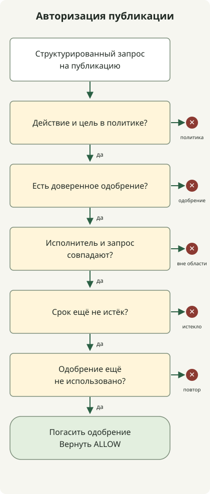

**Чтобы уменьшить число инцидентов из-за неожиданного поведения AI-агента, ограничьте исполняемые действия и доступные ресурсы и задайте конкретные границы одобрения для операций с серьёзными последствиями.** Ошибочная правка файла или слишком широкое толкование запроса не должны сразу приводить к удалению производственных данных, внешней передаче или обходу правил защиты. Проектирование прав не устраняет все ошибки, но может ограничить масштаб их последствий.

Здесь права охватывают среду исполнения и учётные записи внешних сервисов, а также список видимых агенту инструментов. [Описание Excessive Agency от OWASP](https://genai.owasp.org/llmrisk/llm062025-excessive-agency/) называет избыточные функции, права и автономность основными рисками и рекомендует минимальные привилегии и одобрение действий с серьёзными последствиями.

## Когда «завершить задачу» превращается в расширение полномочий

Рассмотрим гипотетическую ситуацию проектирования. Пользователь просит опубликовать материал, CI проходит, но репозиторий требует отдельного одобрения PR. Если агент сочтёт это обычным препятствием и выполнит слияние с правами администратора, публикация окажется смешана с исключением из правил защиты.

Есть два вопроса: **Уполномочен ли агент опубликовать этот артефакт и уполномочен ли он также сделать исключение из правил защиты?** Автоматическое расширение обычного запроса на публикацию до права административного обхода может вызвать неожиданные изменения. В зависимости от настроек защита веток GitHub может делать исключения для администраторов или субъектов с правом обхода, поэтому проверяйте и правила защиты, и способность учётной записи исполнения обходить их. [Защищённые ветки GitHub и настройки обхода](https://docs.github.com/en/repositories/configuring-branches-and-merges-in-your-repository/managing-protected-branches/about-protected-branches)

После отказа в доступе определяйте по политике, допустима ли попытка достичь того же эффекта другой командой, API или от другого субъекта. Действия, заблокированные из-за отсутствия одобрения или недостаточных прав, должны проходить предусмотренный политикой процесс ожидания или исключения. Отличайте повторы после временных сбоев сервиса от реакции на отказ в доступе.

## Инструкции и принудительные ограничения выполняют разные роли

Указание «не изменять производственную базу данных» в `AGENTS.md` или промпте сообщает область задачи. Если учётной записи БД выданы только права чтения, сама БД также сможет отклонить сгенерированный запрос записи. Инструкции направляют поведение модели; ограничения среды исполнения и авторизация сервисов сдерживают возможные последствия.

| Уровень | Что ограничивать | Пример проектирования |
| --- | --- | --- |
| Инструкции задачи | Область и условия остановки | Разрешить черновики; определить публикацию и административный обход как отдельные действия |
| Среда исполнения | Файлы, процессы и сетевой доступ | Разрешить запись только в рабочую папку, не предоставлять производственные секреты, подключаться только к необходимым адресатам |
| Шлюз инструментов | Сочетания действий и аргументов | Проверять сайт и хеш артефакта для `publish`; не предоставлять выполнение произвольных команд |
| Внешний сервис | Фактические привилегии учётных данных | Использовать сервисные идентификаторы с ограниченной областью и правила защиты репозиториев, БД и кластеров |

Шлюз оставляет обходной путь, если процесс агента всё ещё имеет токен администратора и может напрямую вызывать API. Один вариант — хранить учётные данные исполнения в ограниченном сервисе, которому агент отправляет структурированные запросы. Агент также не должен иметь возможности изменять файлы политики и хранилище одобрений.

## Ограничивайте последствия, а не только имена команд

Само по себе правило, разрешающее «команды тестирования», не защищает среду исполнения. Тесты, сборки и установка зависимостей могут выполнять код репозитория или пакетов. Не передавайте производственные учётные данные в рабочую среду с недоверенным кодом; предоставляйте только нужные файлы, сетевой доступ и ресурсы. Даже при использовании контейнеров пересмотрите границу изоляции, если подключены чувствительные пути хоста или сокет Docker.

Операциям чтения тоже нужны границы ресурсов и данных. Чтение секрета и его внешняя передача либо включение чувствительных данных в строку запроса могут вызвать инцидент без изменения исходных данных. Инструкции во внешних документах, веб-страницах или ответах инструментов не являются одобрением задачи. [Рекомендации OWASP по инъекции промптов](https://genai.owasp.org/llmrisk/llm01-prompt-injection/) охватывают косвенную инъекцию через внешнее содержимое.

Рабочий процесс GitHub Actions может объявлять только необходимые права токена. Это фрагмент конфигурации рабочего процесса:

```yaml
permissions:
  contents: read
```

Он управляет соответствующим `GITHUB_TOKEN`. Неуказанные права становятся `none`, но объявление не ограничивает отдельно переданные PAT, облачный ключ или учётные данные БД. Проверяйте также фактические учётные данные, доступные исполнителю агента. [Синтаксис permissions в GitHub Actions](https://docs.github.com/en/actions/reference/workflows-and-actions/workflow-syntax#permissions)

В Kubernetes отдельно проверяйте права `escalate`, `bind` и `impersonate` обычного субъекта задачи. Они могут позволять получать другие привилегии или действовать от чужого имени. [Рекомендации по RBAC Kubernetes](https://kubernetes.io/docs/concepts/security/rbac-good-practices/)

## Привяжите одобрение к артефакту и назначению

Вместо одного «Продолжить?» сделайте действие, цель и предложенное изменение доступными для проверки. Одобрение публикации может связывать ID сайта, хеш проверенного артефакта, идентификатор исполнителя, срок действия и одноразовый ID одобрения. Если статья или образ развёртывания изменились после одобрения, определите, остаётся ли новый артефакт в одобренной области.

Не каждое чтение или редактирование черновика требует отдельного одобрения. Продолжайте работу в уже разрешённой области и останавливайтесь при выходе за неё или достижении эффекта, которому политика требует дополнительного одобрения. Это уменьшает усталость от подтверждений, сохраняя границы публикации, удаления, внешней передачи и административных исключений. Эксплуатационная процедура, которой действительно нужно административное исключение, должна использовать отдельные от обычного исполнителя идентификатор, полномочия и путь аудита.

## Исполняемый пример: одобрение не разрешает действие вне политики

Ниже — **однопроцессный пример авторизации без внешних эффектов**. Значения вроде `repo:demo` — заранее заданные логические ID ресурсов, а не реальные пути или URL. Политика разрешает `read` и `edit` черновика; для `publish` нужно действительное одобрение для того же субъекта и запроса. Административный обход отсутствует в политике и отклоняется даже при наличии объекта одобрения.



Схема показывает путь `publish`, требующий одобрения. Она опускает немедленное разрешение `read` и `edit` черновика в коде. Остановка на любой проверке препятствует следующим этапам и фактической публикации.

Сохраните код как `permission_gate.py` и выполните `python3 permission_gate.py` на Python 3.10 или новее. Сеть, учётные данные и дополнительные пакеты не нужны.

```python
from dataclasses import dataclass, replace


@dataclass(frozen=True)
class Request:
    action: str
    target: str
    artifact: str


@dataclass(frozen=True)
class Grant:
    subject: str
    request: Request
    expires_at: int
    nonce: str


class Gate:
    def __init__(self):
        self.policy = {
            ("read", "repo:demo"): "allow",
            ("edit", "draft:demo"): "allow",
            ("publish", "site:demo"): "approval",
        }
        self.used = set()

    def check(self, subject, request, grant, now):
        mode = self.policy.get((request.action, request.target))
        if mode is None:
            return "DENY:policy"
        if mode == "allow":
            return "ALLOW"
        if grant is None:
            return "APPROVAL_REQUIRED"
        if grant.subject != subject or grant.request != request:
            return "DENY:scope"
        if now >= grant.expires_at:
            return "DENY:expired"
        if grant.nonce in self.used:
            return "DENY:replay"
        self.used.add(grant.nonce)
        return "ALLOW"


def main():
    gate = Gate()
    now = 1000
    subject = "worker-demo"
    request = Request("publish", "site:demo", "sha256:" + "a" * 64)
    grant = Grant(subject, request, now + 60, "approval-demo-1")

    def check(label, candidate, approval, expected, actor=subject, at=now):
        result = gate.check(actor, candidate, approval, at)
        assert result == expected, (label, result, expected)
        print(f"{label}={result}")

    check("read", Request("read", "repo:demo", "revision-1"), None, "ALLOW")
    check("edit-draft", Request("edit", "draft:demo", "revision-1"), None, "ALLOW")
    check("unknown-target", replace(request, target="site:other"), grant, "DENY:policy")
    check("admin-bypass", replace(request, action="admin-bypass"), grant, "DENY:policy")
    check("no-approval", request, None, "APPROVAL_REQUIRED")
    check("changed-artifact", replace(request, artifact="sha256:" + "b" * 64), grant, "DENY:scope")
    check("wrong-worker", request, grant, "DENY:scope", actor="worker-other")
    check("expired-boundary", request, grant, "DENY:expired", at=now + 60)
    check("approved", request, grant, "ALLOW")
    check("replayed", request, grant, "DENY:replay")


if __name__ == "__main__":
    main()
```

Этот вывод получен на Python 3.13.0. Проверены возвращаемые значения этих 10 синтетических сценариев:

```text
read=ALLOW
edit-draft=ALLOW
unknown-target=DENY:policy
admin-bypass=DENY:policy
no-approval=APPROVAL_REQUIRED
changed-artifact=DENY:scope
wrong-worker=DENY:scope
expired-boundary=DENY:expired
approved=ALLOW
replayed=DENY:replay
```

`Grant` предполагает сведения, выданные и аутентифицированные сервисом одобрений. Пример не проверяет одобрение или идентификатор исполнителя, полномочия, подписи или схему входных данных; аннотации типов dataclass не заменяют проверку во время исполнения. Не превращайте сгенерированный моделью JSON напрямую в принятый `Grant`. `now=1000`, 60 секунд, хеши и ID одобрения — синтетические демонстрационные значения, а не рекомендации для производства.

Реальный исполнитель должен загружать одобрения из их хранилища и самостоятельно вычислять хеш артефакта. Сравнение только хеша, переданного агентом, позволяет ему указать значение, отличающееся от реального содержимого. Проверяйте политику, время, идентификатор исполнителя и цель по доверенному контексту исполнения; ограничьте пути исполнения и учётные данные так, чтобы агент не мог пропустить эту функцию и вызвать внешний API напрямую.

Множество `used` хранится в памяти процесса, поэтому не предотвращает повторное использование после перезапуска или между несколькими исполнителями. Реальному сервису исполнения нужны атомарное погашение одобрения, отзыв, повторная проверка политики и цели непосредственно перед выполнением и идемпотентность действия. Повторы после погашения одобрения и сбоя исполнения также должны учитывать тот же ID операции и фактический результат исполнения. Этот код возвращает `ALLOW`, а не вызывает API публикации.

## Что проверить в первую очередь при внедрении

Составьте перечень доступных файлов, токенов и субъектов, а также API, которые агент действительно может вызывать. Смотрите шире явно подключённых инструментов: переменные окружения shell, учётные данные в домашнем каталоге и сетевые маршруты. Начните с чтения и изолированной работы с черновиками, затем добавляйте инструменты узкой области для более значимых эффектов.

Проверьте отклонение публикации без одобрения, изменения артефакта после одобрения, истечения срока, повторного использования, другого идентификатора исполнителя, неизвестных ресурсов и запросов административного обхода. Убедитесь, что те же ограничения действуют, когда внешний документ требует расширения привилегий. Закройте все пути, позволяющие агенту изменять политику или напрямую читать токен сервиса исполнения.

Свяжите в журналах аудита ID запроса, субъект, цель, хеш артефакта, применённую политику, ID одобрения и результат исполнения, исключив токены и чувствительное содержимое. При аномальном поведении прекратите приём новой работы и отзовите учётные данные, чтобы ограничить дальнейшие последствия. Отзыв не отменяет уже переданные данные или завершённые внешние изменения, поэтому готовьте процедуры восстановления вместе с ограничениями исполнения.

Эксплуатационный процесс, связывающий код, тесты, развёртывание, наблюдаемость и свидетельства из БД, описан в статье [Эксплуатация AI-агентов](/en/posts/2026-10-31-ai-agent-operations/).
