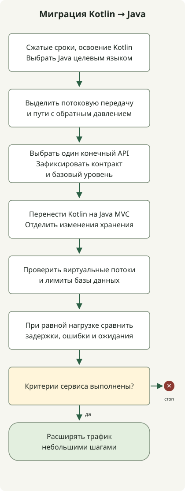

**Эта миграция переводит Kotlin, WebFlux и корутины на Java, Spring MVC и виртуальные потоки.** Причинами перехода с Kotlin на Java стали сжатые сроки поставки и время, которое существующей команде потребовалось бы на освоение Kotlin. При выборе языка учитывались сроки и нагрузка от обучения команды; серверную модель исполнения перевели на MVC с виртуальными потоками.

Контекст поставки, определивший выбор языка, и влияние виртуальных потоков на производительность требуют отдельных объяснений. Код ниже показывает форму миграции; он не воспроизводит производственный код или измеренные результаты.

Руководство описывает поэтапную миграцию для Java 21 или новее и Spring Boot 3.2 или новее. Оно не обещает роста пропускной способности или снижения задержки. Измеряйте фактический результат с учётом профиля ожидания/CPU запроса, лимита соединений с БД, возможностей нижележащих сервисов и репрезентативного нагрузочного теста.

<span id="separate-the-three-choices"></span>

## Отделите выбор языка от модели исполнения

**WebFlux и MVC — варианты веб-среды исполнения.** В основе WebFlux лежат Reactive Streams и асинхронный неблокирующий ввод-вывод; MVC использует модель запросов Servlet. **Корутины — модель асинхронного программирования Kotlin**, поэтому при выборе MVC можно сохранить функции `suspend`. Spring поддерживает корутины Kotlin в аннотированных контроллерах как MVC, так и WebFlux. Для поддержки корутин нужны `kotlinx-coroutines-core` и `kotlinx-coroutines-reactor`. [Поддержка корутин в Spring Framework](https://docs.spring.io/spring-framework/reference/languages/kotlin/coroutines.html)

Виртуальные потоки — легковесные потоки Java. Они могут уменьшить стоимость ожидания платформенных потоков в архитектуре «поток на запрос» с блокирующими вызовами. Их включение не делает JDBC неблокирующим и не увеличивает пул соединений с БД. В Spring Boot 3.2 и новее на JDK 21 или новее можно включить исполнение на виртуальных потоках через `spring.threads.virtual.enabled=true`. Для наилучшего опыта Boot рекомендует Java 24 или новее и выделяет закрепление потоков (pinning), существующие настройки пулов и поведение потоков-демонов как вопросы для проверки. [Настройки и ограничения виртуальных потоков Spring Boot](https://docs.spring.io/spring-boot/reference/features/spring-application.html)

Эта миграция одновременно меняет язык, веб-среду и модель конкурентного исполнения. Проверяйте каждое изменение отдельно. Как показывает таблица, миграция хранения — отдельное решение; из неё не следует, что реальный сервис использовал R2DBC или перешёл на JPA.

| Изменение | Что меняется | Что проверять отдельно |
| --- | --- | --- |
| Kotlin → Java | Язык реализации и форма асинхронного API | Обработка null, объекты данных, исключения, отмена и существующие контракты API |
| WebFlux → MVC | Серверная модель обработки запросов | Фильтры, безопасность, преобразование исключений, SSE и WebSocket |
| R2DBC → JDBC/JPA (при необходимости) | Модель доступа к БД | Границы транзакций, запросы, лимиты соединений и тайм-ауты |
| Исполнение на корутинах → синхронные вызовы и виртуальные потоки | Модель исполнения и ожидания | Совместимость библиотек, использование ThreadLocal, pinning и эксплуатационные сигналы |

## Какие пути переносить?

MVC с виртуальными потоками стоит оценить, когда обычный путь «запрос — ответ» использует JPA или JDBC и большую часть времени ждёт БД или HTTP-ответ нижележащего сервиса. Пути, чей основной контракт — поток с высокой конкурентностью, серверные события (SSE), WebSocket или управление спросом Reactive Streams, возможно, лучше оставить на WebFlux либо выделить отдельно. Возможность возвращать `Flow` из MVC не гарантирует одинаковое поведение потоковой передачи, отмены или обратного давления в любой среде.



Схема показывает последовательность миграции обычного пути запроса. Отложите перенос путей, которым всё ещё нужна потоковая передача, и сохраните или выделите их. Расширяйте трафик только после того, как тесты и наблюдения удовлетворят критериям; сохраните возможность вернуться к прежнему пути при ухудшении относительно базового уровня.

<span id="you-can-keep-coroutine-controllers"></span>

## Перенесите контроллер Kotlin с корутинами на Java MVC

Эти фрагменты показывают конечную точку поиска одного заказа. До миграции контроллер Kotlin ждёт сервис через функцию `suspend`.

```kotlin
@RestController
class OrderController(private val orders: OrderService) {
    @GetMapping("/orders/{id}")
    suspend fun get(@PathVariable id: Long): OrderDto = orders.get(id)
}
```

После миграции контроллер Java MVC вызывает синхронный метод сервиса и возвращает тот же DTO ответа. Предполагается, что `orders.get(id)` тоже стал синхронным контрактом, доступным из Java. Прямого вызова метода Kotlin `suspend` из Java здесь нет.

```java
@RestController
public class OrderController {
    private final OrderService orders;

    public OrderController(OrderService orders) {
        this.orders = orders;
    }

    @GetMapping("/orders/{id}")
    public OrderDto get(@PathVariable("id") Long id) {
        return orders.get(id);
    }
}
```

Аннотации Spring берутся из `org.springframework.web.bind.annotation`; `OrderService` и `OrderDto` — типы прикладного сервиса и ответа. Эти фрагменты не образуют полноценное исполняемое приложение. Включите виртуальные потоки настройкой Boot ниже и проверьте исполнение во время реального HTTP-запроса.

Проверьте отображение nullable-типов Kotlin в Java и сохранение контрактов равенства и сериализации `data class`. Замена вызовов корутин `async` последовательными вызовами Java может изменить порядок запросов к нижележащим сервисам и время ответа, поэтому отдельно проверяйте параллелизм, тайм-ауты и отмену. Одной обёртки существующих вызовов корутин в `runBlocking` недостаточно для завершения миграции на синхронные сервисы Java.

Spring MVC сам поддерживает Kotlin `suspend` и `Flow`, поэтому отказ от корутин не является обязательным условием перехода на MVC. В данном случае **Java выбрали целевым языком из-за сжатых сроков и времени на освоение Kotlin существующей командой**, поэтому контракты контроллеров и сервисов тоже меняются в этом направлении.

## Проверяйте миграцию репозитория отдельно

Если нужно изменить и модель доступа к БД, ниже приведён отдельный пример перехода с Kotlin R2DBC `CoroutineCrudRepository` на Spring Data JPA в Java. Ограничивайте размер результата вместо сбора всех строк в память и сохраняйте сортировку, размер страницы и фильтры авторизации существующего API.

```kotlin
interface OrderRepository : CoroutineCrudRepository<Order, Long> {
    fun findByCustomerId(customerId: Long): Flow<Order>
}
```

Синхронный репозиторий JPA может выполнять запросы постранично:

```java
public interface OrderRepository extends JpaRepository<Order, Long> {
    Page<Order> findByCustomerId(Long customerId, Pageable pageable);
}
```

Эти фрагменты показывают форму репозиториев, а не полное приложение. В реальном проекте также проверьте стратегию загрузки сущностей, область транзакций, запросы N+1, стабильный порядок страниц и семантику отмены или частичного потребления прежнего `Flow`. Начните с одного API с конечным ответом и добавьте контрактные тесты и наблюдение за запросами перед дальнейшей миграцией.

## Включите виртуальные потоки и проверьте их

При Spring Boot 3.2 или новее и JDK 21 или новее можно применить эту настройку:

```yaml
spring:
  threads:
    virtual:
      enabled: true
```

После её применения проверьте, действительно ли поток обработки запроса виртуальный. Для временной диагностики запишите `Thread.currentThread().isVirtual()` из перехватчика или контроллера MVC. Это проверяет только данный путь запроса и не доказывает, что все задачи приложения или диспетчеры корутин используют виртуальные потоки.

Для пути контроллера Java это выражение проверяет текущий поток запроса:

```java
public class RequestThreadProbe {
    public static boolean isVirtual() {
        return Thread.currentThread().isVirtual();
    }
}
```

Boot указывает, что с виртуальными потоками свойства пулов могут утратить прежнее действие, а pinning в некоторых синхронизированных участках или вызовах native-кода может влиять на пропускную способность. Не увеличивайте число виртуальных потоков для обхода лимитов соединений с БД или конкурентности нижележащих сервисов. Ограничьте пул БД её реальными возможностями и настройте предельное время получения соединения, запроса к БД, вызова нижележащего сервиса и запроса в целом.

## Переносите поэтапно и задайте критерии отката

1. **Зафиксируйте базовый уровень.** Соберите частоту запросов, задержки p50/p95/p99, долю ошибок, CPU, heap, ожидания пула БД и задержки вызовов нижележащих сервисов для репрезентативных конечных точек при одинаковой нагрузке.
2. **Отметьте исключительно реактивные пути.** Перечислите пути, зависящие от SSE, WebSocket, неограниченных потоков данных, обратного давления или операций Reactive Streams, и исключите их из начальной миграции.
3. **Перенесите один API с конечным ответом.** Переводите Kotlin на Java, отдельно проверяя изменение серверной среды исполнения и необходимое изменение хранения, затем тестируйте контракты запроса, ответа, ошибок, отмены и авторизации.
4. **Проверьте исполнение на виртуальных потоках.** Проверяйте потоки во время работы и путь вызова JDBC, а не только свойство развёртывания. Отдельно рассмотрите исполнители фоновых задач.
5. **Сравните при равной нагрузке.** Сравните распределение задержек, ошибки, CPU, ожидания БД и использование соединений при одинаковых объёме данных и нагрузке. Виртуальные потоки не добавляют вычислительных ресурсов для CPU-bound-задач, поэтому следите и за насыщением CPU.
6. **Начните расширение с небольшой доли трафика.** Если бизнес-ошибки, задержки, ожидания пула БД или потребление ресурсов превышают заранее заданные критерии, остановите расширение и исследуйте причину либо вернитесь к прежнему пути. Пороговые значения команда должна задать на основе SLO сервиса и базового уровня.

Не сообщайте об улучшении пропускной способности или задержки, если его не измеряли в целевой среде. Сначала измерьте изменённый путь с теми же входными данными. Если результат не улучшается, нет оснований считать миграцию на MVC самоцелью.

## Критерии решения

Если обычный трафик «запрос — ответ» использует JDBC/JPA и конкурентные блокирующие ожидания могут быть узким местом, оцените MVC и виртуальные потоки на небольшом пути. Здесь Java выбрали из-за сжатых сроков и времени на освоение Kotlin существующей командой. Не приравнивайте смену языка к росту пропускной способности от виртуальных потоков. Если потоковая передача или поведение Reactive Streams — требование продукта, сохраните WebFlux, а не ослабляйте контракт ради смены модели потоков. Принимайте решение, сравнивая задержки, ошибки, ожидания БД и эксплуатационную сложность при равной нагрузке.
