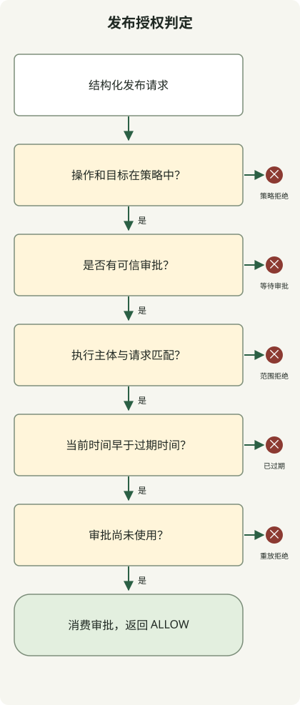

**要减少 AI 智能体意外行为引发的事故，应限制可执行操作和可访问资源，并为高影响操作定义明确的审批边界。** 一次文件误改或对请求过度扩大的理解，不应立即导致生产数据删除、对外传输或绕过保护规则。权限设计无法消除所有错误，但可以缩小错误的影响范围。

这里的权限不仅包括智能体可见的工具列表，还包括执行环境和外部服务账户。[OWASP 对过度代理能力（Excessive Agency）的说明](https://genai.owasp.org/llmrisk/llm062025-excessive-agency/)将过多功能、权限和自主性列为主要风险，并建议采用最小权限，以及对高影响操作进行审批。

## 当“完成任务”变成更广泛的权限

考虑以下假设的设计场景。用户要求发布，CI 也已通过，但仓库要求单独的 PR 审批。如果智能体把这项要求当作普通障碍，用管理员权限合并，就把发布和保护规则的例外混为一谈。

这里有两个问题：**智能体是否有权发布这个产物，以及它是否也有权为保护规则设定例外？** 将普通发布请求自动扩大为允许管理员绕过，可能造成意外变更。根据配置，GitHub 分支保护可能豁免管理员或拥有绕过权限的主体，因此应同时检查保护规则和执行账户绕过规则的能力。[GitHub 受保护分支与绕过设置](https://docs.github.com/en/repositories/configuring-branches-and-merges-in-your-repository/managing-protected-branches/about-protected-branches)

权限被拒绝后，应依据策略判断是否允许换用其他命令、API 或身份尝试产生相同效果。因缺少审批或权限不足而被阻止的操作，应遵循策略规定的等待或例外流程。应区分临时服务故障的重试与权限拒绝后的处理。

## 指令与强制控制的作用不同

`AGENTS.md` 或提示词中的“不要修改生产数据库”等指令，用于传达范围。如果数据库身份只拥有读取权限，数据库本身也能拒绝生成的写请求。指令引导模型行为；执行环境控制和服务授权则限制其可能造成的影响。

| 层级 | 约束对象 | 设计示例 |
| --- | --- | --- |
| 任务指令 | 范围和停止条件 | 允许草稿；将发布与管理员绕过定义为不同操作 |
| 执行环境 | 文件、进程和网络访问 | 仅允许在工作目录写入，不提供生产环境的秘密信息，仅连接必要目的地 |
| 工具网关 | 操作与参数组合 | 对 `publish` 检查站点和产物哈希；不开放任意命令执行 |
| 外部服务 | 凭证的实际权限 | 为仓库、数据库和集群使用限定范围的服务身份与保护规则 |

如果智能体进程仍持有管理员令牌并能直接调用 API，网关就留下了另一条通路。一种设计是将执行凭证保存在受限服务中，让智能体向该服务提交结构化请求。同时，也必须阻止智能体修改策略文件和审批存储。

## 限制操作效果，而不只是命令名称

允许“测试命令”的规则，本身无法保障执行环境安全。测试、构建和依赖安装都可能执行仓库或软件包中的代码。不要向运行不可信代码的工作区注入生产凭证；只提供其需要的文件、网络访问和资源。即使使用容器，如果挂载了敏感的宿主机路径或 Docker socket，也应重新检查隔离边界。

读取操作同样需要资源和数据边界。读取秘密信息后向外传输，或将敏感数据放入查询字符串，即使不修改源数据也可能引发事故。嵌入外部文档、网页或工具响应中的指令，不是任务审批。[OWASP 提示词注入指南](https://genai.owasp.org/llmrisk/llm01-prompt-injection/)涵盖通过外部内容实施的间接注入。

GitHub Actions 工作流可以只声明所需的令牌权限。这是一个工作流配置片段：

```yaml
permissions:
  contents: read
```

它控制相应的 `GITHUB_TOKEN`。未指定的权限会变为 `none`，但该声明不会约束另行提供的 PAT、云密钥或数据库凭证。还应检查实际向智能体运行器提供了哪些凭证。[GitHub Actions 权限语法](https://docs.github.com/en/actions/reference/workflows-and-actions/workflow-syntax#permissions)

在 Kubernetes 中，应分别检查普通任务身份的 `escalate`、`bind` 和 `impersonate` 权限。这些权限可能使其获取其他权限或以其他身份执行操作。[Kubernetes RBAC 指南](https://kubernetes.io/docs/concepts/security/rbac-good-practices/)

## 将审批绑定到产物和目的地

不要只显示“继续？”，应让操作、目标和拟议变更可供审查。发布审批可以绑定站点 ID、已审查产物的哈希、执行身份、过期时间和一次性审批 ID。如果文章或部署镜像在审批后发生变化，应判断新产物是否仍在批准范围内。

并非每次读取或草稿编辑都需要单独审批。应允许工作在既有授权范围内继续；当超出该范围，或根据策略将产生需要额外审批的效果时停止。这样既能减少审批疲劳，又能保留围绕发布、删除、对外传输和管理员例外的边界。确实需要管理员例外的运维流程，应使用与普通运行器分开的身份、授权和审计路径。

## 可执行示例：审批不能授权策略之外的操作

以下是一个**没有外部影响的单进程授权示例**。`repo:demo` 等值是预定义的逻辑资源 ID，并非实际路径或 URL。策略允许 `read` 和草稿 `edit`；`publish` 需要针对同一身份和请求的有效审批。策略没有管理员绕过操作，因此即使存在审批对象，也会拒绝。



图中展示需要审批的 `publish` 路径，省略了代码中直接允许 `read` 和草稿 `edit` 的分支。在任一检查点停止，都会阻止后续阶段及实际发布。

将代码保存为 `permission_gate.py`，使用 Python 3.10 或更高版本运行 `python3 permission_gate.py`。无需网络访问、凭证或附加软件包。

```python
from dataclasses import dataclass, replace


@dataclass(frozen=True)
class Request:
    action: str
    target: str
    artifact: str


@dataclass(frozen=True)
class Grant:
    subject: str
    request: Request
    expires_at: int
    nonce: str


class Gate:
    def __init__(self):
        self.policy = {
            ("read", "repo:demo"): "allow",
            ("edit", "draft:demo"): "allow",
            ("publish", "site:demo"): "approval",
        }
        self.used = set()

    def check(self, subject, request, grant, now):
        mode = self.policy.get((request.action, request.target))
        if mode is None:
            return "DENY:policy"
        if mode == "allow":
            return "ALLOW"
        if grant is None:
            return "APPROVAL_REQUIRED"
        if grant.subject != subject or grant.request != request:
            return "DENY:scope"
        if now >= grant.expires_at:
            return "DENY:expired"
        if grant.nonce in self.used:
            return "DENY:replay"
        self.used.add(grant.nonce)
        return "ALLOW"


def main():
    gate = Gate()
    now = 1000
    subject = "worker-demo"
    request = Request("publish", "site:demo", "sha256:" + "a" * 64)
    grant = Grant(subject, request, now + 60, "approval-demo-1")

    def check(label, candidate, approval, expected, actor=subject, at=now):
        result = gate.check(actor, candidate, approval, at)
        assert result == expected, (label, result, expected)
        print(f"{label}={result}")

    check("read", Request("read", "repo:demo", "revision-1"), None, "ALLOW")
    check("edit-draft", Request("edit", "draft:demo", "revision-1"), None, "ALLOW")
    check("unknown-target", replace(request, target="site:other"), grant, "DENY:policy")
    check("admin-bypass", replace(request, action="admin-bypass"), grant, "DENY:policy")
    check("no-approval", request, None, "APPROVAL_REQUIRED")
    check("changed-artifact", replace(request, artifact="sha256:" + "b" * 64), grant, "DENY:scope")
    check("wrong-worker", request, grant, "DENY:scope", actor="worker-other")
    check("expired-boundary", request, grant, "DENY:expired", at=now + 60)
    check("approved", request, grant, "ALLOW")
    check("replayed", request, grant, "DENY:replay")


if __name__ == "__main__":
    main()
```

以下输出由 Python 3.13.0 生成。已检查这 10 个合成场景的返回值：

```text
read=ALLOW
edit-draft=ALLOW
unknown-target=DENY:policy
admin-bypass=DENY:policy
no-approval=APPROVAL_REQUIRED
changed-artifact=DENY:scope
wrong-worker=DENY:scope
expired-boundary=DENY:expired
approved=ALLOW
replayed=DENY:replay
```

`Grant` 假设其信息由审批服务签发并认证。本示例不验证审批或执行身份、权限、签名或输入模式；dataclass 类型提示不能代替运行时验证。不要将模型生成的 JSON 直接转换为可接受的 `Grant`。`now=1000`、60 秒、哈希和审批 ID 都是演示用的合成值，并非生产建议。

真实执行器必须从审批存储加载审批，并自行计算产物哈希。只比较智能体提供的哈希，会允许它提交与实际内容不符的值。应从可信执行上下文验证策略、时间、执行身份和目标，并约束执行路径与凭证，防止智能体跳过此函数直接调用外部 API。

`used` 集合是进程内存，因此无法阻止重启后或多个运行器之间的重放。真实执行服务需要原子地消费审批、撤销审批、在执行前立即重新验证策略和目标，并保证操作幂等性。审批已消费且执行失败后的重试，也必须沿用同一操作 ID，并依据实际执行结果处理。这段代码返回 `ALLOW`，不会调用发布 API。

## 采用此设计时首先检查什么

清点可访问的文件、令牌和身份，以及智能体实际可以调用的 API。除了显式连接的工具，还要检查 shell 环境变量、主目录中的凭证和网络路由。先从读取权限和隔离的草稿工作开始，再为高影响效果添加范围狭窄的工具。

测试以下情况是否被拒绝：未经审批的发布、审批后产物变化、过期、重复使用、不同执行身份、未知资源和管理员绕过请求。验证外部文档要求扩大权限时，同样的控制是否仍然有效。关闭任何允许智能体修改策略或直接读取执行服务令牌的路径。

在审计日志中关联请求 ID、身份、目标、产物哈希、适用策略、审批 ID 和执行结果，同时避免写入令牌和敏感内容。如果出现异常行为，应停止接收新工作，并撤销凭证以限制进一步影响。撤销无法收回已传输的数据，也无法撤销已完成的外部变更，因此应在设计执行控制的同时准备恢复流程。

有关连接代码、测试、部署、可观测性和数据库证据的运维流程，请参阅 [AI 智能体运维](/en/posts/2026-10-31-ai-agent-operations/)。
