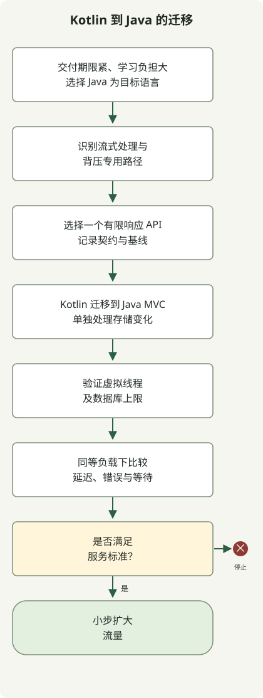

**这次迁移将 Kotlin、WebFlux 和协程替换为 Java、Spring MVC 和虚拟线程。** 从 Kotlin 转向 Java，是因为交付期限紧迫，而且现有团队需要经历 Kotlin 的学习过程。语言选型考虑的是交付时间和团队的学习负担；服务端执行模型则转向了采用虚拟线程的 MVC。

语言选型背后的交付背景与虚拟线程的性能影响，需要分别说明。以下代码用于展示迁移的形态，并非生产代码的复现，也不代表测量结果。

本指南介绍适用于 Java 21 或更高版本、Spring Boot 3.2 或更高版本的分阶段迁移。它不承诺提高吞吐量或降低延迟。应结合请求的等待与 CPU 使用特征、数据库连接上限、下游容量以及有代表性的负载测试，测量实际结果。

<span id="separate-the-three-choices"></span>

## 将语言选型与执行模型分开

**WebFlux 和 MVC 是 Web 运行时的选择。** WebFlux 以 Reactive Streams 和异步、非阻塞 I/O 为核心；MVC 使用 Servlet 请求模型。**协程是 Kotlin 的异步编程模型**，因此选择 MVC 时仍然可以保留 `suspend` 函数。Spring 在 MVC 和 WebFlux 的注解控制器中都支持 Kotlin 协程。协程支持需要 `kotlinx-coroutines-core` 和 `kotlinx-coroutines-reactor`。[Spring Framework 协程支持](https://docs.spring.io/spring-framework/reference/languages/kotlin/coroutines.html)

虚拟线程是轻量级 Java 线程。在采用阻塞调用、每个请求一个线程的设计中，它们可以降低平台线程等待的开销。启用虚拟线程不会让 JDBC 变为非阻塞，也不会扩大数据库连接池。Spring Boot 3.2 及更高版本可在 JDK 21 或更高版本上通过 `spring.threads.virtual.enabled=true` 启用基于虚拟线程的执行。为获得最佳体验，Boot 推荐 Java 24 或更高版本，并提示应检查线程固定（pinning）、现有线程池设置以及守护线程行为。[Spring Boot 虚拟线程设置与注意事项](https://docs.spring.io/spring-boot/reference/features/spring-application.html)

这次迁移同时改变语言、Web 运行时和并发模型。应分别验证每项变化。如表中所示，存储迁移是另一项决策；这里并未证实实际服务使用过 R2DBC 或迁移到了 JPA。

| 变化 | 改变的内容 | 需要单独验证的内容 |
| --- | --- | --- |
| Kotlin → Java | 实现语言与异步 API 形式 | 空值处理、数据对象、异常、取消及现有 API 契约 |
| WebFlux → MVC | 服务端请求处理模型 | 过滤器、安全、异常映射、SSE 和 WebSocket |
| R2DBC → JDBC/JPA（如有需要） | 数据库访问模型 | 事务边界、查询、连接上限和超时 |
| 基于协程的执行 → 同步调用与虚拟线程 | 执行与等待模型 | 库兼容性、ThreadLocal 使用、线程固定和运行信号 |

## 哪些路径适合迁移？

如果普通请求/响应路径使用 JPA 或 JDBC，并且大部分时间花在等待数据库或下游 HTTP 响应上，可以评估采用虚拟线程的 MVC。相较之下，核心契约涉及高并发流、服务器发送事件（SSE）、WebSocket 或 Reactive Streams 需求控制的路径，可能更适合保留在 WebFlux 中，或拆成专用路径。`Flow` 可以作为 MVC 返回类型，并不保证所有环境中的流式传输、取消或背压行为都完全一致。



图中展示普通请求路径的迁移顺序。仍需流式处理的路径应推迟迁移，并予以保留或拆分。只有测试和观测达到标准后，才能扩大流量；如果相对基线出现退化，应保留返回旧路径的方法。

<span id="you-can-keep-coroutine-controllers"></span>

## 将 Kotlin 协程控制器迁移到 Java MVC

以下片段展示一个查询单个订单的端点。迁移前，Kotlin 控制器通过 `suspend` 函数等待服务。

```kotlin
@RestController
class OrderController(private val orders: OrderService) {
    @GetMapping("/orders/{id}")
    suspend fun get(@PathVariable id: Long): OrderDto = orders.get(id)
}
```

迁移后，Java MVC 控制器调用同步服务方法，并返回相同的响应 DTO。这里假设 `orders.get(id)` 也已改为可从 Java 调用的同步契约，并非直接从 Java 调用 Kotlin 的 `suspend` 方法。

```java
@RestController
public class OrderController {
    private final OrderService orders;

    public OrderController(OrderService orders) {
        this.orders = orders;
    }

    @GetMapping("/orders/{id}")
    public OrderDto get(@PathVariable("id") Long id) {
        return orders.get(id);
    }
}
```

Spring 注解来自 `org.springframework.web.bind.annotation`；`OrderService` 和 `OrderDto` 分别是应用服务类型与响应类型。这些片段不是完整的可运行应用。通过下方 Boot 配置启用虚拟线程，并在真实 HTTP 请求期间验证执行情况。

检查 Kotlin 可空类型如何映射到 Java，以及如何保留 `data class` 的相等性和序列化契约。将协程的 `async` 调用改为顺序执行的 Java 调用，可能改变下游请求顺序和响应时间，因此应分别验证并行性、超时和取消。仅用 `runBlocking` 包装现有协程调用，并不等于完成向同步 Java 服务的迁移。

Spring MVC 本身也支持 Kotlin 的 `suspend` 和 `Flow`，所以移除协程不是使用 MVC 的前提。本例中，**由于交付期限紧迫，以及现有团队学习 Kotlin 的成本，Java 被选为目标语言**，控制器和服务契约也因此朝这个方向迁移。

## 单独验证仓储迁移

如果数据库访问模型也必须改变，下面是另一个独立示例：从 Kotlin 的 R2DBC `CoroutineCrudRepository` 迁移到 Java 中的 Spring Data JPA。应限制结果集大小，而不是把所有行收集到内存，并保留现有 API 的排序、页大小和授权过滤条件。

```kotlin
interface OrderRepository : CoroutineCrudRepository<Order, Long> {
    fun findByCustomerId(customerId: Long): Flow<Order>
}
```

同步 JPA 仓储可以逐页查询：

```java
public interface OrderRepository extends JpaRepository<Order, Long> {
    Page<Order> findByCustomerId(Long customerId, Pageable pageable);
}
```

这些片段展示仓储的形式，并非完整应用。实际项目中还需检查实体抓取策略、事务范围、N+1 查询、稳定的分页排序，以及原先 `Flow` 的取消或部分消费语义。先从一个有限响应 API 开始，加入契约测试和查询观测，再继续迁移。

## 启用并验证虚拟线程

使用 Spring Boot 3.2 或更高版本及 JDK 21 或更高版本时，可以应用以下设置：

```yaml
spring:
  threads:
    virtual:
      enabled: true
```

应用后，验证处理请求的线程是否确实为虚拟线程。临时诊断时，可从 MVC 拦截器或控制器记录 `Thread.currentThread().isVirtual()`。这只检查该请求路径，不能证明应用的每个任务或协程调度器都使用虚拟线程。

对于 Java 控制器路径，以下表达式检查当前请求线程：

```java
public class RequestThreadProbe {
    public static boolean isVirtual() {
        return Thread.currentThread().isVirtual();
    }
}
```

Boot 提醒，使用虚拟线程后，线程池属性可能不再具有原先的效果；某些同步代码段或原生调用中的线程固定也可能影响吞吐量。不要通过增加虚拟线程数量绕过数据库连接上限或下游并发上限。将数据库连接池限制在数据库可承受的范围内，并配置连接获取、查询、下游调用和整体请求的截止时间。

## 分阶段迁移并定义回滚标准

1. **记录基线。** 在相同负载条件下，收集代表性端点的请求速率、p50/p95/p99 延迟、错误率、CPU、堆、数据库连接池等待和下游调用延迟。
2. **标记仅适用于响应式模型的路径。** 列出依赖 SSE、WebSocket、无界流、背压或 Reactive Streams 操作的路径，并将其排除在首轮迁移之外。
3. **迁移一个有限响应 API。** 将 Kotlin 转为 Java，同时单独验证服务端运行时变化和任何必要的存储变化，再测试请求、响应、错误、取消和授权契约。
4. **验证虚拟线程执行。** 检查运行时线程及 JDBC 调用路径，而不只是部署属性。另行检查后台任务的执行器。
5. **在相同负载下比较。** 使用相同数据规模和负载，比较延迟分布、错误、CPU、数据库等待和连接使用情况。虚拟线程不会为 CPU 密集型工作增加 CPU 容量，因此也要留意 CPU 饱和。
6. **从少量流量开始扩大。** 如果业务错误、延迟、数据库连接池等待或资源使用超过预先设定的标准，应停止扩大并调查，或回滚到旧路径。团队应根据服务 SLO 和基线设定阈值。

不要报告未在目标环境中测量过的吞吐量或延迟收益。先用相同输入测量变更后的路径。如果结果没有改善，就没有理由把迁移到 MVC 本身当作目标。

## 决策标准

如果普通请求/响应流量使用 JDBC/JPA，且并发阻塞等待可能是瓶颈，可以在小范围路径上评估 MVC 和虚拟线程。本例选择 Java，是因为交付期限紧迫，以及现有团队学习 Kotlin 的成本。不要把语言变化等同于虚拟线程带来的吞吐量提升。如果流式处理或 Reactive Streams 行为是产品要求，应保留 WebFlux，避免为了改变线程模型而削弱契约。应在相同负载下比较延迟、错误、数据库等待和运维复杂度，再作决定。
