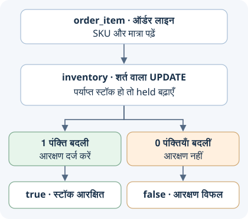

---
{
  "state": "draft",
  "language": "hi",
  "translationKey": "2026-11-22-commerce-database-design",
  "title": "ई-कॉमर्स डेटाबेस में SKU, ऑर्डर, स्टॉक और भुगतान कैसे दर्ज करें?",
  "description": "PostgreSQL में ऑर्डर की तय कीमत, आरक्षित स्टॉक और भुगतान के प्रयास दर्ज करें। दो सेशन में देखें कि आखिरी इकाई किस ऑर्डर को मिलती है।",
  "sourcePath": "src/content/posts/en/2026-11-22-commerce-database-design.md",
  "sourceSha256": "da573ac023d969b02216c24993c872e842a6693607f8e3805fd988ce7d64bcf3"
}
---

**ई-कॉमर्स डेटाबेस में कैटलॉग की मौजूदा शर्तें, खरीद के समय तय रकम, हर ऑर्डर के लिए आरक्षित स्टॉक और भुगतान प्रदाता का परिणाम अलग-अलग दर्ज होने चाहिए।** कल कीमत बदलने पर भी बीते दिन के ऑर्डर की रकम वही दिखनी चाहिए। आज सिर्फ़ एक इकाई बची है तो एक साथ आए दो ऑर्डरों में से एक ही उसे आरक्षित कर सके। PostgreSQL के उदाहरण में देखेंगे कि किन तालिकाओं और बाधाओं से ये दोनों शर्तें पूरी होती हैं।

यह [आखिरी इकाई वाले पिछले उदाहरण](/hi/posts/2026-11-22-commerce-system-design-last-unit-of-stock/) का अगला भाग है। मान लें कि एक विक्रेता भौतिक सामान बेचता है, उसका एक गोदाम है और भुगतान कोरियाई वॉन (KRW) में होता है। स्टॉक और ऑर्डर एक ही डेटाबेस में हैं। शिपमेंट के बाद वापसी और हिसाब के निपटारे के लिए अलग मॉडल होंगे।

## एक खरीद के बारे में क्या दर्ज करना है?

| सवाल | किन तालिकाओं में पढ़ें या लिखें | कुंजी और मान |
| --- | --- | --- |
| काले कीबोर्ड की मौजूदा कीमत क्या है? | `product` → `sku` | उत्पाद ID, बिक्री के लिए उपलब्ध SKU, मौजूदा कीमत |
| कल के ऑर्डर के लिए 43,000 वॉन क्यों लिए? | `orders` → `order_item` | ऑर्डर ID, तय मात्रा, प्रति इकाई कीमत, छूट और शिपिंग शुल्क |
| आखिरी इकाई किसे मिली? | `inventory`, `stock_reservation` | हर SKU का भौतिक स्टॉक और हर ऑर्डर लाइन का आरक्षण |
| प्रदाता का जवाब खो जाए तो वही भुगतान कैसे खोजें? | `payment_attempt`, `payment_event` | ऑर्डर से जुड़ा भुगतान प्रयास, प्रदाता की लेनदेन ID और इवेंट ID |

यहाँ `product` कैटलॉग में दिखने वाला उत्पाद है और `sku` उसका ऐसा विकल्प है जिसे खरीदा जा सकता है, जैसे काला कीबोर्ड। ऑर्डर लाइन में SKU का संदर्भ और **खरीद के समय उत्पाद का नाम, विकल्प का नाम और प्रति इकाई कीमत** सहेजते हैं। एक इकाई की कीमत 42,000 वॉन, छूट 2,000 वॉन और शिपिंग 3,000 वॉन हो तो कुल 43,000 वॉन बनते हैं। इसे दिखाने के लिए मौजूदा कीमत से दोबारा गणना की ज़रूरत नहीं है। ऑर्डर बनने के बाद उसकी लाइनें अपरिवर्तित रहती हैं, क्योंकि तय रकम और आरक्षित मात्रा दोनों उन्हीं पर आधारित हैं। इस्तेमाल हो चुके SKU की बिक्री रोकने के लिए उसे बिक्री से हटाएँ। पुराने ऑर्डरों से जुड़ी पंक्तियों पर कैस्केड डिलीट लागू न करें।

## PostgreSQL की कुंजियाँ और बाधाएँ तय करें

नीचे का DDL अभ्यास के खाली डेटाबेस में एक बार चलाएँ। उदाहरण में ID स्वयं दी गई हैं और रकम पूर्णांक वॉन में है। कार्ट में एक ही SKU की सभी इकाइयाँ एक ऑर्डर लाइन में जुड़ती हैं, इसलिए `(order_id, sku_id)` से लाइन और उसके आरक्षण दोनों की पहचान होती है।

```sql
CREATE TABLE product (
    id bigint PRIMARY KEY,
    name text NOT NULL
);

CREATE TABLE sku (
    id bigint PRIMARY KEY,
    product_id bigint NOT NULL REFERENCES product(id),
    code text NOT NULL UNIQUE,
    option_name text NOT NULL,
    current_price_krw bigint NOT NULL CHECK (current_price_krw >= 0),
    sellable boolean NOT NULL
);

CREATE TABLE inventory (
    sku_id bigint PRIMARY KEY REFERENCES sku(id),
    on_hand integer NOT NULL CHECK (on_hand >= 0),
    held integer NOT NULL CHECK (held >= 0),
    allocated integer NOT NULL CHECK (allocated >= 0),
    CHECK (held <= on_hand - allocated)
);

CREATE TABLE orders (
    id bigint PRIMARY KEY,
    customer_id bigint NOT NULL,
    request_key text NOT NULL,
    request_hash text NOT NULL,
    status text NOT NULL CHECK (status IN ('PENDING_PAYMENT', 'CONFIRMED', 'CANCELLED')),
    total_krw bigint NOT NULL CHECK (total_krw >= 0),
    shipping_krw bigint NOT NULL CHECK (shipping_krw >= 0),
    created_at timestamptz NOT NULL DEFAULT now(),
    UNIQUE (customer_id, request_key)
);

CREATE TABLE order_item (
    order_id bigint REFERENCES orders(id),
    sku_id bigint REFERENCES sku(id),
    item_name text NOT NULL,
    option_name text NOT NULL,
    quantity integer NOT NULL CHECK (quantity > 0),
    unit_price_krw bigint NOT NULL CHECK (unit_price_krw >= 0),
    discount_krw bigint NOT NULL CHECK (discount_krw >= 0),
    CHECK (discount_krw <= quantity * unit_price_krw::numeric),
    PRIMARY KEY (order_id, sku_id)
);

CREATE TABLE stock_reservation (
    order_id bigint,
    sku_id bigint REFERENCES inventory(sku_id),
    state text NOT NULL CHECK (state IN ('HELD', 'ALLOCATED', 'RELEASED', 'SHIPPED')),
    expires_at timestamptz NOT NULL,
    PRIMARY KEY (order_id, sku_id),
    FOREIGN KEY (order_id, sku_id) REFERENCES order_item(order_id, sku_id)
);

CREATE TABLE payment_attempt (
    id bigint PRIMARY KEY,
    order_id bigint NOT NULL REFERENCES orders(id),
    attempt_no integer NOT NULL CHECK (attempt_no > 0),
    provider text NOT NULL,
    merchant_account text NOT NULL,
    provider_request_key text NOT NULL,
    provider_payment_id text,
    amount_krw bigint NOT NULL CHECK (amount_krw >= 0),
    state text NOT NULL CHECK (state IN
        ('PENDING', 'UNKNOWN', 'PAID', 'CLOSED_UNPAID', 'REFUND_PENDING', 'REFUNDED')),
    UNIQUE (order_id, attempt_no),
    UNIQUE (provider, merchant_account, provider_request_key),
    UNIQUE (provider, merchant_account, provider_payment_id)
);

CREATE TABLE payment_event (
    provider text,
    merchant_account text,
    event_id text,
    received_at timestamptz NOT NULL DEFAULT now(),
    PRIMARY KEY (provider, merchant_account, event_id)
);

CREATE INDEX orders_customer_history
    ON orders (customer_id, created_at DESC, id DESC);

CREATE INDEX reservation_expiry
    ON stock_reservation (expires_at, order_id, sku_id)
    WHERE state = 'HELD';
```

हर स्टॉक पंक्ति में `CHECK` बाधा `held + allocated ≤ on_hand` सुनिश्चित करती है। ऑर्डर की रकम उसकी लाइनों के योग से मिलती है या सभी सक्रिय आरक्षणों की कुल मात्रा `held` के बराबर है, यह जानने के लिए कई पंक्तियाँ पढ़नी पड़ती हैं। ऑर्डर बनाने वाले ट्रांज़ैक्शन में रकम और आरक्षण साथ दर्ज करें। संचालन में संग्रहीत योग और काउंटर का मूल रिकॉर्ड से नियमित मिलान करें। [PostgreSQL में CHECK बाधाएँ](https://www.postgresql.org/docs/17/ddl-constraints.html#DDL-CONSTRAINTS-CHECK-CONSTRAINTS)

एक ही ग्राहक फिर से वही `request_key` भेजे तो मौजूदा ऑर्डर खोजें। संग्रहीत `request_hash` अलग हो तो इसे कुंजी के दोबारा इस्तेमाल का टकराव मानें। अनुरोध के समय प्रदाता की लेनदेन ID अज्ञात हो सकती है, इसलिए शुरू में `NULL` की अनुमति दें। ID मिलने पर वह उस प्रदाता और व्यापारी खाते के संयोजन में अद्वितीय होनी चाहिए। `payment_event` की कुंजी एक ही इवेंट को दो बार दर्ज होने से रोकती है। एक सफल भुगतान की सूचना अलग इवेंट ID से भी आ सकती है। शिपमेंट अनुरोध के लिए प्रति ऑर्डर अद्वितीय कुंजी रखें और स्थिति बदलने से पहले पिछली स्थिति जाँचें। [PostgreSQL में UNIQUE बाधाएँ](https://www.postgresql.org/docs/17/ddl-constraints.html#DDL-CONSTRAINTS-UNIQUE-CONSTRAINTS) · [डुप्लिकेट वेबहुक पर Stripe का मार्गदर्शन](https://docs.stripe.com/webhooks#handle-duplicate-events)

## शर्त वाले UPDATE से आखिरी इकाई आरक्षित करें



उपलब्ध मात्रा `on_hand - allocated - held` है। दुकान के पेज पर पहले कितनी भी इकाइयाँ दिखी हों, चेकआउट पर **उपलब्धता की जाँच और आरक्षित मात्रा की वृद्धि एक ही UPDATE में होती हैं**। फ़ंक्शन आरक्षण की पंक्ति तभी जोड़ता है जब अपडेट ने कोई पंक्ति बदली हो। SQL त्रुटि से पंक्ति जुड़ने में विफलता हो तो उसी कथन में `held` की वृद्धि भी वापस हो जाती है।

```sql
CREATE FUNCTION reserve_stock(p_order_id bigint, p_sku_id bigint,
                              p_expires_at timestamptz)
RETURNS boolean
LANGUAGE sql
AS $$
    WITH held_stock AS (
        UPDATE inventory AS i
           SET held = i.held + line.quantity
          FROM order_item AS line
         WHERE line.order_id = p_order_id
           AND line.sku_id = p_sku_id
           AND i.sku_id = line.sku_id
           AND i.on_hand - i.allocated - i.held >= line.quantity
         RETURNING i.sku_id
    ), reservation AS (
        INSERT INTO stock_reservation (order_id, sku_id, state, expires_at)
        SELECT p_order_id, sku_id, 'HELD', p_expires_at
        FROM held_stock
        RETURNING 1
    )
    SELECT EXISTS (SELECT 1 FROM reservation);
$$;
```

चेकआउट में नया ऑर्डर और उसकी लाइनें, हर SKU का आरक्षण, पहला भुगतान प्रयास और आगे भेजे जाने वाले काम एक ही ट्रांज़ैक्शन में दर्ज करें। किसी भी आइटम के लिए फ़ंक्शन `false` लौटाए तो कॉल करने वाला पूरा ट्रांज़ैक्शन रोलबैक करे। कई SKU आरक्षित करते समय हमेशा एक ही क्रम में लॉक लें, जैसे SKU ID के बढ़ते क्रम में। चेकआउट अनुरोध दोहराए जाने पर ऑर्डर की अद्वितीय कुंजी जाँचें और पहले से आरक्षित ऑर्डर के लिए फ़ंक्शन दोबारा न चलाएँ। आरक्षण जोड़ते समय `ON CONFLICT DO NOTHING` लगाने से आरक्षण दर्ज हुए बिना काउंटर बढ़ सकता है।

स्थानीय कमिट के बाद भुगतान प्रदाता को अनुरोध भेजें। भुगतान की पुष्टि होने पर आरक्षण को `ALLOCATED` करें और जितनी मात्रा `held` से घटाएँ उतनी `allocated` में जोड़ें। आरक्षण छोड़ने पर केवल `held` घटता है। माल भेजने पर `on_hand` और `allocated` दोनों घटते हैं। एक ही मात्रा दो बार न कटे, इसके लिए आरक्षण और स्टॉक की पंक्तियाँ एक ही ट्रांज़ैक्शन में लॉक करें और अपेक्षित पिछली स्थिति जाँचें।

## दो सेशन से आखिरी इकाई आरक्षित करके देखें

DDL और फ़ंक्शन चलाने के बाद अभ्यास डेटाबेस में नीचे का डेटा डालें। केवल आरक्षण की होड़ को अलग से देखने के लिए दोनों ऑर्डर लाइनें पहले ही बना लें।

```sql
INSERT INTO product VALUES (1, 'Keyboard');
INSERT INTO sku VALUES (101, 1, 'KB-BLK', 'Black', 42000, true);
INSERT INTO inventory VALUES (101, 1, 0, 0);

INSERT INTO orders (id, customer_id, request_key, request_hash,
                    status, total_krw, shipping_krw)
VALUES (41, 1001, 'checkout-a', 'fixture-a', 'PENDING_PAYMENT', 43000, 3000),
       (42, 1002, 'checkout-b', 'fixture-b', 'PENDING_PAYMENT', 43000, 3000);

INSERT INTO order_item
VALUES (41, 101, 'Keyboard', 'Black', 1, 42000, 2000),
       (42, 101, 'Keyboard', 'Black', 1, 42000, 2000);
```

एक ही डेटाबेस से जुड़े दो `psql` सेशन खोलें। **A** में नीचे का कथन चलाएँ। यह `true` लौटाता है और ट्रांज़ैक्शन खुला रहता है।

```sql
BEGIN ISOLATION LEVEL READ COMMITTED;
SELECT reserve_stock(41, 101, now() + interval '10 minutes') AS reserved;
```

A का ट्रांज़ैक्शन खुला रखते हुए **B** में नीचे का कथन चलाएँ। उसी स्टॉक पंक्ति को अपडेट करने की कोशिश में B का `SELECT` इंतज़ार करता है।

```sql
BEGIN ISOLATION LEVEL READ COMMITTED;
SELECT reserve_stock(42, 101, now() + interval '10 minutes') AS reserved;
```

A में `COMMIT;` चलाएँ। लॉक छूटने पर B अपडेट हुई पंक्ति पर `WHERE` की शर्त दोबारा जाँचता है। अब उपलब्ध मात्रा शून्य है, इसलिए B `false` लौटाता है। B में `ROLLBACK;` चलाकर अभ्यास समाप्त करें। [PostgreSQL का Read Committed आइसोलेशन](https://www.postgresql.org/docs/17/transaction-iso.html#XACT-READ-COMMITTED)

```sql
SELECT sku_id, on_hand, held, allocated FROM inventory;
SELECT order_id, sku_id, state FROM stock_reservation ORDER BY order_id;
```

PostgreSQL 17.12 में दो कनेक्शन एक साथ चलाए गए। `pg_stat_activity` में B को लॉक के लिए इंतज़ार करते देखने के बाद A को कमिट किया गया। A ने `true` और B ने `false` लौटाया। अंत में `inventory` में `on_hand / held / allocated` के मान `1 / 1 / 0` थे। केवल **ऑर्डर 41 का एक `HELD` आरक्षण** बचा।

कैटलॉग की कीमत 45,000 वॉन करने के बाद भी ऑर्डर 41 की प्रति इकाई कीमत 42,000 वॉन और कुल रकम 43,000 वॉन रही। स्टॉक में एक इकाई जोड़कर ऑर्डर 41 के लिए फ़ंक्शन फिर चलाने पर अद्वितीय कुंजी का उल्लंघन हुआ और `held` का मान 1 ही रहा। अभ्यास में दो कनेक्शनों की होड़ और SQL बाधाएँ जाँची गईं। भुगतान प्रदाता को कॉल, आरक्षण की अवधि समाप्त होने पर समवर्ती कार्रवाई और प्रोडक्शन का भार अलग से जाँचना होगा।

## क्वेरी के आधार पर इंडेक्स चुनें

ग्राहक का ऑर्डर इतिहास दिखाने के लिए क्वेरी का रूप `WHERE customer_id = … ORDER BY created_at DESC, id DESC LIMIT …` है। DDL का संयुक्त इंडेक्स ग्राहक के फ़िल्टर और क्रम दोनों से मेल खाता है। पुराने आरक्षण साफ़ करने वाला काम `WHERE state = 'HELD' AND expires_at <= now()` इस्तेमाल करता है, इसलिए आंशिक इंडेक्स में बाकी स्थितियों के आरक्षण नहीं रखे जाते। अवधि वाला इंडेक्स संभावित पंक्तियाँ खोजता है। आरक्षण छोड़ने का निर्णय लॉक लेने और भुगतान की स्थिति जाँचने के बाद होता है। [PostgreSQL में बहु-कॉलम इंडेक्स](https://www.postgresql.org/docs/17/indexes-multicolumn.html) · [आंशिक इंडेक्स](https://www.postgresql.org/docs/17/indexes-partial.html)
