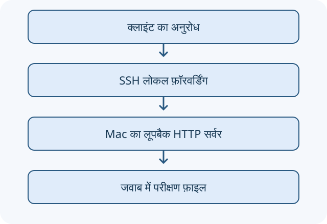

---
{
  "state": "draft",
  "language": "hi",
  "translationKey": "2026-11-23-macbook-personal-server",
  "title": "निजी नेटवर्क पर MacBook को निजी सर्वर की तरह इस्तेमाल करें",
  "description": "SSH टनल से Mac के लूपबैक HTTP सर्वर तक पहुँचने का अभ्यास करें और समझें कि Mac कब उपलब्ध रहता है।",
  "sourcePath": "src/content/posts/en/2026-11-23-macbook-personal-server.md",
  "sourceSha256": "9d4d027b764ef8bf01ccd259c0d9a651cbb6306532afced8de3af23db443416c"
}
---

भरोसेमंद निजी नेटवर्क पर छोटे डेवलपमेंट डेमो के लिए MacBook को सर्वर बना सकते हैं। अस्थायी HTTP सर्वर सिर्फ़ Mac के लूपबैक पते पर चलाएँ और दूसरे कंप्यूटर से SSH की लोकल पोर्ट फ़ॉरवर्डिंग के ज़रिए उससे जुड़ें। यह सीमित अवधि का अभ्यास है। सार्वजनिक या हमेशा चालू रहने वाली सेवा के लिए अलग व्यवस्था चाहिए।



चित्र अनुरोध और जवाब का रास्ता दिखाता है। प्रमाणीकरण और डेमो के बाद सफ़ाई के चरण नीचे दिए गए हैं।

## पहुँच तैयार करें

अपने नियंत्रण वाले निजी नेटवर्क पर दो कंप्यूटर इस्तेमाल करें। साझा या सार्वजनिक नेटवर्क में अविश्वसनीय डिवाइस हो सकते हैं। निजी IP पता अपने आप पहुँच सीमित नहीं करता। राउटर पर पोर्ट फ़ॉरवर्डिंग न करें। इस काम के लिए macOS पर अलग मानक खाता बनाएँ और केवल ज़रूरी फ़ाइलों तक पहुँच दें। Mac पर System Settings → General → Sharing → Remote Login खोलें, इसे चालू करें और “Only these users” चुनकर उस खाते को अनुमति दें। किसी अलग ज़रूरत के बिना रिमोट उपयोगकर्ताओं के लिए पूरे डिस्क की पहुँच बंद रखें। Remote Login पैनल में Mac का SSH पता देखें। macOS संस्करण और डिवाइस प्रबंधन नीति के अनुसार सेटिंग अलग दिख सकती है। [Apple की Remote Login गाइड](https://support.apple.com/guide/mac-help/allow-a-remote-computer-to-access-your-mac-mchlp1066/mac)

क्लाइंट पर इस काम के लिए अलग कुंजी बनाएँ और पूछे जाने पर पासफ़्रेज़ दें। यदि फ़ाइल पहले से है तो उसे सुरक्षित रखें। कोई दूसरा खाली पथ चुनें और आगे के कमांड में भी वही पथ दें।

```sh
ssh-keygen -t ed25519 -f ~/.ssh/macbook_demo
```

भरोसेमंद माध्यम से `~/.ssh/macbook_demo.pub` की सार्वजनिक कुंजी वाली एक पंक्ति Mac पर कॉपी करें। Mac पर अनुमत खाते में स्थानीय रूप से लॉग इन करके नीचे के कमांड चलाएँ। सार्वजनिक कुंजी की पंक्ति चिपकाएँ और नई पंक्ति पर Ctrl-D दबाएँ। इससे मौजूदा प्रविष्टियाँ सुरक्षित रखते हुए कुंजी `~/.ssh/authorized_keys` में जुड़ती है। निजी कुंजी कभी कॉपी न करें।

```sh
umask 077
mkdir -p ~/.ssh
chmod 700 ~/.ssh
cat >> ~/.ssh/authorized_keys
chmod 600 ~/.ssh/authorized_keys
```

[OpenSSH की अधिकृत कुंजी फ़ाइल](https://man.openbsd.org/sshd#AUTHORIZED_KEYS_FILE_FORMAT) और [ssh-keygen का मैनुअल](https://man.openbsd.org/ssh-keygen) देखें।

Mac के स्थानीय टर्मिनल में होस्ट कुंजी का फ़िंगरप्रिंट देखें।

```sh
ssh-keygen -lf /etc/ssh/ssh_host_ed25519_key.pub
```

क्लाइंट से अनुमत खाते और Remote Login में दिखे पते का उपयोग करके जुड़ें। उदाहरण में दिए `demo` और `192.168.1.20` की जगह अपने मान दें। पहली बार कनेक्शन स्वीकार करने से पहले दिखाए गए ED25519 फ़िंगरप्रिंट का Mac पर देखे फ़िंगरप्रिंट से मिलान करें। वे अलग हों तो रुककर कारण जाँचें। होस्ट कुंजी बदलने की चेतावनी आए तो उसे भी जाँच के बाद ही स्वीकार करें। [OpenSSH में होस्ट की पहचान जाँचना](https://man.openbsd.org/ssh#VERIFYING_HOST_KEYS)

```sh
ssh -i ~/.ssh/macbook_demo -o HostKeyAlgorithms=ssh-ed25519 demo@192.168.1.20
```

लॉगिन सफल हो तो `exit` लिखें। कुंजी जोड़ने से पासवर्ड आधारित प्रमाणीकरण अपने आप बंद नहीं होता।

## परीक्षण सर्वर शुरू करें और टनल खोलें

Mac पर अनुमत खाते के टर्मिनल में एक खाली अस्थायी डायरेक्टरी बनाएँ। उसमें एक हानिरहित फ़ाइल रखें और Python 3.7+ का सर्वर शुरू करें। यह केवल Mac के IPv4 लूपबैक पते पर सुनता है। इस टर्मिनल को खुला रखें।

```sh
sample_dir=$(mktemp -d)
printf 'home server test\n' > "$sample_dir/index.html"
python3 -m http.server 8000 --bind 127.0.0.1 --directory "$sample_dir"
```

अगर पोर्ट 8000 पहले से इस्तेमाल में है तो रुकें और सर्वर तथा फ़ॉरवर्डिंग, दोनों के कमांड में वही खाली पोर्ट चुनें। Python का सरल HTTP सर्वर परीक्षण के लिए है और सिम्बॉलिक लिंक का अनुसरण करता है। केवल खाली परीक्षण डायरेक्टरी और हानिरहित फ़ाइल इस्तेमाल करें। [Python का http.server](https://docs.python.org/3/library/http.server.html)

क्लाइंट पर दूसरे टर्मिनल में टनल खोलें और इसे चालू रखें।

```sh
ssh -N -o ExitOnForwardFailure=yes -i ~/.ssh/macbook_demo -L 127.0.0.1:18000:127.0.0.1:8000 demo@192.168.1.20
```

क्लाइंट पर एक और टर्मिनल में यह कमांड चलाएँ।

```sh
curl http://127.0.0.1:18000/
```

अपेक्षित आउटपुट `home server test` है। क्लाइंट अपने पोर्ट 18000 से जुड़ता है। SSH अनुरोध Mac तक ले जाता है और वहाँ लूपबैक पोर्ट 8000 से जोड़ता है। टनल विफल हो तो पता, अनुमत उपयोगकर्ताओं की सूची, फ़िंगरप्रिंट और कुंजी जाँचें। टनल खुल जाए लेकिन curl विफल हो तो देखें कि Python प्रक्रिया चल रही है और दोनों पोर्ट सही हैं। `ExitOnForwardFailure` स्थानीय लिसनर बनने की पुष्टि करता है। लक्ष्य HTTP सर्वर तक पहुँच अलग से जाँचनी पड़ती है। [OpenSSH में पोर्ट फ़ॉरवर्डिंग](https://man.openbsd.org/ssh#L)

SSH टनल के टर्मिनल में Ctrl-C दबाकर उसे बंद करें। Mac के टर्मिनल में Ctrl-C दबाकर Python रोकें, फिर केवल ऊपर बनाई गई परीक्षण फ़ाइल और डायरेक्टरी हटाएँ।

```sh
rm "$sample_dir/index.html"
rmdir "$sample_dir"
```

सार्वजनिक कुंजी और Remote Login केवल इस अभ्यास के लिए जोड़े थे तो उसी कुंजी की पंक्ति हटाएँ और Remote Login बंद करें। पहले से मौजूद कुंजियाँ और पहुँच सेटिंग सुरक्षित रखें।

## उपलब्धता और आगे के विकल्प

स्क्रीन बंद होना और Mac का स्लीप में जाना अलग स्थितियाँ हैं। लैपटॉप का ढक्कन बंद करने पर आम तौर पर वह स्लीप में जाता है। ढक्कन बंद करने, नेटवर्क से जगाने या पावर सेटिंग बदलने से यह परीक्षण चलता रहेगा, ऐसा न मानें। FileVault चालू हो तो रीस्टार्ट के बाद ज़रूरत पड़ने पर किसी व्यक्ति के Mac अनलॉक कर सकने की व्यवस्था रखें। Apple ने macOS 26 या बाद के संस्करण वाले Apple silicon पर कुछ शर्तों में SSH से FileVault अनलॉक करने की विधि दी है। पहले जाँचें कि वे शर्तें आपके सिस्टम पर लागू होती हैं। [Apple की स्लीप गाइड](https://support.apple.com/guide/mac-help/put-your-mac-to-sleep-or-wake-it-mh10330/mac) · [Apple की FileVault गाइड](https://support.apple.com/guide/security/managing-filevault-sec8447f5049/web)

एक बार के डेमो के बाद प्रक्रिया रोक दें। फ़ाइलें साझा करने के लिए macOS File Sharing और उसके पहुँच नियंत्रण देख सकते हैं। लंबे समय तक चलने वाली सेवा के लिए अलग launchd कॉन्फ़िगरेशन, अपडेट, बैकअप और रिकवरी योजना चाहिए। अलग हार्डवेयर अधिक उपयुक्त हो सकता है। घर के बाहर से पहुँच के लिए निजी VPN पर अलग से विचार कर सकते हैं। Mac और सेवा को सुरक्षित रखना तब भी ज़रूरी है।

लूपबैक HTTP जवाब की जाँच एक अस्थायी फ़ाइल और प्रक्रिया के साथ स्थानीय रूप से की गई थी। SSH कनेक्शन और टनल पाठक के लिए दिए गए चरण हैं। इस Mac से SSH के ज़रिए जुड़ने का परीक्षण नहीं किया गया था।
