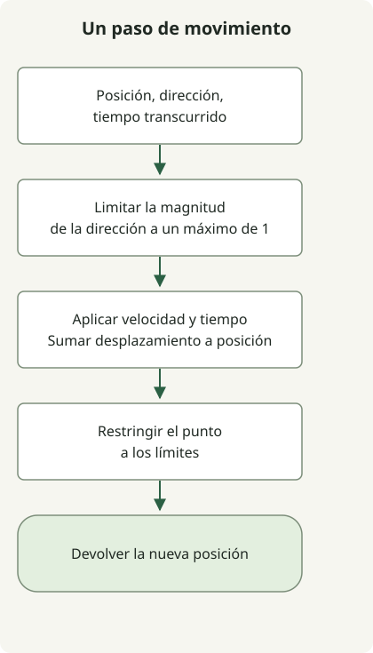

**Para un equipo pequeño que empieza un juego general en 2D o 3D, Godot es un primer candidato útil. Bevy encaja con un equipo de Rust dispuesto a hacerse cargo de más herramientas; Stride merece atención para los flujos de trabajo con C#; O3DE merece evaluarse cuando el equipo puede mantener un proceso más amplio de contenido y compilación en 3D.** Son puntos de partida para validar, no una clasificación de rendimiento.

Esta comparación basada en documentación está dirigida a desarrolladores que eligen un motor de videojuegos. Las referencias de versiones consultadas el 2 de noviembre de 2026 son Godot 4.7.2, Bevy 0.20, Stride 4.4 y O3DE 26.05. El ejemplo ejecutable de abajo solo prueba una pequeña función de movimiento de Godot; no demuestra la experiencia con los editores de los otros motores, la velocidad de renderizado ni la fiabilidad de sus exportaciones.

## ¿Qué comparamos?

Los cuatro proyectos se presentan como motores de videojuegos. Sus flujos de trabajo difieren: un editor visual integrado y un flujo ECS basado en código dejan al equipo distintas cantidades de herramientas por integrar. Un framework o una biblioteca de renderizado también pueden ser adecuados, pero hay que contabilizar las herramientas de escenas, recursos y edición que falten como trabajo que deberá aportar el equipo.

| Motor y versión de referencia | Flujo de desarrollo | Primera pregunta antes de decidirse |
| --- | --- | --- |
| [Godot 4.7.2](https://godotengine.org/download/archive/) | Editor de escenas y nodos con scripts | ¿Permite el lenguaje elegido exportar al destino real? |
| [Bevy 0.20](https://bevy.org/news/bevy-0-20/) | Sistemas y componentes en Rust, basados en ECS | ¿Puede el equipo mantener las herramientas y las migraciones de API? |
| [Stride 4.4](https://www.stride3d.net/blog/announcing-stride-4-4/) | C# y Game Studio | ¿Está disponible el editor en los equipos de desarrollo? |
| [O3DE 26.05](https://www.docs.o3de.org/docs/release-notes/2605-0-release-notes/) | Editor 3D extensible y proceso basado en componentes | ¿Puede el equipo compilar, importar recursos y empaquetar una escena pequeña? |

Los escenarios siguientes son recomendaciones derivadas de estos flujos de trabajo. No relatan cómo un equipo publicó un juego con cada motor.

## ¿Qué motor encaja con el flujo de trabajo del equipo?

### Godot: empezar con el ciclo completo de creación

Godot es un punto de partida razonable cuando el equipo quiere editar escenas, añadir comportamiento e iterar en un mismo entorno. Su [licencia MIT](https://godotengine.org/license/) permite juegos propietarios; distribuir el motor sigue requiriendo los avisos de derechos de autor y licencia correspondientes. Los complementos, las fuentes, la música y los modelos tienen sus propias condiciones.

Comprueba pronto la combinación de lenguaje y plataforma. La [documentación de exportación web de Godot](https://docs.godotengine.org/en/stable/tutorials/export/exporting_for_web.html) indica actualmente que los proyectos de Godot 4 en C# no pueden exportarse a la web. Por tanto, un prototipo de escritorio en C# no demuestra que pueda distribuirse en el navegador. Para consolas, la [guía de adaptación de Godot](https://godotengine.org/consoles/) describe la aprobación de la plataforma, los SDK oficiales y las plantillas de exportación privadas o los proveedores externos. Un motor de código abierto no elimina ese proceso.

### Bevy: elegir Rust junto con la responsabilidad sobre las herramientas

Bevy es un motor, no solo un renderizador. Su [introducción](https://bevy.org/learn/quick-start/introduction/) describe Rust, ECS y la elección entre las licencias MIT y Apache 2.0. También advierte de versiones con cambios incompatibles en la API y migraciones potencialmente difíciles.

Esto hace que Bevy resulte interesante para un equipo que quiera situar los sistemas y componentes en el centro de su modelo de desarrollo. Trata la integración del editor, la iteración con recursos y la migración entre versiones como aspectos que deben demostrarse con el proyecto del equipo. Conocer Rust no demuestra por sí solo un ciclo de creación más rápido, y un ECS paralelo no demuestra mejores tiempos por fotograma para un juego concreto.

### Stride: separar la compatibilidad con C# de la disponibilidad del editor

Las [preguntas frecuentes de Stride](https://www.stride3d.net/faq/) describen su licencia MIT y la ausencia de regalías por el motor. Su flujo de trabajo con C# puede convertirlo en un candidato útil para un equipo que ya utilice .NET.

La [matriz de plataformas](https://doc.stride3d.net/latest/en/manual/platforms/index.html) distingue los sistemas de desarrollo de los destinos del juego: Windows cuenta con soporte completo del editor; Linux y macOS permiten compilar y trabajar solo con código con ciertas condiciones, y el editor no está disponible de forma nativa fuera de Windows. El [anuncio de la versión 4.4](https://www.stride3d.net/blog/announcing-stride-4-4/) informa de mejoras en las compilaciones fuera de Windows. No conviertas esas mejoras en una afirmación de que el mismo flujo de trabajo del editor está disponible en todas partes.

### O3DE: evaluar el proceso antes que la demostración

O3DE merece estar entre los candidatos de un equipo preparado para hacerse cargo de un proceso 3D extensible. Su [archivo de licencia](https://github.com/o3de/o3de/blob/2605.0/LICENSE.txt) especifica Apache 2.0 por defecto con una opción MIT e identifica componentes externos por separado. La [página de descarga](https://o3de.org/download/) enumera paquetes para Windows/Linux y requisitos importantes para los equipos de desarrollo. Son requisitos del sistema de desarrollo, no una lista general de destinos de exportación de juegos.

Empieza por importar un recurso representativo, compilar el proyecto y empaquetar una escena. Las [notas de la versión 26.05](https://www.docs.o3de.org/docs/release-notes/2605-0-release-notes/) marcan el nuevo sistema de partículas como experimental y desaconsejan su uso en producción. Que una función aparezca en las notas de una versión no la convierte automáticamente en una dependencia lista para producción.

## ¿«Gratis» significa código abierto o producción sin costes?

No. El acceso al código fuente y un precio de compra nulo no demuestran que exista una licencia de código abierto. Por ejemplo, [Defold se describe actualmente como un motor con código fuente disponible](https://defold.com/open/); evalúa su licencia concreta en lugar de agruparlo automáticamente con los cuatro motores anteriores.

La licencia del motor tampoco paga las adaptaciones a consolas, las licencias de recursos, el alojamiento, los complementos ni el mantenimiento. Antes de decidir, identifica qué partes aporta el motor, cuáles requieren otra licencia y cuáles construirá el equipo. Evita estimar un coste total sin definir ese alcance.

## ¿Qué debería verificar un prototipo pequeño?

Asigna a los motores seleccionados la misma tarea de aceptación: cargar un recurso representativo, implementar una interacción y crear una compilación para el destino previsto. Registra la configuración, las dificultades del ciclo de editar y volver a ejecutar, y cualquier requisito no compatible. Es una evaluación propuesta, no una prueba de rendimiento realizada para este artículo.

Aquí hay una parte reproducible: una **prueba de movimiento en Godot sin interfaz gráfica**. Recibe una posición, una dirección sintética y los segundos transcurridos, limita la magnitud de la dirección a 1, aplica la velocidad y restringe el punto resultante a un rectángulo. Se supone que las entradas son finitas y el tiempo transcurrido no es negativo. La restricción no equivale a colisiones con obstáculos, tratamiento del tamaño del sprite ni simulación física.



El diagrama muestra una llamada a `advance`. El programa de prueba de abajo repite las llamadas y comprueba los resultados; no lee el teclado ni dibuja un personaje. La [referencia de Vector2](https://docs.godotengine.org/en/4.7/classes/class_vector2.html) documenta las operaciones vectoriales. Esto separa el comportamiento probado de las afirmaciones sobre productividad del editor o rendimiento del juego.

Con el binario estándar del editor Godot 4.7.2 disponible como `godot`, guarda `project.godot` y `movement.gd` en el mismo directorio. Tras instalar el motor, no se necesita ninguna escena, recurso externo, paquete ni acceso a la red para ejecutar el script.

`project.godot`:

```ini
config_version=5
```

`movement.gd`:

```gdscript
extends SceneTree

const SPEED := 120.0
const LIMIT := Vector2(640.0, 360.0)

func advance(pos: Vector2, direction: Vector2, delta: float) -> Vector2:
    var bounded := direction.limit_length(1.0)
    var next := pos + bounded * SPEED * delta
    return next.clamp(Vector2.ZERO, LIMIT)

func _initialize() -> void:
    var cases := [
        [Vector2(100, 100), Vector2.ZERO, 0.5, Vector2(100, 100)],
        [Vector2(100, 100), Vector2.RIGHT, 0.5, Vector2(160, 100)],
        [Vector2.ZERO, Vector2(1, 1), 1.0, Vector2(84.852814, 84.852814)],
        [Vector2.ZERO, Vector2(0.5, 0), 1.0, Vector2(60, 0)],
        [Vector2(639, 100), Vector2.RIGHT, 1.0, Vector2(640, 100)],
        [Vector2(5, 100), Vector2.LEFT, 1.0, Vector2(0, 100)],
        [Vector2(100, 359), Vector2.DOWN, 1.0, Vector2(100, 360)],
        [Vector2(100, 100), Vector2.RIGHT, 0.0, Vector2(100, 100)],
    ]
    for sample in cases:
        var actual := advance(sample[0], sample[1], sample[2])
        if not actual.is_equal_approx(sample[3]):
            push_error("movement mismatch")
            quit(1)
            return
    var split := advance(advance(Vector2(100, 100), Vector2.RIGHT, 0.25), Vector2.RIGHT, 0.25)
    if not split.is_equal_approx(advance(Vector2(100, 100), Vector2.RIGHT, 0.5)):
        push_error("time-step mismatch")
        quit(1)
        return
    print("movement cases=9")
    quit(0)
```

Ejecútalo desde ese directorio mediante la [interfaz de línea de comandos de Godot](https://docs.godotengine.org/en/4.7/tutorials/editor/command_line_tutorial.html). En macOS, sustituye `godot` por la ruta `Godot.app/Contents/MacOS/Godot` del paquete instalado si no está en `PATH`.

```sh
godot --headless --no-header --path . --script movement.gd --quit-after 1
```

El ejemplo se ejecutó localmente en macOS con Godot 4.7.2. Su salida fue:

```text
movement cases=9
```

Las comprobaciones cubren la entrada inactiva, el movimiento horizontal y diagonal, la magnitud parcial de entrada, los límites superiores e inferiores, el tiempo transcurrido nulo y un paso temporal dividido lejos de los límites. No verifican el renderizado, la exportación a dispositivos de destino, los obstáculos, la red ni el rendimiento comparativo.

## ¿Cómo tomar la decisión final?

Elige el candidato que satisfaga el flujo de trabajo y la compilación de destino que requiere el juego, con una carga de mantenimiento que el equipo pueda aceptar. Si la prioridad es un ciclo de edición visual, empieza el prototipo con Godot. Si el equipo quiere expresamente hacerse cargo de Rust/ECS, prueba las herramientas de Bevy y los costes de migración. Para un equipo de C#, prueba Stride en los equipos reales donde se usará el editor. Para un proceso 3D de mayor escala, valida el ciclo de recursos y compilación de O3DE antes de depender de una función de demostración.

El siguiente resultado útil es una pequeña compilación para el dispositivo de destino y una lista de requisitos no satisfechos, no una clasificación universal de motores. Conserva esas pruebas para la decisión junto al proyecto, de modo que una actualización del motor pueda evaluarse con el mismo comportamiento.
